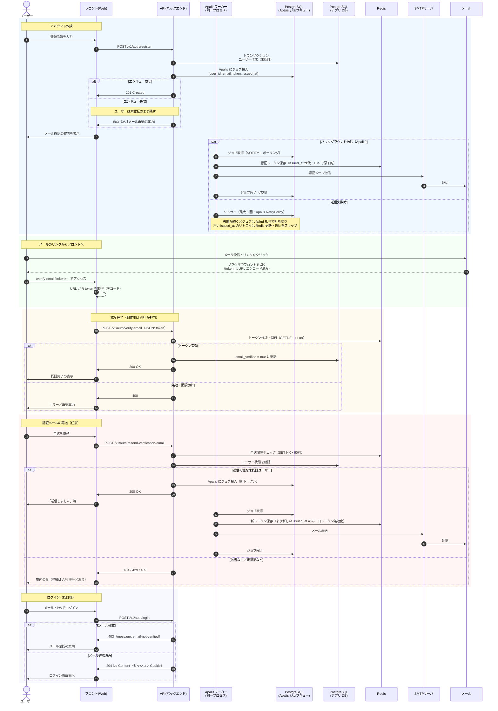

# メール認証フロー

登録からメール確認・ログインまでのシーケンス（Apalis + PostgreSQL ジョブキュー）。

運用 UI: [Apalis Board](https://github.com/apalis-dev/apalis-board) を `http://localhost:3400/` で提供（キュー `verification_email` の監視・再試行状況）。ジョブペイロードに認証トークン・メールアドレスが含まれるため、board の UI/API は管理者セッション必須。

## シーケンス図

## 旧 Outbox 方式からの変更点

| 項目 | 以前 | 現在 |
|------|------|------|
| キュー | `verification_email_outbox` テーブル + ポーリング | Apalis `PostgresStorage`（`verification_email` キュー） |
| 登録後 | 同一 TX で outbox 行 + `wake_worker` | TX はユーザー INSERT のみ → コミット後に `enqueue`（失敗時は 503・再送で回復） |
| ワーカー | 自前 supervisor・SKIP LOCKED | Apalis ワーカー（NOTIFY・リトライ・グレースフルシャットダウン） |
| 失敗処理 | `attempts` / `failed` 列を手動更新 | Apalis `RetryPolicy`（最大 8 回） |
| 運用 UI | なし | Apalis Board（`/`） |
| ワーカーの生存回復 | 自前 supervisor | `job::supervise` が終了した世代を別 ID で作り直す（下記） |

## ワーカーの監督と復帰

全キュー（7 本）の apalis ワーカーは `job::supervise` の監督ループの下で動く。apalis のワーカーは heartbeat が失敗すると終了し、プロセスも HTTP も生きたままジョブが Pending で滞留する。本番では DB の IO 停滞でプールの取得が 30 秒を超え、7 本すべてが終了して 19 時間滞留した。

- **世代別 ID**: `apalis.workers.id` は `{queue}-worker-{プロセス起動時の UUID}-{世代番号}`。同じ ID で登録し直すと 2 つの問題が起きる。`register.sql` の更新はセッション単位の advisory lock 付きなので、別のプール接続からだと `WORKER_ALREADY_EXISTS` で即死する。また `last_seen` が更新され続けるので、死んだ世代が掴んでいた Running / Queued のジョブが孤児回収（`last_seen` から 5 分）の対象にならない。ID を変えれば旧行の `last_seen` が止まり、5 分後に新世代の heartbeat がそのジョブを Pending に戻す。旧行は `jobs.lock_by` から参照されるので消さない
- **監督ループ**: shutdown の前に世代が終わったら、Ok・Err・panic を問わず待ってから作り直す。待ちは 1 秒から倍々で最大 60 秒。5 分以上動いた世代の後は 1 秒に戻す。shutdown の後は結果を問わず作り直さない。世代は `run_until` ではなく ctx の `stop()` で止める。`run_until` は起動前に signal が来ると停止が捨てられ、ワーカーが止まらなくなる
- **保証**: 再試行はされるが exactly-once ではない。ACK の前に世代が終わったジョブは孤児回収の後に再実行されるので、メールが重複して届くことがある。メール以外のジョブ（GitHub 連携・レビュー要約など）も同じ
- **プール**: `job::setup_pool` は 16 本。ワーカーごとに LISTEN 用の接続が 1 本ずつ常時占有される（7 本）ので、残りの 9 本を heartbeat・poll・孤児回収・ハンドラーからのジョブ投入が共有する。これは通常時の予算で、世代交代中は旧世代のリスナーの接続が UNLISTEN まで一時的に残る
- **Board の表示**: ワーカー一覧には古い世代の行も残る。ctx を監督側で作るので、`layers` 列はサービスの型名ではなく `()` になる
- **未解明**: heartbeat の更新が 0 件になる事象（`WORKER_DOES_NOT_EXIST`）が本番で 1 回観測されたが、原因は分かっていない。起きても監督が作り直すので復帰はする
