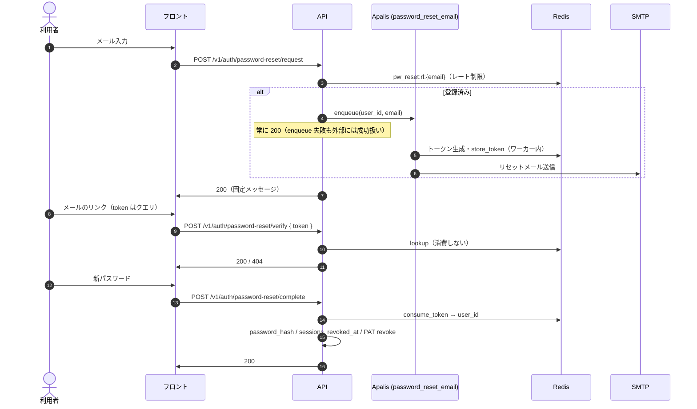

自己サービスのパスワードリセットとログイン中の変更の運用を記述する。仕様の定義元は[パスワードリセット・変更](/features/auth-password-reset)である。メール認証の同じ形の Apalis の使い方は[メール認証のフロー](/dev/design/email-verification-flow)に、管理者によるリセットは[サービス管理者・監査ログ](/features/admin)の管理者専用 API（監査ログ `user.password_reset`）に書く。

## 運用 UI

キューと Board の関係は次のとおりである。

| キュー | Board 登録 | 備考 |
|---|---|---|
| `verification_email` | あり（`http://localhost:3400/`） | 認証メールの監視・再試行 |
| `password_reset_email` | なし | ジョブ payload は `user_id` + `email` のみ。トークンはワーカー内で Redis に保存 |

`password_reset_email` を Board に載せないのは、リセット用 bearer secret を運用 UI・バックアップ・トレースに載せないためである（CodeRabbit の指摘に対応した）。

## シーケンス図

流れは次のとおりである。



## Redis キー

キーは次のとおりである。

| キー | 内容 | TTL |
|---|---|---|
| `pw_reset:t:{token}` | `user_id` | 30 分 |
| `pw_reset:u:{user_id}` | `token` | 30 分 |
| `pw_reset:rl:{email}` | `1`（存在のみ） | 60 秒 |

メールアドレスは `normalize_email` 後の値を `rl:` に使用する。

## メールリンクの `?token=` 形式とクライアント側露出

リセットメールのリンクは `{app_url}/auth/reset-password?token={token}`（クエリパラメータ）形式である。`crates/service/src/password_reset_email_delivery.rs` が組み立てる。

### この形式を採用する理由

理由は次のとおりである。

| 観点 | 説明 |
|---|---|
| メール UX | クリッカブル URL は通常 GET。クエリ付きリンクはメールクライアント・ブラウザで広くサポートされる |
| フロントルーティング | SPA の `/auth/reset-password` ページが URL から `token` を読み取り、確認 UI を表示する |
| API 設計との分離 | トークン検証・消費は `POST /v1/auth/password-reset/verify` / `complete` の JSON ボディで行い、メールリンク自体はフロント初回ロード用である |

### リスク評価（Low–Medium）

クエリパラメータに bearer トークンを載せるため、次の経路でクライアント側に残る可能性がある。

| 経路 | 内容 |
|---|---|
| ブラウザ履歴 | 利用者がリンクを踏んだ URL が履歴・同期端末に保存される |
| `Referer` ヘッダ | リセットページから外部サイトへ遷移した場合、Referer にフル URL（`?token=` 含む）が載る実装・ブラウザ設定がある |
| 共有端末 | 履歴やオートコンプリートから第三者がトークン付き URL を辿れる |

サーバー側の緩和策として、トークンは TTL 30 分・単回消費（GETDEL）である。漏洩しても有効な時間は限られる。

### API アクセスログへの非露出

メールリンクの `?token=` はフロント初回 GET にのみ現れる。以降の API 呼び出しは次のとおりトークンをボディで渡す。

```text
GET  /auth/reset-password?token=...     ← フロント（静的/SSR）。バックエンド API ログ対象外
POST /v1/auth/password-reset/verify   { "token": "..." }
POST /v1/auth/password-reset/complete   { "token": "...", "new_password": "..." }
```

そのためバックエンドのアクセスログ・構造化ログにはリセットトークンを載せない（[構造化ログ](#構造化ログトークン非記録)）。リクエストログ middleware は `uri.path()` のみ記録し、クエリ文字列は含めない。

これは API サーバー側の話である。ブラウザ履歴・Referer への露出はフロント初回 URL に依存するので、[未実装と既知の制限](#未実装と既知の制限)に候補を書く。

## 構造化ログ（トークン非記録）

アプリログにリセットトークン・新パスワード・メール本文 URL の bearer 部分を**出力してはならない**。記録するイベントは次のとおりである。

| `event` フィールド | タイミング | 付与フィールド |
|---|---|---|
| `auth.password_reset.email_queued` | 登録済みの利用者へジョブ投入成功 | `user_id` |
| `auth.password_reset.email_sent` | ワーカーが Redis 保存 + SMTP 成功 | `user_id` |
| `auth.password_reset.completed` | `password-reset/complete` 成功 | `user_id` |
| `auth.password_change.completed` | `password/change` 成功 | `user_id` |

### ログに含めてはいけないもの

含めてはいけないものは次のとおりである。

- `?token=` クエリ（HTTP アクセスログ・リクエストログで URI 全体を出さない）
- `PasswordResetCompleteBody` の `token` / `new_password`
- Apalis ジョブ payload への平文トークン（禁止・実装済み）
- SMTP 送信失敗時の `Debug` でメール本文全体を出すこと（`error = ?e` のみに留める）

リクエストログ middleware はパスのみ（`uri.path()`）を記録し、クエリ文字列は含めない。

### 障害時の監視

監視する条件は次のとおりである。

| ログ / 条件 | 意味 | 対応 |
|---|---|---|
| `password reset email enqueue failed`（`warn!`, `user_id` 付き） | DB 上は利用者が存在するがメールキュー投入失敗 | 外部応答は 200 のまま。キュー・DB 接続を確認し手動再送、または利用者に時間をおいて再試行を案内 |
| ジョブの処理失敗 | ワーカーの処理が異常終了 | Apalis リトライ（最大 8 回）後の failed を確認 |
| `auth.password_reset.completed` が急増 | 大量リセット完了 | 不正利用・クレデンシャルスタッフィングを調査 |

## 未実装と既知の制限

- 管理者が送るリセットメールは別の経路で、`crates/service/src/password_reset_delivery.rs` の `build_reset_url` が `{app_url}/password-reset?token={token}` を組み立てる。フロントエンドにこのパスのページは無く、ページがあるのは `/auth/reset-password` だけである

より強いクライアント側秘匿が必要になった場合の候補は次のとおりである。いずれも未実装である。

| 方式 | 概要 | トレードオフ |
|---|---|---|
| Fragment（`#token=`） | フラグメントは HTTP リクエストに載らず Referer にも通常含まれない | ルーター・SSR・メールクライアントの `#` の扱いが課題になる。サーバー側ログ削減の恩恵は「初回ロードがフロントのみ」の前提と同じ形である |
| 短寿命セッション交換 | メールリンクは opaque `code` のみ。フロントがすぐ `POST` で one-time token に交換する | 追加エンドポイントと Redis キーの設計が要る。メール URL のエントロピーは下げるが交換ステップが増える |

移行時は既存メールの TTL・単回消費・Board 非登録の方針を維持し、このページと[パスワードリセット・変更](/features/auth-password-reset)のセキュリティを同時に更新する。

## 決定の記録

| 日付 | 決定 | 理由 |
|---|---|---|
| 2026-05-30 | `password_reset_email` を Board に登録しない | リセット用 bearer secret を運用 UI・バックアップ・トレースに載せない（CodeRabbit の指摘） |
