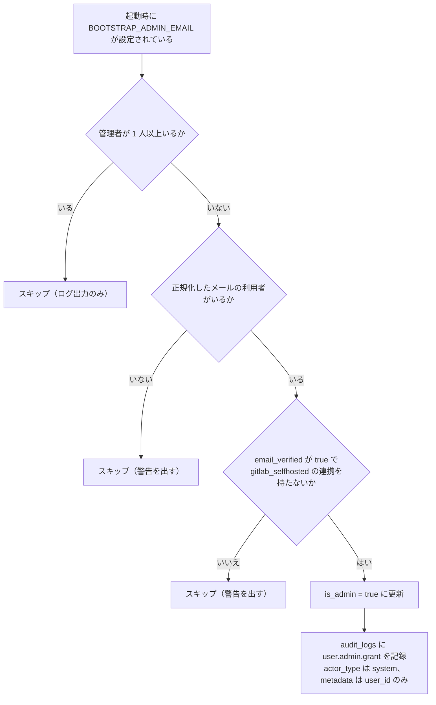

## 概要

この機能は、`users.is_admin` によるテナント横断の全権管理者の識別と、管理者操作を `audit_logs` に記録して検索・閲覧する監査ログからなる。サービス全体を運用する管理者のための機能である。使う表は `users` と `tenants`、`audit_logs`、`system_settings` で、他の機能には依存しない。管理者 API はテナント・プロジェクト・タスクの内容を読むだけで、編集はできない。

## 振る舞い

### 管理者ができる操作

管理者（`is_admin = true`）が実行できる操作は次のとおりである。

| 分類 | 操作 |
|---|---|
| 閲覧 | 全テナントの一覧と詳細、テナント配下のプロジェクト一覧、プロジェクト配下のタスク一覧（読み取り専用） |
| 利用者の管理 | 利用者の作成・停止・停止解除・強制削除、管理者フラグの付与・剥奪 |
| 利用者の管理 | パスワードリセットメールの送信（送信先メールの指定可） |
| 利用者の管理 | パスキーの削除・2FA のリセット・OAuth 連携の解除 |
| テナントの管理 | テナントの強制削除 |
| システム | システム設定の変更 |
| 監査 | 監査ログの閲覧・検索 |
| 運用 | ジョブ管理画面（apalis board）の閲覧 |

ジョブ管理画面は公開 API と同じリスナーに載せ、ミドルウェア（`require_admin_session`）で管理者のセッションに限定する。

管理者は `is_admin` フラグ 1 本で表す 2 値である。

### 初期管理者

アプリ起動時に `BOOTSTRAP_ADMIN_EMAIL` が設定されている場合、管理者が 1 人もいなければ該当する利用者の `is_admin` を `true` に設定する。



昇格するのは、email が確認済み（`email_verified = true`）で、その確認の出所が確かな利用者だけである。確かな出所は、password の登録の確認メール・GitHub・gitlab.com・Google・運用者が設定した OIDC である。`gitlab_selfhosted` の連携を持つ利用者は昇格しない。初期管理者は password で登録して確認メールを通すか、上の provider でログインしてから起動する。

環境変数は次のとおりである。

| 変数 | 既定 | 内容 |
|---|---|---|
| `BOOTSTRAP_ADMIN_EMAIL` | なし | 起動時のみ参照する初期管理者のメールアドレス。管理者が既にいれば実行しない。初期構築の後は環境変数から削除することを推奨する |

### 管理者フラグと停止

規則は次のとおりである。

- 自分自身の `is_admin = false` は `403` を返す
- 最後の管理者の降格・停止・削除は `403` を返す
- 停止すると対象の全セッションを無効化し、PAT を失効させる。停止解除で失効した PAT は戻らない
- 停止中の利用者は、`AuthUser` などの認証エクストラクタ全般で `403`（`account-suspended`）になる

### 利用者の作成

`POST /v1/admin/users` は `username`（3 文字以上）、`email`、`password`（8 文字以上）と、任意の `is_admin` / `email_verified` を受け取る。重複は `409 Conflict` を返す。

### 利用者の強制削除

`users` の行は消さず、識別情報を消して残す。自分自身の削除は `403` を返す。

- メールとユーザー名を `deleted+{id}@invalid.local` / `deleted-{id}` に置き換え、パスワードを消し、`is_suspended = true`・`is_admin = false`・`email_verified = false` にする
- 作成したタスクをソフト削除し、担当者の割り当てとテナント所属を消す
- PAT を失効させ、セッションを無効化し、2FA・パスキー・OAuth 連携を消し、アバターの実体を消す
- `project_members` の行は消さない

### パスワードリセットメール

`POST /v1/admin/users/{id}/password-reset` の規則は次のとおりである。

- `send_to` は省略でき、値は `null` か省略である。本文の JSON 自体は必要である。省略時は利用者の登録メールアドレスに送信する
- `send_to`（例: `support-relay@example.com`）を指定すると、その宛先に送信する。利用者がメールアドレスを削除・変更してしまった場合の救済に使う
- 生成したリセットトークンは [パスワードのリセットと変更](/dev/features/auth/password-reset)と同じ TTL（30 分）で有効である
- 送信先ごとのレート制限に当たると `409 Conflict` を返す
- トークンは応答に含めない。応答は `{ "message": "..." }` だけである
- 監査ログに `user.password_reset` と `metadata.reset_email` を記録する

### 2FA の強制リセット

`POST /v1/admin/users/{id}/reset-2fa` は次の処理を行う。

- `totp_credentials` の行を削除し、`users.totp_enabled = false` に設定する
- リカバリーコードをすべて削除する
- 対象の利用者の全セッションを無効化する。PAT は失効させない
- 監査ログに `user.2fa.reset` を記録する

### テナントの強制削除

テナントの強制削除は行を消して外部キーの CASCADE に任せる。Drive のストレージの実体は消さない（[Drive の未実装と既知の制限](/dev/features/drive#未実装と既知の制限)）。

### 監査ログに記録するアクション

管理者の操作と、本人によるプロフィール更新を記録する。

| アクション | `resource_type` | トリガー |
|---|---|---|
| `user.admin.grant` | `user` | 管理者フラグの付与。ブートストラップを含む |
| `user.admin.revoke` | `user` | 管理者フラグの剥奪 |
| `user.create` | `user` | 管理者による利用者の作成 |
| `user.suspend` | `user` | 利用者の停止 |
| `user.unsuspend` | `user` | 利用者の停止解除 |
| `user.delete` | `user` | 利用者の強制削除（管理者のみ） |
| `user.password_reset` | `user` | パスワードリセットメールの送信（管理者操作） |
| `user.2fa.reset` | `user` | 2FA の強制リセット（管理者操作） |
| `user.passkey.delete` | `user` | パスキーの強制削除（管理者操作） |
| `user.oauth.disconnect` | `user` | OAuth 連携の強制解除（管理者操作） |
| `tenant.delete` | `tenant` | テナントの強制削除（管理者のみ） |
| `system.settings.update` | `system` | システム設定の変更 |
| `user.profile.update` | `user` | 本人によるユーザー名・アバターの更新 |

`metadata` の形は `openapi.json` から読めないので、アクションごとに次に示す。`user.2fa.reset` の `metadata` は NULL である。

```json
// user.admin.grant / user.admin.revoke / user.suspend / user.unsuspend
{ "before": false, "after": true }

// user.admin.grant（ブートストラップ。actor_type は system）
{ "user_id": "uuid" }

// user.create
{ "email": "alice@example.com", "is_admin": false }

// user.delete
{ "email": "alice@example.com" }

// user.password_reset
{ "reset_email": "support-relay@example.com" }

// user.passkey.delete
{ "passkey_id": "uuid" }

// user.oauth.disconnect
{ "provider": "github" }

// tenant.delete
{ "tenant_name": "Example Corp" }

// system.settings.update
{
  "changed_fields": ["user_registration_enabled"],
  "before": { "user_registration_enabled": true, "drive_default_quota_mb": 10240, "drive_system_max_quota_mb": 102400 },
  "after": { "user_registration_enabled": false, "drive_default_quota_mb": 10240, "drive_system_max_quota_mb": 102400 }
}

// user.profile.update
{ "changed_fields": ["username"], "username": { "before": "alice", "after": "alice2" } }
```

### 記録のタイミング

操作が成功した後に INSERT する。バリデーションエラーなどの失敗した操作は記録しない。

管理者操作では対象の更新と監査ログの INSERT は別のトランザクションなので、INSERT に失敗すると、操作は成立したまま応答が `500` になる。`user.profile.update` だけは更新と同じトランザクションで記録する。

監査ログは追記専用である。更新・削除する API は無く、DB では `app_role` というロールが存在する環境に限り `UPDATE` / `DELETE` を剥奪する。`app_role` は外部プロビジョニング前提で、存在しない環境もある。

### 脅威と対策

脅威ごとの対策は次のとおりである。

| 脅威 | 対策 |
|---|---|
| 管理者権限の横取り | `is_admin` の変更は `AdminUser` エクストラクタ経由のみである。一般の利用者の API では変更できない |
| 管理者がいなくなる状態 | 自己の `is_admin=false` の操作と、最後の管理者の降格・停止・削除を `403` で拒否する |
| 監査ログの改ざん | 更新・削除の API を持たない。`app_role` が存在する環境では DB のロールでも `UPDATE` / `DELETE` を剥奪する |
| ブートストラップの悪用 | `BOOTSTRAP_ADMIN_EMAIL` は起動時のみ参照し、管理者がいれば実行しない。本番では環境変数の削除を推奨する |
| PAT による管理者操作 | `AdminUser` エクストラクタはセッション認証のみ受理する。有効な PAT・Device Token は `403` を返す |
| パスワードリセットの悪用 | リセットメールの送信を監査ログに記録する。トークンは応答に含めず、管理者がパスワードを知ることはできない |
| ジョブのペイロードの漏洩 | ジョブ管理画面を管理者のセッションに限定する |

## データ

`users` の管理者機能に関わる列は次のとおりである。

| 列 | 型 | 制約 | 説明 |
|---|---|---|---|
| `is_admin` | BOOLEAN | NOT NULL | サービス管理者のフラグ |
| `is_suspended` | BOOLEAN | NOT NULL | 停止中のフラグ |
| `sessions_revoked_at` | TIMESTAMPTZ | NULL 可 | セッションの一括無効化の時刻 |

`audit_logs` の列は次のとおりである。

| 列 | 型 | 制約 | 説明 |
|---|---|---|---|
| `id` | UUID | PK | |
| `actor_id` | UUID | NULL 可, FK users SET NULL | 操作者。NULL はシステムの自動実行 |
| `actor_type` | VARCHAR | NOT NULL | `user` / `system` |
| `action` | VARCHAR | NOT NULL | ドット記法のアクション名。例は `user.admin.grant` |
| `resource_type` | VARCHAR | NOT NULL | 対象の種別。`user` / `tenant` / `system` |
| `resource_id` | VARCHAR | NOT NULL | 対象の ID（UUID の文字列など） |
| `tenant_id` | UUID | NULL 可, FK tenants SET NULL | テナントスコープの操作のみ設定する |
| `metadata` | JSONB | NULL 可 | 変更前後・補足情報など |
| `ip_address` | VARCHAR(45) | NULL 可 | `X-Forwarded-For` の先頭、無ければ `X-Real-IP` |
| `user_agent` | VARCHAR | NULL 可 | |
| `created_at` | TIMESTAMPTZ | NOT NULL DEFAULT now() | |

`system_settings` はサーバー全体の設定を 1 行だけ持つ表である。`singleton` が主キーで、CHECK により `true` だけを許す。列は次のとおりである。

| 列 | 型 | 既定値 | 説明 |
|---|---|---|---|
| `user_registration_enabled` | BOOLEAN | `true` | 新規登録を受け付けるか。パスワードの登録と OAuth の新規作成が参照する |
| `drive_default_quota_mb` | BIGINT | `10240` | 保存するだけで Drive からは読まない（[未実装と既知の制限](#未実装と既知の制限)の節） |
| `drive_system_max_quota_mb` | BIGINT | `102400` | 同上 |

3 つの表の定義と監査ログのインデックス・権限は [m20260520000000_initial_schema.rs](https://github.com/koyori-app/task/blob/main/apps/backend/migration/src/m20260520000000_initial_schema.rs) にある。

## API

利用者の管理は次のとおりである。

| メソッド | パス | 説明 |
|---|---|---|
| GET | `/v1/admin/users` | 全利用者の一覧 |
| POST | `/v1/admin/users` | 利用者を作成する |
| PATCH | `/v1/admin/users/{id}` | `is_admin` / `is_suspended` を変更する |
| DELETE | `/v1/admin/users/{id}` | 利用者を強制削除する |
| POST | `/v1/admin/users/{id}/password-reset` | パスワードリセットメールを送信する |
| POST | `/v1/admin/users/{id}/reset-2fa` | 2FA を強制リセットする |
| DELETE | `/v1/admin/users/{id}/passkeys/{passkey_id}` | パスキーを強制削除する |
| DELETE | `/v1/admin/users/{id}/oauth/{provider}` | OAuth 連携を強制解除する |

テナントと閲覧は次のとおりである。

| メソッド | パス | 説明 |
|---|---|---|
| GET | `/v1/admin/tenants` | 全テナントの一覧（名前順） |
| GET | `/v1/admin/tenants/{id}` | テナントの詳細 |
| DELETE | `/v1/admin/tenants/{id}` | テナントを強制削除する |
| GET | `/v1/admin/tenants/{id}/projects` | テナント配下のプロジェクト一覧（読み取り専用） |
| GET | `/v1/admin/tenants/{id}/projects/{pid}/tasks` | プロジェクト配下のタスク一覧（読み取り専用）。`id` / `project_id` / `title` のみを返し、削除済みを除く |

監査ログとシステム設定は次のとおりである。

| メソッド | パス | 説明 |
|---|---|---|
| GET | `/v1/admin/audit-logs` | 監査ログの閲覧 |
| GET | `/v1/admin/system/settings` | システム設定の取得 |
| PATCH | `/v1/admin/system/settings` | システム設定の変更。省略した項目は変えない |

`/v1/admin/audit-logs` のクエリは次のとおりである。並びは `created_at` の降順、同時刻は `id` の降順である。`next_cursor` は続きがあるときだけ返す。

| クエリ | 型 | 内容 |
|---|---|---|
| `action` | string | アクション名の前方一致。例は `user.admin` |
| `resource_type` | string | リソース種別で絞る |
| `resource_id` | string | リソース ID で絞る |
| `actor_id` | UUID | 操作者で絞る |
| `tenant_id` | UUID | テナントで絞る |
| `from` | RFC 3339 | 期間の開始（含む）。形式が違えば `400` |
| `to` | RFC 3339 | 期間の終了（含む）。形式が違えば `400` |
| `limit` | int | 既定 50。`1..=200` に補正する |
| `cursor` | string | ページネーションのカーソル。`created_at` と `id` の複合で、不正なら `400` |

`PATCH /v1/admin/system/settings` の項目は `user_registration_enabled`（既定 `true`）、`drive_default_quota_mb`（既定 `10240`）、`drive_system_max_quota_mb`（既定 `102400`）である。負の値と、`drive_system_max_quota_mb > 0` のときにそれを超える `drive_default_quota_mb` は `400` を返す。値が変わらなければ監査ログを記録しない。

## 認可

| 操作 | 誰が | スコープ |
|---|---|---|
| `/v1/admin/**` のすべて | `is_admin = true` の利用者（`AdminUser`） | セッション専用。PAT・Device Token は不可 |
| ジョブ管理画面 | 管理者のセッション（`require_admin_session`） | セッション専用 |

`AdminUser` は次の順に判定する。

1. Bearer トークンがあれば `AuthUser` で検証する。無効なトークンは `401`、有効なトークンは認証方式の不一致として `403` を返す
2. セッションを取り出し、半認証なら `403` を返す
3. 利用者を引き、停止中なら `403`（`account-suspended`）を返す
4. `is_admin` が `false` なら `403` を返す

## 画面

フロントエンドにあるのは、`GET /v1/auth/me` の応答に含まれる `is_admin` の型だけである。URL は [URL 仕様](/dev/frontend/url-spec)に予定として載っている。

## 未実装と既知の制限

- 管理画面が無い。`/admin` 配下のページも、管理者用のコンポーネントも無い
- 監査ログの保持期間によるアーカイブ・物理削除が無く、行は残り続ける
- システム設定の `drive_default_quota_mb` / `drive_system_max_quota_mb` は保存されるだけである。Drive の有効クォータは環境変数 `DRIVE_DEFAULT_QUOTA_MB` / `DRIVE_SYSTEM_MAX_QUOTA_MB` だけで決まる（[Drive のクォータ](/dev/features/drive/quota#未実装と既知の制限)）
- テナントの強制削除は、テナントの行を消した後に `tenant_id` へ同じ ID を入れて監査ログを挿入する。`audit_logs.tenant_id` には `tenants` への外部キーがあるので、この挿入は失敗して、削除が成立したまま `500` を返し、監査ログも残らない可能性がある。実行は確認しておらず、この経路の統合テストは無い

### 記録していないアクション

一般の利用者の重要な操作は、`user.profile.update` を除き記録していない。次のアクションは未実装である。

| アクション | `resource_type` | 対応する機能 |
|---|---|---|
| `auth.login.success` / `auth.login.failure` | `user` | 認証基盤 |
| `auth.2fa.enable` / `auth.2fa.disable` | `user` | 2FA |
| `auth.passkey.add` / `auth.passkey.remove` | `user` | パスキー |
| `auth.oauth.connect` / `auth.oauth.disconnect` | `user` | OAuth |
| `auth.pat.create` / `auth.pat.delete` | `user` | PAT |
| `tenant.owner.transfer` | `tenant` | テナント管理 |
| `project.member.add` / `project.member.remove` / `project.member.role.change` | `project` | プロジェクト管理 |
| `project.delete` | `project` | プロジェクト管理 |
| `github.integration.connect` / `github.integration.disconnect` | `project` | GitHub 連携 |

### 管理画面の導入時の設計

以下は導入時の設計である。

管理者の権限で通常のテナント・プロジェクト・タスク画面を見ても、一般の利用者と同じ表示にする。管理者専用の操作・データは `/admin` 配下のページからのみアクセスできるようにする。

- 通常の画面に管理者バッジや追加の操作ボタンは表示しない
- ナビゲーションバーに「管理者」リンクを 1 つ追加するのみとする（`is_admin` のときのみ表示）
- テナント・プロジェクト・タスクの管理者用の閲覧は `/admin` 配下の専用ルートで行う

`/admin` は管理者ダッシュボードで、上部に利用者数・テナント数・停止中の件数を並べ、その下に各管理画面への入口を置く。


`/admin/users` は利用者の管理画面で、名前・メール・状態・操作の列を持つ一覧と、利用者の作成のボタンを置く。


一覧の「詳細」から開くドロワーには、状態と、その利用者への操作をまとめる。


`/admin/audit-logs` は監査ログの画面で、日時・操作者・アクション・対象の列を持つ一覧と、アクション・期間の絞り込みと検索を置く。


`/admin/**` 配下のページは、未ログインと `is_admin = false` の利用者を通さない。`is_admin` は `GET /v1/auth/me` の応答から得る。画面側のガードは表示の制御であり、権限の判定は API の `AdminUser` が行う。

## 決定の記録

| 日付 | 決定 | 理由 |
|---|---|---|
| 2026-05-27 | 管理者は `is_admin` フラグ 1 本の 2 値とし、ロール階層を設けない | 記録なし |
| 2026-05-27 | 管理者が既に存在する場合はブートストラップを実行しない | 運用中に環境変数が誤設定されても意図しない権限付与が発生しない |
| 2026-05-27 | 管理者 UI は `/admin` 配下に完全に分離する | 記録なし |
| 2026-05-27 | 管理者 API の閲覧は読み取り専用とする | 記録なし |
| 2026-10-17 | `gitlab_selfhosted` の連携を持つ利用者は初期管理者に昇格しない | 確認の結果を運用者の外の instance から受け取ったことがありうる |
| 2026-11-04 | ジョブ管理画面を管理者に限る | ジョブのペイロードにメール認証トークンやメールアドレスが含まれる |
| 2026-11-04 | 強制削除で `project_members` の行を消さない | 消すと、その人しか指定されていなかったプロジェクトがメンバー 0 件になり、テナント全体に開放されてしまう |
| 2026-11-04 | `AdminUser` は有効な Bearer を `401` でなく `403` にする | Desktop は Device Token への `401` を失効とみなしてログアウトする |
