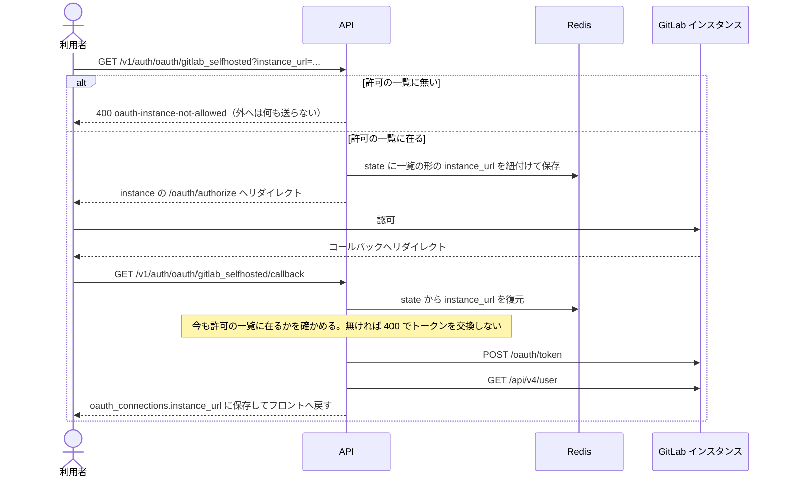
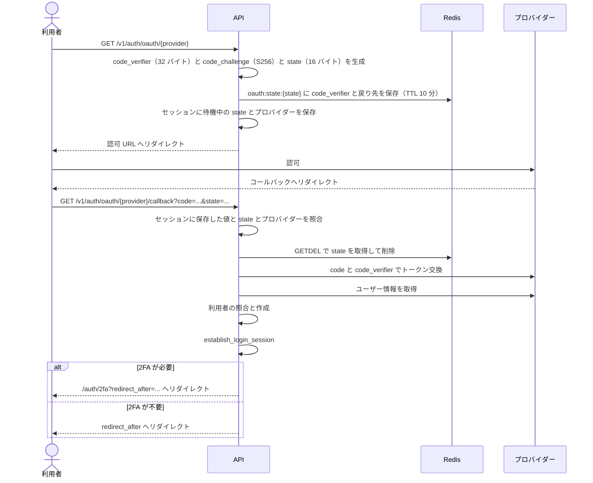
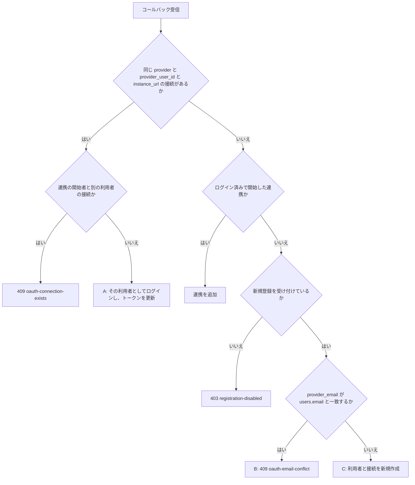

## 概要

メール + パスワード認証（Argon2id）に加えて、GitHub・GitLab・Google・汎用 OIDC でのログインと新規登録ができる。Authorization Code + PKCE のみを使い、セッションは既存の Redis セッションと共通である。メール/パスワードの利用者は後から OAuth を連携でき、逆もできる。パスワードの無い OAuth 専用の利用者も許容する。PKCE や state、トークン暗号化といったプロトコル層は外部クレート `auth-core` に置き、プロバイダーの解決と利用者の照合はこのリポジトリの `service::oauth` と `handler::handlers::oauth` が担う。

## 振る舞い

### 対応プロバイダー

対応するプロバイダーは次のとおりである。

| プロバイダー | `provider` 値 | 開始用 slug | 方式 | スコープなど |
|---|---|---|---|---|
| GitHub | `github` | `github` | OAuth 2.0 | GitHub Apps とは別。`read:user` / `user:email` |
| GitLab.com | `gitlab` | `gitlab` | OAuth 2.0 | `read_user` |
| GitLab self-hosted | `gitlab_selfhosted` | `gitlab_selfhosted` | OAuth 2.0 | `read_user`。利用者がインスタンス URL を入力する |
| Google | `google` | `google` | OIDC | `openid email profile` |
| 汎用 OIDC | `oidc:{issuer}` | `oidc` | OIDC Discovery | `openid email profile`。Okta・Entra ID・Keycloak などを想定する。設定できる issuer は 1 つだけである |
| GitHub（PR 承認用） | `github_app` | `github_app` | GitHub App のユーザー認可 | サインインには使わない連携専用 |

### プロバイダーの設定

プロバイダーは環境変数で設定する。

| 変数 | 内容 |
|---|---|
| `OAUTH_GITHUB_CLIENT_ID` / `OAUTH_GITHUB_CLIENT_SECRET` | GitHub の資格情報 |
| `OAUTH_GITLAB_CLIENT_ID` / `OAUTH_GITLAB_CLIENT_SECRET` | GitLab.com の資格情報 |
| `OAUTH_GITLAB_SELFHOSTED_INSTANCE_URLS` | 受け付ける instance のカンマ区切り。例は `https://gitlab.example.com,https://gitlab.example.org`。空・未設定なら `gitlab_selfhosted` は無効になる |
| `OAUTH_GITLAB_SELFHOSTED_CLIENT_ID` / `OAUTH_GITLAB_SELFHOSTED_CLIENT_SECRET` | 一覧の全ての instance に使う既定の資格情報 |
| `OAUTH_GITLAB_SELFHOSTED_INSTANCE_CREDENTIALS` | instance ごとの資格情報（任意）。鍵は一覧と同じ URL で、例は `{"https://gitlab.example.org":{"client_id":"...","client_secret":"..."}}` |
| `OAUTH_GOOGLE_CLIENT_ID` / `OAUTH_GOOGLE_CLIENT_SECRET` | Google の資格情報 |
| `OAUTH_OIDC_ISSUER_URL` | 汎用 OIDC の issuer。例は `https://accounts.example.com` |
| `OAUTH_OIDC_CLIENT_ID` / `OAUTH_OIDC_CLIENT_SECRET` | 汎用 OIDC の資格情報 |
| `OAUTH_ENCRYPTION_KEY` | トークンの暗号鍵の元。ログイン用プロバイダーを 1 つでも有効にするなら必須で、32 文字以上 |
| `OAUTH_DEFAULT_REDIRECT_PATH` | `redirect_after` の省略時の戻り先。既定は `/dashboard` |
| `GITHUB_APP_CLIENT_ID` / `GITHUB_APP_CLIENT_SECRET` | `github_app` の資格情報。App 連携と同じ値を使う |

### PR 承認用の連携

`github_app` は、レビュー済みの PR に、レビュワー本人の名義で Approve（マージ可のとき）と変更要求（未解決の High / Medium があるとき）を出すための連携である（[レビュー指摘管理](/dev/features/review-findings)の GitHub 要約コメント）。

- ログイン中の利用者にだけ結べる。開始・コールバックとも `link_user_id` が無ければ拒み、これで利用者を作ったりログインしたりはしない
- `list_providers` は `sign_in: false` で返し、サインイン画面（`OAuthButtons.vue`）には出さない
- 資格情報は `GITHUB_APP_CLIENT_ID` / `GITHUB_APP_CLIENT_SECRET` である。`OAUTH_ENCRYPTION_KEY` が無ければ有効にしない
- トークンの権限は「App の権限 ∩ 本人の権限」で、scope は無い。`/user` だけを読み、App の Email addresses 権限が要る `/user/emails` は読まない
- トークンは既定で 8 時間で切れる。使う側（要約ジョブ）が期限の近いトークンをリフレッシュトークンで更新し、回転した新しいトークンを保存し直す（`service::oauth::github_app`）
- ログイン手段には数えない。連携一覧（`/oauth/connections`）も連携ごとに `sign_in: false` を返し、設定画面はこれで数える

### GitLab self-hosted

self-hosted は GitLab.com と違い、OAuth エンドポイントがインスタンスごとに異なる。受け付ける instance は運用者が `OAUTH_GITLAB_SELFHOSTED_INSTANCE_URLS` で決め、空・未設定ならプロバイダー一覧にも出ない。

一覧と利用者が渡す `instance_url` は、比べる前に同じ形へ揃える。scheme と host を小文字にし、既定の port と末尾の `/` を落とす。資格情報・query・fragment を含む URL は受けない。

許可の一覧に入っていても、`auth-core` の URL 検証（SSRF 対策）を通らない instance は使えない。プライベート IP・リンクローカルへ解決される host を拒み、http は localhost にだけ許す。

client の資格情報は既定で `OAUTH_GITLAB_SELFHOSTED_CLIENT_ID` / `OAUTH_GITLAB_SELFHOSTED_CLIENT_SECRET` を一覧の全ての instance に使い、`OAUTH_GITLAB_SELFHOSTED_INSTANCE_CREDENTIALS` で instance ごとに上書きできる。資格情報の無い instance や、一覧に無い instance の資格情報は設定の誤りとして起動を止める。



同じ利用者が複数の self-hosted インスタンスを接続できる。接続は `(provider, provider_user_id, instance_url)` で識別する。

self-hosted の利用には、対象インスタンスに管理者がシステムの OAuth アプリ（Client ID / Secret）を登録しておく必要がある。`callback URL` は `{APP_BASE_URL}/v1/auth/oauth/gitlab_selfhosted/callback` に統一する。

### 本番（Dokploy）の設定

`list_providers` は `is_provider_configured` で client id と secret が両方入っているプロバイダーだけを返す。`OAuthButtons.vue` はサインインに使えるプロバイダーが 1 件以上あるときだけ描画する。未設定だとボタンも「または」の区切り線も出ず、エラーにはならない。

本番の設定で使う値は次のとおりである。

| 項目 | 値 |
|---|---|
| compose の環境変数 | `backend.environment` に列挙したキーしかコンテナへ渡らない。Dokploy の Environment に入れるだけでは足りず、`docker-compose.prod.yml` 側にも書く |
| Redirect URI | `{APP_ORIGIN}/api/v1/auth/oauth/{provider}/callback`。`/api` を含める |
| `github_app` の Callback URL | GitHub App の設定に `{APP_ORIGIN}/api/v1/auth/oauth/github_app/callback` を足す。App の Callback URL は複数登録できるので、インストール時のユーザー認可の URL は残す |
| `APP_BASE_URL` | compose で `${APP_ORIGIN}/api` を渡す |
| `EMAIL_VERIFICATION_APP_URL` | `APP_ORIGIN` と同じ値。コールバック後に利用者を戻す先を `build_frontend_redirect` がこれから組む。`/api` は付かない |
| `OAUTH_ENCRYPTION_KEY` | 32 文字以上の文字列。実際の鍵は `auth_core::crypto` の HKDF が導出する。生成の例は `openssl rand -base64 48` である |

backend は frontend の SSR サーバ越しにしか公開しない。SSR サーバは `/api/*` を転送し、`redirect: 'manual'` でバックエンドのリダイレクトをそのまま返す。プロバイダーへ渡す `redirect_uri` は `APP_BASE_URL` から組む。

`OAUTH_ENCRYPTION_KEY` は一度決めたら変えない。

設定できているかは discovery を呼ぶと確かめられる。

```bash
curl -s https://<domain>/api/v1/auth/oauth/providers
# {"providers":[]} なら backend に渡っていない
```

### 認可フロー

認可は Authorization Code + PKCE で進む。



`redirect_after` は `/` で始まる相対パスのみ許可する。`//`・`:`・`\`・`@`・`..` を拒否し、開始の時点で `400` を返す。組み立て時はフロントの基底 URL と `url::Url::join` で同一 origin を検証する。省略時の戻り先は `OAUTH_DEFAULT_REDIRECT_PATH` である。

プロバイダーが `error` を返した場合は詳細をログに残し、フロントへ `oauth_error=authorization_failed` のみ付与して `error_redirect_after`（省略時は `redirect_after`）へリダイレクトする。これ以外のコールバックの失敗（メール競合の `409` など）はリダイレクトせず、JSON のエラーをそのまま返す。`oauth_error` を付けるのはプロバイダーのエラーのときだけである。

### 利用者の照合

コールバックは、プロバイダーから受け取った `provider_user_id` と `provider_email` で次の順に判定する。



新規登録の設定は `system_settings.user_registration_enabled` である。止めても、ケース A の既存の利用者のログインと、ログイン済みの利用者への連携は通る。設定の確認はメールの照合より先に行うので、止めている間はケース B の条件でも `403` になる。

ケース A は接続があれば成立し、利用者の `email_verified` を確かめない。凍結中の利用者は照合の後で `403 account-suspended` になる。

ケース B では、既存の利用者と同じメールアドレスでログインせずに OAuth ログインを試みると `409 oauth-email-conflict` を返し、自動マージはしない。ログイン済みで開始した場合はメールを照合せず、セッションの利用者に接続を追加する。

### 新規の利用者の作成

ケース C で作る利用者の値は次のとおりである。

| 項目 | 値 |
|---|---|
| `username` | プロバイダーのログイン名から英数字と `_`・`-` だけを残して先頭 50 文字にする。空なら `oauth_user`。同名がいれば `{name}_2`, `{name}_3` … とし、100 まで試して空かなければ失敗する |
| `email` | 正規化した `provider_email`。プロバイダーが返さなければ `{user_id}@oauth.local` |
| `email_verified` | 次の表のとおり |
| `password_hash` | NULL |
| `bio` | 空文字 |
| `avatar_url` | プロバイダーが返した値 |

`email_verified` は、プロバイダー自身が確かめた結果を採る。

| プロバイダー | 確認の元 |
|---|---|
| GitHub | `/user/emails` の `verified`。verified のメールだけを候補にし、`primary` を優先する |
| gitlab.com | `/api/v4/user` の `confirmed_at` |
| Google・汎用 OIDC | userinfo の `email_verified`。汎用 OIDC は運用者が設定した issuer の値である |
| `gitlab_selfhosted` | 採らず `false` で作る |

確認の元が無いときは `false` で作り、メールアドレスがあれば password の登録と同じ確認メールを送る。確認メールのリンクを開けば `email_verified` が `true` になる。送信のキュー投入に失敗しても利用者の作成は止めず、再送 API で送り直せる。

### 連携の追加

ログイン済みの利用者は次の順に OAuth を接続する。

1. ログイン済みで `GET /v1/auth/oauth/{provider}` をリクエストする。開始者の `link_user_id` を state に保存する
2. コールバックは、セッションの利用者が `link_user_id` と同じかを確かめる。違えば `400 invalid-oauth-state` を返す
3. 現在のセッションの利用者に `oauth_connections` の行を追加する

重複の扱いは次のとおりである。

| 状況 | 結果 |
|---|---|
| そのプロバイダーのアカウントが別の利用者に接続済み | `409 oauth-connection-exists` |
| 同じ利用者が同じプロバイダー・インスタンスに別のアカウントで接続済み | `409 oauth-connection-exists` |
| 同じ利用者が同じアカウントを接続し直す | エラーにせず、トークンを更新する |

連携のコールバックもログインと同じ `establish_login_session` を通る。セッション ID が更新され、TOTP が有効な利用者は半認証になって `/auth/2fa` へリダイレクトされる。

### 連携の解除

`DELETE /v1/auth/oauth/connections/{provider}` の `{provider}` には開始用 slug か DB の `provider` の値を指定する。`gitlab_selfhosted` はクエリの `instance_url` が必須で、無ければ `400` を返す。接続が無ければ `404 oauth-connection-not-found` を返す。

最後の認証手段は解除できない。ログイン用の連携が 1 件以下で、パスワードが無く、パスキーも無いときの解除を `403 oauth-last-auth-method` で拒む。判定は利用者の行をロックしたトランザクションの中で行う。`github_app` の連携は件数に数えず、`github_app` 自体の解除はこの判定にかけない。

パスワードが NULL の利用者へのパスワード認証は `401 invalid-credentials` を返す。

### ログイン名の保存

`provider_login` はログイン・連携のたびに `ProviderUserInfo.username` を小文字にして保存し直す。本人の識別には `provider_user_id` を使う。`provider_login` はコミット作者を Task の利用者に解決する用途（[Git ホスティングとタスクの連携](/dev/features/tasks/github-tasks)のアクティビティ）と、レビュー画面の「自分が作成した PR」の判定（[レビュー指摘管理](/dev/features/review-findings)の画面）に使う。

列を足す前からある接続は空のまま残るので、連携一覧（`GET /v1/auth/oauth/connections`）を開いたときに保存済みのアクセストークンでプロバイダーに問い合わせて補完する。補完の規則は次のとおりである。

- 期限切れ・失効・復号できないトークンでは補完できず、空のまま返す。一覧そのものは止めない
- 問い合わせは接続ごとに 3 秒で打ち切り、接続どうしは並行に待つ
- 汎用 OIDC の接続は slug から実装を解決できないので補完の対象外である

改名で同じ名前が別の人に移ることがあるので、保存するときに同じ `provider` / `instance_url` で同じ名前を持つ別の接続からは外す。一意性はこの付け替えと、照合側の「ちょうど 1 件のときだけ採る」で保つ。

### 脅威と対策

脅威ごとの対策は次のとおりである。

| 脅威 | 対策 |
|---|---|
| CSRF | `state` を Redis で管理し（TTL 10 分、`GETDEL` で使い捨て）、開始したセッションに保存した値とも照合する |
| Code Injection | PKCE（`code_challenge_method=S256`）。`code_verifier` は Redis にのみ保存する |
| トークンの漏洩 | `access_token` / `refresh_token` は AES-256-GCM で暗号化して保存する。鍵は `OAUTH_ENCRYPTION_KEY` から HKDF で導出する。API の応答では返さない |
| メールの偽装 | プロバイダーのメールが一致しても自動マージしない。セッションなしのときは `409` を返す |
| オープンリダイレクト | `redirect_after` を相対パスに限り、組み立て時に同一 origin を確かめる |
| SSRF | self-hosted は運用者の許可の一覧に限り、URL 検証も通す。汎用 OIDC の issuer も同じ URL 検証を通す |
| `provider_user_id` の衝突 | 接続は `provider` を含む複合 UNIQUE で識別するので、プロバイダーをまたいで ID が同じでも別の接続になる |
| 最後の認証手段の削除 | 解除前にパスワード・ログイン用の連携の件数・パスキーの件数を確かめる |

## データ

`users.password_hash` は NULL を許容する。`oauth_connections` の列は次のとおりである。

| 列 | 型 | 制約 | 説明 |
|---|---|---|---|
| `id` | UUID | PK | |
| `user_id` | UUID | NOT NULL, FK users CASCADE | |
| `provider` | VARCHAR | NOT NULL | `github` / `gitlab` / `gitlab_selfhosted` / `google` / `oidc:{issuer}` / `github_app` |
| `provider_user_id` | VARCHAR | NOT NULL | プロバイダー側の不変の利用者 ID |
| `provider_email` | VARCHAR | NULL 可 | プロバイダーが返したメール。参照用で、主キーとして使わない |
| `instance_url` | VARCHAR | NULL 可 | GitLab self-hosted のインスタンス URL（例: `https://gitlab.example.com`）。クラウド版は NULL |
| `access_token_enc` | TEXT | NULL 可 | AES-256-GCM 暗号化 |
| `refresh_token_enc` | TEXT | NULL 可 | AES-256-GCM 暗号化 |
| `token_expires_at` | TIMESTAMPTZ | NULL 可 | |
| `created_at` | TIMESTAMPTZ | NOT NULL DEFAULT now() | |
| `updated_at` | TIMESTAMPTZ | NOT NULL DEFAULT now() | |
| `provider_login` | VARCHAR | NULL 可 | プロバイダー上のログイン名（小文字） |
| `(provider, provider_user_id, instance_url)` | | UNIQUE NULLS NOT DISTINCT | self-hosted の複数インスタンスに対応する。NULL どうしも重複として扱うので、クラウド版も一意になる |

`users.password_hash` の NULL 許容と `oauth_connections` の定義は [m20260520000000_initial_schema.rs](https://github.com/koyori-app/task/blob/main/apps/backend/migration/src/m20260520000000_initial_schema.rs)、`provider_login` は [m20260911010000_oauth_provider_login.rs](https://github.com/koyori-app/task/blob/main/apps/backend/migration/src/m20260911010000_oauth_provider_login.rs) にある。

## API

| メソッド | パス | 説明 |
|---|---|---|
| GET | `/v1/auth/oauth/providers` | 有効なプロバイダーの一覧 |
| GET | `/v1/auth/oauth/{provider}` | 認可 URL へリダイレクトする |
| GET | `/v1/auth/oauth/{provider}/callback` | コールバックを処理する |
| GET | `/v1/auth/oauth/connections` | 連携済みプロバイダーの一覧 |
| DELETE | `/v1/auth/oauth/connections/{provider}` | 連携を解除する |
| POST | `/v1/auth/password` | OAuth の利用者がパスワードを新規に設定する |

連携一覧の `provider_email`・`instance_url`・`provider_login` は値があるときだけ含める。

`POST /v1/auth/password` のパスワードは 8 文字以上で、成功は `204` である。既にパスワードが設定されている場合は `409 password-already-set` を返す。変更は `/v1/auth/password/change` を使う（[パスワードのリセットと変更](/dev/features/auth/password-reset)のログイン中の変更）。

## 認可

| 操作 | 誰が | スコープ |
|---|---|---|
| プロバイダー一覧・コールバック | 誰でも | 認証不要。コールバックは公開エンドポイントである |
| 認可の開始 | 誰でも。`github_app` はログイン中の利用者のみ | 認証不要 |
| 連携一覧・解除 | ログイン中の本人 | セッション専用 |
| パスワードの新規設定 | ログイン中の本人 | セッション専用 |

## 画面

サインイン画面はメールアドレスとパスワードの欄の下に、区切り線「または」と OAuth のボタンを並べる（`OAuthButtons`）。ボタンの文言は「{プロバイダー名} で続ける」で、self-hosted にはインスタンス URL の入力欄が付く。プロバイダーのエラーで戻ると（`?oauth_error=`）、「外部プロバイダーでの認証に失敗しました。もう一度お試しください。」を表示する。

連携の一覧・追加・解除は `/settings/security` にまとめる。画面の定義元は[アカウント設定の画面](/dev/features/account-settings#画面)である。連携の追加は既存の開始 URL（`GET /v1/auth/oauth/{provider}`）をそのまま使い、`redirect_after` にこの画面を指定して戻す。

| コンポーネント | ファイル |
|---|---|
| `OAuthButtons` | `components/auth/OAuthButtons.vue` |
| `AuthMethodsSection` | `components/settings/AuthMethodsSection.vue` |
| `PasswordMethodRow` | `components/settings/PasswordMethodRow.vue` |
| プロバイダーの表示名・開始 URL | `lib/oauth-providers.ts`。サインイン画面と共通 |

## 未実装と既知の制限

| 項目 | 内容 |
|---|---|
| テナント単位 OIDC | 企業向けに Okta などを「テナント独自の IdP」として設定できるようにするか（SaaS の標準機能）。プロバイダーの設定は今、環境変数だけである |
| アカウント統合 UI | メール競合時に「ログインして連携」へ誘導する画面が無い。`409` はコールバックの JSON のまま表示され、サインイン画面に戻らない |
| ログイン名の追跡 | ログインし直さない人の改名は追えない |
| 暗号鍵の変更 | `OAUTH_ENCRYPTION_KEY` を変えると保存済みのトークンが復号できず、連携済みの利用者は OAuth をやり直すことになる |

## 決定の記録

| 日付 | 決定 | 理由 |
|---|---|---|
| 2026-05-27 | Authorization Code + PKCE のみを使い、Implicit Flow は使わない | 記録なし |
| 2026-05-27 | パスワードの無い OAuth 専用の利用者を許容する | 記録なし |
| 2026-05-27 | プロバイダーのメールが一致しても自動マージしない | プロバイダーが返すメールアドレスは不変ではないので、なりすましを防ぐ |
| 2026-09-05 | 連携の一覧・追加・解除はパスワードと同じ `/settings/security` に置く | どちらも「最低 1 つは残す」という同じ制約を共有する |
| 2026-09-11 | `provider_login` に UNIQUE 制約を張らない | SeaORM の entity は 1 列に `unique_key` を 1 つしか持てず、`provider` は既に複合 UNIQUE に入っているので表せない。表せない UNIQUE 制約は起動時の schema sync が黙って DROP する |
| 2026-10-10 | `github_app` の連携はログイン手段に数えず、それ自体の解除は最後の認証手段の判定にかけない | サインインに使えないので、それだけ残るとログインできない。解除してもログイン手段は減らない |
| 2026-10-17 | 受け付ける self-hosted の instance は運用者が許可の一覧で決める | 記録なし |
| 2026-11-04 | `github_app` は `OAUTH_ENCRYPTION_KEY` が無ければ有効にしない | ここで鍵を必須にすると、ログイン用 OAuth を使っていない環境が起動しなくなる |
| 2026-11-04 | `gitlab_selfhosted` の `email_verified` は採らず `false` で作る | 記録なし |
| 2026-11-04 | 設定画面は連携一覧の `sign_in` でログイン手段を数える | プロバイダー一覧の `sign_in` で引くと、GitHub App の設定を外した後に残った連携をログイン手段に数えてしまう |
| 2026-11-04 | `APP_BASE_URL` に `${APP_ORIGIN}/api` を渡す | `${APP_ORIGIN}` にすると、認可画面から `/v1/auth/...` へ戻されて frontend のルーティングに落ち、コールバックが届かない |
