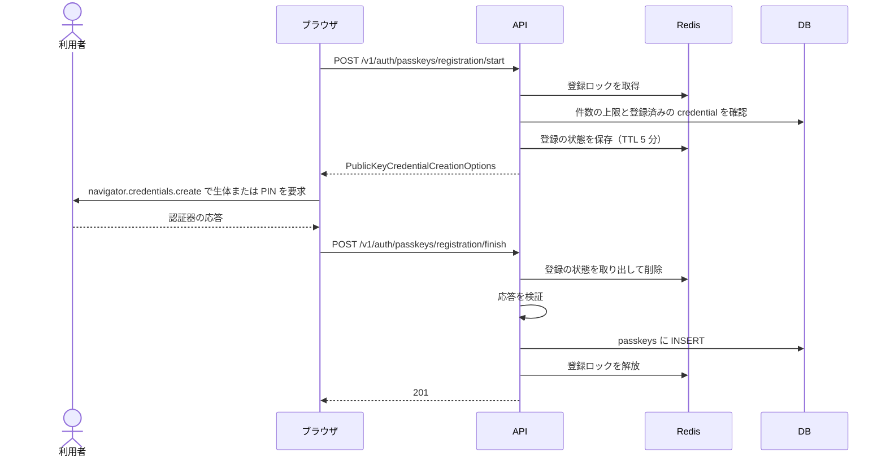
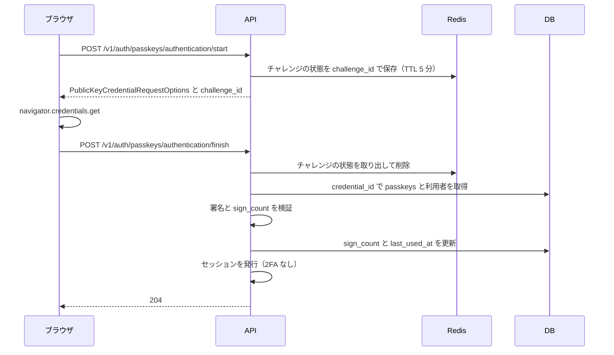

## 概要

WebAuthn（FIDO2）を使い、Touch ID・Face ID・セキュリティキーなどをパスキーとして登録・使用できる。実装には [`webauthn-rs`](https://github.com/kanidm/webauthn-rs) を使う。パスキーは利用者の検証（生体または端末の PIN）を必須にして認証するので、「所持（デバイス）+ 生体または PIN」の多要素認証として扱う。パスキーのログインは[2 段階認証](/features/auth-2fa)の TOTP を免除し、パスワードなしの完全なログインとして機能する。既存のメール/パスワードや OAuth に追加で登録でき、代替の認証手段になる。

## 振る舞い

### 登録

登録はログイン済みの利用者が既存のアカウントにパスキーを足す操作である。規則は次のとおりである。

- メールアドレスが確認済みでなければ `403` になる
- 同じ利用者の登録は Redis のロックで 1 つに限り、進行中に開始すると `409`（`passkey-registration-in-progress`）を返す
- ロックとチャレンジの状態の TTL はどちらも 5 分である
- 1 利用者が複数のデバイスに登録できる。上限は 20 個で、登録の開始時に確かめ、完了時にも利用者の行をロックして確かめ直す



`registration/finish` の失敗は次のとおりである。

| 状況 | 結果 |
|---|---|
| 上限を超える | `409`（`passkey-limit-exceeded`） |
| ロックや状態が無い | `400` |
| 検証に失敗 | `400`（`webauthn-error`）。ロックを解放する |

### ログイン

セッションなしでパスキーだけでログインできる。`start` が発行した `challenge_id` を `finish` に渡して、Redis のチャレンジの状態と対応づける。



`authentication/finish` の結果は次のとおりである。

| 状況 | 結果 |
|---|---|
| 成功 | `204`。セッションを発行する |
| `challenge_id` の状態が無い | `400` |
| credential が未登録、利用者のメールが未確認、カウンターの逆行 | `401`（`invalid-credentials`） |
| カウンターが非ゼロからゼロに戻った | `401`（`possible-credential-clone`） |
| 凍結済みの利用者 | `403`（`account-suspended`） |
| 署名の検証に失敗 | `400`（`webauthn-error`） |

### Conditional UI

`authentication/start` の `email` を省略すると、discoverable credential 用のチャレンジを返す。`allowCredentials` は空で、`mediation: "conditional"` が付く。フロントエンドはこの指定で `credentials.get()` を呼び、ブラウザがパスワードのオートフィルの UI にパスキーを表示する。

`email` を指定しても、利用者が存在しない・未確認・パスキー未登録なら同じ discoverable のチャレンジに切り替える。パスキーがある場合だけ `allowCredentials` に credential を列挙する。

### 検証の規則

WebAuthn の設定と検証の規則は次のとおりである。

| 項目 | 規則 |
|---|---|
| RP ID | 環境変数 `WEBAUTHN_RP_ID`。省略時は origin のホスト名 |
| origin の検証 | `EMAIL_VERIFICATION_APP_URL` の scheme・host・port を origin とし、`webauthn-rs` が検証する。サブドメインを許す設定はしていない |
| userVerification | `required`。生体認証またはデバイスの PIN を必須にする |
| residentKey | `webauthn-rs` の `start_passkey_registration` の既定で `discouraged`。discoverable な credential を作るかは認証器による |
| sign_count | 応答のカウンターが 0 より大きければ、DB の値より大きいことを必須とする。カウンターが 0 の場合、DB の値も 0 なら「非対応の認証器」として許容し、DB の値が 0 より大きければクローンの疑いとして拒否する |
| challenge の TTL | Redis で 5 分。`GETDEL` で取り出すので使い捨てである |
| 最後の認証手段の削除 | パスキーが 1 件で、`password_hash IS NULL` で、ログイン用の `oauth_connections` が 0 件なら `403`（`last-auth-method`）。`github_app` の連携はログインに使えないので数えない |
| メール未確認 | 未確認の利用者は登録できず（`403`）、認証も通らない（`401`） |

環境変数は次のとおりである。

| 変数 | 内容 |
|---|---|
| `WEBAUTHN_RP_ID` | WebAuthn の RP ID。省略時は origin のホスト名 |
| `EMAIL_VERIFICATION_APP_URL` | origin の元になるフロントの URL |

## データ

`passkeys` の列は次のとおりである。

| 列 | 型 | 制約 | 説明 |
|---|---|---|---|
| `id` | UUID | PK | |
| `user_id` | UUID | NOT NULL, FK users CASCADE | |
| `credential_id` | BYTEA | NOT NULL, UNIQUE | WebAuthn が生成する認証器固有 ID |
| `public_key` | BYTEA | NOT NULL | `webauthn-rs` の `Passkey` を JSON にしたもの。公開鍵を含む |
| `aaguid` | BYTEA | NULL 可 | 認証器モデルの識別子（16 バイト）。取得できない場合とゼロの場合は NULL |
| `sign_count` | BIGINT | NOT NULL DEFAULT 0 | 署名カウンター。0 はカウンター非対応の認証器 |
| `name` | VARCHAR(255) | NOT NULL | 利用者が付けた名前 |
| `last_used_at` | TIMESTAMPTZ | NULL 可 | |
| `created_at` | TIMESTAMPTZ | NOT NULL DEFAULT now() | |

列の定義は [m20260520000000_initial_schema.rs](https://github.com/koyori-app/task/blob/main/apps/backend/migration/src/m20260520000000_initial_schema.rs) にある。

## API

| メソッド | パス | 説明 |
|---|---|---|
| POST | `/v1/auth/passkeys/registration/start` | 登録チャレンジを発行する |
| POST | `/v1/auth/passkeys/registration/finish` | 登録を完了して DB に保存する（`201`）。`name` は 1〜255 文字 |
| POST | `/v1/auth/passkeys/authentication/start` | 認証チャレンジを発行する。`email` は省略できる |
| POST | `/v1/auth/passkeys/authentication/finish` | 認証を検証してセッションを発行する（`204`） |
| GET | `/v1/auth/passkeys` | 登録済みのパスキーの一覧。`last_used_at` は未使用なら含まない |
| PATCH | `/v1/auth/passkeys/{id}` | 名前を変更する（`204`） |
| DELETE | `/v1/auth/passkeys/{id}` | 削除する（`204`）。[検証の規則](#検証の規則)の最後の認証手段の削除に当たると `403` |

`registration/start` の応答は `webauthn-rs` の `CreationChallengeResponse` をそのまま JSON にしたもので、`publicKey` の下に `challenge`・`rp`・`user`・`pubKeyCredParams` などが入る。`excludeCredentials` に登録済みの credential を渡すので、同じ認証器を二重に登録しにくい。

`authentication/start` の応答は `webauthn-rs` の `RequestChallengeResponse` の JSON に `challenge_id` を足したものである。

```json
{
  "publicKey": {
    "challenge": "base64url-encoded-challenge",
    "rpId": "app.example.com",
    "allowCredentials": [{ "type": "public-key", "id": "base64url-credential-id" }],
    "userVerification": "required"
  },
  "challenge_id": "uuid"
}
```

`registration/finish` の `credential` と `authentication/finish` の `credential` は `PublicKeyCredential` の JSON である。

## 認可

| 操作 | 誰が | スコープ |
|---|---|---|
| 登録・一覧・名前の変更・削除 | ログイン中の本人（`CurrentUser`）。他人のパスキーの ID は `404`（`passkey-not-found`） | セッション専用。有効な Bearer と半認証のセッションは `403` |
| 認証の開始と完了 | 誰でも | 認証不要 |
| 強制削除（`DELETE /v1/admin/users/{id}/passkeys/{passkey_id}`） | サービス管理者（[サービス管理者の API](/features/admin#api)） | セッション専用 |

## 画面

フロントエンドがパスキーの API を使うのは 1 か所だけである。`/settings/security` の `AuthMethodsSection.vue` が `GET /v1/auth/passkeys` を呼び、最後の認証方法の注意書きを出すために件数を数える（[アカウント設定の画面](/features/account-settings#画面)）。

## 未実装と既知の制限

パスキーの画面は無い。

| 無い画面 | 内容 |
|---|---|
| ログイン画面 | パスキーでのログインボタンと、Conditional UI での候補の表示 |
| セキュリティ設定画面 | `/settings/security` でのパスキーの一覧・追加・名前変更・削除 |

## 決定の記録

| 日付 | 決定 | 理由 |
|---|---|---|
| 2026-11-04 | パスキーを多要素認証として扱い、ログインで TOTP を免除する | 利用者の検証を必須にして認証するので、「所持（デバイス）+ 生体または PIN」が揃う |
