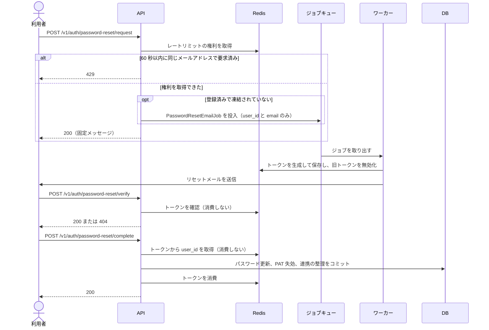
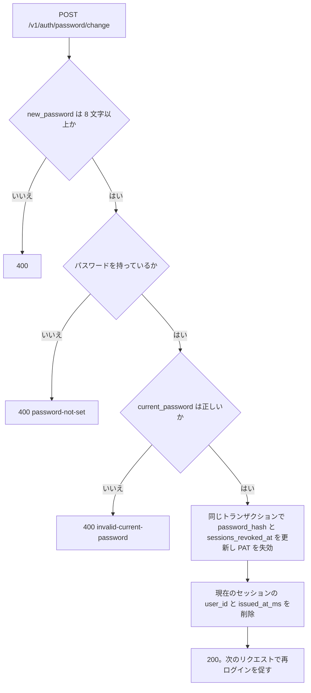

## 概要

パスワードを変える経路は、パスワードを忘れた利用者向けのリセットと、ログイン中の利用者向けの変更の 2 つである。どちらも完了後に、対象の利用者の既存のセッションと Device Token を無効化し、PAT を失効させる。TOTP の設定は変えないので、2FA が有効な利用者は新しいパスワードでログインしても 2FA を求められる。管理者が特定の利用者宛にリセットメールを送る操作は[サービス管理者の API](/dev/features/admin#api) で定義し、このページのトークンの生成と保存を共有する。

## 振る舞い

### リセット

リセットは「メールの要求」「トークンの確認」「新パスワードの設定」の 3 段階で進む。



`request` は、未登録・凍結中のメールアドレスにも同じ `200` を返す。キュー投入の失敗も外部には `200` のままにする。レートリミットの判定は利用者の検索より先に行うので、`429` の有無も登録の有無に左右されない。トークンはワーカー内で生成するので、Apalis の payload に秘密値は載らない。

`complete` は、`validator` で `new_password` を検証してから（8 文字以上）トークンを確認する。トークンが無効・期限切れなら `400` を返す。トークンの消費は DB のコミットの後に行う。

`complete` の同じトランザクションで `users.password_hash` と `sessions_revoked_at` を更新し、該当する利用者の `personal_tokens` を `revoked = true` にする。パスワードの無い OAuth 専用の利用者も、この経路でパスワードを設定できる。

リセットのメールを受けた者を、この利用者の持ち主とみなす。次の OAuth の連携は同じトランザクションで外す。外した連携は、ログインした後に結び直せる。

- `email_verified = false` の利用者の連携はすべて外す
- `email_verified = true` の利用者でも、許可の一覧（`OAUTH_GITLAB_SELFHOSTED_INSTANCE_URLS`）に無い instance の `gitlab_selfhosted` の連携は外す

### ログイン中の変更

`POST /v1/auth/password/change` は、現在のパスワードを確かめて新しいパスワードに置き換える。



他のセッションは `sessions_revoked_at` で次のリクエストのときに無効になる。

OAuth のみで登録した利用者（`password_hash IS NULL`）はこのエンドポイントを使えず、`400` になる。パスワードを新規に設定するには `POST /v1/auth/password`（[OAuth ログインの API](/dev/features/auth/oauth#api)）かパスワードリセットを使う。

### セッションの無効化

ログインは発行時刻をセッションの `issued_at_ms` にミリ秒精度で保存する。エクストラクタはこれを `sessions_revoked_at` と比べ、セッションが古ければ `401` を返す。Device Token は発行時刻（`created_at`）が `sessions_revoked_at` 以前なら `401` になる。

### トークンの保存

トークンは Redis のみに保持し、DB の表は持たない。実装は `service::password_reset` にあり、メール認証と同じ Lua スクリプトの構造である。Redis のキーは次のとおりである。

| キー | 値 | TTL |
|---|---|---|
| `pw_reset:t:{token}` | `user_id` の文字列 | `TOKEN_TTL_SECS`（30 分） |
| `pw_reset:u:{user_id}` | `token` の文字列 | `TOKEN_TTL_SECS`（30 分） |
| `pw_reset:rl:{email}` | `"1"`。存在するだけで意味がある | `RATE_LIMIT_SECS`（60 秒） |

- `t:` / `u:` の組はメール認証（`email_verify:`）と同じ双方向の対応付けである
- 同じ利用者への二重発行では Lua スクリプトで旧トークンを原子的に無効化する
- `rl:` のキーで送信レートをメールアドレス単位に制限する。メールアドレスは小文字変換と前後の空白の除去で正規化する

`service::password_reset` の関数は次のとおりである。

| 関数 | 動作 |
|---|---|
| `store_token` | トークンを原子的に保存する。旧トークンは失効する |
| `lookup_token_user_id` | 消費せずにトークンに紐づく `user_id` を返す。無効・期限切れは `None` |
| `consume_token` | Lua スクリプトでトークンを消費し `user_id` を返す。無効・期限切れは `None` |
| `try_acquire_rate_limit` | `SET NX` でレートリミットの権利を取得する。`Ok(false)` は `429` 相当 |

### リセットメール

メール認証の `VerificationEmailJob` と同じ Apalis のジョブキューの構造で、`PasswordResetEmailJob` を実装している。キュー名は `password_reset_email` で、最大 8 回再試行する。

メール本文のテキスト部分は次のとおりで、同じリンクを持つ HTML 部分も送る。リンクの基底は `EMAIL_VERIFICATION_APP_URL` である。

```text
件名: パスワードリセットのご案内

以下のリンクをクリックしてパスワードをリセットしてください。
このリンクは 30 分間有効です。

https://app.example.com/auth/reset-password?token={token}

このメールに心当たりのない場合は無視してください。
```

### 脅威と対策

脅威ごとの対策は次のとおりである。

| 脅威 | 対策 |
|---|---|
| メールアドレスの列挙 | リクエストの結果は登録の有無によらず同じ応答（200）にする。キュー障害時も 200 にする |
| Apalis board からの漏洩 | パスワードリセットのキューは board API に登録しない。登録するのは verification のみである |
| トークンの総当たり | 32 バイト（256 ビット）の乱数を URL-safe な base64 にして使うので、総当たりは現実的でない |
| トークンの再利用 | 完了時に消費して削除する。TTL 30 分で自動失効する。同時リクエストの排他はしない |
| 旧セッションの悪用 | `sessions_revoked_at` で完了前のセッションと Device Token を無効化し、PAT を失効させる |
| 出所の確かでない OAuth の連携 | 完了時に、未確認の email の利用者の連携と、許可の一覧に無い instance の連携を外す |
| メール爆撃 | `pw_reset:rl:{email}` で 60 秒に 1 回に制限する |
| OAuth の利用者への誤ったパスワード変更 | `password_hash IS NULL` の場合、change エンドポイントは `400` を返す |
| トークンのログ・キューへの漏洩 | リセットトークンは Redis のみに置く。Apalis の payload・構造化ログ・HTTP ログのクエリに載せない（運用は [パスワードリセットのフロー](/dev/design/password-reset-flow)） |

### 構造化ログ

成功時のみ `tracing` の `event` フィールドで記録する。値は `user_id` のみである。

- `auth.password_reset.email_queued`
- `auth.password_reset.email_sent`
- `auth.password_reset.completed`
- `auth.password_change.completed`

enqueue の失敗は `warn!(user_id, error)` で記録し、外部の HTTP 応答は 200 のままにする。OAuth の連携を外したときは、外した件数を `info` のログに残す。

## データ

トークンのための表は持たない。パスワードの変更とリセットが使う `users` の列は次のとおりである。

| 列 | 型 | 制約 | 説明 |
|---|---|---|---|
| `users.sessions_revoked_at` | TIMESTAMPTZ | NULL 可 | パスワードのリセット・変更の完了時に現在時刻を設定する |

列の定義は [m20260520000000_initial_schema.rs](https://github.com/koyori-app/task/blob/main/apps/backend/migration/src/m20260520000000_initial_schema.rs) にある。

## API

| メソッド | パス | 説明 |
|---|---|---|
| POST | `/v1/auth/password-reset/request` | リセットメールを送信する |
| POST | `/v1/auth/password-reset/verify` | トークンの有効性を確認する。`token` は JSON の本文で渡す |
| POST | `/v1/auth/password-reset/complete` | 新しいパスワードを設定する |
| POST | `/v1/auth/password/change` | ログイン中にパスワードを変更する |

応答は次のとおりである。

| エンドポイント | 応答 |
|---|---|
| `request` | `200`。登録の有無に関わらず `{ "message": "入力されたメールアドレスにリセットリンクを送信しました（登録済みの場合）" }` を返す。レートリミットに当たると `429` |
| `verify` | 有効なら `200`。無効・期限切れは `404`（`password-reset-token-not-found`） |
| `complete` | `200`。`{ "message": "パスワードをリセットしました。再度ログインしてください。" }` を返す。トークンが無効・期限切れなら `400`（`invalid-password-reset-token`） |
| `password/change` | `200`。`{ "message": "パスワードを変更しました。再度ログインしてください。" }` を返す |

## 認可

| 操作 | 誰が | スコープ |
|---|---|---|
| リセットの要求・確認・完了 | 誰でも | 認証不要 |
| ログイン中の変更 | ログイン中の本人 | セッション専用。有効な PAT・Device Token は `403` |
| 特定の利用者宛のリセットメール | サービス管理者（[サービス管理者の API](/dev/features/admin#api)） | セッション専用 |

## 画面

| 項目 | 値 |
|---|---|
| 入口 | サインイン画面の「パスワードをお忘れですか？」のリンク |
| リセット URL | `/auth/reset-password` |
| 変更 URL | `/settings/security` の「パスワード」の行 |

`/auth/reset-password` の 1 ページが、クエリの `token` の有無で 2 つのフォームを出し分ける。

| URL | 表示 |
|---|---|
| `/auth/reset-password` | メールアドレスの入力（`PasswordResetRequestForm`） |
| `/auth/reset-password?token=...` | トークンの確認の後、新パスワードの入力（`PasswordResetCompleteForm`） |

リンク先の画面は URL の `?token=` を読み取り、`POST /v1/auth/password-reset/verify` に `{"token":"..."}` を送ってトークンを確認する。有効なら新パスワードの入力フォームを表示する。

パスワードの変更は、現在のパスワード・新しいパスワード・確認を入力する。規則の定義元は[アカウント設定の画面](/dev/features/account-settings#画面)である。

| コンポーネント | ファイル |
|---|---|
| `PasswordReset` | `components/auth/PasswordReset.vue`。ページは `pages/auth/reset-password/+Page.vue` |
| `PasswordResetRequestForm` | `components/auth/PasswordResetRequestForm.vue` |
| `PasswordResetCompleteForm` | `components/auth/PasswordResetCompleteForm.vue` |
| `PasswordMethodRow` | `components/settings/PasswordMethodRow.vue` |

## 未実装と既知の制限

- `complete` は同じトークンの同時リクエストを排他しない。両方ともコミットまで進むことがあり、その場合は後の消費が `400` を返すが、パスワードの更新は取り消されない

## 決定の記録

| 日付 | 決定 | 理由 |
|---|---|---|
| 2026-05-27 | `request` は登録の有無を応答で区別しない | メールアドレスの有無を漏らさない |
| 2026-06-03 | パスワードリセットのキューは Apalis の board API に登録しない | 記録なし |
| 2026-06-03 | トークンはワーカー内で生成する | Apalis の payload に秘密値を載せない |
| 2026-10-17 | リセットの完了時に、未確認の email の利用者の連携と、許可の一覧に無い instance の連携を外す | リセットのメールを受けた者を持ち主とみなすので、確かめていない email で結ばれた連携を残さない |
| 2026-11-04 | トークンの消費は DB のコミットの後に行う | DB の更新に失敗したときにトークンだけ失効して再試行できなくなるのを避ける |
| 2026-11-04 | トークンは Redis のみに保持し、DB の表を持たない | メール認証と同じ方針に揃える |
| 2026-11-04 | セッションの失効はミリ秒で比べる | 失効の直後に発行したセッションまで落とさない |
| 2026-11-04 | レートリミットの判定を利用者の検索より先に行う | `429` の有無を登録の有無に左右されないようにする |
