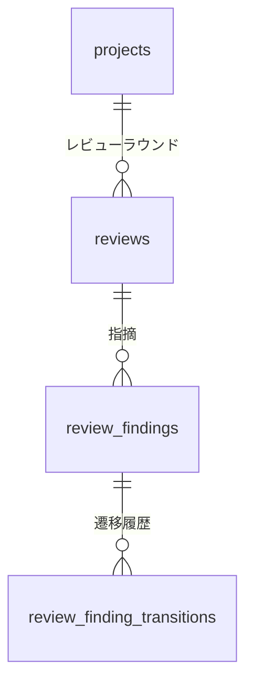
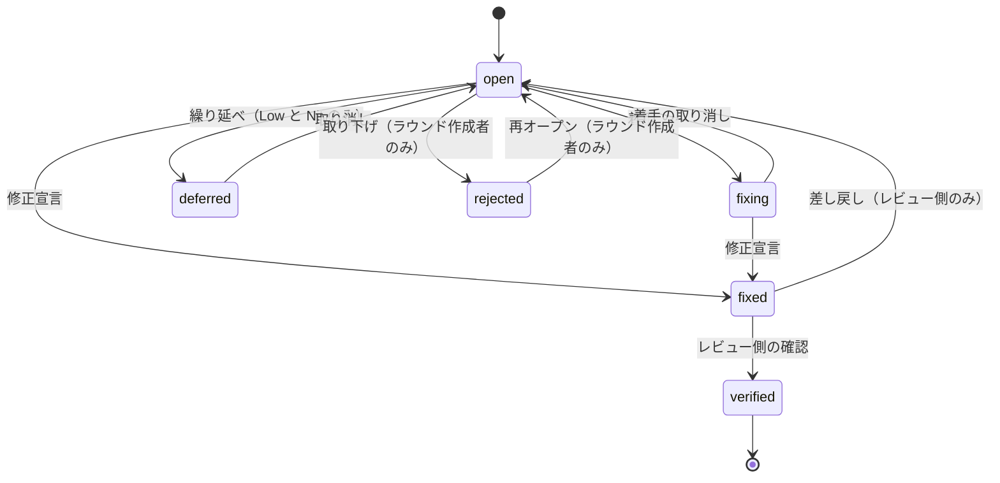

## 概要

PR レビューの指摘を task 自身のデータとして管理する機能である。レビュワーは AI と人間のどちらもあり得て、全機能で両者を同格に扱う。AI は PAT + CLI、人間はセッション + Web UI が主経路で、モデル・権限規則は共通である。GitHub 側に置くのは bot の要約コメント 1 本と、マージ可になったときのレビュワー本人の Approve だけで、詳細は[要約コメントと Approve](/dev/features/review-findings/github-comment) に書く。GitHub 連携（`github_integrations`、1 プロジェクト = 1 リポジトリ）、GitHub App、PAT スコープに依存し、連携が無くても起票・管理はできる。

## 用語

| 語 | 意味 |
|---|---|
| ラウンド | 1 回のレビュー依頼に対応する記録。PR 内の連番で、表示は R1, R2, … である |
| 指摘 | ラウンドに属する 1 件の問題 |
| レビュー側 | その指摘を含むラウンドの作成者、または同じ PR のより新しいラウンドの作成者 |
| 代行 | 作成者がテナントの利用者でなくなった指摘を、テナントオーナーが取り下げること |
| ゲート | マージしてよいかの判定 |

## 振る舞い

### 運用ルール

コードを書く前に決まる規約で、task と vrt の両リポジトリに適用する。

| ルール | 内容 |
|---|---|
| マージ基準 | High / Medium はマージ前に必須。Low / Nit は繰り延べ可（deferred にして通常タスク化し、後日対応する） |
| インライン禁止 | GitHub の PR へインラインレビューコメントを投稿しない。PR に置くのは bot の要約コメント 1 本と、マージ可になったときのレビュワー本人の Approve（本文なし）のみ |
| 判定の元 | 指摘の一覧・状態の判定の元は task だけである。GitHub のスレッド resolved フラグは使わない・見ない |
| 再レビュー | 依頼ごとに 1 ラウンド。判定は verified（解消）/ 据え置き / 未対応 で、指摘の状態として記録する |
| ゲートの信頼境界 | マージ可否はラウンド作成者の誠実性を前提にする。ラウンドは `write:review` を持つ誰でも、指摘ゼロでも確定できる。自己レビューの禁止は GitHub の branch protection（必須レビュワー）で担保し、ゲートはそこに積む二段目として使う |
| オーナーも境界の内側 | テナントオーナーからはゲートを守らない。代わりに痕跡を残す。代行での棄却は件数を集計と要約コメントに常設し、誰がいつ代行したかは遷移履歴に残る |
| 未連携の PR 空間 | 連携の無いプロジェクトで扱ってよい PR は 1 リポジトリ相当までとする。リポジトリが空になり PR 番号だけがキーになるので、2 つのリポジトリの PR #10 をどちらもレビューすると同じ PR として続く |

### ラウンド

プロジェクトの下にレビューラウンドがあり、ラウンドの下に指摘があり、指摘ごとに遷移履歴が残る。



- 同一 PR への再レビューは新しいラウンドとして作り、更新しない。`round` はサーバーが PR 内で採番する
- 採番は採番から挿入までをプロジェクト行のロックで直列化し、`UNIQUE (project_id, repo_owner, repo_name, pr_number, round)` を最後の制約として残す
- ラウンドは確定時に指摘ごと一括作成し、確定後の指摘の追記はできない。出し忘れは新しいラウンドとして出す。1 件だけのラウンドも正当である
- 人間のレビュワーは UI の下書きに指摘を貯めて最後に確定する。確定は一括作成 API を 1 回呼ぶことで、下書きはクライアント側の関心事でサーバーは持たない
- 指摘ゼロ（`findings: []`）のラウンドも正当で、「指摘なし」の記録として意味を持つ

### PR を指すキー

PR を指すキーにリポジトリを含める。採番・一覧・集計・要約更新ジョブの合流キーは、いずれもラウンドに保存したリポジトリを含めた単位で扱う。

- 一覧と集計が見るのは現在の連携先（連携が無ければリポジトリ無し）のラウンドである。旧リポジトリのラウンドは履歴として残るが混ざらない
- 連携を解除しても指摘は消さない。`integration_id` は `NULL` になるだけである

### 状態遷移

指摘は `open` から始まる。修正の経路は `fixing` と `fixed` を通って `verified` で終わり、Low / Nit の繰り延べ（`deferred`）と指摘の取り下げ（`rejected`）は `open` との間を行き来する。



遷移の主体と条件は次のとおりである。

| 遷移 | 誰が | 条件 |
|---|---|---|
| `open → fixing` / `fixing → open` / `fixing → fixed` / `open → fixed` | `write:review` を持つ誰でも | `fixing` は修正側が着手を知らせる状態で、経なくてもよい |
| `fixed → verified` | レビュー側 | `fixed` を宣言した本人は不可 |
| `fixed → open`（差し戻し） | レビュー側 | 宣言した本人の制限は無い。再レビューの「未対応」判定に相当する |
| `open → deferred` | `write:review` を持つ誰でも | `low` / `nit` の指摘だけ。`high` / `medium` は 409 |
| `deferred → open` | `write:review` を持つ誰でも | |
| `open → rejected` / `rejected → open` | その指摘を出したラウンドの作成者 | 作成者がテナントの利用者でなくなっている場合に限り、テナントオーナーが代行できる |

ほかの規則は次のとおりである。

- `fixing` から `verified` / `deferred` / `rejected` へは直接進めず、`fixed` か `open` を経る
- `fixing` はマージ可否の集計で `open` / `fixed` と同じく未解決に数える。`fixed_by` は記録しない
- 「より新しいラウンドの作成者」は `rejected` にできない。他人の指摘が誤りだと思ったら、自分のラウンドで反論を出すか、修正側として `fixed` を宣言する
- 代行で棄却された件数は集計と要約コメントに常設する。数えるのは代行で棄却された指摘の件数で、遷移の回数ではない
- `verified` は終端で、戻さない。誤りだったと分かったら新しいラウンドで指摘を出し直す
- 各遷移は誰がいつ行ったかを `review_finding_transitions` に記録する。任意の `note` も残す。起票は `from_state` が NULL の行である
- 状態遷移は指摘の行をロックして直列化する（`SELECT … FOR UPDATE` 相当）。状態の確認、副作用（繰り延べタスクの起票・再オープン・クローズ）、`deferred_task_id` と状態の更新までを同一トランザクションで行う

### 繰り延べ

`deferred` にした時点で、同じプロジェクトへ通常タスク（優先度 Low、本文に指摘への参照）を自動起票して `deferred_task_id` にリンクする。以降の追跡は普段のタスク運用に乗る。`open` へ戻す際は、システムが自動起票したタスクを自動でクローズする。

有効な自動起票タスクは指摘 1 件につき同時に 1 つである。

- `deferred → open` でクローズしたあと再び `deferred` にしたら、`deferred_task_id` のタスクが残っていれば（同じプロジェクトにあり、削除されていなければ）再オープンして使い回す
- 削除済み・リンク無しなら代替を 1 件起票してリンクを付け替える
- タスクの削除はソフトデリート（`deleted_at`）で、`deferred_task_id` の外部キーは外れない。生死はリンク先の `deleted_at` で判定する
- 再オープンは完了・畳みを解いて既定ステータスへ戻し、`completed_at` を消す。既定ステータスが無ければ起票時と同じく拒否する（409。指摘の状態は変えない）
- 完了ステータスの無いプロジェクトでは、クローズ時にタスクをソフト削除で畳むので、再繰り延べは毎回「削除済みなので代替を起票」になる

### マージ可否

マージ可否は「ラウンドが 1 件以上ある」かつ「open / fixing / fixed の High・Medium が 0」である。

- 集計は最新ラウンドの `head_sha` を返す。現在の HEAD と突き合わせるのは呼び出し側である。読み取り API から GitHub を呼ばない
- 集計はキャッシュ済みの現在 head とその確認時刻（要約ジョブが保存したもの。無ければ空）も返す。画面の「レビューが古い / 鮮度不明」の出し分けに使う。ジョブが最後に走った時点の値で push では更新されないので、ゲートの条件には使わず、表示を「可」以外へ落とす方向にだけ使う
- 集計はどのリポジトリを見た結果か（`repository`。連携が無ければ空）も返す。リポジトリが確定しない集計をゲートとして通さないのは呼び出し側の役目で、CLI と画面の両方を含む
- 集計はオーナー代行で棄却された件数も返す
- 判定の元のゲートは CLI の `--head` 照合と branch protection である

集計は表示用の判定 `gate` を返す（`service::reviews::review_gate`）。上から順に最初に当たったものである。既存の欄（件数・SHA・確認時刻・代行棄却数・`mergeable`）は残す。画面と Desktop はこの値を表示に使い、判定を再計算しない。

| `gate` | 条件 |
|---|---|
| `unlinked` | 集計対象のリポジトリが確定しない（連携なし） |
| `unreviewed` | ラウンドが 0 件 |
| `blocked` | open / fixing / fixed の High・Medium がある |
| `stale_unknown` | `cached_pr_head_sha` が無い |
| `outdated` | `cached_pr_head_sha` ≠ `latest_head_sha` |
| `ready` | 上のいずれでもない（`pr_head_checked_at` を併記する） |

### CLI

AI レビュワーの主経路は JSON 一括投入である。CLI（`apps/backend/crates/cli`）は Rust の単一バイナリで、実行にランタイムの用意が要らない。CI では置くだけで使える。`v*` タグの push で GitHub Release に添付され、導入手順は `apps/backend/crates/cli/README.md` にある。投入 JSON の検証と絞り込みの綴りは backend の型（`payload` / `entity` / `common::validation`）をそのまま使う。

```bash
# レビュー 1 ラウンド分を一括起票（ファイル or `-` で標準入力）
task review submit findings.json --project TASK
task review submit findings.json --project TASK --pr 618   # JSON の pr を上書き

# 指摘一覧（フィルタつき）
task review list --project TASK --pr 618 --state open --severity high,medium

# ラウンド一覧（R1, R2, … と head SHA・件数）
task review rounds --project TASK --pr 618

# 状態遷移
task review resolve <finding-id> --project TASK --state fixed
task review resolve <finding-id> --project TASK --state deferred --note "後で直す"

# 集計。マージできない状態なら非 0 で終了する（CI や手元のマージ前確認に使える）
task review summary --project TASK --pr 618

# 照合する HEAD を明示する（CI では PR head の SHA を渡す）
# GitHub Actions の pull_request では GITHUB_SHA が合成マージコミットを指すので使わない
task review summary --project TASK --pr 618 --head "${{ github.event.pull_request.head.sha }}"
task review summary --project TASK --pr 618 --no-head-check   # 鮮度を見ない
task review summary --project TASK --pr 618 --allow-unlinked  # 連携なしプロジェクトで使う

# 読み取りの視界を明示する（既定は現在の連携先）。連携を差し替えたあとに旧リポジトリの
# ラウンドを読む、連携を張る前のラウンド（空文字）を読む、のどちらにも使う
task review list   --project TASK --pr 618 --repo acme/old
task review rounds --project TASK --pr 618 --repo ""
```

レビューの通知（ラウンドの起票・指摘の状態遷移）は `task notifications` で読む。`--json` を付けなければ 1 件 1 行（`{ID}\t{未読|既読}\t{日時}\t{種別}\t{対象}\t{要約}`）で、先頭の完全な ID を `task notifications read` に渡せる。レビューの通知の対象は `PR #618 @ owner/name R2` の形になる。

```bash
task notifications list --unread --limit 20
task notifications read <notification-id>
task notifications read-all

# プロジェクトごとの受け取り設定（フラグ無しは現在値の表示）
task notifications settings --project TASK
task notifications settings --project TASK --in-app review_round_created,review_finding_changed
task notifications settings --project TASK --email ""      # メールは受け取らない
```

種別の綴りは送信前に検証し、未知の値は終了コード 2 で弾く。

投入 JSON と絞り込みの値は送信前に CLI 側でも検証する。綴り違い（`severity: "critical"`、`--state closed`）や必須項目の欠落は、どの指摘のどの項目かを添えて終了コード 2 で弾く。

読み取りの 3 コマンド（`list` / `rounds` / `summary`）は `--repo` を受ける。値は `owner/name`、空文字は連携を張る前のラウンドを指す。形式が違えば終了コード 2 で弾く。

`submit` の JSON の例は次のとおりである。

```json
{
  "pr": 618,
  "head_sha": "60cdd7795f94fa4e4148ce996c2efb4c363e3f5e",
  "summary": "総評。実装は整合。ストーリーのセレクタに 1 件。",
  "findings": [
    {
      "severity": "medium",
      "title": "LastAdminGuard の findByRole が複数一致で必ず失敗する",
      "body": "説明文にもマッチするため…（再現条件・根拠）",
      "file": "apps/frontend/stories/components/MembersSection.stories.ts",
      "line": 257
    }
  ]
}
```

`head_sha` は 40 桁の小文字 16 進で書く。CLI（終了コード 2）と API（400）の両方で弾く。

終了コードは失敗の理由を区別する。

| コード | 意味 |
|---|---|
| 1 | ゲート不成立、または分類のない失敗 |
| 2 | 送信前に弾いた入力の誤り、または設定不足 |
| 3 | 認証の失敗（401） |
| 4 | 権限の不足（403） |
| 5 | 参照先が見つからない（404） |

`summary` は次のいずれかで終了コード 1 になる。判断できないときは通さない。

| 終了する条件 | 理由 |
|---|---|
| High / Medium が open・fixing・fixed のいずれかで残っている | マージ基準 |
| ラウンドが 1 件も無い | レビューされていない。「指摘なし」とは違う |
| 最新ラウンドの `head_sha` が照合対象の HEAD と違う | レビュー後にコミットが積まれている |
| 照合する HEAD が決まらない | 判断できないので通さない。`--no-head-check` で明示的に外せる |
| 集計対象のリポジトリが確定しない（連携が無い） | どのリポジトリの PR を見た集計か決まらない。`--allow-unlinked` で明示的に外せる |

照合する HEAD は `--head` があればそれ、無ければ実行ディレクトリの `git rev-parse HEAD` である。

## データ

`reviews`（レビューラウンド）の列は次のとおりである。

| 列 | 内容 |
|---|---|
| `project_id` | 対象プロジェクト |
| `integration_id` / `repo_owner` / `repo_name` | ラウンドを出した時点の GitHub 連携と、その連携先リポジトリの保存値。連携が無ければ `integration_id` は NULL、`repo_owner` / `repo_name` は空文字列 |
| `pr_number` | PR 番号 |
| `round` | PR 内の連番（1 始まり） |
| `head_sha` | レビュー時点の PR head（裏取りした commit の記録）。40 桁の小文字 16 進のみ受け付ける |
| `reviewer_id` | ラウンドを作成した利用者（PAT の持ち主。AI もこの利用者として動く） |
| `summary` | 総評（markdown） |
| `pr_title` / `pr_author` | 表示用の PR メタ。要約コメント投稿ジョブが GitHub から取得してキャッシュする。連携なし・取得失敗時は空のままで PR 番号だけ表示する |
| `pr_head_sha` / `pr_head_checked_at` | 要約ジョブが GitHub から読んだ現在の head と確認時刻のキャッシュ。画面の鮮度表示に使う |
| `summary_comment_id` | 投稿済みの要約コメントの ID |

`review_findings`（指摘）の列は次のとおりである。

| 列 | 内容 |
|---|---|
| `review_id` | 属するラウンド |
| `severity` | `high` / `medium` / `low` / `nit` |
| `title` | 1 行の要約 |
| `body` | 詳細（markdown）。再現条件・根拠を書く |
| `file` / `line` | 位置情報（任意）。インラインコメントの代替はこのテキスト情報で足りる |
| `state` | `open` / `fixing` / `fixed` / `verified` / `deferred` / `rejected` |
| `deferred_task_id` | 繰り延べ時に自動起票した通常タスクへのリンク（任意） |
| `fixed_by` | 最後に `fixed` を宣言した利用者。差し戻し後も消さない。自分の修正の `verified` を止める判定に使う |

定義は [m20260826000000_review_findings.rs](https://github.com/koyori-app/task/blob/main/apps/backend/migration/src/m20260826000000_review_findings.rs) にある。PR の実体表 `forge_pull_requests` は[Git ホスティング連携のデータ](/dev/features/tasks/github-tasks#データ)に書く。

## API

パスは既存規約どおりテナント・プロジェクト配下に置く。

| メソッド | パス | 動作 |
|---|---|---|
| POST | `/v1/tenants/{t}/projects/{p}/reviews` | ラウンドと指摘の一括作成（1 リクエスト）。成功後に GitHub 要約更新をジョブ投入する |
| GET | `/v1/tenants/{t}/projects/{p}/reviews?pr=618` | ラウンドの一覧。指摘の件数つき |
| GET | `/v1/tenants/{t}/projects/{p}/reviews/{id}` | ラウンドの詳細。指摘を含み、各指摘に `available_actions` |
| GET | `/v1/tenants/{t}/projects/{p}/reviews/pull-requests` | レビューのある PR の一覧。画面の PR 一覧が使う |
| GET | `/v1/tenants/{t}/projects/{p}/reviews/summary?pr=618` | PR 単位の集計。重大度 × 状態の件数、ラウンド数、最新ラウンドの `head_sha`、集計対象のリポジトリ、オーナー代行での棄却件数、「マージ可否」、表示用の判定 `gate` |
| GET | `/v1/tenants/{t}/projects/{p}/review-findings?pr=618&state=&severity=` | PR の指摘一覧。状態・重大度で絞り込み、各指摘に `available_actions`。CLI の `review list` と UI の一覧が使う |
| PATCH | `/v1/tenants/{t}/projects/{p}/review-findings/{id}` | 状態遷移（`state` と任意のコメント）。応答の指摘にも遷移後の `available_actions` |

PR 単位の読み取りの規則は次のとおりである。

- ラウンド一覧・集計・指摘一覧は共通して `pr` と、任意の `repo=owner/name` を受ける。`repo` の空文字は連携を張る前のラウンドを指し、形式が違えば 400 を返す
- `/reviews/pull-requests` はクエリを取らず、現在の連携先だけを見る
- 読み取りは既定で現在の連携先のラウンドだけを見る。過去の連携先や連携前のラウンドは `repo` で明示して読む
- 絞り込みクエリに未知の値が混ざっていたら 400 を返す

`/reviews/pull-requests` の行（`ReviewedPullRequest`）は次のとおりである。可否は返さない。

- `unresolved`（未解決数）は open / fixing / fixed を数える。`blocking`（塞いでいる件数）は同じ状態の High / Medium のみを数える。`blocking_fixed` は `blocking` の内数で確認（verified）待ちの分である
- ラウンド数とホスト上の PR の状態 `state`（`open` / `closed` / `merged` / `unknown`）を持つ
- PR 行（`forge_pull_requests`）から `state`・`merged_at`・`merge_effects_processed_at`・`pull_request_id` を返す。PR 行とは自然キー `(project_id, repo_owner, repo_name, pr_number)` で結ぶ。PR 行が無ければ `state = unknown`、他は null である

起票と遷移の規則は次のとおりである。

- ラウンドの起票は、連携先のリポジトリが決まっていれば PR 行を `state = unknown` で用意する。既にあれば触らない。後から届いた webhook が同じ行に合流する
- PR 番号は 1 以上の整数として検証する。実在確認まではしない。要約コメントの投稿時に判明し、投稿失敗は起票を巻き戻さない
- 状態遷移後も要約更新ジョブを投入する
- 起票と状態遷移は in-app 通知を作る（起票・遷移と同じトランザクション）。受信者の規則は[通知・ウォッチャー](/dev/features/tasks/notifications)に書く
- 起票と状態遷移は Webhook イベント（`review.round_created` / `review.finding_changed`）も同じトランザクションで積む
- 起票の上限は、指摘が 1 ラウンド 200 件、`summary` が 20000 文字、`title` が 1〜200 文字、`body` が 1〜20000 文字、`file` が 1000 文字、`line` が 1 以上である。遷移の `note` は 2000 文字まで
- 409 は理由を本文（`message`）に入れる。High / Medium の繰り延べ・規則にない遷移・既定ステータスが無いの 3 つである。共通の `conflict` だけでは、CLI から使うレビュワーが「直すのか、取り下げるのか」を選べない

指摘のレスポンス（ラウンド詳細・指摘一覧・起票・遷移の応答）は `available_actions` を返す。

- 要求者がいま遷移できる遷移先の state の一覧で、`PATCH … {state}` にそのまま渡せる値である。動詞ではない
- `write:review` が無い要求者には空配列を返す
- 判定は候補の state ごとに `service::reviews::check_transition`（`ensure_transition_allowed` の判定本体）を呼ぶだけである
- 判定の材料（ラウンドの作成者・より新しいラウンドの作成者・作成者の不在・オーナー）は一覧分をまとめて引き、指摘の件数に比例して DB を往復しない
- クライアント（Web・Desktop）はこれだけを見て操作を出し、規則を持たない

## 認可

| 操作 | 誰が | スコープ |
|---|---|---|
| 閲覧 | プロジェクトに入れる人全員 | `read:review` |
| 起票・状態遷移 | [状態遷移](#状態遷移)の主体の規則に従う | `write:review` |
| 通知の読み取り・既読化（CLI） | 本人 | タスク通知は `read:task` / `write:task`、レビュー通知は `read:review` / `write:review` |
| 通知設定の読み取り・更新（CLI） | 本人 | `read:task` / `write:task`。`--project` にキーを渡すと UUID を引くためにプロジェクト API を呼ぶので `read:project` も要る。UUID を渡せば要らない |

スコープの規則は次のとおりである。

- `write:review` は `read:review` を包含する。既存スコープの包含の規則は[個人アクセストークンの認可の含意の規則](/dev/design/personal-access-tokens-authz#含意の規則)に書く
- `write:review` は繰り延べ経由で通常タスクの作成・クローズ・再オープンを伴う。`write:task` を渡さない分離の例外で、作られるのは指摘に紐づく 1 件だけで、本文も指摘の写しに限られる
- `api` は全スコープを、`read_api` は `read:review` を含む read の全スコープを包含する
- リソース束縛は既存の PAT 規則（テナント束縛 + `allowed_project_ids`）にそのまま乗る
- セッションは既存どおり全スコープ相当である
- 通知設定に関わる PAT の視界は[個人アクセストークンの認可](/dev/design/personal-access-tokens-authz)に書く

## 画面

| 項目 | 値 |
|---|---|
| URL | `/{tenant}/projects/{key}/reviews`。`?pr=618` で PR を指定する。要約コメントのリンク先である |
| クエリ | 指摘の絞り込みと選択は `?round=` / `?severity=` / `?state=` / `?finding=`。PR 一覧の状態は `?mine=1`（自分が作成した PR だけ）と `?page=N`（ページを操作していなければ載せない。`page` が無いときは表示中の PR が載るページを開くので、明示した 1 ページ目は `page=1` として残す） |
| ページファイル | `apps/frontend/src/pages/@tenant/projects/@projectKey/reviews/+Page.vue` |
| 本体 | `components/reviews/ReviewFindingsView.vue` と `ReviewRoundComposer.vue`、`ReviewFindingBody.vue` |

ページは `<ReviewFindingsView :key="projectId">` で作り直す。設定画面と同じ扱いである。

### ラウンドの起票

人間のレビュワー向けである。対象 PR と head SHA を指定し、指摘（重大度 / title / body / file:line）を下書きに 1 件ずつ追加して、まとめて確定する。確定までサーバーには何も作られない。指摘ゼロでの確定もできる。head SHA は 40 桁の小文字 16 進かを送信前に見る。

### PR 一覧

- 番号・タイトルの部分一致で探せる
- 各行にホスト上の PR の状態（Open / Merged / Closed / 状態不明）をバッジで出し、状態で絞り込める。開いた直後は Open の PR だけを出し、Open の PR が 1 件も無い一覧と、URL の `page` が Open の一覧には無く「すべて」の一覧なら在るときは「すべて」で開く。URL に `pr` が無いときに自動で開く PR は、この絞り込みで先頭に出るものである。状態の絞り込みは URL に載せず、開き直すと既定に戻る
- 10 件ごとにページを分け、`page` が無ければ表示中の PR が載っているページを開く。範囲外の `page` は最後のページに寄せて理由を出す
- 絞り込みとページ分割は画面側で行う。API は全件を集計して返す
- 各行のバッジは件数の事実だけを出す。`blocking` が 0 なら「未解決なし」、open / fixing が残れば赤の「N 件が未解決」（N は `blocking - blocking_fixed`）、すべて fixed なら「N 件が承認待ち」である

「自分が作成した PR だけ」のスイッチの動作は次のとおりである。

- PR の作成者（`pr_author`）は GitHub のユーザー名なので、閲覧者の連携 GitHub アカウントのユーザー名（`GET /v1/auth/oauth/connections` の `provider_login`）と大文字小文字を区別せず照合する
- 未連携ならスイッチは無効で、URL の `mine=1` は理由を出して無視する
- ログイン名を保存する前（`m20260911010000_oauth_provider_login`）からある連携は `provider_login` が空なので、連携一覧 API が保存済みのアクセストークンでプロバイダーに問い合わせて補完する
- トークンの期限切れ・失効で補完できなければ、スイッチは無効のまま「GitHub を連携し直すと使えます」と案内する。未連携とは言わない
- 問い合わせは接続ごとに 3 秒で打ち切って並べ、PR 一覧は連携一覧の到着を待たずに出す。待つのはスイッチと URL の `mine` の確かめだけである
- 連携一覧の取得自体に失敗したときは未連携と言わず、URL の `mine=1` も消さない

### 指摘の一覧と操作

- PR 単位の指摘一覧は重大度・状態・ラウンドでフィルタする。各指摘は title / file:line / 本文 / 遷移履歴を持つ
- 状態遷移の操作は fixing / fixed / verified / deferred / rejected と、戻り遷移（fixed → open の差し戻し、fixing → open の着手の取り消し、deferred → open、rejected → open）である
- 出すボタンは指摘の `available_actions` そのものである。役割制約はすべて backend が判定済みである
- 自分が fixed を宣言した指摘には、確認が出ない理由の説明だけを添える
- `deferred` はリンクされた通常タスクへジャンプできる
- ラウンドの履歴として、同じ PR に何ラウンド（R1, R2, …）レビューが走り、どの head を見たかを出す

遷移規則は画面に持たない。`lib/review-findings.ts` の `findingActions` は `available_actions` にラベルを付けるだけ、`mergeVerdict` は `gate` に見出しと説明を付けるだけである。

### マージ可否の表示

次の 6 つを集計の `gate` で出し分ける。画面は判定を再計算しない。判定は「可」以外へ落とす方向にだけ使い、「可」の保証には使わない。

| 表示 | `gate` | 内容 |
|---|---|---|
| リポジトリ未確定 | `unlinked` | GitHub 連携が無い。ゲートとして扱ってよい表示ではない |
| 未レビュー | `unreviewed` | ラウンドが 0 件 |
| マージ不可（残数つき） | `blocked` | 未解決の High・Medium がある |
| レビューが古い | `outdated` | キャッシュ済みの現在 head と最新ラウンドの `head_sha` が不一致。可を出さない |
| 鮮度不明 | `stale_unknown` | キャッシュが無い（ジョブが一度も走っていない・メタ取得に失敗した）。可を出さない |
| マージ可 | `ready` | GitHub を最後に確認した時刻を必ず併記する |

判断の材料として、レビューした commit（手元の HEAD と見比べれば、レビュー後に積まれたコミットに気づける）、集計対象のリポジトリ（空を含む）、オーナー代行での棄却件数（あれば）、GitHub の確認時刻を並べる。

## 未実装と既知の制限

### PR の指定

読み取りの PR 選択に `host` / `host_url` / `pull_request_id` を足し、同名リポジトリ・同番 PR の候補が複数あるときに 409 で再指定を求める規則が無い。`reviews` がホストと PR 行への参照を持たないので、現在は `repo` + `pr` だけで対象が決まり、ホストは区別しない。CLI の `--host` / `--host-url` / `--pull-request-id` も無い。設計は[Git ホスティング連携のホストまで含めた PR の指定](/dev/features/tasks/github-tasks#ホストまで含めた-pr-の指定)に書く。

`reviews` は `pull_request_id` を持たない。`integration_id` / `repo_owner` / `repo_name` / `pr_number` / `pr_title` / `pr_author` を PR 行へ移して `(pull_request_id, round)` で採番する移行が残っており、レビュー側と PR 行は自然キーで結んでいる。`host` / `host_url` を含めた結合は GitLab 対応時に行う。

### 範囲外

| 項目 | 理由 |
|---|---|
| AI 自動修正ループ（検知、修正、報告） | 別仕様。導入時はラウンド上限（自動往復 1 ラウンドまで）/ 重大度ゲート（High の自動修正は人間必須）/ 収束判定（同一箇所への再指摘で停止）の 3 ガードレールを必須とする。このモデルのラウンド・状態・集計はその前提を満たす |
| GitHub インラインコメントの取り込み・同期 | resolved 状態の判定の元が 2 つになり、どちらを信じるかが決まらなくなる。#587 型の過去データも移行しない |
| deferred のプロジェクト横断ビュー | 溜まっている deferred（Low/Nit）の件数と一覧は無く、画面はプロジェクト単位である。テナント横断の集計エンドポイントを足してから行う |
| 自己レビューの機械的な禁止 | GitHub の PR 作者と task の利用者を同定する仕組み（利用者への GitHub アカウント紐付け）が要る。ゲートの信頼境界として明記するに留め、禁止は branch protection の必須レビュワーで担保する |
| リポジトリ改名への追従 | ラウンドの保存値は owner / name の文字列で、`github_integrations` も数値の repository id を持たない。GitHub 側でリポジトリや org を改名して再連携すると、同じリポジトリなのに別リポジトリ扱いになり、旧ラウンドが一覧・集計の既定の視界から外れる。`repo` の絞り込みで読むことはできる。追従するには id 列の追加と連携フローの改修が要るので、別の変更として扱う |
| ラウンドの取り消し（void） | 誤った PR 番号へ出したラウンドを消す手段は用意しない。ラウンドは「どの head を見た時点の判断か」の記録で、追記不可・削除不可がモデルの根幹である。誤投の実害は指摘を `rejected` へ落とせば消え、ラウンドそのものは「そういうレビューがあった」記録として残す |

要約コメントと Approve の範囲外は[要約コメントと Approve の未実装と既知の制限](/dev/features/review-findings/github-comment#未実装と既知の制限)に書く。

### テストが無い受け入れ条件

次の受け入れ条件は、テストファイルへ移した部分を除いた次のサブ条件のテストが無い。

- 指摘数の境界: API で `findings` が境界を越える件数（201 件は CLI の事前検証のみ）
- マージ可否: ラウンド間で head が異なるときに最新ラウンドの `head_sha` を返すこと
- CLI の鮮度検査: head 違い、HEAD 不定、`--no-head-check` での終了コードの直接の確認
- CLI のリポジトリ検査: 非 0 と `--allow-unlinked` の終了コードの直接の確認、連携を外して視界を空にし空のラウンド 1 本で「可」を作る手が通らない通し
- 代行の痕跡: 除名、代行で棄却、再招待を通すこと、遷移履歴の時刻、実データの代行棄却が要約コメントに残る通し
- 拒否系: スコープ不足 403、同一テナントの他プロジェクト 404（`findings_are_scoped_to_their_project` は別テナントを見ている）、`rejected` から `open` 以外への遷移、`rejected → open` を作成者が通す HTTP 経由、起票 API の PR 番号が 0 以下
- 繰り延べ: タスク起票に失敗したとき deferred へ遷移しないこと、同じ指摘へ同時に `deferred` を送っても有効なタスクは 1 件だけで負けた側は 409 になること、既にクローズ済み・削除済みなら冪等成功として遷移を通すこと
- 繰り延べの往復: タスクが 1 件のままであること、代替が 1 件だけであることの件数の確認

## 決定の記録

| 日付 | 決定 | 理由 |
|---|---|---|
| 2026-08-26 | 範囲は「運用ルール + 指摘のタスク管理 + GitHub 要約投稿」とする。自動修正ループは範囲外にする | 導入前は Low までマージ前に直してリードタイムが伸びていた。GitHub のインラインコメントを 1 指摘 = 1 スレッドで積むと PR ページが重く見通しも悪い。[#587](https://github.com/koyori-app/task/pull/587) はスレッド 28 本すべてが 1 コメントのみ（返信ゼロ）、resolved は 16/28 で管理が途中で崩れた。Low を GitHub Issue に逃すと Issue 一覧が散らかる。自動修正ループの土台（機械可読な指摘・状態・集計）になるようにモデルを設計する |
| 2026-08-26 | データモデルは専用エンティティ（`reviews` / `review_findings`）にする | 将来の自動化が機械可読な状態・集計を要求するので、既存タスク + カスタムフィールドの相乗りは不採用 |
| 2026-08-26 | 重大度は High / Medium / Low / Nit の 4 段階とし、マージ必須は High / Medium にする | 記録なし |
| 2026-08-26 | 状態は open / fixed / verified / deferred / rejected とする。verified / rejected はレビュー側のみ、fixed 宣言者本人は不可とする | のちに rejected の主体は指摘を出した本人へ狭め、`fixing` を足した |
| 2026-08-26 | 起票はレビュワーが CLI から JSON 一括投入する。GitHub 経由の取り込みはしない | 生成しやすく、検証もしやすい |
| 2026-08-26 | 置き場所はプロジェクトにする。GitHub 連携は要約コメントの投稿にだけ必要で、連携が無くても起票・管理はできる。deferred は通常タスクへ自動変換する | 記録なし |
| 2026-08-26 | GitHub へは App（bot）名義の要約コメント 1 本のみとする。インライン投稿は禁止する | 2026-10-10 にレビュワー本人の Approve を足した |
| 2026-08-26 | スコープは `read:review` / `write:review` を新設する | レビュー専用の AI にタスク書き換え権限（`write:task` 等）を渡さずに済ませる |
| 2026-08-26 | `write:review` は `read:review` を包含する | 起票した本人が自分の結果を読めないと運用にならない。既存スコープは task 系が包含・project 系が非包含で前例が割れていたので明示した。project 系の非包含はのちに欠落と判じ、全対を包含へ揃えた |
| 2026-08-26 | 指摘一覧は `review-findings` を独立したパスに置く | CLI の `review list` と UI の一覧が「ラウンド単位」ではなく「PR 単位」で引く |
| 2026-08-26 | 差し戻し後も `fixed_by` を残す | 差し戻した本人が同じ指摘を verified に進めるのを防ぐ |
| 2026-08-26 | 指摘一覧への導線 URL は既存の `email_verification_app_url`（アプリの公開 URL）を流用する | 要約コメント専用の設定は増やさない |
| 2026-08-26 | CLI は投入 JSON と絞り込みの値を送信前に検証する（終了コード 2）。`review summary` は未解決が残ると終了コード 1 にする | サーバー側の検証に任せきりにすると、AI が生成した JSON の取り違えを直す手がかりが薄くなる。CI が「直せば通る」のか「レビューが足りない」のかを出し分ける |
| 2026-08-26 | 画面は `/{tenant}/projects/{key}/reviews` にする。PR 一覧のために `GET .../reviews/pull-requests`（集計つき）を追加する | 記録なし |
| 2026-08-26 | 絞り込みは画面側で適用する（API は PR 単位で全件返す） | 指摘は 1 PR あたり高々数十件で、往復を増やす価値がない |
| 2026-08-26 | レビューの反復の呼称は「ラウンド」（表示は R1, R2, …）とする。「巡」表記は使わない | 記録なし |
| 2026-08-26 | レビュワーは AI（PAT + CLI）と人間（セッション + Web UI）を同格に扱う。ラウンドは確定時一括作成・追記不可で、人間の下書きは UI 側の関心事にする | 追記を許すと「どの head を見た時点の判断か」というラウンドの意味が濁る |
| 2026-08-26 | モック評価を受けて戻り遷移（fixed→open 差し戻し / deferred→open / rejected→open）を追加する。deferred から戻すとき自動起票タスクはシステムが自動クローズする。verified は終端にする | 二重管理を作らない |
| 2026-08-26 | ラウンドは出した時点の連携とリポジトリ（`integration_id` / `repo_owner` / `repo_name`）を保存する。採番・一覧・集計・要約の合流はリポジトリを含めた単位にする。連携解除では指摘を消さない | 連携先は差し替えられるので、`project_id + pr_number` だけでは別リポジトリの同番 PR を同じ PR として続け、旧リポジトリ向けの指摘を新リポジトリへ投稿してしまう。指摘の判定の元は task 側にあり、GitHub 連携は要約コメントの投稿にだけ必要である（取り込み Issue のリンクとは扱いが違う） |
| 2026-08-26 | マージ可否は「ラウンドが 1 件以上」かつ「open / fixed の High・Medium が 0」とする。HEAD の鮮度は集計が返す `head_sha` を CLI が手元の HEAD と突き合わせて見る | 件数だけだと未レビューの PR が 0 件で「可」になる。読み取り API から GitHub を呼ばず、ゲートの応答時間と可用性を GitHub に握らせない。「いま検査している木」の SHA が手元にあるので、余計な依存と権限を増やさない |
| 2026-08-26 | マージ可否のゲートは「ラウンド作成者の誠実性」を信頼境界とする。自己レビューの機械的な禁止は範囲外にし、branch protection で担保する。連携を外して集計の視界を空にする手は塞ぐ。集計はどのリポジトリを見たかを返し、CLI は確定しないときに通さない（`--allow-unlinked` で明示的に外せる） | 修正した本人が空のラウンドを 1 本出せば「レビュー済み・指摘なし・HEAD 一致」を自力で満たせ、PR 作者と利用者の同定が無いので task 側では防げない |
| 2026-08-26 | 取り下げは、作成者がテナントの利用者でなくなった場合に限りテナントオーナーが代行できる | 除名・退会で取り下げる主体が消えると、誤った High を取り下げる主体が居なくなり、直していないものを `fixed → verified` と記録するしかなくなる。監査記録に嘘を書かせない |
| 2026-08-26 | `rejected` の主体は「その指摘を出したラウンドの作成者」に限る。`verified` と差し戻しは後続ラウンドの作成者にも認める | 「より新しいラウンドの作成者」まで広げると、指摘ゼロのラウンドを 1 本作るだけでレビュー側を自称でき、他人の High を棄却してマージ基準を単独で迂回できる。`verified` と差し戻しは再レビューの判定そのものである |
| 2026-08-26 | 繰り延べは Low / Nit に限る（High / Medium の deferred は 409） | マージ可否の集計から外れる状態への遷移をレビュー側以外にも開くと、High を 1 回 `deferred` にするだけでマージ基準を迂回できる。集計から外れる遷移（`deferred` / `rejected` / `verified`）は、どれも修正する側が 1 人で通せないようにする |
| 2026-08-26 | ラウンドの採番は `UNIQUE (project_id, repo_owner, repo_name, pr_number, round)` + 行ロックで直列化する。連携が無いラウンドの `repo_owner` / `repo_name` は空文字列にする | NULL にすると Postgres の UNIQUE が NULL 同士を別物として扱い、制約が効かない。番号が重なると R1, R2, … の表示と「どの head を見た判断か」の対応が崩れる |
| 2026-08-26 | 要約更新ジョブは同一 (project, リポジトリ, pr) で合流させる。実行区間も同じ単位で Redis のロックで直列化する。ロック・フラグとも TTL 付きにし、ロックの解放はトークン照合つきにする | 要求ごとにジョブを積むと、20 件の指摘を順に `fixed` にしただけで同じコメントへ 20 回書き込みに行き、GitHub の secondary rate limit に当たる。並行実行だと古い状態の書き込みが後から着き、コメントが巻き戻る。advisory lock だと GitHub API 呼び出しのあいだ Postgres のトランザクションを開いたままにする必要がある。持ち主が落ちても詰まらせない |
| 2026-08-26 | PR メタはタイトル・作者のみキャッシュする。マージ基準のゲートは設定化せず固定（High+Medium 必須・fixed は未解決扱い）とする。snippet 専用フィールドは作らず body の markdown コードブロックで表現する | 増減行数など鮮度が落ちる数値は持たない |
| 2026-08-27 | テナントオーナーの代行の痕跡を、遷移ではなく指摘の件数で数える | `rejected → open` が通る以上、遷移の回数で数えると指摘 1 件の痕跡が何件にも見える |
| 2026-08-27 | 未連携のプロジェクトで扱う PR を 1 リポジトリ相当までとする | リポジトリが空になり PR 番号だけがキーになる |
| 2026-08-27 | ロックと更新待ちのフラグの TTL を別の基準で決める。ロックの解放はトークンで照合する | フラグの TTL が短いとジョブが落とす前に切れ、合流が効かなくなって連続書き込みが戻るうえ、外からは効いていないことが見えない。長いとジョブが終端失敗したあとの凍結がその分だけ延びる。TTL が無いとその PR の要約を誰も更新できなくなる。照合が無いと、TTL 超過後に別のジョブが取り直したロックを遅れて完走した古いジョブが解放する。ロックの TTL が短すぎると塞いだはずの並行書き込みが戻る |
| 2026-08-28 | テナントオーナーからはゲートを守らない。代わりに痕跡を残し、代行での棄却件数を集計と要約コメントに常設する | 代行の条件（作成者の不在）はオーナー自身が除名で作れる（除名、代行で棄却、再招待で他人の High を単独で消せる）が、条件を絞っても防ぎきれない。アカウント削除に限ると元の問題が解決せず、「不在が N 日」は除名時刻の記録という新しい仕組みを要求して攻撃を遅らせるだけである。オーナーは連携解除もメンバー管理もできる上位の主体である |
| 2026-08-28 | 連携なしのゲート拒否を画面にも要求する。マージ可否の表示は「リポジトリ未確定」「レビューが古い」「鮮度不明」を含む 6 値にする | CLI にだけ実装すると、人間の主経路が素通しになる。連携を外すと集計の視界が空になり、空のラウンド 1 本で「可」を作れる |
| 2026-08-28 | 要約コメントのマーカーにプロジェクト ID を含め、原則を「1 PR × 1 プロジェクトに 1 本」へ改める。同一リポジトリへの複数連携は禁止しない | 固定文字列だと、同じリポジトリへ 2 つのプロジェクトが連携したときに互いのコメントを誤認して交互に上書きし、一方に未解決の High があるのに他方が「マージ可」を出し続ける。UNIQUE の置き場が無く、グローバルに張るとテナントを跨いだ連携妨害になる |
| 2026-08-28 | 読み取り API にリポジトリの絞り込みを用意する | 「履歴として残る」と書きながら読む手段が無いと、旧リポジトリ・未連携時代の指摘へ到達できない |
| 2026-08-28 | 再繰り延べは既存の自動起票タスクを再オープンして使い回す（`deferred_task_id` を保持）。不変条件は「同時に存在する有効なタスクは 1 件」である。リンク先が削除済みなら代替を 1 件起票する | 毎回起票すると、往復のたびに `seq_id` と通知を消費してタスク一覧が同じ内容で埋まる。「同じ物理タスク」に固定すると、削除済みタスクとの往復が成立しなくなる。リンクが残っているかで判定すると、削除済みのタスクを再オープンして黙って復活させる |
| 2026-08-28 | 完了ステータスの無いプロジェクトで再繰り延べのたびにタスクが作り直されることを許容する | 畳み方を可逆にするより、この稀な構成でタスクが作り直される方を選ぶ |
| 2026-08-28 | 要約コメントの特定は「マーカー一致 + 作成者が自分の bot」の両方を必須にし、投稿後は `comment_id` を保存して直接更新する。保存した値を捨てるのは編集が 404 のときだけにする | マーカーは PR の参加者なら誰でも書けるので先取りでき、App は他人のコメントを編集できないので更新は失敗し続け、失敗はベストエフォートで握り潰されるので要約が永久に作られない。一時障害で捨てるとコメントが増え、古い方は「マージ可」と書かれたまま残る |
| 2026-08-28 | 状態遷移は指摘の行ロック（`SELECT … FOR UPDATE` 相当）で直列化し、副作用とリンク・状態の更新を同一トランザクションで行う | 並行の `deferred` で双方がタスクを起票し、後勝ちのリンクだけが残って孤児ができるのを防ぐ。書き込みの単位ごとに直列化の道具を明記する（ラウンドの採番はプロジェクト行のロック、要約ジョブは Redis のロック） |
| 2026-08-28 | GitHub 要約コメントも投稿時に HEAD の鮮度を見る（PR メタの `head.sha` と最新ラウンドの `head_sha` の比較。追加の API 呼び出しは無い）。不一致・メタ取得失敗では「マージ可」と書かない。画面は要約ジョブが保存したキャッシュで「レビューが古い／鮮度不明」へ落とし、「可」には確認時刻を併記する | キャッシュは push で更新されないので、一致を保証に使わない。push での追従は別仕様で扱う |
| 2026-08-30 | 集計の範囲・合流の鍵・投稿先・installation token を連携行の 1 回の読み取りから作る | 同じジョブの中で連携を引き直すと、その間に差し替えが入ったときに「範囲は旧リポジトリ、投稿先は新リポジトリ」になり、旧リポジトリの指摘が新リポジトリの同番号 PR へ載る |
| 2026-08-30 | ロックを取れなかったジョブを失敗にせず積み直す | apalis の既定の再試行にはバックオフが無く、数ミリ秒で試行回数を使い切って終端する。そのときフラグだけが残り、生きたジョブが 1 本も無いまま、TTL のあいだ以降の遷移が合流で捨てられる。積み直しを回数で打ち切ると要約が古いまま止まる。待たずに積み直すと空振りを繰り返す |
| 2026-08-31 | 読み取りの 3 コマンドに `--repo` を置く（`owner/name`、空文字は連携前） | API 側の絞り込みだけでは、CLI を主経路にする AI レビュワーが過去の連携先のラウンドを読めない。黙って現在の連携先へ落とすと、読めていないことに気づけない |
| 2026-08-31 | `head_sha` は 40 桁の小文字 16 進に限る（CLI は終了コード 2、API は 400） | 鮮度の照合は厳密一致なので、短縮 SHA を受け取るとそのラウンドは永久にマージ可へ届かず、「同じ commit に見えるのに再レビューを要求される」形で出て原因を辿れない。`git log --oneline` の短縮 SHA を貼るのは人間のほうが起こりやすく、サーバーの 400 では何桁必要か伝わらないので画面でも送信前に見る |
| 2026-08-31 | ジョブに投入時のリポジトリを持たせ、連携先が変わっていたら投入時のフラグだけを落として降りる | 実行側が現在の連携先で引き直すと別のキーを消しに行き、元のフラグが TTL のあいだ残る。その間そのリポジトリの遷移は合流で捨てられ、コメントが古いまま止まる（A で遷移、実行前に A→B→A と戻すと起きる） |
| 2026-08-31 | ページを `<ReviewFindingsView :key="projectId">` で作り直す | vike-vue はクライアント遷移で同じ `+Page.vue` に解決される URL 間ではコンポーネントを patch するので、クエリの引数も選択中の PR も前のプロジェクトのまま残る |
| 2026-09-01 | PR 一覧は可否を断定しない（`mergeable` を返さず、バッジは「未解決なし / N 件が未解決」） | 可否には鮮度と連携の有無も要る。一覧に `mergeable` を置くと、詳細パネルが「リポジトリ未確定」等へ落とした横で一覧だけ「マージ可」と出る矛盾が起きた |
| 2026-09-01 | ラウンドは作成者の不在（`reviewer_left_tenant`）を返す | オーナー代行は画面（人間の主経路）から使えないと意味が半分になるが、在籍状態を返さないと画面が代行の条件を組めなかった。オーナーは `tenant_members` 行を持たないので、この判定では不在に数えない |
| 2026-09-02 | PR を実体表（`forge_pull_requests`）へ切り出し、`reviews` は FK で参照する方針を [Git ホスティング連携](/dev/features/tasks/github-tasks)側に置く | レビュー指摘、PR、タスクと辿る。PR 表はできたが、`reviews` の FK 付け替えは残っている |
| 2026-09-07 | レビュー履歴の PR 選択に `host` / `host_url` / `pull_request_id` を追加し、`repo + pr` だけは候補が一意な場合に限定すると決める | GitHub と Forgejo の同名リポジトリ・同番 PR は API 409 / CLI 非 0 で再指定を要求する |
| 2026-09-09 | `pull_request_id` は候補探索を省略するが、併記された `repo` / `host` / `host_url` は対象行との一致を検証し、不一致を API 400 / CLI 非 0 で拒否すると決める | Git ホスティング連携では不一致を拒否する一方、このページは他の指定を無視するように読めた |
| 2026-09-22 | ラウンドの起票と指摘の状態遷移を in-app 通知にする。宛先は同じ PR の関係者（ラウンドの作成者・`fixed_by`・PR の作者）で、`review_round_any` を設定に入れた利用者はラウンドの起票だけを追加で受け取る。購読の既定は OFF にする。PR の作者への起票通知は要約ジョブが担う。通知の可視性は `notifications.project_id` で判定する | 既定にすると、PR を見ていないプロジェクト全員へ全ラウンドが流れる。起票時点では作者が分からず、`reviews.pr_author` を埋めるのがこのジョブである。レビュー通知はタスクに紐づかない |
| 2026-09-24 | 指摘に `available_actions`、集計に `gate` を足し、画面の遷移表・可否判定の写しを消す。判定は `ensure_transition_allowed` の本体（`check_transition`）を候補ごとに呼ぶだけで、材料は一覧分まとめて引く | backend と同じ表を画面にも持つと、片方だけ変えて「押せるのに失敗する」ボタンができた。Koyori Desktop が 3 つ目の写しを持つと、規則を変えるたびに 3 か所を揃える必要が出る |
| 2026-10-01 | 状態に `fixing`（修正中）を足す（TASK-240）。マージ可否の集計では未解決に数え、遷移は `open ⇄ fixing → fixed` を修正側に開くだけにする | 修正側が着手を知らせる手段が無く、同じ指摘に複数人が手を付けうる。着手しただけでは何も直っていない。集計から外れる遷移を増やさない |
| 2026-10-04 | PR 一覧に「自分が作成した PR だけ」とページ送り（10 件）を足し、`mine` / `page` を URL に保つ。自分の PR は連携 GitHub のユーザー名で判定する。連携一覧 API が `provider_login` を返すようにする（TASK-243） | アプリのユーザー名とは一致すると限らない。サーバーで切っても集計の仕事は減らない |
| 2026-10-10 | マージ可になったら、最新ラウンドの作成者本人の名義で PR を Approve する。条件は要約コメントの「マージ可」と同じ 1 か所（`merge_ready`）に寄せる。トークンは GitHub App のユーザー認可で取り、ログイン用の OAuth App の scope は広げない。未連携のときは承認しない。重複の確認は DB 列ではなく GitHub のレビュー一覧（本人の ID・同じ commit）で見る。取り消しは範囲外とする | コメントと承認を食い違わせない。集計 API の `mergeable` は鮮度を見ないので使わない。bot の承認は必須承認数に数えられうるので、空のラウンドで GitHub 側の承認まで満たせる。本人の名義なら、PR 作者は自分の PR を承認できない・write 権限が要る・Code Owners といった GitHub の規則がそのまま効く。OAuth App の scope を広げるとログインで全リポジトリへの書き込みを求めることになる。bot で代わりに承認すると「連携しない」だけで空ラウンドの穴が開く |
| 2026-10-10 | 承認は `commit_id` を明示し、取り下げ済みの承認がある commit にも出し直さない | 省くと GitHub は最新の commit に付けるので、判定と投稿の間に push されるとレビューしていない commit を承認する。人が取り下げた直後の遷移で承認し直して争わない |
| 2026-10-18 | PR 一覧に `blocking_fixed`（High / Medium かつ fixed の件数）を足し、バッジですべて fixed の PR を「N 件が承認待ち」として未対応と分ける（TASK-302）。`blocking` / `unresolved` の値と意味はマージ判定と同じ集計のまま変えない | 確認待ちだけの PR が修正の要る PR と同じ赤で出ており、iOS は PR ごとに指摘一覧を読み直して fixed を数えていた |
| 2026-11-11 | PR 一覧の「PR の状態」の既定を Open だけにし、Open の PR が無い一覧では「すべて」で開く（TASK-503）。状態の絞り込みは引き続き URL に載せない | マージ済み PR が溜まると一覧の大半を占め、多くの場合に見たいのは Open の PR である。webhook を受けていない CLI 運用では全件が `unknown` なので、Open 固定だと一覧が空になる。URL に載せると共有リンクの意味（`pr` で指す PR を開く）と絡み、既定は「開き直すと戻る」で足りる |
| 2026-11-12 | URL の `page` が Open の一覧には無く「すべて」の一覧なら在るときは、開いた直後の「PR の状態」を「すべて」にする（TASK-503） | 状態の絞り込みは URL に載らないので、「すべて」でページを送った URL を開き直すと Open の一覧で数えることになり、在るページを「ありません」と言って最後のページへ寄せていた。状態を URL に載せずに、共有した側の一覧へ辿り着けるようにする |
