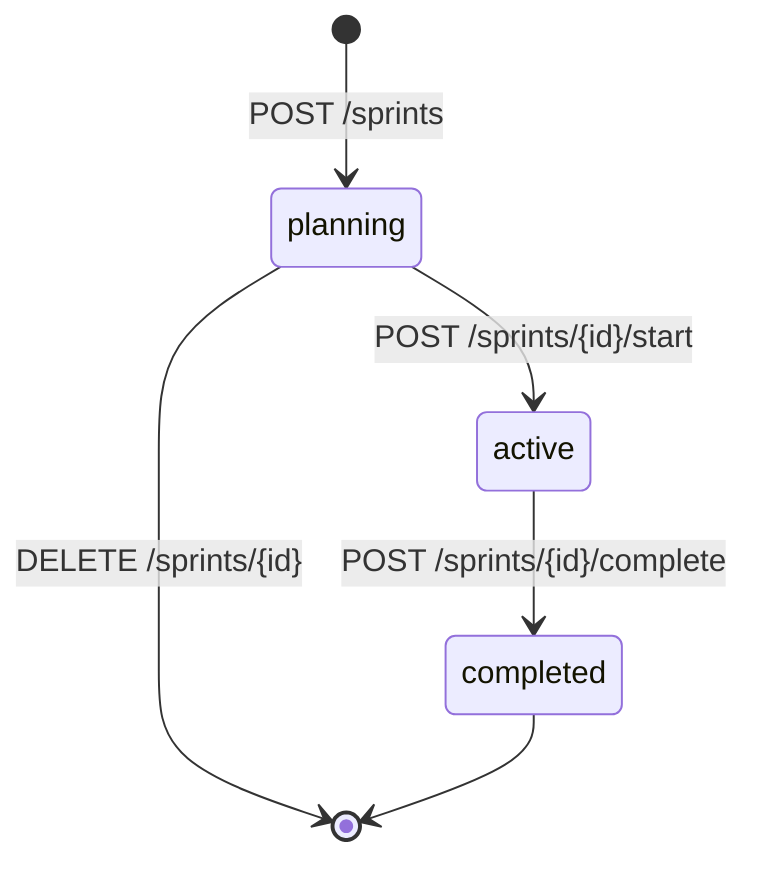

## 概要

スプリントは 2 週間程度の時間軸で区切った作業サイクルで、プロジェクトごとに持つ。マイルストーンが「リリース単位」なら、スプリントは「作業サイクル単位」である。詳細 API はバーンダウンのデータを一緒に返す。[コア](/features/tasks/core)の機能に依存し、API と CLI から使う。

## 振る舞い

### 状態

状態は次の順に一方向に進む。更新と削除ができるのは `planning` の間だけで、他の状態では 409 になる。

`status='active'` のスプリントはプロジェクト内で同時に 1 つのみである。開始 API は既存のアクティブスプリントを見て 409 を返し、同時に開始された場合は部分 UNIQUE インデックス `idx_sprints_active_per_project` の違反を 409 に変える。

### タスクとの紐付け

タスクとの紐付けは `tasks.sprint_id` で行う。完了済みのスプリントへは割り当てられず、409 になる。一括更新の例外は[タスク拡張](/features/tasks/extensions)のバルク操作に書く。

### 完了時の未完了タスク

`POST /sprints/{id}/complete` は未完了タスクの移動先を `move_incomplete_to_sprint_id` と `move_incomplete_to_backlog` で受ける。

- どちらも指定しない場合と `move_incomplete_to_backlog` が `true` の場合は、タスクの `sprint_id` を NULL にして Backlog 扱いにする
- 両方を指定すると 400 になる
- 移動先が自分自身か完了済みのスプリントでも 400 になる

### バーンダウン

各ポイントはスプリントの開始日から、終了日と今日の早い方までの日ごとに作る。未来の日は含まない。日付の区切りはすべて UTC である。

- `ideal_remaining` は、開始日までに作られていたタスク数を 0 まで線形に減らした値（四捨五入）である。期間が 1 日のときは 0 になる
- `actual_remaining` は、その日までに作られたタスクのうち、その日の終わりに未完了だったものの数である
- いま完了ステータスにあるタスクは、`completed_at` がその日より後なら未完了として数える

`tasks.sprint_id` の変更履歴は持たないので、過去の日の数も、いまスプリントに入っているタスクから計算する。

## データ

### `sprints`

| 列 | 型 | 制約 | 説明 |
|---|---|---|---|
| `id` | UUID | PK | |
| `project_id` | UUID | NOT NULL, FK→projects CASCADE | |
| `name` | VARCHAR(255) | NOT NULL | 例は "Sprint 3", "2026-W23" |
| `goal` | TEXT | NULLABLE | スプリントゴール |
| `start_date` | DATE | NOT NULL, CHECK(start_date <= end_date) | |
| `end_date` | DATE | NOT NULL | |
| `status` | VARCHAR | NOT NULL DEFAULT 'planning', CHECK `sprints_status_check` | `planning` / `active` / `completed` |
| `created_by` | UUID | NOT NULL, FK→users | |
| `created_at` | TIMESTAMPTZ | NOT NULL DEFAULT now() | |
| `updated_at` | TIMESTAMPTZ | NOT NULL DEFAULT now() | |

`tasks.sprint_id` は `sprints` への FK（ON DELETE SET NULL）で、列は[コアのデータ](/features/tasks/core#データ)に書く。列の定義は [m20260520000000_initial_schema.rs](https://github.com/koyori-app/task/blob/main/apps/backend/migration/src/m20260520000000_initial_schema.rs) にある。

## API

URL 基底パスは `/v1/tenants/{tenant_id}/projects/{project_id}` である。

| メソッド | パス | 説明 |
|---|---|---|
| `GET` | `/sprints` | 一覧（`?status=` でフィルター可。不明な値は 400） |
| `POST` | `/sprints` | 作成（`planning` 状態で作成） |
| `GET` | `/sprints/{id}` | 取得（`task_counts` と `burndown` を含む） |
| `PUT` | `/sprints/{id}` | 更新（`planning` 状態のみ。`clear_goal` でゴールを消す） |
| `DELETE` | `/sprints/{id}` | 削除（`planning` 状態のみ） |
| `POST` | `/sprints/{id}/start` | 開始（`planning` から `active` へ） |
| `POST` | `/sprints/{id}/complete` | 完了（`active` から `completed` へ） |
| `POST` | `/sprints/{id}/tasks` | タスクを割り当て（`task_ids` の配列）。割り当て後のタスクを返す |

`task_counts.in_progress` は完了ステータスでないタスクの数である。`In Progress` という名前のステータスだけを数えるわけではない。

CLI は `task sprints list` / `show` / `start` / `complete` / `burndown` を持つ。

## 認可

| 操作 | 誰が | スコープ |
|---|---|---|
| 読み取り | プロジェクトに入れる人 | `read:sprint` |
| 作成・更新・削除・開始 | プロジェクトに入れる人 | `write:sprint` |
| 完了・タスクの割り当て | プロジェクトに入れる人 | `write:sprint` と `write:task` の両方 |

## 画面

画面に出るのは、カレンダーの最上段のスプリントの帯だけである。帯は[スケジュールの画面](/features/tasks/schedule#画面)に書く。

## 未実装と既知の制限

スプリントの専用画面（一覧・作成・開始と完了の操作・バーンダウンチャート）が無い。

バーンダウンチャートの案では、横軸を日付、縦軸を残タスク数として `ideal_remaining` と `actual_remaining` の 2 本の線を引き、actual が ideal より上（遅延）か下（前倒し）かを色で分ける。計算に使う値は API が返す。

