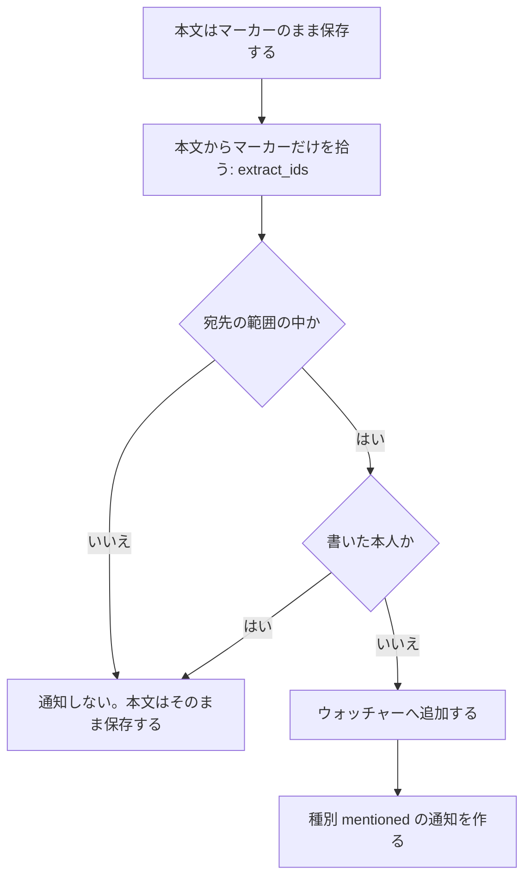

## 概要

タスクへのスレッドコメント、コメントと説明文の @メンション、タスクの変更履歴（アクティビティ）を扱う機能である。タスク詳細の右の欄が、履歴とコメントを 1 本にまとめて見せる。[コア](/dev/features/tasks/core)の機能に依存し、メンションの通知は[通知・ウォッチャー](/dev/features/tasks/notifications)へ渡す。クリップボードの形式は[コメントのメンションのクリップボード形式](/dev/features/tasks/collaboration-clipboard)に分ける。

## 用語

| 語 | 意味 |
|---|---|
| マーカー | メンションのマーカー。本文に埋める `<@利用者ID>` で、`<@` + ハイフン付き UUID + `>` の形である |
| チップ | メンションのチップ。画面で `@今の名` と描く部品である |
| 宛先の範囲 | メンションの通知を送れる利用者。そのプロジェクトに入れる利用者（`project_accessible_user_ids`）とテナント owner である |
| 名前を返す範囲 | [名前を返す範囲](#名前を返す範囲)の小節で定める、マーカーの id から名前を引ける利用者である |

## 振る舞い

### アクティビティの記録

タスクへの変更はアプリ層から明示的に `task_activities` へ書き込む。データベースのトリガーは使わない。記録する種別は[データ](#データ)の節の表に書く。

GitHub Issue の一括取り込みと webhook による新規作成は `github_issue_imported`、リンク済みタスクへの変更反映は `github_issue_synced` を記録する。

- どちらも `user_id = NULL`（システム操作）で、タスク・同期リンクと同じトランザクションで保存する
- 再取り込み・同じ内容の通知・古い通知・書き戻しの跳ね返りでは履歴を増やさない
- 画面には同期元のリポジトリ名と Issue 番号を表示する
- 導入前の履歴は遡って作成しない

### メンションの保存と通知

コメント本文とタスクの説明文のメンションは、利用者の ID をマーカーとして本文に埋めて持つ。例は `<@11111111-1111-4111-8111-111111111111> 確認お願いします` である。マーカーの形・拾い方・宛先の範囲・名前の解決は、コメントと説明文で同じ関数を通る（`payload::mentions`・`service::mentions`）。

本文を受け取ってから通知するまでの流れは次のとおりである。



- 本文の `@username` の文字は拾わない
- 範囲外の id・存在しない id は通知しないが、拒否もせず本文のまま保存する。描画側で灰色のチップにする
- 外れた利用者・退会した利用者には、名前を表示に出しても通知しない
- 編集では、編集前に無く新しく増えたマーカーの利用者だけに通知する（`comment_added` は送らない）

### メンションの通知の種別と文言

コメントも説明文も種別は `mentioned`（通知の設定・メールの有無も共通）で、`payload` と文言で分かれる。

| 出所 | トリガー | `payload` | メールの文言 | 遷移先 |
|---|---|---|---|---|
| コメント | 投稿・編集（編集では増えた分だけ） | `{ comment_id, author }` | `{author} が {タスク} のコメントであなたにメンションしました。` | タスクのページ |
| 説明文 | タスクの作成・説明文の編集（編集では増えた分だけ） | `{ source: "task_description", author }` | `{author} が {タスク} の説明文であなたにメンションしました。` | タスクのページ |

説明文を書く経路は、Web・CLI・API のすべてが `POST /tasks`・`PUT /tasks/{id}` の同じハンドラを通るので、どこから書いても同じように拾う。説明文を空にする更新では通知しない。GitHub の Issue 本文の取り込み（`github/sync.rs`）は説明文を書くが、GitHub 側の本文にはマーカーが無いので拾わず、通知もしない。

### 名前の解決

API は本文をマーカーのまま返し、並べて `mentions`（id から表示情報への対応表）を返す。対象はコメントの作成・編集・一覧と、タスクの詳細（`GET`/`POST`/`PUT /tasks/{id}` の説明文）である。`mentions` は画面が描くときに API を呼び直さないための対応表で、`status` は次のいずれかになる。

| `status` | 意味 | `name` | `avatar_url` | チップの描き方 |
|---|---|---|---|---|
| `member` | いまそのプロジェクトに入れる利用者 | 返す | 返す | 青い字の `@今の名`（自分宛ては強調） |
| `outside` | 利用者は存在するが、そのプロジェクトに入れない。外れた利用者・テナントを抜けた利用者を含む | そのテナントに属している・属していた利用者だけ返す | 名前と同じ範囲で返す | 灰色の字に破線の下線の `@今の名`。名前が引けない利用者は `@（このプロジェクトの外の利用者）` |
| `gone` | 利用者の行が無い（削除、存在しない id） | 返さない | 返さない（返す行が無い） | 灰色の字に破線の下線の `@（退会した利用者）` |

表に無い id を画面が描くときは `@（不明な利用者）` にする。

### 名前を返す範囲

判定は `service::mentions::tenant_footprint_ids` の 1 か所に置く。`users` の行は除名後も残るが、`tenant_members` は除名で行ごと消えるので、属していた証拠をそのテナントのプロジェクトの中にある記録で判定する。

記録とは、現在の所属・テナント owner・プロジェクトの明示のメンバー（除名後も残る）・タスクの作成者・コメントの書き手・担当者・アクティビティの主である。どれにも当たらない利用者（別のテナントの利用者、所属して何も残さず外れた利用者）は名前が引けず、定型の句になる。

### 本文を画面の外へ出すとき

本文が利用者の画面の外へ出るところでは、マーカーを `@今の名` に戻す。戻す関数は `payload::mentions::to_plain` の 1 つで、外れた利用者・退会した利用者も、名前が引ければ名前で出す。引けない利用者は定型の句にし、id は決して出さない。

| 出力先 | コメント | 説明文 |
|---|---|---|
| webhook | `comment.created` の `comment.body` を戻す | 載せない（`task.created` は説明文を持たない） |
| CLI | `tasks comment` の出力を戻す | `tasks create/show/update/complete` の出力を戻す（`tasks show --raw` はマーカーのまま出す）。`tasks list` は対応表を持たないので定型の句にする |
| タスク検索の抜粋（`/tasks/search`） | 対象外 | 戻してから抜粋にする |
| GitHub への書き戻し（`push_task`） | 書き出す経路が無い | 戻してから Issue 本文に書く（`github/sync.rs`） |
| メール・通知 `payload` | 本文を載せない | 本文を載せない |

本文を書き換えて戻すなら `tasks show --raw` でマーカーのまま取る。`--json` と併せても同じで、`mentions` の表はどちらでも載る。

### メンションの検索

`/tasks/search`（web の検索欄・CLI の `tasks search` も同じ API）は、検索語の中の `@名` の語を、その名の利用者をマーカーでメンションした説明文にも当てる。`@名` の語は `@` の後に空白までの一続きの文字である。

- 名は検索のときに利用者へ引く（`service::mentions::resolve_names`）。改名の後は今の名で当たり、前の名では当たらない。索引の列も移し替えも持たない
- 名を引く範囲は[名前を返す範囲](#名前を返す範囲)と同じである。範囲外の利用者は同名でも当てない
- 名は大小を問わず完全に一致する利用者だけを引く
- 名の一部（`@ali`）や `@` だけの語はマーカーに当てず、文字として当てる。文字の当て方は本文の生の文字に及ぶので、`@` だけの語はマーカーの `<@` を含む説明文にも当たる
- 同名の利用者が範囲の中に 2 人いれば、どちらのマーカーにも当てる。画面ではどちらも同じ `@名` と出る
- 検索語の文字に当てる処理も残し、OR で合わせる。文字の当て方は検索全体と同じで（tsvector・部分一致・表記ゆれ）、[タスク拡張](/dev/features/tasks/extensions)の全文検索に書く。マーカーより前の素の `@username` の本文も文字で当たる
- 他の語と並べたとき（`@名 仕様`）は、`@名` の語ごとの当て方と残りの語の当て方をすべて満たすものが当たる
- 抜粋は `to_plain` でマーカーを `@今の名` に戻してから切り、`@名` の語を強調する
- コメントは検索しない

### 既存の本文

`@username` の文字で書かれた既存のコメント・説明文は移し替えない。素の文字のまま描き、編集してもその中の `@username` は名前で解決されず、通知も送らない。補完で選び直せばマーカーになる。

### リアクションの規則

コメントとタスク本体に絵文字リアクションを付けられる。押した人と絵文字の組は 1 件で、同じ組を重ねて付けられない。1 つの対象に付けられる絵文字は 20 種類までで、21 種類目は 400 で断る。すでにある絵文字は上限に関係なく押せる。数えてから足すので、対象の行をロックして同時の `PUT` を直列にする。

リアクションは通知も `task_activities` の履歴も作らない。反応のたびに通知や履歴が増えると、本来の変更が埋もれるためである。

削除済みコメントには付けられず、`PUT` は 400 になる。付いていた分は一覧と押した人の一覧では見せないが、自分の分を外す `DELETE` は 200 で通す（応答は 0 件）。絵文字の値は形（空でない、64 バイト以下、空白・制御文字を含まない）だけを検め、本当に絵文字かは判定せず、正規化もしない。異体字セレクタの有無が違えば別の絵文字として数える。

## データ

### `task_comments`

| 列 | 型 | 制約 | 説明 |
|---|---|---|---|
| `id` | UUID | PK | |
| `task_id` | UUID | NOT NULL, FK→tasks CASCADE | |
| `user_id` | UUID | NOT NULL, FK→users CASCADE | |
| `body` | TEXT | NOT NULL | 本文。メンションはマーカーで持つ |
| `parent_comment_id` | UUID | NULLABLE, FK→task_comments SET NULL | スレッド返信（1 段のみ） |
| `created_at` | TIMESTAMPTZ | NOT NULL DEFAULT now() | |
| `updated_at` | TIMESTAMPTZ | NOT NULL DEFAULT now() | |
| `deleted_at` | TIMESTAMPTZ | NULLABLE | ソフトデリート |

### `task_activities`

| 列 | 型 | 制約 | 説明 |
|---|---|---|---|
| `id` | UUID | PK | |
| `task_id` | UUID | NOT NULL, FK→tasks CASCADE | |
| `user_id` | UUID | NULLABLE, FK→users SET NULL | NULL はシステム操作 |
| `event_type` | VARCHAR | NOT NULL | 下の表のとおり |
| `payload` | JSONB | NOT NULL | 変更前後の値 |
| `created_at` | TIMESTAMPTZ | NOT NULL DEFAULT now() | |
| `dedupe_key` | VARCHAR | NULLABLE, UNIQUE | 連携由来の出来事を 1 回だけ積むための鍵。[Git ホスティング連携](/dev/features/tasks/github-tasks)のアクティビティに書く |

`event_type` と `payload` の形は次のとおりである。

| 値 | ペイロード例 |
|---|---|
| `task_created` | `{}` |
| `github_issue_imported` | `{ "repo_owner": "acme", "repo_name": "backend", "issue_number": 42 }` |
| `github_issue_synced` | `{ "repo_owner": "acme", "repo_name": "backend", "issue_number": 42 }` |
| `status_changed` | `{ "from": "Backlog", "to": "In Progress" }` |
| `priority_changed` | `{ "from": "medium", "to": "high" }` |
| `assignee_added` | `{ "user_id": "uuid", "role": "primary" }`（一括更新では `role` が付かない） |
| `assignee_removed` | `{ "user_id": "uuid" }` |
| `deadline_changed` | `{ "field": "hard_deadline", "from": "...", "to": "..." }` |
| `planned_start_changed` | `{ "from": "2026-10-01", "to": "2026-10-05" }`（解除は `to: null`） |
| `comment_added` | `{ "comment_id": "uuid" }` |
| `comment_edited` | `{ "comment_id": "uuid" }` |
| `comment_deleted` | `{ "comment_id": "uuid" }` |
| `relation_added` | `{ "type": "blocks", "target_seq_id": 55 }` |
| `relation_removed` | `{ "type": "blocks", "target_seq_id": 55 }` |
| `label_added` | `{ "label_id": "uuid", "name": "bug" }` |
| `label_removed` | `{ "label_id": "uuid", "name": "bug" }` |
| `archived` / `unarchived` | `{}` |
| `forge_commit_linked` | `{ "host": "github", "sha": "a3f92c1…", "message": "fix: … TASK-42", "author_handle": "yupix", "author_name": "Yupix", "html_url": "https://github.com/…/commit/a3f92c1…" }` |
| `forge_pull_request_linked` | `{ "host": "github", "number": 87, "title": "feat: … TASK-42", "author_handle": "yupix", "html_url": "https://github.com/…/pull/87", "state": "open", "source": "manual" }`（`source` は初回のリンクの参照元。`manual` なら主語は操作者） |
| `forge_pull_request_unlinked` | `{ "host": "github", "number": 87, "html_url": "https://github.com/…/pull/87", "pull_request_id": "uuid" }` |
| `forge_pull_request_merged` | `forge_pull_request_linked` と同じ形（`state` は `"merged"`）。`Closes` 付きの PR のマージでタスクを完了したときに積む（`user_id` は NULL） |
| `forge_merge_effects_acknowledged` | `{ "host": "github", "pull_request_id": "uuid", "number": 87, "html_url": "https://github.com/…/pull/87" }`（`user_id` は確認済みにした操作者） |

### `reactions`

コメントとタスク本体に付ける絵文字リアクションである。1 行が、ある人がある対象にある絵文字を付けた 1 件を表す。

| 列 | 型 | 制約 | 説明 |
|---|---|---|---|
| `id` | UUID | PK | |
| `task_id` | UUID | NOT NULL, FK→tasks CASCADE | コメント向けでも、そのコメントの `task_id` を入れる |
| `target_type` | TEXT | NOT NULL | `task` / `comment` |
| `target_id` | UUID | NOT NULL | `task` なら `task_id` と同じ、`comment` ならコメント ID。多態の参照なので FK は無い |
| `user_id` | UUID | NOT NULL, FK→users CASCADE | |
| `emoji` | TEXT | NOT NULL | 空でない、64 バイト以下、空白・制御文字を含まない文字列 |
| `created_at` | TIMESTAMPTZ | NOT NULL | |

`(target_type, target_id, user_id, emoji)` は UNIQUE 制約である。索引は `(target_type, target_id)` と `task_id` に張る。コメントはソフトデリートなのでリアクションの行は残し、API では見せない。タスクごと消えるときは `task_id` の CASCADE で消える。

`reactions` の列の定義は [m20261105000000_reactions.rs](https://github.com/koyori-app/task/blob/main/apps/backend/migration/src/m20261105000000_reactions.rs) にある。

`task_comments` と `task_activities` の列の定義は [m20260520000000_initial_schema.rs](https://github.com/koyori-app/task/blob/main/apps/backend/migration/src/m20260520000000_initial_schema.rs) にある。`dedupe_key` は [m20260911000000_forge_commit_links.rs](https://github.com/koyori-app/task/blob/main/apps/backend/migration/src/m20260911000000_forge_commit_links.rs) で足す。

## API

パスは `/v1/tenants/{tenant_id}/projects/{project_id}` の配下である。

### コメント

| メソッド | パス | 説明 |
|---|---|---|
| `GET` | `/tasks/{id}/comments` | コメント一覧（スレッド構造。親は新着順、返信は古い順） |
| `POST` | `/tasks/{id}/comments` | 投稿（`body` と `parent_comment_id`。`body` のメンションはマーカーで送る） |
| `PUT` | `/tasks/{id}/comments/{cid}` | 編集 |
| `DELETE` | `/tasks/{id}/comments/{cid}` | ソフトデリート |

返信は 1 段までで、返信への返信と削除済みコメントへの返信は 400 になる。削除済みコメントは返信の有無にかかわらず、`"body": null, "is_deleted": true` で一覧に残る。`mentions` は削除済みコメントの本文にあるマーカーを含まない。`reactions` は[リアクション](#リアクション)の `ReactionSummary` の配列で、削除済みコメントでは空である。

### リアクション

エンドポイントは次のとおりである。パスはコメントの API と同じ基底の配下である。

| メソッド | パス | スコープ | 説明 |
|---|---|---|---|
| `PUT` | `/tasks/{id}/reactions/{emoji}` | `write:task` | タスク本体に付ける（冪等）。`ReactionSummary` を返す |
| `DELETE` | `/tasks/{id}/reactions/{emoji}` | `write:task` | 自分の分を外す。無くても 200。`ReactionSummary` を返す |
| `GET` | `/tasks/{id}/reactions/{emoji}/users` | `read:task` | 押した全員。`ReactionUsersResponse` を返す |
| `PUT` | `/tasks/{id}/comments/{cid}/reactions/{emoji}` | `write:task` | コメントに付ける（冪等）。`ReactionSummary` を返す |
| `DELETE` | `/tasks/{id}/comments/{cid}/reactions/{emoji}` | `write:task` | 自分の分を外す。無くても 200。`ReactionSummary` を返す |
| `GET` | `/tasks/{id}/comments/{cid}/reactions/{emoji}/users` | `read:task` | 押した全員。`ReactionUsersResponse` を返す |

権限はコメントの投稿と同じで、スコープに加えてテナントとプロジェクトへのアクセスを検査する（`ensure_tenant_access`）。外せるのは自分の分だけである。`{emoji}` はパーセントエンコードして渡す。

`ReactionSummary` の例は次のとおりである。

```json
{
  "emoji": "👍",
  "count": 3,
  "reacted": true,
  "users": [{ "id": "uuid", "name": "yupix", "avatar_url": null }]
}
```

`reacted` は呼び出した本人が押しているかを表す。`users` は先頭 5 人までで、本人がいれば先頭、残りは押した順である。

`ReactionUsersResponse` の例は次のとおりである。`users` は全員を押した順で返す。

```json
{
  "emoji": "👍",
  "count": 3,
  "users": [{ "id": "uuid", "name": "yupix", "avatar_url": null }]
}
```

`ReactionSummary` は、コメント一覧の `CommentThread` / `CommentReply` とタスク詳細の `TaskDetailResponse` に `reactions` として埋め込む。無ければ `[]` で、並びは最初に付いた順（その絵文字の最古の `created_at` 順）である。

エラーは次のとおりである。

| 応答 | 条件 |
|---|---|
| 400 `reaction-limit-exceeded` | 21 種類目の絵文字を付けようとした |
| 400 `bad-request` | 絵文字の値が不正（空白・制御文字を含む、64 バイト超）、または削除済みコメントへの `PUT` |
| 404 | タスクが無い、またはコメントがそのタスクに属さない |

### アクティビティ

| メソッド | パス | 説明 |
|---|---|---|
| `GET` | `/tasks/{id}/activities` | 変更履歴一覧（新着順。`limit` 既定 20・上限 100、`cursor`） |

全件は返さず、続きは `offset` ではなくカーソルで取る。`user` はシステム操作なら `null` である。

## 認可

| 操作 | 誰が | スコープ |
|---|---|---|
| コメント・履歴の取得 | プロジェクトに入れる人 | `read:task` |
| コメントの投稿 | プロジェクトに入れる人 | `write:task` |
| コメントの編集 | 投稿者本人のみ（本人以外は 403） | `write:task` |
| コメントの削除 | 投稿者、またはテナントオーナー | `write:task` |

## 画面

タスク詳細の右の欄に、操作履歴とコメントを古い順の 1 本にまとめて並べる。新しいものが下端の入力欄の隣に来る。日付で区切り、時刻は `14:02` の形で出す。見出しの絞り込みで「すべて / コメント / 履歴」を切り替える。

### 合流の規則

`lib/activity-timeline.ts` の `buildTimeline` が次のとおりに並べる。

- コメント本体と重なるので、`comment_added` の履歴は並べない。編集と削除の履歴は残す
- 同じ人の操作は、束の先頭から 5 分以内なら 1 件に束ねる。間にコメントが入るか、日付が変わると束ねない
- 履歴はカーソルで 20 件ずつ、コメントは全件取る
- 未取得の履歴より古いコメントは前後関係が決まらないので、続きの履歴があるあいだは出さない。上端の「以前のアクティビティを見る」で続きを取る
- コメントの絞り込みでは全件を出す

### コメントの操作

- 一覧はクライアント取得（vue-query）で取る。取得失敗は欄の中だけで扱い、再試行の導線を出す。GET と POST は独立なので、入力欄は取得失敗時も残す
- 操作は投稿・返信（1 段スレッド）・編集・削除である。返信は一覧に展開せず、件数を押すと列ごとスレッドへ切り替える
- 削除済みコメントは「削除されたコメント」と表示し、編集・削除・返信の導線を出さない。既にある返信を開く導線は残す
- 編集と削除はホバーで出るメニューに集める。ホバーできない端末では常に出す
- 編集は投稿者本人のコメントにだけ出す
- 削除は全コメントに出し、可否は backend の判定に任せる。テナントオーナーにも許可されており、frontend からは判定できないためである
- 削除済みでないコメントのうち `updated_at != created_at` のものに「(編集済み)」を表示する。backend は作成時に両カラムへ同一時刻を入れる
- 本文は[コメントの描画](#コメントの描画)のとおり Markdown として描画する
- 入力欄はふだん 1 行で、フォーカスするか下書きがあるときに広げる

### リアクションの操作

コメントのリアクションは次のとおりである。

- 本文の下に、絵文字と件数のボタンを並べる。ボタンが無いときの追加ボタンは ⋯ メニューの左にホバーで出し（ホバーできない端末では常に出す）、ボタンがあるときはボタンの行の末尾に出す。削除済みコメントと編集中には出さない
- ⋯ メニューの「リアクションを見る」から、押した全員の一覧を開ける
- 押した時点で表示を変え、失敗したら戻して、ボタンの下に文言を出す。上限超過は「これ以上種類を増やせません」と出す。可否は backend の判定に任せる
- ボタンにホバーかフォーカスして 400ms で、押した人のカードを出す。タッチ端末は長押しで全員の一覧を出す

タスクの概要（説明）のリアクションは、説明の本文の直下にボタンと追加ボタンを常に出す。説明が空の間と編集中は出さない。全画面・オーバーレイ・分割ビューは同じ `TaskDetailHub` なので、表示は共通である。

### 操作履歴の表示

- コメント（14px）より小さい 12px で「項目と値」の行にする。変更前後の値を出し、`from` のない履歴は変更後だけを出す
- 優先度は `PRIORITY_CONFIG` の語に直す。担当者の名前はメンバー一覧、ステータスとラベルの色はプロジェクトの定義から引く。引けない色は省き、引けない担当者は文で出す
- 利用者が選ぶ色と優先度の色は点とアイコンにだけ載せる
- 取得失敗はコメントと独立に扱う。`event_type` が未知なら「操作しました」と出す

### メンションの入力欄

コメント（`CommentEditor`）も説明文（`MarkdownEditor`）も、同じ CodeMirror の拡張（`lib/comment-mention-extensions.ts`）を使う。

- `@` を打つと候補（`assignable-users`。通知の範囲と同じ集合）を出し、選ぶと `@検索語` をマーカーに替える
- 候補に出すのは今入れる利用者だけである。外れた利用者・退会した利用者は候補に出さない
- 入力欄の中でもマーカーは見せず、チップとして一塊に扱う
- 補完で選ばなかった手打ちの `@name` は素の文字のままで、メンションにならない
- 説明文の入力欄ではコード（コードブロック・インラインコード）の中のマーカーはチップにしない

### コメントの描画

`CommentBody` だけが本文を描画する。説明文と同じ KFM renderer と sanitizer を `profile: 'comment'`（github profile ＋ 単独の改行を `<br>` にする）で使う。

- `v-html` に渡すのは sanitize 済みの HTML だけで、独自の消毒の設定や経路は無い
- markdown の中の生の HTML（`<b>`・`<script>`・`<!-- -->`、`Vec<String>` の `<String>` など）は、要素にせず文字として（escape して書いたとおりに）出す。説明文も同じである
- 描画器は初めて要るときに動的 import する。描画中・失敗・上限超は id を出さない素の文字（`@今の名`）にする。上限は 65,536 文字で、タスク説明文の SSR の上限 100,000 文字より小さい
- チップは説明文と同じ `remark-kfm-mention` で描く。ログイン中の利用者へのチップには `koyori-mention-self`（強調）が付き、プロジェクトの外の利用者・退会した利用者は灰色の字に破線の下線のチップで、名前が引ける利用者は名前を出す
- 描画のキャッシュキーに `currentUserId` を含め、閲覧者ごとの強調が混ざらないようにする
- 見出しは、コメントの枠（14px）の中だけ大きさを詰める（h1 1.25em・h2 1.15em・h3 1.05em）。説明文の見た目は変えない

保存済みのコメントは移し替えず、DB の本文のまま描く。素の文字として書かれた本文は、markdown の記法に当たる並びだけ見た目が変わる。単独の改行は `<br>` で改行のままである。

- 見た目が変わる並びは、行頭の `# `・`- `・`* `・`1. `・`> `、`_`・`*`・`~` の囲み、`---` の直前の行、自動 link である
- 生の HTML として読まれる並びは、`Vec<String>` の `<String>` など英数字を山括弧で囲んだ文字・HTML の行で始まる段落・HTML のコメントで、画面には文字のまま出る
- この一覧は `comment-legacy-text.test.ts` が固定する（本文は無傷）

### 説明文の描画

説明文も同じ KFM renderer で HTML にして `v-html` へ出す。

- 両方ともマーカーは remark プラグイン `remark-kfm-mention` が `span.koyori-mention.koyori-mention-{status}` のチップにする。中身は `span.koyori-mention-label` 1 つである
- チップの文字・状態はレンダラへ渡す `mentions` の表から引き、表はキャッシュキーにも載る
- コードブロックとインラインコードの中・リンクの内側のマーカーはチップにしない
- `mentions` を渡さない描画（他の消費側）は何も変えない
- ID は HTML に出さない

### チップの形

コメントと説明文の KFM の描画・入力欄の 2 つが、同じ判定 `mentionChip`（`lib/comment-mention.ts`）と、koyori の固定 class（`MENTION_CLASS_NAMES`）を使う。見た目は `@koyori-app/ui-vue/style.css` が持ち、task はチップの見た目の CSS を持たない。チップは `@名` の色の字と、角丸の不透明な薄い地で、アバターは出さない。チップで行が広がらない。

koyori の CSS は `components` 層に入り、層の外の `.kfm-content a` が勝つので、そちらを `:not(.koyori-mention)` にしてチップを外している。

状態ごとの見た目は次のとおりである。

| 対象 | 見た目 |
|---|---|
| いま入れる利用者 | 青の字（`--koyori-color-mention`）に、同じ色の薄い地（`--koyori-color-mention-subtle`） |
| 自分宛て（ログイン中の本人。`member` のときだけ） | 黄の字（`--koyori-color-mention-self`）に黄の薄い地（`--koyori-color-mention-self-subtle`）で、太さは 600。コメントのチップは `currentUserId` を渡して適用する。説明文はサーバーで描くが、サーバーの描画に閲覧者を渡していないので強調しない |
| 外れた利用者・退会した利用者・名前が引けない利用者 | 灰色の字（`text-secondary`）に、地なしで `border-strong` の破線の下線。色の薄さだけで状態を分けない |

入力欄のチップ（CodeMirror の widget）も同じ形である。一塊の扱い・caret・クリップボードの形式は共通で、チップの要素は本文のマーカーから作り、画面の DOM からは作らない。

### チップのリンク

いま入れる利用者（`member`）で名前が引けるチップは、プロフィールのページ（`/{テナントの表示用 id}/users/{利用者 ID}`。`userProfileHref` と同じパス）への `<a>` にする。

- パスは表にある利用者の id とテナントだけで組み、本文の文字は入れない
- テナントは描画の引数 `mentionTenant` で渡す。説明文は SSR の `+data.ts`、コメントは `TaskComments` から `TaskCommentItem` を経て `CommentBody` へ渡す
- `remark-kfm-task-ref` と同じ文字種（`[a-z0-9][a-z0-9-]{0,62}`）のときだけリンクにする。キャッシュキーにも含める
- 外れた利用者はリンクにしない。プロフィールの API はテナントの owner・メンバー・プロジェクトの明示のメンバーしか返さず、記録だけの利用者は 404 になるためである
- 名前が引けない利用者・退会した利用者もリンクにしない
- 消毒の許可は足していない。`a` と `href` は DOMPurify の既定で通り、class は koyori の固定 class（`MENTION_CLASS_NAMES`）だけである
- 指したときは下線、キーボードの focus には koyori のフォーカスの輪（`--koyori-focus-color`、2px）を出す
- 入力欄のチップはリンクにしない

### コピーと貼り付け

チップを含む文をコピー・切り取りすると、`text/plain` には `@今の名`、`text/html` にはチップの要素を載せ、task の入力欄へ貼るとチップのまま戻る。形式の決まりは[コメントのメンションのクリップボード形式](/dev/features/tasks/collaboration-clipboard)に書く。

### コンポーネント

| コンポーネント | ファイル |
|---|---|
| `TaskComments`（タイムライン＋入力欄＋スレッド） | `components/tasks/TaskComments.vue` |
| `TaskActivityEntry`（履歴 1 件） | `components/tasks/TaskActivityEntry.vue` |
| `TaskActivityFilter`（見出しの絞り込み） | `components/tasks/TaskActivityFilter.vue` |
| `TaskCommentItem`（1 コメントの表示・編集・削除） | `components/tasks/TaskCommentItem.vue` |
| `CommentBody`（本文の描画） | `components/tasks/CommentBody.vue` |
| `CommentEditor`（入力欄） | `components/tasks/CommentEditor.vue` |
| `ReactionBar`（ボタンの行・押した人のカードと一覧の開閉） | `components/reactions/ReactionBar.vue` |
| `EmojiPicker`（絵文字の選択。データは開いた時に読む） | `components/reactions/EmojiPicker.vue` |

## 未実装と既知の制限

- `sprint_changed`（スプリント割り当ての履歴）が無い。スプリントを変えても履歴は積まない
- タスクの削除は履歴を積まない
- desktop・iOS・Android の app でのクリップボードの読み書き（[形式](/dev/features/tasks/collaboration-clipboard)の実装）が無い。web だけ実装済みである
- 外部 Issue（GitHub）の本文の `@user` を `@user@github.com` の形で描き、タスクの利用者と紛れさせることを行っていない。GitHub の Issue 本文を取り込んだ説明文はマーカーを持たないので、メンションの通知もチップも出ない
- 所属して何も記録を残さず外れた利用者の名前は引けない。所属の履歴を持たないためで、履歴を残すなら `tenant_members` の除名を記録する表が要る
- `tasks show` の出力は人が読む形なので、そのまま `tasks update --description` に戻すとマーカーが名前の素の文字になる
- GitHub へ書き戻した本文は GitHub 側で `@今の名` の素の文字になり、GitHub 側の編集で説明文が置き換わるとマーカーは失われる

## 決定の記録

| 日付 | 決定 | 理由 |
|---|---|---|
| 2026-08-21 | コメントの入力欄は一覧の取得失敗時も残す | GET と POST は独立である |
| 2026-10-17 | メンションは利用者の ID をマーカーとして本文に持つ | 名前を本文に持たないので、改名してもメンションは切れない |
| 2026-10-17 | 範囲外や存在しない id を拒否しない | メンションされた利用者が後からプロジェクトを外れても、その本文を編集できるようにする |
| 2026-10-17 | 既存の本文（`@username` の文字）を移し替えない | 記録なし |
| 2026-10-18 | 名前を返す範囲を、テナント内の記録で判定する | 後から外れた利用者・テナントを抜けた利用者の名前が消えると文脈が読めなくなる。一方、マーカーの id を知っただけで別のテナントの利用者の名前を引かれるわけにはいかない |
| 2026-10-18 | メンションの検索は検索時に名を引き、索引の列も移し替えも持たない | 改名の後は今の名で当たる |
| 2026-10-19 | 入力欄のチップはリンクにしない | 編集の邪魔になる |
| 2026-11-04 | 本文の `@username` の文字を拾わず、マーカーだけを拾う | 文字を拾うと、同名の利用者や `bob@example.com` の `example` を宛先にしてしまう |
| 2026-11-04 | 変更履歴は全件を返さない | 履歴は操作のたびに増え、長く使われたタスクほど DB・応答・描画のコストが上限なく伸びる |
| 2026-11-04 | 変更履歴の続きは `offset` ではなくカーソルで取る | 履歴は新しい側に積まれるので、`offset` だとページの間に 1 件積まれただけで境界の行が二重に出る |
| 2026-11-04 | 変更履歴はアプリ層から書き込み、データベースのトリガーを使わない | 記録なし |
| 2026-11-04 | 絵文字の種類は 1 つの対象あたり 20 までとし、21 種類目は 400 にする（TASK-445）。既にある絵文字は上限に関係なく押せる | 数えてから足すので、対象の行をロックして同時の `PUT` を直列にする |
| 2026-11-04 | リアクションは通知も `task_activities` の履歴も作らない（TASK-445） | 反応のたびに通知や履歴が増えると、本来の変更が埋もれる |
| 2026-11-04 | 削除済みコメントにはリアクションを付けられず、`PUT` は 400 にする（TASK-445）。付いていた分は一覧と `/users` で見せず、自分の分を外す `DELETE` は 200 で通す | 返信と同じ扱いに揃える |
| 2026-11-04 | 絵文字の値は形だけを検め、本当に絵文字かは判定しない。正規化もしない（TASK-445） | 異体字セレクタの有無が違えば別の絵文字として数える |
| 2026-11-11 | メンションのチップは koyori の Mention の固定 class で描き、task は見た目の CSS を持たない。アバターはチップに出さない（TASK-511） | 配色が koyori の更新で変わっても、対比を koyori の検査で保てる。task の半透明の地は墨の面で 1.10:1 になっていた |
