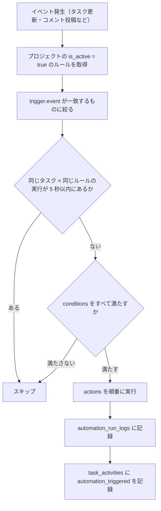

## 概要

このページは未実装の設計案であり、現在の動作を説明するものではない。`automations` / `automation_run_logs` のテーブル、API、ジョブ、画面のいずれもコードに無い。案は「X が起きたとき、条件を満たせば Y をする」をノーコードで設定できるルールエンジンで、[コア](/dev/features/tasks/core)、[コメント・アクティビティ](/dev/features/tasks/collaboration)、[通知・ウォッチャー](/dev/features/tasks/notifications)に依存する。現在、利用者が設定できる自動処理は無い。これに近い動作として、`Closes KEY-N` を含む PR のマージでタスクを完了にする処理があるが、自動化エンジンを通らない固定の処理である（[Git ホスティング連携の Webhook](/dev/features/tasks/github-tasks/webhook) のマージ時副作用）。

## 振る舞い

以下の小節はすべて実装するときの案である。

### トリガーの案

`trigger` は JSONB で、次の形を想定する。

| 契機 | `trigger` |
|---|---|
| ステータスが特定の値に変わったとき | `{ "event": "status_changed", "to_status_id": "uuid" }` |
| 担当者が追加されたとき | `{ "event": "assignee_added" }` |
| 締切の N 日前。バッチジョブが毎日評価する | `{ "event": "deadline_approaching", "days_before": 1 }` |
| 全サブタスクが完了したとき | `{ "event": "subtask_all_done" }` |
| PR がマージされたとき。旧名の `github_pr_merged` も別名として受ける | `{ "event": "pull_request_merged" }` |
| コメントが投稿されたとき | `{ "event": "comment_added" }` |

`pull_request_merged` の投入元は [Git ホスティング連携の Webhook](/dev/features/tasks/github-tasks/webhook) のマージ時副作用で、自動完了と同じトランザクションでジョブを積む想定である。

### 条件の案

`conditions` は JSONB の配列で、AND で結合する想定である。

| 条件 | `conditions` の要素 |
|---|---|
| 優先度が high 以上 | `{ "field": "priority", "op": "in", "value": ["high", "critical", "critical_fire"] }` |
| 担当者が特定の利用者 | `{ "field": "assignee_ids", "op": "contains", "value": "uuid" }` |
| ラベルが付いている | `{ "field": "label_ids", "op": "contains", "value": "uuid" }` |

### アクションの案

`actions` は JSONB の配列で、順番に実行する想定である。

| 動作 | `actions` の要素 |
|---|---|
| ステータスを変更する | `{ "type": "set_status", "status_id": "uuid" }` |
| ラベルを追加する | `{ "type": "add_label", "label_id": "uuid" }` |
| ラベルを削除する | `{ "type": "remove_label", "label_id": "uuid" }` |
| 担当者を追加する | `{ "type": "assign_user", "user_id": "uuid", "role": "secondary" }` |
| 進捗率を設定する | `{ "type": "set_progress", "value": 100 }` |
| 担当者全員に通知する | `{ "type": "notify_assignees" }` |
| コメントを自動投稿する | `{ "type": "post_comment", "body": "全サブタスクが完了しました。自動クローズします。" }` |

### 実行の流れの案

イベントが起きると、そのプロジェクトの有効なルールのうちトリガーが一致するものを順に評価する想定である。同じタスクで同じルールが 5 秒以内に動いていればスキップする。条件をすべて満たしたルールだけがアクションを順番に実行し、`automation_run_logs` と `task_activities`（`automation_triggered`）に記録する。



## データ

次の 2 表は案である。migration ファイルはまだ無い。

`automations` の列の案は次のとおりである。

| 列 | 型 | 制約 | 説明 |
|---|---|---|---|
| `id` | UUID | PK | |
| `project_id` | UUID | NOT NULL, FK→projects CASCADE | |
| `name` | VARCHAR(255) | NOT NULL | |
| `trigger` | JSONB | NOT NULL | トリガーの定義 |
| `conditions` | JSONB | NOT NULL DEFAULT `'[]'` | 追加の条件。AND で結合する |
| `actions` | JSONB | NOT NULL | アクションの定義。順番に実行する |
| `is_active` | BOOLEAN | NOT NULL DEFAULT true | |
| `created_by` | UUID | NOT NULL, FK→users | |
| `created_at` | TIMESTAMPTZ | NOT NULL DEFAULT now() | |

`automation_run_logs` の列の案は次のとおりである。無限ループの防止に使う。

| 列 | 型 | 制約 | 説明 |
|---|---|---|---|
| `task_id` | UUID | NOT NULL, FK→tasks CASCADE | |
| `automation_id` | UUID | NOT NULL, FK→automations CASCADE | |
| `ran_at` | TIMESTAMPTZ | NOT NULL DEFAULT now() | |

`idx_automation_run_logs` を `(task_id, automation_id, ran_at DESC)` に張り、5 秒以内の再発火の確認に使う。

## API

エンドポイントの案は次のとおりである。

| メソッド | パス | 説明 |
|---|---|---|
| GET | `/automations` | 一覧 |
| POST | `/automations` | 作成。テナントオーナーのみ |
| PUT | `/automations/{id}` | 更新 |
| DELETE | `/automations/{id}` | 削除 |
| POST | `/automations/{id}/toggle` | 有効 / 無効の切り替え |

`POST /automations` のリクエストの例は次のとおりである。全サブタスクの完了で親タスクを Done にする。

```json
{
  "name": "全サブタスク完了 → 親を Done に",
  "trigger": { "event": "subtask_all_done" },
  "conditions": [],
  "actions": [
    { "type": "set_status", "status_id": "uuid-of-done" },
    { "type": "set_progress", "value": 100 }
  ]
}
```

## 画面

| 項目 | 値 |
|---|---|
| URL の案 | `/tenants/{tid}/projects/{pid}/automations` |

エディタの案は、1 つのルールを上から順に、トリガー、任意の条件、順番に実行するアクションの 3 段で編集する。右上で有効 / 無効を切り替える。


コンポーネントの案は次のとおりである。

| コンポーネント | ファイル |
|---|---|
| `AutomationPage` | `pages/automations/+Page.vue` |
| `AutomationEditor` | `components/automations/AutomationEditor.vue` |
| `TriggerSelector` | `components/automations/TriggerSelector.vue` |
| `ConditionEditor` | `components/automations/ConditionEditor.vue` |
| `ActionEditor` | `components/automations/ActionEditor.vue` |

## 未実装と既知の制限

- このページの機能はすべて未実装である

## 決定の記録

| 日付 | 決定 | 理由 |
|---|---|---|
| 2026-05-27 | 同じタスクで同じルールが 5 秒以内に動いていればスキップする | アクションがさらにイベントを起こしても、ルールが互いを発火し続けないようにする |
| 2026-11-04 | PR マージのトリガー名をホスト中立の `pull_request_merged` にする | PR の連携が GitLab / Forgejo を見据えた作りである（日付は不明） |
