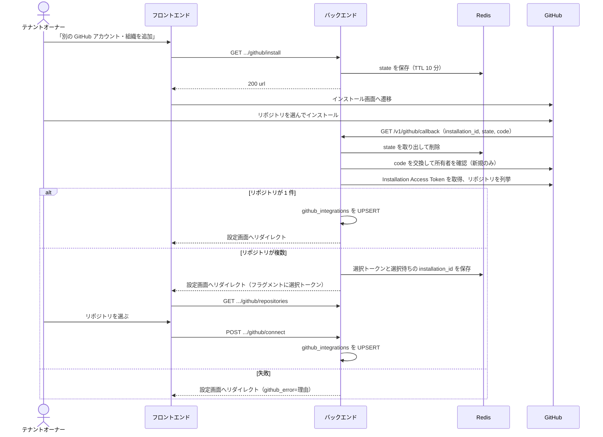

## 概要

個人 OAuth トークンではなく GitHub Apps を使い、プロジェクトと GitHub リポジトリを接続する基盤である。利用者のアカウントに依存せず、org 単位で権限を管理できる。このページは GitHub App のインストールとコールバックの処理、Installation Access Token の取得、GitHub Webhook の受信エンドポイント、GitHub Issue の取り込みと同期の入口を扱う。PR・コミット・ブランチとタスクのリンクは [Git ホスティング連携](/dev/features/tasks/github-tasks)に書く。

## 振る舞い

### セットアップの流れ

連携は、設定画面の「別の GitHub アカウント・組織を追加」から始まる。バックエンドが発行した `state` を付けて GitHub のインストール画面へ移り、GitHub が callback へ戻す。callback は `state` と installation の所有者を確かめ、見えるリポジトリが 1 件ならそのまま連携し、複数なら選択トークンを発行して設定画面の選択 UI へ渡す。

各段階の動作は次のとおりである。

1. テナントオーナーが設定画面で開始し、フロントが `GET /v1/tenants/{tid}/projects/{pid}/github/install` を呼ぶ。
2. バックエンドが CSRF 対策の `state`（32 バイト乱数、URL-safe base64）を生成し、Redis に `{ tenant_id, project_id, user_id, installation_id }` を値として保存する（TTL 10 分）。`installation_id` はプロジェクトが連携済みのときだけ入る。応答はインストール URL `https://github.com/apps/{APP_NAME}/installations/new?state={state}` で、フロントがそこへ遷移する。
3. リポジトリを選んでインストールすると、GitHub が `GET /v1/github/callback?installation_id=12345&state={state}&code={code}` へ戻す。`code` は GitHub App 側で「Request user authorization (OAuth) during installation」を有効にしていると付く。無効だと手順 6 の所有者確認ができず連携が止まる。`setup_action=request`（オーナーの承認待ち）はインストールが未完了なので 400 で拒否する。
4. バックエンドが `state` を検証する。Redis に無い・期限切れなら 400 を返す。取り出すと同時に削除して再利用を防ぎ、`{ tenant_id, project_id, user_id }` を復元する。
5. セッションの利用者が `state` の `user_id` と一致するか確認する（不一致は 403）。続けてテナントオーナーであることと、プロジェクトがそのテナントにあることも確かめる。
6. installation の所有者を確認する。詳細は[所有者の確認](#所有者の確認)の小節に書く。
7. `installation_id` を検証して Installation Access Token を取得する。失敗時の戻り先は[設定画面へ戻す理由](#設定画面へ戻す理由)の小節に書く。
8. installation が見えるリポジトリを列挙する。1 件ならそのまま連携先に決めて手順 9 へ進む。複数なら連携レコードは作らず、選択トークン（32 バイト乱数）を Redis に保存する（値は `{ tenant_id, project_id, user_id, installation_id }`、TTL 10 分）。設定画面へ `?...#github_select={token}` 付きでリダイレクトし、選択 UI に任せる。
9. トークンを AES-256-GCM で暗号化して DB に保存する（`project_id` で `github_integrations` を UPSERT）。
10. フロントの設定画面へリダイレクトする。

### 所有者の確認

installation の所有者の確認は、新しく束縛するときだけ行う。

- `code` を GitHub App の Client ID / Client secret でユーザーアクセストークンに交換し、`GET /user/installations` に `installation_id` が含まれるかを見る
- 束縛先が既に決まっているときは省く。`state` に載せた連携済みの ID、このプロジェクトの選択待ちの ID、同じテナントが使用中のインストールの 3 つである

### 設定画面へ戻す理由

callback の失敗は `?...&github_error=<理由>` を付けて設定画面へ戻す。理由は次のとおりである。

| 理由 | 起きるとき | 対処 |
|---|---|---|
| `installation_forbidden` | `GET /user/installations` に含まれない、または `code` が無効 | 自分がアクセスできるアカウント / Organization へ入れ直す |
| `installation_authorization_required` | `code` そのものが無い | App 設定でユーザー認可を有効にする。入れ直しても直らないので理由を分ける |
| `github_unavailable` | 交換や照会が通信レベルで失敗した、または GitHub API 自体が応答しない | 再試行する |
| `installation_rejected` | `installation_id` の検証に落ちた（`state` に束縛された ID と不一致、選択待ちの ID も切れた古いインストール） | GitHub 側で入れ直す |
| `installation_gone` | GitHub 側から消えている（404 / 410） | アンインストールする対象が無いので、別のアカウント・組織への追加を案内する |
| `no_repositories` | 見えるリポジトリが 0 件 | 連携先を選びようがない |

### 同じインストールの共有

GitHub App のインストールはアカウント単位で 1 つなので、同じ org の別リポジトリを別プロジェクトへ連携すると、同一 `installation_id` を複数の `github_integrations` 行が持つ。

- callback は、同じテナントの別プロジェクトが既に使っているインストールなら鮮度チェックを免除する
- 連携解除は、他のプロジェクトがまだ使っている間は GitHub 側のアンインストールを行わない
- `github_integrations` を変更する経路（UPSERT と解除）は、すべて `installation_id` をキーにした Postgres の transaction-scoped advisory lock で直列化する
- 別の installation へ付け替える UPSERT は新旧両方の ID を昇順にロックする

### 既存インストールの再利用

同じ Organization を別プロジェクトで使うとき、GitHub のインストール画面へ進むと既存アプリの管理画面になり、callback に戻らないことがある。戻り先は App 設定の Redirect on update などに依存する。そこで「連携する」は、まず `GET /github/installations` で同じテナントの連携行から候補を出す。

- 候補は `installation_id` 単位で重複排除し、最初の連携行を代表（`source_integration_id`）にする。表示名は代表行の `repo_owner` である
- 他テナントの連携や App 全体のインストール一覧は出さない
- 候補を選ぶと `POST /github/reuse` がその行を再取得してテナント所属を確かめ、サーバー側で `installation_id` を解決する。リクエストの `installation_id` は受け取らない
- GitHub で Installation Access Token を取れることを確かめてから、callback と同じ選択トークン（TTL 10 分）を発行し、以降は `GET /github/repositories`、`POST /github/connect` の経路に乗せる
- 使用中の連携から来ているので、鮮度チェックや新しい `code` は求めない。この経路では 1 件でも自動接続せず選ばせる
- GitHub 側で消えていれば（404 / 410）`410`、一時障害は `5xx` で再試行させ、再利用元の連携行は消さない
- 候補を取れたことだけでは認可済みとせず、`POST` のたびにテナントオーナーと所属を確かめる

### 選択トークン

- `installation_id` は選択トークン側（Redis）に束縛し、リクエストでは受け取らない
- 送られてきた `repo_owner` / `repo_name` が、その installation の可視範囲に含まれることを検証する
- 受け渡しは 3 通りである。callback はフラグメント（`#github_select=`）で渡し、一覧取得は `X-Github-Select-Token` ヘッダーで受け、確定（`POST /github/connect`）はリクエストボディで受ける
- 一覧取得（`GET /github/repositories`）では消さない。選び直せるようにするためである
- 確定では、検証をすべて通した後・DB を更新する直前に、Redis 上で原子的に取り上げる（GET + PTTL + DEL）。同じトークンでの `POST` が同時に来ても、取れた 1 本だけが DB 更新へ進む
- DB 更新に失敗したときは、取り上げた時点の残り TTL のまま書き戻す。有効期限は延ばさない
- 書き戻し自体に失敗するとトークンは失われるが、選択待ちの `installation_id` は残っているので、インストールをやり直せば選択画面に戻れる

### 確定時の再確認

`POST /github/connect` と callback の自動接続の UPSERT は、advisory lock を取ったあとに Installation Access Token を取り直し、それを保存する。

- 解除が先なら GitHub が 404 を返して `400` で止まる
- 一時障害なら `5xx` のまま選択トークンを戻して再試行できる
- callback の自動接続でこの取り直しに失敗したときは、素のエラーを返さず設定画面へ戻す。消えていれば `installation_gone`、一時障害なら installation を保存したうえで `github_unavailable` である。保存してあるので、state の鮮度が切れたあとの再試行も弾かれない

### GitHub App の権限

必要な権限は次のとおりである。

| 権限 | レベル | 用途 |
|---|---|---|
| Contents | Read | コミット読み取り |
| Issues | Read & Write | Issue の取り込みと、タスク側の変更の書き戻し |
| Pull requests | Read & Write | PR 読み取りとレビュー指摘の要約コメント。ユーザー認可のトークンで、マージ可の PR をレビュワー本人の名義で Approve し、未解決の High / Medium がある PR に変更要求を出す（[レビュー指摘の要約コメントと Approve](/dev/features/review-findings/github-comment)） |
| Metadata | Read | リポジトリ情報 |

App 設定の Subscribe to events で購読するイベントは次のとおりである。

| イベント | 用途 |
|---|---|
| Issues | Issue の同期 |
| Push | コミットのリンク（TASK-140） |
| Pull request | PR のリンク（TASK-220） |
| Create / Delete | ブランチのリンク（TASK-291） |

既存の App に Pull request の購読を足すときは、App の設定画面（Developer settings、GitHub Apps、対象 App、Permissions & events の順に開く）で Subscribe to events の Pull request にチェックを入れて保存する。

- Pull requests の権限は既に付与済みなので、権限は増えず、既存インストールのオーナーによる再承認は要らない。権限を増やした場合は、オーナーが承認するまで新しいイベントは届かない
- 購読前に作られた PR は、次に何らかのイベント（編集・push・クローズなど）が届いた時点でリンクされる

Create / Delete の購読も同じ画面で Create と Delete にチェックを入れて保存する。

- どちらも Contents: Read の範囲なので権限は増えず、再承認は要らない
- 購読前に作られたブランチはリンクされない。ブランチの作成イベントは再送されない。PR を開けば head ブランチ名は PR のリンクで拾われる

### アップグレード時の作業

この機能を既に有効にしている環境では、次の 2 つを済ませないとバックエンドが起動しない。設定の検証で落ちる。

1. GitHub App の設定で Request user authorization (OAuth) during installation を有効にする。無効だと callback に `code` が付かず、新規の連携が `installation_authorization_required` で止まる
2. `GITHUB_APP_CLIENT_ID` / `GITHUB_APP_CLIENT_SECRET`（App 設定ページの Client ID / Client secret）を環境変数に足す

### トークンの管理

GitHub API を呼ぶ処理は、呼ぶたびに GitHub App の秘密鍵で Installation Access Token を取り直して使う（`service::github::sync::installation_token`）。Issue の取り込みと書き戻し、PR とコミットの取得、要約コメントのどれも同じである。

`github_integrations.access_token_enc` / `token_expires_at` は連携の確定時の UPSERT で書くだけで、以後は読まれず更新もされない。保存済みのトークンは期限（発行から 1 時間）を過ぎた値のまま残る。トークンを API レスポンスで返すことはない。

### Webhook の受信

`POST /v1/github/webhook` は公開エンドポイントで、次の順に処理する。

1. `X-Hub-Signature-256` ヘッダーを HMAC-SHA256 で検証する。ヘッダーが無い・不一致なら `403` を返す。
2. `X-GitHub-Event` でイベント種別を識別する。`push` / `pull_request` / `create` / `delete` は受信時に正規化し、形が想定と違えば `400` を返す。`issues` などのイベントと、処理しない action（`labeled` 等）・タグの `create` / `delete` は正規化しない。
3. ペイロードの `installation.id` で `github_integrations` を検索する。`repository` があれば `repo_owner` / `repo_name` でも絞る。同じリポジトリを複数プロジェクトへ連携していれば、該当する連携ごとにジョブを 1 つ作る。
4. `X-GitHub-Delivery` があれば受信記録とジョブ投入を 1 トランザクションで確定する。再送は何も積まない。ヘッダーが無ければ再送を見分けられないのでそのまま積む。
5. `200` を返す。該当する連携が無いときもログを残して `200` を返す。

ジョブ（`job::github_webhook`）は、正規化したイベントをタスクへのリンクとして処理し（[Git ホスティング連携の Webhook](/dev/features/tasks/github-tasks/webhook)）、`issues` イベントをタスクへ反映する。それ以外のイベントは受信のログだけを残す。

### Issue の取り込みと同期

取り込みは `POST /github/import` でジョブを積み、ジョブが非同期に進める。以降の Issue の変更は webhook で反映される。タスク側の変更は `pending_push` のフラグを立てて書き戻しジョブが GitHub へ送り、積めなかった分は 5 分ごとのスイープが拾う。

取り込み・webhook による新規作成はアクティビティに「GitHub Issue（owner/repo#N）からタスクを作成しました」（`github_issue_imported`）、既存タスクへの変更反映は「GitHub Issue（owner/repo#N）からタスクを同期しました」（`github_issue_synced`）と出す。システム操作としてタスク更新と同時に記録し、同じ内容や古い通知では追加しない（[コメント・アクティビティ](/dev/features/tasks/collaboration)のイベント定義）。

重複の実行は `POST /github/import` のプロジェクト単位のロック（Redis の `github:import:lock:{project_id}`）で止める。

- ロックを取れたときだけジョブを積む。取れなかったときはジョブを積まずに 409 Conflict を返す
- Redis に触れないときはロックなしでジョブを積む
- ロックの値には取得ごとのランダムトークンを保存し、ジョブが取り込みを終えた時点でトークンが一致するときだけ、成否によらず解放する
- ワーカーが落ちて解放されなかった場合に備えて TTL 15 分で必ず明ける
- 連携解除時には、再連携を妨げないよう現在のロックを破棄する

連携先のリポジトリを別のものへ変えると、そのプロジェクトの `github_issue_links` を連携の更新と同じトランザクションで消す。

### 選択待ちのインストール

選択 UI で選ばずに離脱するとトークンが TTL で切れ、GitHub 側にはインストールだけが残る。そこで選択待ちの `installation_id` を `github_pending_install:{project_id}`（Redis、TTL 24 時間）に保存する。

- callback がこの ID と一致する installation を受け取ったときだけ、新規インストール扱いの鮮度チェック（state の TTL 内に作成されたもののみ）を免除する
- 一致しなければ通常の新規インストール判定に戻すので、別のインストールへ乗り換えられる
- 連携が確定したときと連携解除のときは消す。消すときは「保存している ID が指定のものと一致するときだけ削除」を Redis 上で 1 操作として行う

## データ

`github_integrations` の列は次のとおりである。

| 列 | 型 | 制約 | 説明 |
|---|---|---|---|
| `id` | UUID | PK | |
| `project_id` | UUID | NOT NULL, UNIQUE, FK→projects CASCADE | プロジェクト 1 つにつき 1 リポジトリ |
| `installation_id` | BIGINT | NOT NULL | GitHub App のインストール ID |
| `repo_owner` | VARCHAR | NOT NULL | 例は `myorg` |
| `repo_name` | VARCHAR | NOT NULL | 例は `myapp` |
| `access_token_enc` | TEXT | NOT NULL | 連携の確定時に取得した Installation Access Token を AES-256-GCM で暗号化した値。以後は読まれない |
| `token_expires_at` | TIMESTAMPTZ | NOT NULL | 上のトークンの有効期限。以後は読まれない |
| `created_by` | UUID | NOT NULL, FK→users | |
| `created_at` | TIMESTAMPTZ | NOT NULL DEFAULT now() | |

`github_issue_links` の列は次のとおりである。取り込んだ Issue とタスクの 1 対 1 の対応で、取り込み（`POST .../github/import`）と `issues` webhook で作り・更新し、タスク側の変更の書き戻しにも使う（`service::github::sync`）。

| 列 | 型 | 制約 | 説明 |
|---|---|---|---|
| `id` | UUID | PK | |
| `project_id` | UUID | NOT NULL, FK→projects CASCADE | |
| `integration_id` | UUID | NOT NULL, FK→github_integrations CASCADE | 連携を解除するとリンクも消える |
| `task_id` | UUID | NOT NULL, UNIQUE, FK→tasks CASCADE | |
| `github_number` | INT | NOT NULL | `(project_id, github_number)` で UNIQUE |
| `synced_hash` | VARCHAR | NOT NULL | 直前に同期したタイトル・本文・開閉状態のハッシュ。同じ内容の再適用・書き戻しを止める |
| `github_updated_at` | TIMESTAMPTZ | NOT NULL | 最後に適用した Issue の `updated_at`。これ以前のイベントは捨てる |
| `pending_push` | BOOLEAN | NOT NULL DEFAULT false | タスク側の変更を GitHub へ書き戻す待ち |
| `updated_at` | TIMESTAMPTZ | NOT NULL DEFAULT now() | 行の版。同期・書き戻し・書き戻し要求で進む |
| `github_state` | VARCHAR | NOT NULL DEFAULT `'unknown'` | `synced_hash` と同じ同期で保存した Issue の開閉状態（`open` / `closed`）。取り込み・webhook の適用と書き戻しで埋め、列追加前の行は次の同期まで `unknown`。タスクのステータスからは推定しない |
| `last_synced_at` | TIMESTAMPTZ | NULL | 最後に GitHub と揃えた時刻。取り込み・webhook の適用と書き戻しの成功でだけ進み、書き戻し要求では進まない。列追加前の行は次の同期まで NULL |

タスク詳細の「取り込み元」表示（[Git ホスティング連携の API](/dev/features/tasks/github-tasks#api) の `issue`）はこの行から組む。

定義は次の migration にある。

- [m20260520000000_initial_schema.rs](https://github.com/koyori-app/task/blob/main/apps/backend/migration/src/m20260520000000_initial_schema.rs): `github_integrations`
- [m20260818010000_github_issue_links.rs](https://github.com/koyori-app/task/blob/main/apps/backend/migration/src/m20260818010000_github_issue_links.rs): `github_issue_links`
- [m20261017010000_github_issue_links_state.rs](https://github.com/koyori-app/task/blob/main/apps/backend/migration/src/m20261017010000_github_issue_links_state.rs): `github_state` / `last_synced_at`

## API

| メソッド | パス | 説明 |
|---|---|---|
| GET | `/v1/tenants/{tid}/projects/{pid}/github/install` | インストール開始。state を生成してインストール URL を返す（`{ "url": "https://github.com/apps/{APP_NAME}/installations/new?state=xxx" }`） |
| GET | `/v1/github/callback` | GitHub App インストールコールバック。セッション必須、state 検証あり |
| POST | `/v1/github/webhook` | GitHub Webhook 受信。公開、署名検証あり |
| GET | `/v1/tenants/{tid}/projects/{pid}/github/integration` | 連携状態の取得。token は返さない |
| DELETE | `/v1/tenants/{tid}/projects/{pid}/github/integration` | 連携解除（204） |
| GET | `/v1/tenants/{tid}/projects/{pid}/github/repositories` | 選択トークン（`X-Github-Select-Token` ヘッダー）に紐づく installation のリポジトリ一覧。トークンは消費しない |
| POST | `/v1/tenants/{tid}/projects/{pid}/github/connect` | 選択したリポジトリで連携（204）。成功時にトークンを破棄する。検証で弾いたときは残すので選び直せる |
| GET | `/v1/tenants/{tid}/projects/{pid}/github/installations` | 同じテナントで利用中のインストール。再利用候補で、`installation_id` 単位で重複排除する |
| POST | `/v1/tenants/{tid}/projects/{pid}/github/reuse` | 候補からリポジトリ選択を開始して選択トークンを返す（`Cache-Control: no-store`）。連携行はまだ作らない |
| POST | `/v1/tenants/{tid}/projects/{pid}/github/import` | 連携リポジトリの Issue の取り込み開始。ジョブを積んで 202 を返す |

表に書けない規則は次のとおりである。

- `POST /github/connect` は `select_token` / `repo_owner` / `repo_name` を受ける。プロジェクトが連携済みなら、同じ installation のトークンでなければ 400 を返す
- `repo_owner` / `repo_name` が installation の列挙結果に含まれなければ `400` を返す
- `POST /github/reuse` は `source_integration_id` を受ける。403 は非オーナー、404 は別テナント・存在しない再利用元、410 は GitHub 側で削除済みで、いずれも選択トークンを発行しない
- `GET /github/installations` の 0 件は空配列である
- `GET /github/integration` は未連携なら `connected: false` だけを返す
- `POST /github/import` はロックを取れないとき 409 を返す

## 認可

| 操作 | 誰が | スコープ |
|---|---|---|
| `/v1/tenants/...` 配下のすべて | テナントオーナー。セッション認証を要求し、PAT では使えない | なし |
| `GET /v1/github/callback` | `state` の `user_id` と一致するセッションの利用者で、テナントオーナー | なし |
| `POST /v1/github/webhook` | 公開。署名で検証する | なし |

### 脅威と対策

| 脅威 | 対策 |
|---|---|
| CSRF（インストール誤連携） | `state` パラメータを Redis で管理する（TTL 10 分、コールバック後に即削除）。開始した利用者と callback の利用者の一致も確認する |
| インストール先プロジェクトの誤連携 | state に `{ tenant_id, project_id }` を紐付けて保存し、callback 時に復元して UPSERT する |
| 他人のインストールの紐付け | `installation_id` はリクエストで受け取らず、選択トークン（Redis）に束縛する。トークンの `{ tenant_id, project_id, user_id }` とリクエスト経路・セッションの一致も確認する |
| callback への他人の `installation_id` の差し込み | インストール時のユーザー認可で受け取った `code` をユーザーアクセストークンに交換し、`GET /user/installations` に当該 `installation_id` が含まれることを確認する。含まれなければ `installation_forbidden` で拒否する。User インストールと Organization インストールのどちらも同じ経路で確かめられる |
| 他テナントのインストールの再利用 | `POST /github/reuse` は `installation_id` を受け取らず、`source_integration_id` の行を対象テナントのプロジェクトに限って再取得して解決する。候補一覧も対象テナントの連携行だけから作る |
| 選択トークンのアクセスログ流出 | callback はフラグメントで渡し、一覧取得はヘッダー、確定はリクエストボディで受け取る。URL には載せない |
| 可視範囲外リポジトリの連携 | `repo_owner` / `repo_name` が installation の列挙結果に含まれることを検証する。含まれなければ `400` |
| Webhook 偽装 | `X-Hub-Signature-256` を HMAC-SHA256 で検証する。不一致は即 `403` |
| Installation Access Token の漏洩 | DB では AES-256-GCM で暗号化する。API レスポンスでは一切返さない |
| Token 期限切れ | API を呼ぶたびに取り直すので、保存したトークンの期限に左右されない |

## 画面

| 項目 | 値 |
|---|---|
| URL | `/{tenant_slug}/projects/{project_key}/settings?section=integrations` |
| 入口 | プロジェクト設定の「連携」セクション。専用ページは無い |
| コンポーネント | `IntegrationsSection`（`apps/frontend/src/components/projects/IntegrationsSection.vue`） |

連携済みのときは、GitHub の行にリポジトリ名と連携日、右側に「Issue を取り込む」「連携を解除」を並べる。

| 状態 | 表示 |
|---|---|
| 未連携 | 「連携する」ボタン。押すと `GET /github/installations` の候補（同じテナントで利用中のアカウント・組織）と「別の GitHub アカウント・組織を追加」を出す。後者だけが `GET /github/install` の URL へ遷移する。候補の取得に失敗しても自動では遷移せず、再試行を出す |
| 連携済み | リポジトリ名と連携日、「Issue を取り込む」「連携を解除」 |

### Issue の取り込みのボタン

- 「Issue を取り込む」は `POST /github/import` を呼ぶだけで、完了は待たず「Issue の取り込みを開始しました」とだけ伝える
- 開始に成功したあとは 60 秒間ボタンを塞ぎ、ラベルを「取り込み中…」にする。開始に失敗したときは塞がず、すぐ再試行できる
- 連携が切れたとき・連携先リポジトリが変わったときは、取り込みの結果表示とこの待ち時間をリセットする。解除操作ではなく連携状態の変化で判定する
- 画面の待ち時間はブラウザのローカル状態で、リロード・画面の再訪・別タブでは消える
- 409 Conflict には「Issue の取り込みは既に実行中です」と出す

### リポジトリの選択

インストール後に `?section=integrations#github_select={token}` で戻ってきた場合は、`GET /github/repositories` の結果を並べて 1 件選ばせ、`POST /github/connect` で確定する。一覧の上に `owner/name` の部分一致で絞り込む入力欄を置く。絞り込みはクライアント側のみで行う。

フラグメントは Vike の client entry（`src/pages/+client.ts`）で読み、`sessionStorage` へ退避する。ハイドレーション時の history 書き換えで URL から落ちる。受け取りは `src/lib/github-select-token.ts` に寄せてある。

候補を選ぶと `POST /github/reuse` で選択トークンを受け取り、同じ選択 UI に進む。GitHub へは遷移しない。トークンは callback 経由のものと同じくタブ内（`sessionStorage`）に保持する。選択の途中で「別の GitHub アカウント・組織を追加」から callback で戻ったときは、戻ってきたトークンでそれまでの選択を上書きする。

選択の途中で起きることへの動作は次のとおりである。

- 選択トークンが切れたら（400）、出ている候補から同じものを選び直せば `POST /github/reuse` で再開できる。入れ直しは要らない。ページを再訪した場合も「連携する」から候補を選べば再開できる
- 再利用元の連携が解除されていたら（404）候補を取り直す
- GitHub 側で削除済み（410）なら、別のアカウント・組織の追加を案内する
- 一時障害（5xx）は候補とトークンを残して押し直させる
- リポジトリが 0 件、または目的のものが無いときは「GitHub でアクセス対象を追加」と「再読み込み」を出す
- 「GitHub でアクセス対象を追加」は `GET /github/install` の URL を別タブで開き、元のタブの選択状態は残す。対象アカウント・組織の Configure からリポジトリを追加・保存してもらう。GitHub 側から callback は来ないので、元のタブの「再読み込み」で最新の一覧を取り直して続ける。App 設定の Redirect on update には依存しない
- 選ばずに離れた場合はトークンが TTL で切れ、未連携の表示に戻る
- 接続できたら連携状態を取り直し、候補・選択 UI・トークン・エラー表示を片付ける

## 未実装と既知の制限

- インストール内で自分に権限の無いリポジトリの連携を防げない。選択候補は installation access token で列挙しているので、org の一部リポジトリしか権限が無いメンバーにも、そのインストールが見える全リポジトリ名が出る。ユーザーアクセストークンで `GET /user/installations/{installation_id}/repositories` を引いて絞る必要がある
- 所有者確認の導入前からある `github_integrations` 行は鮮度チェックだけで作られている。確認済みの前提の対象外なので、必要に応じて既存行を別途監査する

## 決定の記録

| 日付 | 決定 | 理由 |
|---|---|---|
| 2026-05-27 | 個人 OAuth トークンではなく GitHub Apps を使う | インストールベースなので利用者のアカウントに依存せず、org 単位で権限を管理できる |
| 2026-05-27 | インストールの callback を `state` で守る | callback は公開エンドポイントなので、攻撃者が細工した `installation_id` を含む URL を踏ませて誤連携させる CSRF が成立しうる。Redis で管理し、正規の開始フローを経たリクエストのみを受け付ける |
| 2026-08-20 | `installation_id` をリクエストで受け取らず選択トークンに束縛する | インストールはアカウント単位で 1 つなので 1 org に複数リポジトリを含むインストールが普通に発生する。直接受け取ると、他人のインストール ID を送るだけで自分のプロジェクトへ紐付けられる |
| 2026-08-20 | 同じテナントの別プロジェクトが使っているインストールは鮮度チェックを免除し、変更経路を advisory lock で直列化する | そのテナントが正規に入れたものだと分かっている。共有判定が連携・解除の同時実行でずれないようにする |
| 2026-08-20 | 選択待ちの `installation_id` を `github_pending_install` に保存し、一致するときだけ鮮度チェックを免除する | 保存しないと、選択を放棄したインストールへは GitHub から App を消すまで二度と戻れない |
| 2026-08-21 | 選択トークンはクエリではなくフラグメントで渡す | クエリだと frontend / CDN のアクセスログにトークンが残る。フラグメントは次の HTTP リクエストに乗らない。ブラウザ履歴には一時的に残るが、frontend が読んだ直後に URL から落とす |
| 2026-08-21 | 確定時に選択トークンを原子的に取り上げる | 同じトークンの同時 `POST` で連携先が後勝ちで入れ替わらないようにする |
| 2026-08-21 | 選択待ちの ID の削除は比較と削除を 1 操作にする | 比較してから削除するまでの間に別のフローが新しい installation を保存すると、古い処理が新しい値を消してしまう |
| 2026-08-22 | 一覧取得は選択トークンをヘッダーで受け、確定はボディで受ける | callback がフラグメントで渡すのはクエリだと frontend / CDN のアクセスログと Referer に残るからで、クエリに載せ直すと backend とその手前のプロキシのアクセスログに残り、手当てが最後まで効かない |
| 2026-08-22 | 束縛先が決まっているときは所有者確認を省く | 確認の導入後に作られた束縛は、どれも確認済みの callback からしか生まれない。`code` を要求すると、リポジトリを足して戻る・選び直すといった復旧の動線が、GitHub が `code` を付け直すかどうかに左右される |
| 2026-08-22 | 取り込みの開始後に 60 秒間ボタンを塞ぐ | 202 が返るのはジョブを積んだ時点なので、連打するとリポジトリの Issue 全ページ取得が押した回数だけ積まれる。タスクは冪等に処理されるが、GitHub API のレート制限とワーカー時間は消費される |
| 2026-08-22 | 取り込みの待ち時間のリセットは連携状態の変化で判定する | 別タブや他の利用者が解除した場合も含める |
| 2026-08-22 | 重複の実行はサーバー側のプロジェクト単位のロックで止める | 画面の待ち時間はリロードや別タブで消える |
| 2026-08-23 | ロックの解放はトークンの一致を確かめて行う | TTL を超えた古いジョブが後続のロックを消さないようにする |
| 2026-09-02 | フラグメントは Vike の client entry で読む | フラグメントはサーバーへ送られず `pageContext` にも現れない。連携セクションは設定ページがテナント / プロジェクトの ID を API で解決し終わるまでマウントされないので、セクション自身の `onMounted` で読むと間に合わず、選択 UI が出ないまま「連携する」ボタンだけが残る（本番で発生） |
| 2026-09-11 | 同じテナントの連携行から候補を出す再利用の経路を置く。リクエストの `installation_id` は受け取らない | インストール画面へ進んでも callback に戻らないことがある。信頼する範囲は callback の「同じテナントが使用中のインストール」と同じ |
| 2026-09-11 | 確定時にロックの内側で GitHub を確かめる | 検証をロックの外で済ませると、その後に「最後の参照の解除」が同じロック下でアンインストールと行削除を終え、消えた installation を指す連携行だけが残る |
| 2026-09-11 | callback で戻ったトークンでそれまでの選択を上書きする | 古い方を優先すると新しいアカウント・組織を選べず、古い方が期限切れなら新しい方まで一緒に捨ててしまう |
| 2026-10-17 | ブランチの Create / Delete を購読に足す | ブランチのリンクに要る。購読前のブランチはリンクされないが、PR を開けば head ブランチ名は PR のリンクで拾われる |
| 2026-11-04 | 連携先を変えると `github_issue_links` を消す | 残すと、書き戻しや再取り込みが新しいリポジトリの同じ番号の Issue を上書きする（日付は不明） |
| 2026-11-04 | Redis に触れないときはロックなしでジョブを積む | 重複防止は認可ではないので、API を落とさない（日付は不明） |
| 2026-11-04 | 連携済みのプロジェクトには同じ installation のトークンしか受けない | 別タブに残った古いトークンで連携先が巻き戻らないようにする（日付は不明） |
