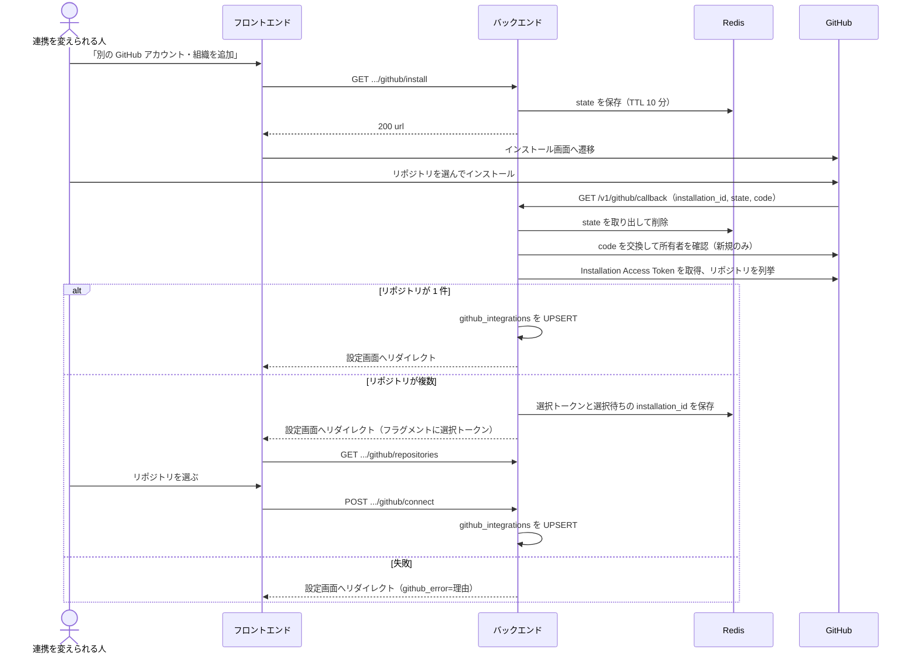

## 概要

個人 OAuth トークンではなく GitHub Apps を使い、プロジェクトと GitHub リポジトリを接続する基盤である。利用者のアカウントに依存せず、org 単位で権限を管理できる。このページは GitHub App のインストールとコールバックの処理、Installation Access Token の取得、GitHub Webhook の受信エンドポイント、GitHub Issue の取り込みと同期の入口、本文に貼ったパーマリンクが指すコードの抜粋の取得を扱う。PR・コミット・ブランチとタスクのリンクは [Git ホスティング連携](/dev/features/tasks/github-tasks)に書く。

## 振る舞い

### セットアップの流れ

連携は、設定画面の「別の GitHub アカウント・組織を追加」から始まる。バックエンドが発行した `state` を付けて GitHub のインストール画面へ移り、GitHub が callback へ戻す。callback は `state` と installation の所有者を確かめ、見えるリポジトリが 1 件ならそのまま連携し、複数なら選択トークンを発行して設定画面の選択 UI へ渡す。

各段階の動作は次のとおりである。

1. 連携を変えられる人（テナントオーナー、プロジェクト `Admin`、そのプロジェクトに入れるテナント `Admin`。[認可](#認可)）が設定画面で開始し、フロントが `GET /v1/tenants/{tid}/projects/{pid}/github/install` を呼ぶ。
2. バックエンドが CSRF 対策の `state`（32 バイト乱数、URL-safe base64）を生成し、Redis に `{ tenant_id, project_id, user_id, installation_id }` を値として保存する（TTL 10 分）。`installation_id` はプロジェクトが連携済みのときだけ入る。応答はインストール URL `https://github.com/apps/{APP_NAME}/installations/new?state={state}` で、フロントがそこへ遷移する。
3. リポジトリを選んでインストールすると、GitHub が `GET /v1/github/callback?installation_id=12345&state={state}&code={code}` へ戻す。`code` は GitHub App 側で「Request user authorization (OAuth) during installation」を有効にしていると付く。無効だと手順 6 の所有者確認ができず連携が止まる。`setup_action=request`（オーナーの承認待ち）はインストールが未完了なので 400 で拒否する。
4. バックエンドが `state` を検証する。Redis に無い・期限切れなら 400 を返す。取り出すと同時に削除して再利用を防ぎ、`{ tenant_id, project_id, user_id }` を復元する。
5. セッションの利用者が `state` の `user_id` と一致するか確認する（不一致は 403）。続けて、その利用者が今も連携を変えられる人であることと、プロジェクトがそのテナントにあることも確かめる。
6. installation の所有者を確認する。詳細は[所有者の確認](#所有者の確認)の小節に書く。
7. `installation_id` を検証して Installation Access Token を取得する。失敗時の戻り先は[設定画面へ戻す理由](#設定画面へ戻す理由)の小節に書く。
8. installation が見えるリポジトリを列挙する。1 件ならそのまま連携先に決めて手順 9 へ進む。複数なら連携レコードは作らず、選択トークン（32 バイト乱数）を Redis に保存する（値は `{ tenant_id, project_id, user_id, installation_id }`、TTL 10 分）。設定画面へ `?...#github_select={token}` 付きでリダイレクトし、選択 UI に任せる。
9. トークンを AES-256-GCM で暗号化して DB に保存する（`project_id` で `github_integrations` を UPSERT）。
10. フロントの設定画面へリダイレクトする。

### 所有者の確認

installation の所有者の確認は、新しく束縛するときだけ行う。

- `code` を GitHub App の Client ID / Client secret でユーザーアクセストークンに交換し、`GET /user/installations` に `installation_id` が含まれるかを見る
- 束縛先が既に決まっているときは省く。`state` に載せた連携済みの ID、このプロジェクトの選択待ちの ID、同じテナントが使用中のインストール（本人が連携を変えられるプロジェクトのもの）の 3 つである

### 設定画面へ戻す理由

callback の失敗は `?...&github_error=<理由>` を付けて設定画面へ戻す。理由は次のとおりである。

| 理由 | 起きるとき | 対処 |
|---|---|---|
| `installation_forbidden` | `GET /user/installations` に含まれない、または `code` が無効 | 自分がアクセスできるアカウント / Organization へ入れ直す |
| `installation_authorization_required` | `code` そのものが無い | App 設定でユーザー認可を有効にする。入れ直しても直らないので理由を分ける |
| `github_unavailable` | 交換や照会が通信レベルで失敗した、または GitHub API 自体が応答しない | 再試行する |
| `installation_rejected` | `installation_id` の検証に落ちた（`state` に束縛された ID と不一致、選択待ちの ID も切れた古いインストール） | GitHub 側で入れ直す |
| `installation_gone` | GitHub 側から消えている（404 / 410） | アンインストールする対象が無いので、別のアカウント・組織への追加を案内する |
| `no_repositories` | 見えるリポジトリが 0 件 | 連携先を選びようがない |
| `authorization_denied` | ユーザー認可の callback に `code` が無い（利用者が GitHub の画面で拒否して `error` が付いた場合を含む）、または `code` が無効 | 「インストール済みのアカウント・組織を GitHub で確認」からやり直す |
| `no_installations` | ユーザー認可の callback で、利用者が見えるインストールが 0 件 | 「別の GitHub アカウント・組織を追加」からインストールする |

callback がどちらの経路かは、クエリの `installation_id` の有無ではなく `state` の種別で決める。`GET /github/install` が作る `state` はインストールの経路で、`installation_id` が無ければ `400` を返す。`GET /github/authorize` が作る `state` はユーザー認可の経路で、クエリの `installation_id` は読まない。`authorization_denied` と `no_installations` はユーザー認可の経路だけが返し、`github_unavailable` は両方の経路が返す。

### 同じインストールの共有

GitHub App のインストールはアカウント単位で 1 つなので、同じ org の別リポジトリを別プロジェクトへ連携すると、同一 `installation_id` を複数の `github_integrations` 行が持つ。

- callback は、同じテナントの別プロジェクトが既に使っているインストールなら鮮度チェックを免除する
- 連携解除は、他のプロジェクトがまだ使っている間は GitHub 側のアンインストールを行わない
- `github_integrations` を変更する経路（UPSERT と解除）は、すべて `installation_id` をキーにした Postgres の transaction-scoped advisory lock で直列化する
- 別の installation へ付け替える UPSERT は新旧両方の ID を昇順にロックする

### 既存インストールの再利用

同じ Organization を別プロジェクトで使うとき、GitHub のインストール画面へ進むと既存アプリの管理画面になり、callback に戻らないことがある。戻り先は App 設定の Redirect on update などに依存する。そこで「連携する」は、まず `GET /github/installations` で、同じテナントの連携行のうち本人が連携を変えられるプロジェクトのものから候補を出す。

- 候補は `installation_id` 単位で重複排除し、最初の連携行を代表（`source_integration_id`）にする。表示名は代表行の `repo_owner` である
- 他テナントの連携や App 全体のインストール一覧は出さない
- 本人が連携を変えられないプロジェクトの連携行は、候補にも再利用元にもしない。テナントオーナーは全部の連携行を使える。callback が「同じテナントが使用中」として所有者の確認を省くのも、同じ絞り込みを通った連携行があるときだけである
- 候補を選ぶと `POST /github/reuse` がその行を再取得してテナント所属を確かめ、サーバー側で `installation_id` を解決する。リクエストの `installation_id` は受け取らない
- GitHub で Installation Access Token を取れることを確かめてから、callback と同じ選択トークン（TTL 10 分）を発行し、以降は `GET /github/repositories`、`POST /github/connect` の経路に乗せる
- 使用中の連携から来ているので、鮮度チェックや新しい `code` は求めない。この経路では 1 件でも自動接続せず選ばせる
- GitHub 側で消えていれば（404 / 410）`410`、一時障害は `5xx` で再試行させ、再利用元の連携行は消さない
- 候補を取れたことだけでは認可済みとせず、`POST` のたびに連携を変えられる人であることと所属を確かめる

### 他のテナントで連携済みのインストールの連携

再利用の候補は同じテナントの連携行だけから作るので、別のテナントで連携済みのアカウント・組織は候補に出ない。そのアカウント・組織には App が入っているので、インストール画面へ進んでも GitHub は既存のインストールの設定画面を出すだけである。callback に戻っても、作成から 10 分を超えたインストールは鮮度チェックで `installation_rejected` になる。そこで、インストール画面を通らずに GitHub のユーザー認可で利用者を確かめる経路を置く。

1. 「インストール済みのアカウント・組織を GitHub で確認」が `GET /github/authorize` を呼ぶ。backend は種別がユーザー認可の `state`（`{ tenant_id, project_id, user_id }`、TTL 10 分）を保存し、`https://github.com/login/oauth/authorize?client_id=...&state=...` を返す。`redirect_uri` は付けないので、GitHub は App に登録した Callback URL の 1 件目（`/v1/github/callback`）へ戻す
2. callback は `code` をユーザーアクセストークンに交換し、`GET /user/installations` でその利用者が見えるインストールを引く。それぞれの表示名（インストール先のアカウント・組織）を App の JWT で引き、候補ごとに `candidate_id`（UUID）を振る
3. 候補とユーザーアクセストークンを認可トークン（Redis の `github_authorized_installations:{token}`、TTL 10 分）に保存し、フラグメント（`#github_installations=`）で設定画面へ戻す
4. 画面は `GET /github/authorized-installations` で候補（`candidate_id` と表示名）を引き、利用者が 1 つ選ぶ
5. `POST /github/authorized-installations/select` が下の条件を確かめ、callback や再利用と同じ選択トークンを発行する。以降は `GET /github/repositories`、`POST /github/connect` の経路に乗せる

選択トークンを発行する条件は次のとおりである。

- そのインストールが `GET /user/installations` に含まれる。callback で確かめ、認可トークンの候補に入っているものだけを選べる
- インストールが見えるリポジトリが 1 件以上あり、その全部に利用者が admin 権限を持つ。発行の直前に毎回、Installation Access Token で引いた一覧と、ユーザーアクセストークンで引いた `GET /user/installations/{installation_id}/repositories` の `permissions.admin` を突き合わせる。owner と name は大文字小文字を区別せずに比べ、`permissions` が無いリポジトリは admin でないものとして扱う
- 両方の一覧を全件読み切れている。一覧の取得は 100 件 × 100 ページで止まるので、インストール側は GitHub の `total_count` と件数が一致することを確かめ、ユーザー側は総数に届かないまま終わったらエラーにする。読み切れていない一覧では認可しない。リポジトリが 10,000 件を超えるインストールは、この経路では連携できない

全部の admin を求めるのは、連携後はインストールが見える全リポジトリから連携先を選べ、同じテナントの中の再利用でも選べるからである。1 件でも admin でないリポジトリがあると、利用者が GitHub 上で読めないリポジトリのコードや Issue を Task から読める。Organization のオーナーと個人アカウントの本人は通り、一部のリポジトリだけ admin のメンバーは通らない。

- `installation_id` はリクエストで受け取らない。`candidate_id` で認可トークンの候補から引く
- 認可トークンは `{ tenant_id, project_id, user_id }` を持つ。2 つの API は、セッションの利用者とパスとの一致、連携を変えられる人であること、プロジェクトの所属を毎回確かめる
- ユーザーアクセストークンは AES-256-GCM で暗号化して認可トークンの中にだけ置く。DB、ジョブ、ログ、レスポンス、URL には出さない
- 認可トークンは一覧でも選択でも消さない。GitHub の一時障害のあとに同じトークンで選び直せる。期限は TTL だけで切れる
- 連携行を作るのは既存の経路（`POST /github/connect`）だけである。この経路は選択トークンを発行するところまでを受け持つ
- 選択トークンを発行したあとで GitHub 側の権限が変わっても、確定では確かめ直さない。新規インストールや再利用と同じく、発行時点の確認で足りるとする

### 選択トークン

- `installation_id` は選択トークン側（Redis）に束縛し、リクエストでは受け取らない
- 送られてきた `repo_owner` / `repo_name` が、その installation の可視範囲に含まれることを検証する
- 受け渡しは 3 通りである。callback はフラグメント（`#github_select=`）で渡し、一覧取得は `X-Github-Select-Token` ヘッダーで受け、確定（`POST /github/connect`）はリクエストボディで受ける
- 一覧取得（`GET /github/repositories`）では消さない。選び直せるようにするためである
- 確定では、検証をすべて通した後・DB を更新する直前に、Redis 上で原子的に取り上げる（GET + PTTL + DEL）。同じトークンでの `POST` が同時に来ても、取れた 1 本だけが DB 更新へ進む
- DB 更新に失敗したときは、取り上げた時点の残り TTL のまま書き戻す。有効期限は延ばさない
- 書き戻し自体に失敗するとトークンは失われるが、選択待ちの `installation_id` は残っているので、インストールをやり直せば選択画面に戻れる

### 確定時の再確認

`POST /github/connect` と callback の自動接続の UPSERT は、advisory lock を取ったあとに Installation Access Token を取り直し、それを保存する。

- 解除が先なら GitHub が 404 を返して `400` で止まる
- 一時障害なら `5xx` のまま選択トークンを戻して再試行できる
- callback の自動接続でこの取り直しに失敗したときは、素のエラーを返さず設定画面へ戻す。消えていれば `installation_gone`、一時障害なら installation を保存したうえで `github_unavailable` である。保存してあるので、state の鮮度が切れたあとの再試行も弾かれない

### GitHub App の権限

必要な権限は次のとおりである。

| 権限 | レベル | 用途 |
|---|---|---|
| Contents | Read | コミット読み取り、コードの抜粋（ファイル本文の読み取り） |
| Issues | Read & Write | Issue の取り込みと、タスク側の変更の書き戻し |
| Pull requests | Read & Write | PR 読み取りとレビュー指摘の要約コメント。ユーザー認可のトークンで、マージ可の PR をレビュワー本人の名義で Approve し、未解決の High / Medium がある PR に変更要求を出す（[レビュー指摘の要約コメントと Approve](/dev/features/review-findings/github-comment)） |
| Metadata | Read | リポジトリ情報 |

App 設定の Subscribe to events で購読するイベントは次のとおりである。

| イベント | 用途 |
|---|---|
| Issues | Issue の同期 |
| Push | コミットのリンク（TASK-140） |
| Pull request | PR のリンク（TASK-220） |
| Create / Delete | ブランチのリンク（TASK-291） |

既存の App に Pull request の購読を足すときは、App の設定画面（Developer settings、GitHub Apps、対象 App、Permissions & events の順に開く）で Subscribe to events の Pull request にチェックを入れて保存する。

- Pull requests の権限は既に付与済みなので、権限は増えず、既存インストールのオーナーによる再承認は要らない。権限を増やした場合は、オーナーが承認するまで新しいイベントは届かない
- 購読前に作られた PR は、次に何らかのイベント（編集・push・クローズなど）が届いた時点でリンクされる

Create / Delete の購読も同じ画面で Create と Delete にチェックを入れて保存する。

- どちらも Contents: Read の範囲なので権限は増えず、再承認は要らない
- 購読前に作られたブランチはリンクされない。ブランチの作成イベントは再送されない。PR を開けば head ブランチ名は PR のリンクで拾われる

### アップグレード時の作業

この機能を既に有効にしている環境では、次の 2 つを済ませないとバックエンドが起動しない。設定の検証で落ちる。

1. GitHub App の設定で Request user authorization (OAuth) during installation を有効にする。無効だと callback に `code` が付かず、新規の連携が `installation_authorization_required` で止まる
2. `GITHUB_APP_CLIENT_ID` / `GITHUB_APP_CLIENT_SECRET`（App 設定ページの Client ID / Client secret）を環境変数に足す

### トークンの管理

GitHub API を呼ぶ処理は、呼ぶたびに GitHub App の秘密鍵で Installation Access Token を取り直して使う（`service::github::sync::installation_token`）。Issue の取り込みと書き戻し、PR とコミットの取得、要約コメント、コードの抜粋のどれも同じである。コードの抜粋だけは結果を Redis に置き、同じ抜粋の 2 回目以降はトークンを取り直さない。

`github_integrations.access_token_enc` / `token_expires_at` は連携の確定時の UPSERT で書くだけで、以後は読まれず更新もされない。保存済みのトークンは期限（発行から 1 時間）を過ぎた値のまま残る。トークンを API レスポンスで返すことはない。

### コードの抜粋

タスクの説明、コメント、ドキュメント、レビュー指摘の本文に GitHub のパーマリンク（コミット SHA と行範囲つきの blob URL）だけの段落があると、画面はリンクの代わりにその行をコードの抜粋として出す。描画の規則は [KFM の描画](/dev/frontend/kfm-phase1-implementation)に書く。行は `GET /v1/github/snippet` が連携リポジトリから取る。

1. クエリ（`owner` / `repo` / `sha` / `path` / `start` / `end`）を検査する。`sha` は 40 桁の 16 進だけを受け、ブランチ名と短縮 SHA は 400 にする。`path` は `/` で区切った各区分が空・`.`・`..`・制御文字を含まないこと、全体が 1,024 バイト以下であることを確かめる。`end` を省くと `start` の 1 行になる
2. `owner` / `repo` を連携しているプロジェクトの連携行を、大文字小文字を区別せずに古い順で 20 件まで引く。引くのは利用者に関わりのあるプロジェクト（オーナーかメンバーであるテナントのプロジェクトと、`project_members` に行があるプロジェクト）に限る。これは候補の絞り込みで、入れるかどうかは候補ごとに確かめる。利用者が入れるプロジェクトの連携行が見つかるまで順に確かめ、最初に見つかった行を使う。1 件も無ければ 404 を返す
3. Redis に同じ抜粋の結果があればそれを返す。キーは `github:snippet:v1:{installation_id}:{owner}/{repo}@{sha}:{start}-{end}:{path}` である。コミット SHA を指定しているので中身は変わらない
4. 無ければ、そのインストールの取得を止めている間かを見る。止めていれば 503 と残りの秒数の `Retry-After` を返し、GitHub へは取りに行かない
5. 利用者ごとの取得回数を 1 つ数える。10 分で 60 回を超えていれば 429 を返し、GitHub へは取りに行かない
6. Installation Access Token を取り、`GET /repos/{owner}/{repo}/contents/{path}?ref={sha}` を呼ぶ。`owner` / `repo` はクエリの値ではなく連携行の値を使う。タイムアウトは 10 秒、応答として読む量は 2 MiB までである
7. 応答の本文を UTF-8 として読み、求められた行を切り出して、結果を Redis に置く

行の切り出しの規則は次のとおりである。

- 行末の `\r` は落とす。ファイル末尾の改行の後ろは行に数えない
- `end` がファイルの行数を超えていれば行数に丸める。`start` が行数を超えていれば 404 を返す
- 200 行、または 48,000 文字（UTF-16 の符号単位。行ごとの改行 1 つを含む）に達したら打ち切り、`truncated: true` を返す。`end_line` は実際に返した最後の行である
- バイナリ（UTF-8 として読めない本文）、1 MiB を超えるファイル（Contents API が本文を返さない）、1 行目が文字数の上限を超えるファイルは 422 を返す
- ファイルが無いとき、パスがディレクトリ・シンボリックリンク・サブモジュールのときは 404 を返す

GitHub 側の失敗は、インストール全体に及ぶものと、その要求だけのものに分けて扱う。インストール全体に及ぶ失敗では、そのインストールの取得を止める（キーは `github:snippet:pause:{installation_id}`）。その要求だけの失敗で止めると、1 つのリポジトリの失敗が、同じインストールを使うほかのリポジトリ・プロジェクト・テナントの抜粋まで止めるので、止めない。

| 失敗 | 範囲 | 応答 | 覚え方 |
|---|---|---|---|
| Contents API の 429 | インストール | 503 | インストールを止める |
| Contents API の 403 で、`Retry-After` がある、または `x-ratelimit-remaining` が 0 | インストール（レート制限） | 503 | インストールを止める |
| Contents API の 403 で、どちらも無いが、本文の `message` が `rate limit` を含む（二次レート制限） | インストール（レート制限） | 503 | インストールを止める |
| Contents API の 5xx | インストール | 503 | インストールを止める |
| 接続の失敗 | インストール | 503 | インストールを止める |
| Installation Access Token の取得の失敗（404 / 410 以外の応答、送信の失敗） | インストール | 503 | インストールを止める |
| Installation Access Token の取得が 404 / 410（インストールが GitHub 側から消えている） | インストール | 404 | 抜粋のキーに 10 分 |
| Contents API の 403 で上のどれでもないもの（GitHub 側でブロックされたリポジトリなど） | その要求 | 404 | 抜粋のキーに 10 分 |
| Contents API のそのほかの 4xx（400 / 401 / 422 / 451 など） | その要求 | 404 | 抜粋のキーに 10 分 |
| タイムアウト（10 秒）、応答の本文の読み取りの失敗 | その要求（一時的） | 503（`Retry-After` は覚えている残りの秒数） | 抜粋のキーに 60 秒。既に結果があれば上書きしない |
| Installation Access Token の取得の、GitHub へ届く前の失敗（App の秘密鍵で署名できないなど） | backend の不具合 | 500 | 覚えない |

インストールを止める時間は次の順で決め、1 秒から 1 時間に丸める。

1. 応答の `Retry-After` の秒数（二次レート制限と 5xx が付ける）
2. `x-ratelimit-remaining` が 0 なら、`x-ratelimit-reset`（Unix 秒）までの秒数。一次レート制限は `Retry-After` を付けない。reset が読めなければ次へ進む
3. どちらも無ければ 60 秒

止める期限は延ばすだけで、縮めない。止めているかの確認から GitHub の応答までの間に同じインストールの取得が並行して進むので、後から届いた短い失敗（既定の 60 秒）で、先に届いた長い期限を上書きしないようにする。残りの秒数との比較と更新は Redis の Lua で 1 操作にし、503 の `Retry-After` には更新後に残っている秒数を返す。

抜粋の結果を覚える場所は次の 3 つである。見せてよいかは backend の認可が決めるので、認可を通らずに結果が返る経路を短く保つ。

| 場所 | 持ち主 | 取れた抜粋 | 取れなかった結果 | 権限を外したとき |
|---|---|---|---|---|
| ブラウザーの HTTP キャッシュ | ブラウザーのプロファイル（利用者を区別しない） | 置かない。応答は拒否も含めて `Cache-Control: no-store` で、画面の fetch も `cache: 'no-store'` にする | 置かない | 残るものが無い |
| 画面のメモリ（`remark-kfm-permalink/element.ts` の Map） | 開いているページ。読み直しとログアウトで消える | 取得の開始から 5 分（壁時計で数える。巻き戻って開始より前になったら取り直す） | 置かない | 表示済みの抜粋はそのまま残る。新しい表示は長くて 5 分後に取り直し、404 ならリンクになる |
| Redis | インストール。読むのは認可の後だけ | 24 時間 | 404 と 422 を 10 分、タイムアウトなどその要求の一時的な失敗を 60 秒。インストール全体に及ぶ失敗は置かず、インストール単位で止める | リクエストのたびに認可を通すので、すぐ 404 になる |

### Webhook の受信

`POST /v1/github/webhook` は公開エンドポイントで、次の順に処理する。

1. `X-Hub-Signature-256` ヘッダーを HMAC-SHA256 で検証する。ヘッダーが無い・不一致なら `403` を返す。
2. `X-GitHub-Event` でイベント種別を識別する。`push` / `pull_request` / `create` / `delete` は受信時に正規化し、形が想定と違えば `400` を返す。`issues` などのイベントと、処理しない action（`labeled` 等）・タグの `create` / `delete` は正規化しない。
3. ペイロードの `installation.id` で `github_integrations` を検索する。`repository` があれば `repo_owner` / `repo_name` でも絞る。同じリポジトリを複数プロジェクトへ連携していれば、該当する連携ごとにジョブを 1 つ作る。
4. `X-GitHub-Delivery` があれば受信記録とジョブ投入を 1 トランザクションで確定する。再送は何も積まない。ヘッダーが無ければ再送を見分けられないのでそのまま積む。
5. `200` を返す。該当する連携が無いときもログを残して `200` を返す。

ジョブ（`job::github_webhook`）は、正規化したイベントをタスクへのリンクとして処理し（[Git ホスティング連携の Webhook](/dev/features/tasks/github-tasks/webhook)）、`issues` イベントをタスクへ反映する。それ以外のイベントは受信のログだけを残す。

### Issue の取り込みと同期

取り込みは `POST /github/import` でジョブを積み、ジョブが非同期に進める。以降の Issue の変更は webhook で反映される。タスク側の変更は `pending_push` のフラグを立てて書き戻しジョブが GitHub へ送り、積めなかった分は 5 分ごとのスイープが拾う。

取り込み・webhook による新規作成はアクティビティに「GitHub Issue（owner/repo#N）からタスクを作成しました」（`github_issue_imported`）、既存タスクへの変更反映は「GitHub Issue（owner/repo#N）からタスクを同期しました」（`github_issue_synced`）と出す。システム操作としてタスク更新と同時に記録し、同じ内容や古い通知では追加しない（[コメント・アクティビティ](/dev/features/tasks/collaboration)のイベント定義）。

重複の実行は `POST /github/import` のプロジェクト単位のロック（Redis の `github:import:lock:{project_id}`）で止める。

- ロックを取れたときだけジョブを積む。取れなかったときはジョブを積まずに 409 Conflict を返す
- Redis に触れないときはロックなしでジョブを積む
- ロックの値には取得ごとのランダムトークンを保存し、ジョブが取り込みを終えた時点でトークンが一致するときだけ、成否によらず解放する
- ワーカーが落ちて解放されなかった場合に備えて TTL 15 分で必ず明ける
- 連携解除時には、再連携を妨げないよう現在のロックを破棄する

連携先のリポジトリを別のものへ変えると、そのプロジェクトの `github_issue_links` を連携の更新と同じトランザクションで消す。

### 選択待ちのインストール

選択 UI で選ばずに離脱するとトークンが TTL で切れ、GitHub 側にはインストールだけが残る。そこで選択待ちの `installation_id` を `github_pending_install:{project_id}`（Redis、TTL 24 時間）に保存する。

- callback がこの ID と一致する installation を受け取ったときだけ、新規インストール扱いの鮮度チェック（state の TTL 内に作成されたもののみ）を免除する
- 一致しなければ通常の新規インストール判定に戻すので、別のインストールへ乗り換えられる
- 連携が確定したときと連携解除のときは消す。消すときは「保存している ID が指定のものと一致するときだけ削除」を Redis 上で 1 操作として行う

## データ

`github_integrations` の列は次のとおりである。

| 列 | 型 | 制約 | 説明 |
|---|---|---|---|
| `id` | UUID | PK | |
| `project_id` | UUID | NOT NULL, UNIQUE, FK→projects CASCADE | プロジェクト 1 つにつき 1 リポジトリ |
| `installation_id` | BIGINT | NOT NULL | GitHub App のインストール ID |
| `repo_owner` | VARCHAR | NOT NULL | 例は `myorg` |
| `repo_name` | VARCHAR | NOT NULL | 例は `myapp` |
| `access_token_enc` | TEXT | NOT NULL | 連携の確定時に取得した Installation Access Token を AES-256-GCM で暗号化した値。以後は読まれない |
| `token_expires_at` | TIMESTAMPTZ | NOT NULL | 上のトークンの有効期限。以後は読まれない |
| `created_by` | UUID | NOT NULL, FK→users | |
| `created_at` | TIMESTAMPTZ | NOT NULL DEFAULT now() | |

`github_issue_links` の列は次のとおりである。取り込んだ Issue とタスクの 1 対 1 の対応で、取り込み（`POST .../github/import`）と `issues` webhook で作り・更新し、タスク側の変更の書き戻しにも使う（`service::github::sync`）。

| 列 | 型 | 制約 | 説明 |
|---|---|---|---|
| `id` | UUID | PK | |
| `project_id` | UUID | NOT NULL, FK→projects CASCADE | |
| `integration_id` | UUID | NOT NULL, FK→github_integrations CASCADE | 連携を解除するとリンクも消える |
| `task_id` | UUID | NOT NULL, UNIQUE, FK→tasks CASCADE | |
| `github_number` | INT | NOT NULL | `(project_id, github_number)` で UNIQUE |
| `synced_hash` | VARCHAR | NOT NULL | 直前に同期したタイトル・本文・開閉状態のハッシュ。同じ内容の再適用・書き戻しを止める |
| `github_updated_at` | TIMESTAMPTZ | NOT NULL | 最後に適用した Issue の `updated_at`。これ以前のイベントは捨てる |
| `pending_push` | BOOLEAN | NOT NULL DEFAULT false | タスク側の変更を GitHub へ書き戻す待ち |
| `updated_at` | TIMESTAMPTZ | NOT NULL DEFAULT now() | 行の版。同期・書き戻し・書き戻し要求で進む |
| `github_state` | VARCHAR | NOT NULL DEFAULT `'unknown'` | `synced_hash` と同じ同期で保存した Issue の開閉状態（`open` / `closed`）。取り込み・webhook の適用と書き戻しで埋め、列追加前の行は次の同期まで `unknown`。タスクのステータスからは推定しない |
| `last_synced_at` | TIMESTAMPTZ | NULL | 最後に GitHub と揃えた時刻。取り込み・webhook の適用と書き戻しの成功でだけ進み、書き戻し要求では進まない。列追加前の行は次の同期まで NULL |

タスク詳細の「取り込み元」表示（[Git ホスティング連携の API](/dev/features/tasks/github-tasks#api) の `issue`）はこの行から組む。

定義は次の migration にある。

- [m20260520000000_initial_schema.rs](https://github.com/koyori-app/task/blob/main/apps/backend/migration/src/m20260520000000_initial_schema.rs): `github_integrations`
- [m20260818010000_github_issue_links.rs](https://github.com/koyori-app/task/blob/main/apps/backend/migration/src/m20260818010000_github_issue_links.rs): `github_issue_links`
- [m20261017010000_github_issue_links_state.rs](https://github.com/koyori-app/task/blob/main/apps/backend/migration/src/m20261017010000_github_issue_links_state.rs): `github_state` / `last_synced_at`

## API

| メソッド | パス | 説明 |
|---|---|---|
| GET | `/v1/tenants/{tid}/projects/{pid}/github/install` | インストール開始。state を生成してインストール URL を返す（`{ "url": "https://github.com/apps/{APP_NAME}/installations/new?state=xxx" }`） |
| GET | `/v1/github/callback` | GitHub App のインストールとユーザー認可のコールバック。セッション必須、state 検証あり。経路は state の種別で決める |
| POST | `/v1/github/webhook` | GitHub Webhook 受信。公開、署名検証あり |
| GET | `/v1/github/snippet` | 連携リポジトリのコードの抜粋。クエリは `owner` / `repo` / `sha` / `path` / `start` / `end`（`end` は省略可） |
| GET | `/v1/tenants/{tid}/projects/{pid}/github/integration` | 連携状態の取得。`can_manage` で、見ている本人が連携を変えられるかを返す。token は返さない |
| DELETE | `/v1/tenants/{tid}/projects/{pid}/github/integration` | 連携解除（204） |
| GET | `/v1/tenants/{tid}/projects/{pid}/github/repositories` | 選択トークン（`X-Github-Select-Token` ヘッダー）に紐づく installation のリポジトリ一覧。トークンは消費しない |
| POST | `/v1/tenants/{tid}/projects/{pid}/github/connect` | 選択したリポジトリで連携（204）。成功時にトークンを破棄する。検証で弾いたときは残すので選び直せる |
| GET | `/v1/tenants/{tid}/projects/{pid}/github/installations` | 同じテナントで利用中のインストール。再利用候補で、`installation_id` 単位で重複排除する |
| POST | `/v1/tenants/{tid}/projects/{pid}/github/reuse` | 候補からリポジトリ選択を開始して選択トークンを返す（`Cache-Control: no-store`）。連携行はまだ作らない |
| GET | `/v1/tenants/{tid}/projects/{pid}/github/authorize` | ユーザー認可の開始。state を生成して GitHub のユーザー認可の URL を返す（`{ "url": "https://github.com/login/oauth/authorize?client_id=xxx&state=xxx" }`） |
| GET | `/v1/tenants/{tid}/projects/{pid}/github/authorized-installations` | 認可トークン（`X-Github-Authorize-Token` ヘッダー）に紐づく、利用者が見えるインストール。`candidate_id` と表示名を返す（`Cache-Control: no-store`）。トークンは消費しない |
| POST | `/v1/tenants/{tid}/projects/{pid}/github/authorized-installations/select` | 候補からリポジトリ選択を開始して選択トークンを返す（`Cache-Control: no-store`）。連携行はまだ作らない |
| POST | `/v1/tenants/{tid}/projects/{pid}/github/import` | 連携リポジトリの Issue の取り込み開始。ジョブを積んで 202 を返す |

表に書けない規則は次のとおりである。

- `POST /github/connect` は `select_token` / `repo_owner` / `repo_name` を受ける。プロジェクトが連携済みなら、同じ installation のトークンでなければ 400 を返す
- `repo_owner` / `repo_name` が installation の列挙結果に含まれなければ `400` を返す
- `POST /github/reuse` は `source_integration_id` を受ける。403 は連携を変えられない人、404 は別テナント・存在しない・本人が連携を変えられないプロジェクトの再利用元、410 は GitHub 側で削除済みで、いずれも選択トークンを発行しない
- `GET /github/installations` の 0 件は空配列である
- `GET /github/authorized-installations` の 400 は、ヘッダーが無い、認可トークンが無い（期限切れを含む）、パスのテナント・プロジェクトがトークンと違う場合である。403 は非オーナーと、トークンの利用者がセッションの利用者と違う場合である
- `POST /github/authorized-installations/select` は `authorize_token` / `candidate_id` を受ける。400 は上の一覧と同じ条件と、候補に無い `candidate_id`、ユーザーアクセストークンが無効（GitHub が 401）の場合である。403 の `message` が `forbidden` なら非オーナーか利用者の不一致、`github-installation-admin-required` なら admin でないリポジトリがある（利用者からインストールが見えなくなった場合を含む）。409 の `message` が `github-installation-no-repositories` ならインストールが見えるリポジトリが 0 件、`github-installation-repositories-incomplete` なら一覧を全件読み切れなかった（10,000 件を超える場合など）。410 は GitHub 側で削除済みである。いずれも選択トークンを発行しない。GitHub の一時障害は `5xx` で、認可トークンは残るので同じトークンで再試行できる
- `GET /github/integration` は未連携なら `connected: false` と `can_manage` だけを返す
- `POST /github/import` はロックを取れないとき 409 を返す
- `GET /v1/github/snippet` は `repo_owner` / `repo_name` / `sha` / `path` / `start_line` / `end_line` / `lines` / `truncated` を返す。400 はクエリの形式が不正、403 は PAT、404 は未連携・権限なし・ファイルなし・行がファイルの外・GitHub がその要求を拒否（レート制限でない 403 など）、422 は行として表示できないファイル、429 は取得回数の上限、503 は GitHub 側の失敗（`Retry-After` つき、`message` は `github-unavailable`）である。GitHub App が未設定の環境では 404 を返す

## 認可

| 操作 | 誰が | スコープ |
|---|---|---|
| `GET /v1/tenants/{tid}/projects/{pid}/github/integration` | プロジェクトに入れる人。セッション認証を要求し、PAT では使えない。`can_manage` で連携を変えられるかを返す | なし |
| それ以外の `/v1/tenants/...` 配下 | テナントオーナー、プロジェクト `Admin`、そのプロジェクトに入れるテナント `Admin`（個人プロジェクトはテナント `Admin` を通さない）。Webhook の管理と同じ人である。セッション認証を要求し、PAT では使えない | なし |
| `GET /v1/github/callback` | `state` の `user_id` と一致するセッションの利用者で、上の行と同じ人 | なし |
| `POST /v1/github/webhook` | 公開。署名で検証する | なし |
| `GET /v1/github/snippet` | そのリポジトリを連携しているプロジェクトのどれかに入れる利用者（テナントオーナー、メンバー、プロジェクトのゲスト）。セッションまたは Device Token を要求し、PAT では使えない。テナントが 2FA を強制していれば 2FA も要る | なし |

### 脅威と対策

| 脅威 | 対策 |
|---|---|
| CSRF（インストール誤連携） | `state` パラメータを Redis で管理する（TTL 10 分、コールバック後に即削除）。開始した利用者と callback の利用者の一致も確認する |
| インストール先プロジェクトの誤連携 | state に `{ tenant_id, project_id }` を紐付けて保存し、callback 時に復元して UPSERT する |
| 他人のインストールの紐付け | `installation_id` はリクエストで受け取らず、選択トークン（Redis）に束縛する。トークンの `{ tenant_id, project_id, user_id }` とリクエスト経路・セッションの一致も確認する |
| callback への他人の `installation_id` の差し込み | インストール時のユーザー認可で受け取った `code` をユーザーアクセストークンに交換し、`GET /user/installations` に当該 `installation_id` が含まれることを確認する。含まれなければ `installation_forbidden` で拒否する。User インストールと Organization インストールのどちらも同じ経路で確かめられる |
| 他テナントのインストールの再利用 | `POST /github/reuse` は `installation_id` を受け取らず、`source_integration_id` の行を対象テナントのプロジェクトに限って再取得して解決する。候補一覧も対象テナントの連携行だけから作る |
| 管理できないプロジェクトのインストールの借用 | 再利用の候補・再利用元・callback の使用中の判定は、本人が連携を変えられるプロジェクトの連携行だけを根拠にする。インストールからは GitHub 側の組織のリポジトリがまとめて見えるので、絞らないと、入れないプロジェクトが使う組織のリポジトリを自分のプロジェクトへ連携して抜粋と Issue を読める |
| 別テナントのインストールを、権限の無い利用者が連携する | ユーザー認可の経路で選択トークンを発行するのは、`GET /user/installations` にそのインストールが含まれ、インストールが見える全リポジトリに利用者が admin 権限を持つときだけである。`installation_id` は受け取らず、認可トークンに束縛した `candidate_id` で引く。認可トークンの `{ tenant_id, project_id, user_id }` とリクエスト経路・セッションの一致も確認する |
| ユーザーアクセストークンの漏洩 | AES-256-GCM で暗号化し、Redis の認可トークン（TTL 10 分）の中にだけ置く。DB、ジョブ、ログ、レスポンス、URL には出さない |
| 選択トークン・認可トークンのアクセスログ流出 | callback はフラグメントで渡し、一覧取得はヘッダー、選択と確定はリクエストボディで受け取る。URL には載せない |
| 可視範囲外リポジトリの連携 | `repo_owner` / `repo_name` が installation の列挙結果に含まれることを検証する。含まれなければ `400` |
| Webhook 偽装 | `X-Hub-Signature-256` を HMAC-SHA256 で検証する。不一致は即 `403` |
| Installation Access Token の漏洩 | DB では AES-256-GCM で暗号化する。API レスポンスでは一切返さない |
| Token 期限切れ | API を呼ぶたびに取り直すので、保存したトークンの期限に左右されない |
| コードの抜粋による、権限の無いリポジトリの読み出し | 取得先は連携行の `repo_owner` / `repo_name` に限り、インストールが見えるほかのリポジトリは読めない。連携行のプロジェクトに入れるかをリクエストのたびに確かめ、Redis の抜粋もその後でしか返さない。未連携と権限なしはどちらも 404 で、連携の有無を区別できない |
| コードの抜粋のパスによる別の API の呼び出し | `path` の区分から `.` と `..` と空を弾き、URL は区分ごとに符号化して組む（文字列の連結で埋めない）。`sha` は 40 桁の 16 進に限る |
| コードの抜粋による GitHub API のレート制限の消費 | 取れた抜粋を 24 時間、取れなかった結果（404・422）を 10 分 Redis に置くので、壊れたパーマリンクを開くたびには取りに行かない。Redis に無い抜粋の取得は利用者ごとに 10 分で 60 回までにする。GitHub がレート制限（429、`Retry-After` か残り 0 の付いた 403、本文がレート制限を知らせる 403）か 5xx を返したら、そのインストールの取得を `Retry-After`、無ければ `x-ratelimit-reset` まで、どちらも無ければ 60 秒止める。期限は並行した失敗で縮めない |
| 1 つのリポジトリの失敗で、同じインストールのほかの抜粋が止まる | インストールを止めるのはインストール全体に及ぶ失敗に限る。レート制限でない 403 と、そのほかの 4xx は、その抜粋だけを 404 として覚える。タイムアウトもその抜粋だけを 60 秒止める |
| コードの抜粋が、同じブラウザーの次の利用者や権限を外された利用者に出る | 応答は URL が同じでも利用者で変わるので、拒否も含めて `Cache-Control: no-store` にし、ブラウザーの HTTP キャッシュに置かない。画面のメモリに覚える時間は 5 分にする |

## 画面

| 項目 | 値 |
|---|---|
| URL | `/{tenant_slug}/projects/{project_key}/settings?section=integrations` |
| 入口 | プロジェクト設定の「連携」セクション。専用ページは無い |
| コンポーネント | `IntegrationsSection`（`apps/frontend/src/components/projects/IntegrationsSection.vue`） |

連携済みのときは、GitHub の行にリポジトリ名と連携日、右側に「Issue を取り込む」「連携を解除」を並べる。

| 状態 | 表示 |
|---|---|
| 未連携 | 「連携する」ボタン。押すと `GET /github/installations` の候補（同じテナントで利用中のアカウント・組織）と「別の GitHub アカウント・組織を追加」を出す。「別の GitHub アカウント・組織を追加」は `GET /github/install` の URL へ、「インストール済みのアカウント・組織を GitHub で確認」は `GET /github/authorize` の URL へ遷移する。候補の取得に失敗しても自動では遷移せず、再試行を出す |
| 未連携で、ユーザー認可から戻った直後 | 「GitHub で確認したアカウント・組織」のパネルに、`GET /github/authorized-installations` の候補と「これを使う」を出す。選ぶとリポジトリの選択へ進む。認可トークンが切れたとき（400 / 403）はトークンを捨てて確認のやり直しを案内し、admin 権限の不足・リポジトリ 0 件・全件を確認できない・削除済みはそれぞれの文言を出す。一時障害ではトークンを捨てず、同じ候補を選び直せる |
| 連携済み | リポジトリ名と連携日、「Issue を取り込む」「連携を解除」 |

連携を変えられない人（`can_manage` が偽）にも状態は見せる。「連携する」「Issue を取り込む」「連携を解除」は disabled にし、連携の設定を変えられる人を 1 行で伝える。候補とリポジトリの選択のパネルは出さない。

### Issue の取り込みのボタン

- 「Issue を取り込む」は `POST /github/import` を呼ぶだけで、完了は待たず「Issue の取り込みを開始しました」とだけ伝える
- 開始に成功したあとは 60 秒間ボタンを塞ぎ、ラベルを「取り込み中…」にする。開始に失敗したときは塞がず、すぐ再試行できる
- 連携が切れたとき・連携先リポジトリが変わったときは、取り込みの結果表示とこの待ち時間をリセットする。解除操作ではなく連携状態の変化で判定する
- 画面の待ち時間はブラウザのローカル状態で、リロード・画面の再訪・別タブでは消える
- 409 Conflict には「Issue の取り込みは既に実行中です」と出す

### リポジトリの選択

インストール後に `?section=integrations#github_select={token}` で戻ってきた場合は、`GET /github/repositories` の結果を並べて 1 件選ばせ、`POST /github/connect` で確定する。一覧の上に `owner/name` の部分一致で絞り込む入力欄を置く。絞り込みはクライアント側のみで行う。

フラグメントは Vike の client entry（`src/pages/+client.ts`）で読み、`sessionStorage` へ退避する。ハイドレーション時の history 書き換えで URL から落ちる。受け取りは `src/lib/github-select-token.ts` に寄せてある。

候補を選ぶと `POST /github/reuse` で選択トークンを受け取り、同じ選択 UI に進む。GitHub へは遷移しない。トークンは callback 経由のものと同じくタブ内（`sessionStorage`）に保持する。選択の途中で「別の GitHub アカウント・組織を追加」から callback で戻ったときは、戻ってきたトークンでそれまでの選択を上書きする。

選択の途中で起きることへの動作は次のとおりである。

- 選択トークンが切れたら（400）、出ている候補から同じものを選び直せば `POST /github/reuse` で再開できる。入れ直しは要らない。ページを再訪した場合も「連携する」から候補を選べば再開できる
- 再利用元の連携が解除されていたら（404）候補を取り直す
- GitHub 側で削除済み（410）なら、別のアカウント・組織の追加を案内する
- 一時障害（5xx）は候補とトークンを残して押し直させる
- リポジトリが 0 件、または目的のものが無いときは「GitHub でアクセス対象を追加」と「再読み込み」を出す
- 「GitHub でアクセス対象を追加」は `GET /github/install` の URL を別タブで開き、元のタブの選択状態は残す。対象アカウント・組織の Configure からリポジトリを追加・保存してもらう。GitHub 側から callback は来ないので、元のタブの「再読み込み」で最新の一覧を取り直して続ける。App 設定の Redirect on update には依存しない
- 選ばずに離れた場合はトークンが TTL で切れ、未連携の表示に戻る
- 接続できたら連携状態を取り直し、候補・選択 UI・トークン・エラー表示を片付ける

## 未実装と既知の制限

- インストール内で自分に権限の無いリポジトリの連携を防げない。選択候補は installation access token で列挙しているので、org の一部リポジトリしか権限が無いメンバーにも、そのインストールが見える全リポジトリ名が出る。ユーザーアクセストークンで `GET /user/installations/{installation_id}/repositories` を引いて絞る必要がある。ユーザー認可の経路（他のテナントで連携済みのインストールの連携）だけは、全リポジトリの admin を確かめるのでこの制限に当たらない
- ユーザー認可の経路の選択は、GitHub が 403 を返すと一時障害として `5xx` にする。403 はレート制限と区別できないためである。停止中（サスペンド）のインストールのように 403 が続く候補では、何度選んでも「選べませんでした」のままになり、理由は画面に出ない。`POST /github/reuse` も同じ扱いである
- 所有者確認の導入前からある `github_integrations` 行は鮮度チェックだけで作られている。確認済みの前提の対象外なので、必要に応じて既存行を別途監査する
- コードの抜粋は、同じリポジトリを連携していて利用者に関わりのあるプロジェクトのうち、古い順の 20 件しか確かめない。その 20 件のどれにも入れず、21 件目以降にだけ入れる利用者には 404 になる（同じテナントで、メンバーを限定したプロジェクト 20 件以上が同じリポジトリを連携している場合）
- コードの抜粋は連携リポジトリだけが対象で、連携していないリポジトリは公開リポジトリでもリンクのまま表示する
- コードの抜粋は GitHub 側の権限を見ない。GitHub でそのリポジトリを読めない利用者にも、プロジェクトに入れれば見える

## 決定の記録

| 日付 | 決定 | 理由 |
|---|---|---|
| 2026-05-27 | 個人 OAuth トークンではなく GitHub Apps を使う | インストールベースなので利用者のアカウントに依存せず、org 単位で権限を管理できる |
| 2026-05-27 | インストールの callback を `state` で守る | callback は公開エンドポイントなので、攻撃者が細工した `installation_id` を含む URL を踏ませて誤連携させる CSRF が成立しうる。Redis で管理し、正規の開始フローを経たリクエストのみを受け付ける |
| 2026-08-20 | `installation_id` をリクエストで受け取らず選択トークンに束縛する | インストールはアカウント単位で 1 つなので 1 org に複数リポジトリを含むインストールが普通に発生する。直接受け取ると、他人のインストール ID を送るだけで自分のプロジェクトへ紐付けられる |
| 2026-08-20 | 同じテナントの別プロジェクトが使っているインストールは鮮度チェックを免除し、変更経路を advisory lock で直列化する | そのテナントが正規に入れたものだと分かっている。共有判定が連携・解除の同時実行でずれないようにする |
| 2026-08-20 | 選択待ちの `installation_id` を `github_pending_install` に保存し、一致するときだけ鮮度チェックを免除する | 保存しないと、選択を放棄したインストールへは GitHub から App を消すまで二度と戻れない |
| 2026-08-21 | 選択トークンはクエリではなくフラグメントで渡す | クエリだと frontend / CDN のアクセスログにトークンが残る。フラグメントは次の HTTP リクエストに乗らない。ブラウザ履歴には一時的に残るが、frontend が読んだ直後に URL から落とす |
| 2026-08-21 | 確定時に選択トークンを原子的に取り上げる | 同じトークンの同時 `POST` で連携先が後勝ちで入れ替わらないようにする |
| 2026-08-21 | 選択待ちの ID の削除は比較と削除を 1 操作にする | 比較してから削除するまでの間に別のフローが新しい installation を保存すると、古い処理が新しい値を消してしまう |
| 2026-08-22 | 一覧取得は選択トークンをヘッダーで受け、確定はボディで受ける | callback がフラグメントで渡すのはクエリだと frontend / CDN のアクセスログと Referer に残るからで、クエリに載せ直すと backend とその手前のプロキシのアクセスログに残り、手当てが最後まで効かない |
| 2026-08-22 | 束縛先が決まっているときは所有者確認を省く | 確認の導入後に作られた束縛は、どれも確認済みの callback からしか生まれない。`code` を要求すると、リポジトリを足して戻る・選び直すといった復旧の動線が、GitHub が `code` を付け直すかどうかに左右される |
| 2026-08-22 | 取り込みの開始後に 60 秒間ボタンを塞ぐ | 202 が返るのはジョブを積んだ時点なので、連打するとリポジトリの Issue 全ページ取得が押した回数だけ積まれる。タスクは冪等に処理されるが、GitHub API のレート制限とワーカー時間は消費される |
| 2026-08-22 | 取り込みの待ち時間のリセットは連携状態の変化で判定する | 別タブや他の利用者が解除した場合も含める |
| 2026-08-22 | 重複の実行はサーバー側のプロジェクト単位のロックで止める | 画面の待ち時間はリロードや別タブで消える |
| 2026-08-23 | ロックの解放はトークンの一致を確かめて行う | TTL を超えた古いジョブが後続のロックを消さないようにする |
| 2026-09-02 | フラグメントは Vike の client entry で読む | フラグメントはサーバーへ送られず `pageContext` にも現れない。連携セクションは設定ページがテナント / プロジェクトの ID を API で解決し終わるまでマウントされないので、セクション自身の `onMounted` で読むと間に合わず、選択 UI が出ないまま「連携する」ボタンだけが残る（本番で発生） |
| 2026-09-11 | 同じテナントの連携行から候補を出す再利用の経路を置く。リクエストの `installation_id` は受け取らない | インストール画面へ進んでも callback に戻らないことがある。信頼する範囲は callback の「同じテナントが使用中のインストール」と同じ |
| 2026-09-11 | 確定時にロックの内側で GitHub を確かめる | 検証をロックの外で済ませると、その後に「最後の参照の解除」が同じロック下でアンインストールと行削除を終え、消えた installation を指す連携行だけが残る |
| 2026-09-11 | callback で戻ったトークンでそれまでの選択を上書きする | 古い方を優先すると新しいアカウント・組織を選べず、古い方が期限切れなら新しい方まで一緒に捨ててしまう |
| 2026-10-17 | ブランチの Create / Delete を購読に足す | ブランチのリンクに要る。購読前のブランチはリンクされないが、PR を開けば head ブランチ名は PR のリンクで拾われる |
| 2026-11-04 | 連携先を変えると `github_issue_links` を消す | 残すと、書き戻しや再取り込みが新しいリポジトリの同じ番号の Issue を上書きする（日付は不明） |
| 2026-11-04 | Redis に触れないときはロックなしでジョブを積む | 重複防止は認可ではないので、API を落とさない（日付は不明） |
| 2026-11-04 | 連携済みのプロジェクトには同じ installation のトークンしか受けない | 別タブに残った古いトークンで連携先が巻き戻らないようにする（日付は不明） |
| 2026-11-17 | 連携リポジトリのファイル本文を、テナントオーナーに限らずプロジェクトに入れる利用者にセッションで見せる。PAT と BOT は対象外にする | 抜粋は本文に貼って見せるためのもので、貼られた本文を読める人に見えるのが自然である。GitHub App の権限は増えない（Contents: Read は付与済み）。PAT はテナントとプロジェクトに束縛されたトークンなので、連携を横断で引く API には通さない |
| 2026-11-17 | 抜粋を出す範囲を、表示中のプロジェクトではなく「利用者が入れるプロジェクトのどれかに連携されたリポジトリ」にする | 本文を描画する要素はテナントとプロジェクトの UUID を知らない。利用者を基準にすればどの画面でも同じ結果になり、別プロジェクトのタスクから参照したコードも出る。認可は候補ごとに既存のプロジェクトの判定を通す |
| 2026-11-17 | 抜粋の上限を 200 行・48,000 文字にし、取れた抜粋を 24 時間 Redis に置く | 画面は抜粋を着色のために `POST /internal/render-description`（本文 65,536 文字まで）へ送るので、その上限に収める。取りに行くと Installation Access Token の発行と Contents API で GitHub へ 2 リクエスト出るので、閲覧のたびには取りに行かない |
| 2026-11-17 | 抜粋の応答をブラウザーの HTTP キャッシュに置かず（`no-store`）、画面のメモリに 5 分だけ覚える | 当初は `private, max-age=300` だったが、`private` は共有キャッシュを止めるだけで利用者を分けない。同じブラウザーで次にログインした利用者が、認可を通らずに前の利用者の抜粋を受け取れた。画面のメモリも期限が無いと、権限を外された後も開いたままのタブが抜粋を出し続ける。取り直しは認可の後ろの Redis が受けるので安い |
| 2026-11-17 | 取れなかった結果（404・422）も 10 分 Redis に置き、GitHub 側の失敗の後はインストール単位で取得を止めて 503 を返す | 取れないパーマリンクは開くたびに GitHub へ 2 リクエスト（トークンの発行と Contents API）出し、インストールのレート制限（Issue・PR・コミットの同期と共有）を消費する。利用者ごとの回数の上限だけでは、レート制限に当たった後も各利用者の枠が残る限り取りに行き続ける。GitHub 側の失敗はこちらの不具合ではないので 500 にしない |
| 2026-11-17 | 連携行の候補を、利用者に関わりのあるプロジェクトに絞ってから 20 件引く | 絞らずに古い順で切ると、同じリポジトリを多くのテナントが連携しているときに無関係なテナントの行で 20 件が埋まり、自分のプロジェクトの連携に届かない |
| 2026-11-17 | インストールを止めるのは、インストール全体に及ぶ失敗（レート制限の 403 / 429、5xx、接続の失敗）に限る。その要求に固有の失敗は抜粋のキーに覚える | 当初は 404 以外の非 2xx とタイムアウトのすべてで止めていた。GitHub 側でブロックされたリポジトリを指すパーマリンクが 1 本あると、開かれるたびに同じインストールのほかのリポジトリの抜粋まで 60 秒止まる |
| 2026-11-17 | インストールを止める期限は延ばすだけにし、一次レート制限では `x-ratelimit-reset` まで止める | 無条件に上書きすると、並行した取得のうち後から届いた短い失敗が、先に届いた長い `Retry-After` を消す。`SET NX` では逆順に届いた長い期限が入らないので、Lua で比べてから更新する。一次レート制限は `Retry-After` を付けないので、読まないと窓が明けるまで 1 分に 1 回取りに行く |
| 2026-11-17 | 画面のメモリの期限を壁時計で数える | 単調な時計（`performance.now()`）は端末のスリープの間に進まない環境があり、権限を外した後に抜粋が出る時間がスリープの分だけ延びる。壁時計の巻き戻しは、取得の開始より前なら期限切れとして扱う |
| 2026-11-17 | `Retry-After` も残り 0 も付かない 403 は本文の `message` を見て、レート制限なら止める | 二次レート制限の 403 は `Retry-After` も残り 0 も付けないことがある。これをその要求に固有の拒否と読むと、実在する抜粋を 10 分「無い」と覚え、制限中も取りに行き続ける。GitHub は制限中に要求を続けることを連携の停止の理由にしている |
| 2026-11-25 | 他のテナントで連携済みのインストールは、GitHub のユーザー認可で利用者を確かめ、インストールが見える全リポジトリの admin に限って連携させる | インストール済みのアカウント・組織ではインストール画面が設定画面になり、callback に戻っても鮮度チェックで弾かれて連携できなかった。連携後はインストールが見える全リポジトリから連携先を選べ、同じテナントの中の再利用でも選べるので、インストール全体を任せられる利用者に限る。経路は callback のクエリではなく `state` の種別で決め、新規インストールと同じテナントの再利用の経路は変えない（TASK-593） |
| 2026-11-25 | 連携の管理を、テナントオーナーだけから Webhook の管理と同じ人（テナントオーナー、プロジェクト `Admin`、そのプロジェクトに入れるテナント `Admin`）へ広げる。連携の状態はプロジェクトに入れる人がセッションで読める。既存インストールの再利用は、本人が連携を変えられるプロジェクトのものに限る（TASK-595） | 同じ設定画面の Webhook が既にこの式で、プロジェクト単位の外部連携という性質も同じである。連携中のリポジトリ名はコミットや Pull Request のリンクと抜粋で、プロジェクトに入れる人には既に見えている。インストールからは組織のリポジトリがまとめて見えるので、再利用を絞らないと、入れないプロジェクトが使う組織のリポジトリを自分のプロジェクトへ連携できる |
