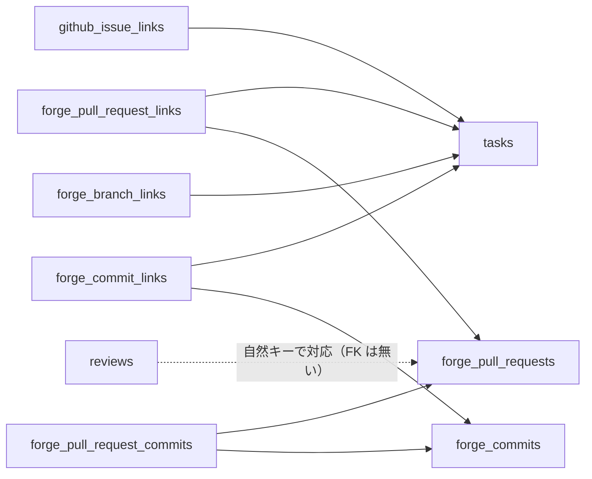

## 概要

[GitHub App 基盤](/features/tasks/github-app)の上で、PR・コミット・ブランチとタスクを自動でリンクする機能である。コミットメッセージや PR のタイトル・本文、ブランチ名に `KEY-N`（プロジェクトキーと連番。例は `ENG-42`）を書くと自動リンクされ、`Closes ENG-42` を含む PR がマージされるとタスクが完了する。リンクされたコミットはタスクのアクティビティに並ぶ（TASK-140）。[コア](/features/tasks/core)、[GitHub App 基盤](/features/tasks/github-app)、[レビュー指摘](/features/review-findings)に依存する。Webhook の受信と処理は[Git ホスティング連携の Webhook](/features/tasks/github-tasks/webhook)に書く。

## 用語

| 語 | 意味 |
|---|---|
| ホスト | GitHub / GitLab / Forgejo のいずれか。`host` と `host_url` の組で識別する |
| `KEY-N` | プロジェクトキーとタスクの連番（`seq_id`）を繋いだ表記 |
| 参照元 | リンクの由来。`forge_pull_request_links.source` の `title` / `body` / `branch` / `manual` |
| 自然キー | PR を指す列の組。`project_id` / `host` / `host_url` / `repo_owner` / `repo_name` / `number` |

## 振る舞い

### ホスト中立の作り

タスク側のデータと処理はホストを知らない。ホストごとに違うのは次の 4 点だけで、それぞれ薄いアダプタに閉じる（`forge-core` の `TokenProvider` / `Repository` と同じ方針）。

| 違うもの | GitHub | 閉じ込める場所 |
|---|---|---|
| 呼び名 | Pull Request | 表示だけ。データは `pull_request` で統一 |
| 番号の意味 | リポジトリ内で Issue と共有 | `number` 列 |
| webhook の届き方 | App 設定で自動 | 連携フロー |
| 署名 / イベント形式 | `X-Hub-Signature-256` + JSON | ホストごとの受信エンドポイントと正規化イベント |

ホストの識別は `host`（`github` / `gitlab` / `forgejo`）と `host_url`（インスタンスの origin。`https://github.com` / `https://gitlab.example.com`）の組で行う。GitLab と Forgejo はセルフホストが普通なので `host` だけでは足りない。

### タスクをハブにする構成

ホスト側の 3 つの実体（Issue / PR / コミット）は、それぞれタスクに結ぶ。Issue と PR を直接結ぶ表は持たない。PR とコミットの所属は中間表で持ち、レビューのラウンドは PR の自然キーで PR 行と対応づける。



- Issue はタスクの GitHub 側の写しである（1 対 1、[GitHub App 基盤のデータ](/features/tasks/github-app#データ)）。PR もタスクに結ぶので、Issue との対応はタスク経由で取れる
- Issue を取り込んでいないプロジェクトでも PR / コミットのリンクは使える
- [レビュー指摘](/features/review-findings)のラウンド（`reviews`）は PR に付く。レビュー指摘、PR、タスクの順に辿れる。`reviews` は `repo_owner / repo_name / pr_number` の組を持ち、PR 行とは `(project_id, repo_owner, repo_name, pr_number)` で結ぶ
- `github_issue_links` / `github_integrations` は GitHub 専用の名前のままである。`forge_` で始まる表は連携表への FK を持たない

### タスクへの自動リンク

PR タイトル・PR 本文・コミットメッセージ・ブランチ名から `KEY-N` を正規表現でパースする。`KEY-N` の部分は `\b([A-Za-z][A-Za-z0-9]{1,9})-([0-9]+)\b` で、`KEY` は大文字に正規化して照合する。`\b` は ASCII の語境界である。

| パターン | 例 | 動作 |
|---|---|---|
| `KEY-N`（タイトル / メッセージ） | `fix: ログインバグ修正 ENG-42` | タスク ENG-42 にリンク追加 |
| 複数 `KEY-N` | `feat: OAuth ENG-42 ENG-43` | タスク ENG-42 と ENG-43 両方にリンク追加 |
| 異なるプロジェクト | `feat: OAuth ENG-42 BACK-7` | 各プロジェクトのタスクにそれぞれリンク |
| ブランチ名 | `feat/ENG-42-oauth` | タスク ENG-42 にブランチリンク追加 |
| クローズキーワード + `KEY-N` | `Closes ENG-42` / `Fixes ENG-42` / `Resolves ENG-42` | `closes = true` でリンク。PR マージ時にタスク ENG-42 を自動クローズ |

クローズキーワードは `Close` / `Closes` / `Closed` / `Fix` / `Fixes` / `Fixed` / `Resolve` / `Resolves` / `Resolved` / `Implement` / `Implements` / `Implemented` である。大小文字を問わない。GitHub と GitLab の集合の和である。キーワードと `KEY-N` の間には空白が必要で、`Closes: ENG-42` のようにコロンを挟んでもよい。PR タイトルと PR 本文の両方が対象である。ホスト自身の `Closes #N`（Issue クローズ）とは構文が異なるので衝突しない。

### KEY-N の解決

`KEY-N` はまず `KEY` でテナント内のプロジェクトを特定し、その `seq_id=N` のタスクを探す。

- `KEY` が不明、またはタスクが見つからない・削除済みの場合はリンク追加をスキップする。エラーにしない
- `SHA256-1` のような偽陽性も、KEY として解決できなければ捨てるだけである
- 1 つのコミット / PR が複数プロジェクトのキーを含む場合、それぞれのプロジェクトのタスクへリンクする
- リンクできるのは、webhook を受けた連携と同じテナントのプロジェクトだけである。別テナントのキーは同じ文字列でも解決しない

抽出は `service::forge::task_refs` にある。

### リンクの手動操作

手動リンクは `source = manual` の行として、自動解析（`title` / `body` / `branch`）の行と独立に共存する。同じタスクが本文にも書かれていても、手動の行を自動解析が上書き・削除することはない。リンクを外すと、その PR ↔ タスクの全 `source` の行を消す。タイトル・本文に `KEY-N` が残っていれば、次に適用対象となる PR イベントの共通処理で `title` / `body` 由来の行が復活する。リンクを恒久的に外したいならホスト側の記述も直す必要がある。GitHub の Issue リンクと同じ挙動である。

コミットとブランチの手動リンクは無い。

### マージ時副作用の確認済み操作

`state = merged` かつ `merge_effects_processed_at = NULL` の PR は、利用者が「確認済み」にできる。この操作はタスクを完了させず、`merge_effects_processed_at` を現在時刻、`merge_effects_acknowledged_by` を操作者にして未適用の表示を解消し、誰がいつ行ったかをリンク先タスクのアクティビティに残す。後から `Closed { merged: true }` が届いても、[マージ時副作用](/features/tasks/github-tasks/webhook#マージ時副作用)は `merge_effects_processed_at IS NULL` のときだけ動くので、タスクを二重に完了させない。

### CLI との合流

`task review submit` は `pr` 番号を受け取る。ラウンドの作成時に、現在の連携先のリポジトリで `forge_pull_requests` の行を用意する（`service::reviews::ensure_pull_request_row`）。

- 既に行があれば触らず、無ければ `state = unknown`・`host_updated_at = NULL` で作る。webhook をまだ受けていなくても行が先にでき、後から届いた webhook が同じ行に合流する
- 連携の無いプロジェクトのラウンドはリポジトリが決まらないので行を作らない
- レビュー側と PR 行は自然キー `(project_id, repo_owner, repo_name, pr_number)` で結ぶ。PR 行は `host = github` だけなので `host` / `host_url` は見ていない
- `review summary` の head 一致検査はラウンドの `head_sha` を見る。`forge_pull_requests.head_sha` は表示用の補助であり、ゲートの根拠にしない
- 読み取りの `review list` / `review rounds` / `review summary` と対応する API は、`--repo owner/name` / `repo=owner/name` でリポジトリを指定する。省略すると現在の連携先を見る

タスクと PR の連携は `task tasks pr list|link|unlink <KEY-N> [<番号>]` で扱う。

- `list` は `GET /tasks/{id}/forge`、`link <番号> [--closes]` は `POST .../forge/pull-requests` を呼ぶ
- `unlink <番号>` は `GET /tasks/{id}/forge` から番号で PR を選んで `DELETE` する。リンクされていない番号は終了コード 5 である
- 同じ番号が複数リポジトリにあれば現在の連携先のものを選び、選べなければ候補を並べて終了コード 2 で止める
- 409 `github-integration-missing` は連携が無い旨のエラーにする

## データ

### リポジトリの識別

`forge_` で始まる実体の表は次の 5 列でリポジトリを指す。連携表（`github_integrations`）への FK は持たない。API 呼び出しに使う連携は、必要になった時点でプロジェクトの現在の連携先から引く。

| 列 | 型 | 説明 |
|---|---|---|
| `host` | VARCHAR | `github` / `gitlab` / `forgejo` |
| `host_url` | VARCHAR | インスタンスの origin。末尾スラッシュ無し |
| `repo_owner` | VARCHAR | GitHub の owner、GitLab の namespace 全体（`group/subgroup`。`/` を含みうる）、Forgejo の owner |
| `repo_name` | VARCHAR | リポジトリ（GitLab のプロジェクト）パス |
| `html_url` | VARCHAR | 行ごとの人間向け URL。合成せず保存する |

`host` / `host_url` / `repo_owner` / `repo_name` の 4 列は `forge-core::Repository` に `host` を足した形で、受信エンドポイントがこの形へ正規化する（`service::forge::events::ForgeRepo`）。

### forge_pull_requests

PR / MR の実体である。`UNIQUE (project_id, host, host_url, repo_owner, repo_name, number)` を張る。

| 列 | 型 | 制約 | 説明 |
|---|---|---|---|
| `id` | UUID | PK | |
| `project_id` | UUID | NOT NULL, FK→projects CASCADE | webhook を受けた連携のプロジェクト。リンク先タスクのプロジェクトとは限らない |
| `host` / `host_url` / `repo_owner` / `repo_name` | VARCHAR | NOT NULL | 共通列 |
| `number` | INT | NOT NULL | GitHub / Forgejo の PR 番号、GitLab の MR `iid` |
| `title` | VARCHAR | NOT NULL DEFAULT `''` | 表示用。webhook / API で取得できたときだけ埋まる |
| `author_handle` | VARCHAR | NOT NULL DEFAULT `''` | ホスト上のアカウント名。webhook / API で取得できたときだけ埋まる |
| `state` | VARCHAR | NOT NULL DEFAULT `'unknown'` | `open` / `closed` / `merged` / `unknown`。`unknown` はレビューラウンドの起票か、ホストから取得できなかった手動リンクだけで作られ、まだ webhook を受けていない行である |
| `head_sha` | VARCHAR(40) | NULLABLE | 最後に観測した head。表示用の補助で、`review summary` のゲートの根拠にしない |
| `html_url` | VARCHAR | NOT NULL DEFAULT `''` | |
| `merged_at` | TIMESTAMPTZ | NULLABLE | |
| `host_updated_at` | TIMESTAMPTZ | NULLABLE | ホスト側で PR が最後に更新された時刻。ホスト側の更新時刻（GitHub / Forgejo の `pull_request.updated_at`、GitLab の `object_attributes.updated_at`）をそのまま入れる世代で、[PR イベント共通の前処理](/features/tasks/github-tasks/webhook#pr-イベント共通の前処理)で比較する |
| `merge_effects_processed_at` | TIMESTAMPTZ | NULLABLE | `Closed { merged: true }` のマージ時副作用を完了した時刻。現在状態の世代とは独立に、NULL の間だけ処理する |
| `merge_effects_acknowledged_by` | UUID | NULLABLE, FK→users SET NULL | 副作用を実行しないまま「確認済み」にした操作者。実際に副作用を処理した場合は NULL |
| `commits_complete` | BOOLEAN | NOT NULL DEFAULT false | PR のコミット一覧を読み切れたか。false のあいだ[コミット集合の同期](/features/tasks/github-tasks/webhook#pr-のコミット集合の同期)の削除を行わず、画面の表示にも使う。同期が一度も走っていない行（`Opened` / `Synchronize` を受けていない PR）も既定の false のままである |
| `created_at` / `updated_at` | TIMESTAMPTZ | NOT NULL DEFAULT now() | |

`merge_effects_processed_at` と `merge_effects_acknowledged_by` の読み方は次のとおりである。

- `merge_effects_processed_at` は PR の現在状態ではなく、マージ時のタスク完了を一度だけ行ったかを表す。マージ後の `Edited` から現在状態が先に `merged` になってもこの列は更新しない。マージ時点のタイトル・本文を持つ `Closed { merged: true }` を処理し終えたときだけ同じトランザクションで設定する
- 例外は[確認済み操作](#マージ時副作用の確認済み操作)で、タスクを完了させずにこの列だけを設定し、`merge_effects_acknowledged_by` に操作者を残す
- 2 つの値の組で「副作用を実行した」と「利用者が手で対応を終えたので実行しないと決めた」を区別する。どちらの場合も NULL 判定が一度きりの保証を担う

### forge_pull_request_links

PR とタスクのリンクである。`PRIMARY KEY (pull_request_id, task_id, source)` で、1 PR が複数タスクを閉じる、1 タスクに複数 PR、どちらも起きるので多対多である。

| 列 | 型 | 制約 | 説明 |
|---|---|---|---|
| `pull_request_id` | UUID | NOT NULL, FK→forge_pull_requests CASCADE | |
| `task_id` | UUID | NOT NULL, FK→tasks CASCADE | |
| `closes` | BOOLEAN | NOT NULL DEFAULT false | この参照元がクローズキーワード付きだったか |
| `source` | VARCHAR | NOT NULL | `title` / `body` / `branch` / `manual`。再解析・手動操作の単位 |
| `created_at` | TIMESTAMPTZ | NOT NULL DEFAULT now() | |

行は参照元ごとに 1 行である。同じタスクがタイトル・本文・ブランチ・手動リンクの複数経路から参照されることがある（タイトルに `ENG-42`、本文に `Closes ENG-42` 等）。上位の概念は次のとおりに集計で導く。

- PR ↔ タスクが「リンクされている」は、行が 1 件以上あることである
- 表示する現在のリンク集合は、残存行を `task_id` ごとにまとめたものである

マージ時の自動完了はこの表の現在集合をそのまま集計しない。[マージ時副作用](/features/tasks/github-tasks/webhook#マージ時副作用)に書くマージ時点の集合を使う。

### forge_commits

コミットの実体である。`UNIQUE (project_id, host, host_url, repo_owner, repo_name, sha)` を張る。rebase / force-push で同じ変更が別 SHA になった場合は別のコミットとして積む。

| 列 | 型 | 制約 | 説明 |
|---|---|---|---|
| `id` | UUID | PK | |
| `project_id` | UUID | NOT NULL, FK→projects CASCADE | リンク先タスクのプロジェクト。webhook を受けた連携のプロジェクトではない |
| `host` / `host_url` / `repo_owner` / `repo_name` | VARCHAR | NOT NULL | 共通列 |
| `sha` | VARCHAR(40) | NOT NULL | 小文字 16 進 |
| `message` | TEXT | NOT NULL | 全文。表示は先頭行 |
| `author_handle` | VARCHAR | NOT NULL DEFAULT `''` | ホスト上のアカウントに解決できたとき |
| `author_name` | VARCHAR | NOT NULL | git の author 名。解決できないときの表示用 |
| `committed_at` | TIMESTAMPTZ | NOT NULL | |
| `html_url` | VARCHAR | NOT NULL | |
| `created_at` | TIMESTAMPTZ | NOT NULL DEFAULT now() | |

1 つのコミットが複数プロジェクトのタスクを参照するときは、プロジェクトごとに 1 行になる。PR のコミット集合の同期でタスクへ結ぶリンクも同じ規則に従う。

### forge_pull_request_commits

PR とコミットの所属の中間表である。`PRIMARY KEY (pull_request_id, commit_id)` で多対多である。同じコミットが複数の PR に含まれることがある（同一ブランチから別 base への PR、stacked PR）。

| 列 | 型 | 制約 |
|---|---|---|
| `pull_request_id` | UUID | NOT NULL, FK→forge_pull_requests CASCADE |
| `commit_id` | UUID | NOT NULL, FK→forge_commits CASCADE |
| `created_at` | TIMESTAMPTZ | NOT NULL DEFAULT now() |

### forge_commit_links

コミットとタスクのリンクである。`PRIMARY KEY (commit_id, task_id)` を張る。

| 列 | 型 | 制約 |
|---|---|---|
| `commit_id` | UUID | NOT NULL, FK→forge_commits CASCADE |
| `task_id` | UUID | NOT NULL, FK→tasks CASCADE |
| `created_at` | TIMESTAMPTZ | NOT NULL DEFAULT now() |

### forge_branch_links

ブランチとタスクのリンクである。`UNIQUE (task_id, host, host_url, repo_owner, repo_name, branch)` を張る。ブランチは実体表を分けず、ブランチ削除イベントで消す。

| 列 | 型 | 制約 |
|---|---|---|
| `id` | UUID | PK |
| `project_id` | UUID | NOT NULL, FK→projects CASCADE |
| `task_id` | UUID | NOT NULL, FK→tasks CASCADE |
| `host` / `host_url` / `repo_owner` / `repo_name` | VARCHAR | NOT NULL |
| `branch` | VARCHAR | NOT NULL |
| `html_url` | VARCHAR | NOT NULL |
| `created_at` | TIMESTAMPTZ | NOT NULL DEFAULT now() |

### forge_webhook_deliveries

webhook の受信記録である。`UNIQUE (host, host_url, delivery_id)` を張る。配信 ID はホストのインスタンス内でしか一意でないので `host_url` まで含める。テナントやプロジェクトは含めず、同じリポジトリを複数プロジェクトへ連携していても 1 配信につき 1 行である。行を作るのは署名検証を通った後である。切り詰められた push の続きのジョブの鍵（`backfill:...`）も同じ表に入れる。

| 列 | 型 | 制約 | 説明 |
|---|---|---|---|
| `id` | UUID | PK | |
| `host` / `host_url` | VARCHAR | NOT NULL | どのホストのどのインスタンスからか |
| `delivery_id` | VARCHAR | NOT NULL | 配信 ID ヘッダーの値 |
| `created_at` | TIMESTAMPTZ | NOT NULL DEFAULT now() | 掃除の基準 |

### アクティビティ

`task_activities` に次のイベントを積む。アクティビティは追記のみで、リンクが消えても行は残す。

| イベント | `payload` | `user_id` |
|---|---|---|
| `forge_commit_linked` | `host` / `sha` / `message` 先頭行 / `author_handle` / `author_name` / `html_url` | ホスト上のアカウントが連携済みの利用者に解決できたときだけ入れ、それ以外は NULL |
| `forge_pull_request_linked` | `host` / `number` / `title` / `author_handle` / `html_url` / `state` / `source` | 同上。手動リンクでは操作者 |
| `forge_pull_request_merged` | `host` / `number` / `title` / `author_handle` / `html_url` / `state` | 常に NULL |
| `forge_pull_request_unlinked` | `host` / `number` / `html_url` / `pull_request_id` | 操作者 |
| `forge_merge_effects_acknowledged` | `host` / `pull_request_id` / `number` / `html_url` | 操作者 |

利用者の解決は次のとおりに行う。

- コミットと PR は作者のホスト上のログイン名（`author_handle`）を `oauth_connections.provider_login` と照合する。大文字小文字を区別せず、`provider = host` かつ `instance_url IS NULL` の行を見る
- 一致する接続がちょうど 1 件で、その利用者がリンク先タスクのプロジェクトに入れる人かテナントオーナーのときだけ `user_id` に入れる
- 解決できなければ表示は `author_handle` / `author_name` に頼る
- `provider_login` は OAuth でログイン・連携したときに保存する（[OAuth 認証](/features/auth-oauth)）ので、それより前の接続は次回ログインまで解決できず、過去のアクティビティも遡って埋めない
- `author_handle` は GitHub がコミットのメールアドレスから解決した値である。`user_id` は「ホストがそのアカウントに帰属させた」の意味にとどめ、通知や権限の根拠に使わない

手で行う操作の履歴は次のとおりである。

- 手動リンクは自動リンクと同じ `forge_pull_request_linked` を同じ `dedupe_key` で積む。PR ↔ タスクにつき初回だけで、`user_id` は操作者である
- `forge_pull_request_linked` の `payload.source` は初回のリンクの参照元である。手動なら `manual`、webhook なら `title`、`body`、`branch` の順で最初に見つかったものである
- リンクを外す操作は `forge_pull_request_unlinked` を `dedupe_key` NULL で積む。2 回外せば 2 行になる
- ブランチのリンクを外してもアクティビティは積まない
- 確認済み操作は、その時点でリンクされている各タスクへ `forge_merge_effects_acknowledged` を積む。リンクが 1 件も無い PR では積む先が無いので、操作者は PR 行の `merge_effects_acknowledged_by` にも持つ

同じ出来事を 2 回積まないための鍵が `task_activities.dedupe_key`（VARCHAR、NULLABLE、UNIQUE）である。連携由来の行だけが鍵を持ち、手で起きる操作の履歴は NULL のままで、同じ操作を 2 回すれば 2 行になる。UNIQUE は NULL 同士を別物とみなすので、NULL の行は何行でも積める。

| イベント | `dedupe_key` |
|---|---|
| `forge_pull_request_linked` | `forge_pull_request_linked:{pull_request_id}:{task_id}` |
| `forge_pull_request_merged` | `forge_pull_request_merged:{pull_request_id}:{task_id}` |
| `forge_commit_linked` | `forge_commit_linked:{commit_id}:{task_id}` |
| `forge_merge_effects_acknowledged` | `forge_merge_effects_acknowledged:{pull_request_id}:{task_id}` |

積むときは `INSERT ... ON CONFLICT (dedupe_key) DO NOTHING RETURNING id` で、行が返ったときだけ初回とみなす。現在のリンク行を数えて初回を判定しない。

### 定義の場所

定義は次の migration にある。

| migration | 内容 |
|---|---|
| [m20260911000000_forge_commit_links.rs](https://github.com/koyori-app/task/blob/main/apps/backend/migration/src/m20260911000000_forge_commit_links.rs) | `forge_commits` / `forge_commit_links` / `forge_webhook_deliveries`、`task_activities.dedupe_key`、`idx_forge_commit_links_task` / `idx_forge_webhook_deliveries_created_at` |
| [m20261017000000_forge_pull_requests.rs](https://github.com/koyori-app/task/blob/main/apps/backend/migration/src/m20261017000000_forge_pull_requests.rs) | `forge_pull_requests` / `forge_pull_request_links`、`idx_forge_pr_links_task` |
| [m20261017020000_forge_branch_links.rs](https://github.com/koyori-app/task/blob/main/apps/backend/migration/src/m20261017020000_forge_branch_links.rs) | `forge_pull_request_commits` / `forge_branch_links`、`idx_forge_pr_commits_commit` / `idx_forge_branch_links_task` |

## API

パスはすべて `/v1/tenants/{tenant_id}/projects/{project_id}` を前に付けたもので、以下は相対で書く。

| メソッド | パス | 説明 |
|---|---|---|
| GET | `/tasks/{id}/forge` | タスクに紐付いた PR / コミット / ブランチ。`TaskForgeResponse` を返す |
| POST | `/tasks/{id}/forge/pull-requests` | 手動で PR をリンクする（`source = manual`） |
| DELETE | `/tasks/{id}/forge/pull-requests/{pull_request_id}` | PR のリンクを外す。PR 行自体は消さない |
| DELETE | `/tasks/{id}/forge/branches/{link_id}` | ブランチのリンクを外す（204） |
| POST | `/forge/pull-requests/{pull_request_id}/merge-effects/acknowledge` | マージ時副作用を実行しないまま「確認済み」にする |

各行は `host` / `host_url` / `repo_owner` / `repo_name` / `html_url` を含む。フロントエンドは `host` で表示ラベル（Pull Request / Merge Request）とアイコンを切り替え、URL は `html_url` をそのまま使う。

### GET /tasks/{id}/forge の応答

`pull_requests` / `commits` / `branches` の 3 配列は空でも必ず返す。形は `openapi.json` の `TaskForgeResponse` にあり、形から読めない規則は次のとおりである。

`pull_requests[]` の規則は次のとおりである。

- PR ごとに 1 件で、PR 行の作成が新しい順である
- `project_id` は PR 行のプロジェクトで、確認済み操作のパスに使う。タスクのプロジェクトとは限らないが、タスクに結ばれた行だけを返すのでタスクの閲覧権限で足りる
- `sources` はこのタスクを参照している `forge_pull_request_links.source` の昇順、`closes` はその `bool_or` である
- `merge_effects_processed_at` を含み、`state = merged` かつ NULL の状態を通常のマージ済みと区別できる。レビュー画面の PR 一覧が使う `ReviewedPullRequest` も同じである
- `commits_complete` は[データ](#forge_pull_requests)の同名の列である

`pull_requests[].unresolved` はマージを塞いでいるレビュー指摘の件数である。`reviews/summary` のゲートと同じ集計で、High / Medium の open / fixing / fixed を数える。PR 行とラウンドは自然キーで結ぶ。次の場合は `null` を返す。

- レビューの無い PR
- PR 行の `project_id` がタスクのプロジェクトと違う
- 呼び出し元が `read:review` を持たない PAT。`write:review` は包含し、セッションと Device Token は持つ扱いである

指摘ゼロのラウンドだけなら `0` を返す。

`commits[]` は `forge_commit_links` で結ばれたコミットで、`committed_at` の新しい順、`message` は先頭行である。PR のコミット集合の同期で結ばれたものも含むが、`forge_pull_request_commits` にしか無い行は返さない。

`branches[]` は `forge_branch_links` の `id` / `host` / `host_url` / `repo_owner` / `repo_name` / `branch` / `html_url` / `created_at` で、新しい順である。`id` は `DELETE .../forge/branches/{link_id}` に使い、他タスクの `link_id` は 404 を返す。

`repository` はタスクのプロジェクトの現在の連携先で、連携が無ければ `null` である。手動リンクの可否と対象リポジトリの表示に使う。連携の管理 API（`GET .../github/integration`）はテナントオーナー専用なので、タスクを読める人なら誰でも読めるここに出す。

`issue` は取り込み元の GitHub Issue（`github_issue_links` の行）である。Issue から取り込んでいない、または連携を解除してリンクが消えたタスクでは `null` になる。

- `state` は同期で保存した `github_issue_links.github_state`（`open` / `closed` / `unknown`）である。タスクのステータスからは推定しない
- `last_synced_at` は `github_issue_links.last_synced_at` である。取り込み・webhook の適用・書き戻しの成功でだけ進む。リンク行の `updated_at` は書き戻し要求（`pending_push` を立てる）でも進む版なので使わない。同期の時刻を保存する前の行では `null` である
- `pending_push` はそのまま返す
- `html_url` はサーバーが `https://github.com/{owner}/{repo}/issues/{number}` を組む。Issue のリンク表は GitHub 専用で URL 列を持たない。ホスト中立にするときに列を足して置き換える
- ラベル・担当者・マイルストーンは GitHub 側の値を保存していないので返さない

### POST /tasks/{id}/forge/pull-requests

リクエストは `{ "number": 87, "closes": false }` の形である。

- `closes` は省略すると `false` である。`number` は 1 以上で、それ以外は 400 を返す
- 成功すると 201 で、`GET /tasks/{id}/forge` の `pull_requests[]` と同じ形の PR を 1 件返す。`unresolved` も同じ集計と同じ `null` の条件である
- リポジトリはプロジェクトの現在の連携先（`github_integrations`）で確定し、`repo` は受け取らない。連携が無ければ 409 `github-integration-missing` を返す。`host` は `github`、`host_url` は `https://github.com` である
- ホストの PR 取得 API は認可を通ってから呼ぶ。引ければ[共通処理](/features/tasks/github-tasks/webhook#pr-イベント共通の前処理)（PR 行の UPSERT と `title` / `body` / `branch` 由来のリンクの再構築）をそのスナップショットで通してから `manual` 行を足す
- 引けなければ（404・障害・GitHub App 未設定）5xx にせず、PR 行が無ければ `state = unknown`、`html_url` は `https://github.com/{owner}/{repo}/pull/{number}` で作り、中身は次に届く PR イベントで埋める
- 同じ PR を付け直すと `manual` 行の `closes` だけを更新する。履歴は増えない

### DELETE /tasks/{id}/forge/pull-requests/{pull_request_id}

204 を返し、その PR ↔ タスクの全 `source` の行を消す。リンクが無ければ 404 を返す。

### POST .../merge-effects/acknowledge

リクエストボディは無い。PR 行をロックし、`state = merged` かつ `merge_effects_processed_at IS NULL` のときだけ、`merge_effects_processed_at` を現在時刻、`merge_effects_acknowledged_by` を呼び出し元にして 200 を返す。タスクは完了させない。

- 同じトランザクションでリンク先タスクへ `forge_merge_effects_acknowledged` を積む
- すでに列が設定済み（副作用の処理済み・確認済みのどちらも）なら 409 を返す
- `state` が `merged` でなければ 409 を返す
- パスのプロジェクトと `project_id` が一致しない id は 404 を返す
- 成功時のレスポンスボディは無い。画面は `GET /tasks/{id}/forge` を取り直す

## 認可

| 操作 | 誰が | スコープ |
|---|---|---|
| `GET /tasks/{id}/forge` | パスのプロジェクトへのアクセス権 | `read:task` |
| `POST` / `DELETE` の各リンク操作 | パスのプロジェクトへのアクセス権 | `write:task` |
| `POST /forge/pull-requests/{id}/merge-effects/acknowledge` | パスのプロジェクトと、PR に今リンクされている全タスクのプロジェクトへのアクセス権。一つでも欠ければ 403 | `write:task` |

webhook 経由のリンクはシステムが行うので権限検査を経ない。

確認済み操作の権限は今のリンクで確かめる。権限を確かめた後に別プロジェクトへのリンクが増えていても 403 を返す。

## 画面

### リポジトリセクション

タスク詳細のセクションで、上から取り込み元 Issue、Pull Requests、Commits、Branches の順に並べる。PR の行には状態のアイコン、番号とタイトル、参照元（タイトル・本文・ブランチ・手動）、作者、未解決の件数を出す。リンクが 1 件も無いときは「まだ PR もコミットもありません」と出す。


- 「取り込み元」行は `issue` があるときだけ先頭に出す。`owner/repo#N` を `html_url` へのリンクにし、状態（Open / Closed / 状態不明）と最終同期（`last_synced_at` が `null` なら出さない）、`pending_push` なら「GitHub への反映待ち」を並べる
- 見出しの「Pull Requests」は、並ぶ PR がすべて `host = gitlab` なら「Merge Requests」になる
- 「PR をリンク」はダイアログで PR 番号と「マージしたらこのタスクを完了にする」（`closes`）を受け取る。リポジトリはプロジェクトの連携先を表示するだけで選ばせない。連携先は `repository` で読み、`null` ならボタンを無効にして理由を出す
- PR 行のメニューの「リンクを外す」は確認ダイアログを挟み、タイトル・本文に `KEY-N` が残っていれば次の PR イベントで戻ることを添える
- PR 行の「N 件が未解決」「未解決なし」は `reviews/summary` と同じ集計で、`unresolved` が `null` なら出さない。クリックでレビュー画面のその PR（`reviews?pr=N`）へ遷移する
- コミットはタスク詳細のアクティビティにも時系列で並ぶ
- Branches の各行はブランチ名と `html_url` へのリンクで、リンクを外すボタンを置く
- `commits_complete = false` の PR の行には「コミット一覧は一部のみ」と添える。ホストの上限に当たった・一覧を読み切れなかった・同期がまだ走っていない状態である。空表示にはしない

### 自動完了の未適用表示

`state = merged` かつ `merge_effects_processed_at = NULL` の PR は、タスク詳細の PR 行に「マージ済み（自動完了は未適用）」のバッジを出す。クリックで開くダイアログでは次を案内する。

- 完了すべきタスクを各タスクの通常操作で手動完了すること
- 連携の管理者へ元の `Closed { merged: true }` webhook の再配送を依頼できること
- 「確認済みにする」操作（確認ダイアログ付き）。[確認済み操作](#マージ時副作用の確認済み操作)を実行する

現在のリンク集合から完了対象を推測して一括適用する操作は置かない。再配送を受信できれば[マージ時副作用](/features/tasks/github-tasks/webhook#マージ時副作用)を通常どおり一度だけ処理し、表示も解消する。

### 設定画面

連携の管理はプロジェクト設定の「連携」セクションで行う（[GitHub App 基盤の画面](/features/tasks/github-app#画面)）。未連携のときの説明は「コミットや Pull Request をタスクに紐付けます。」の 1 行である。自動リンクの ON/OFF 設定は持たない。

### コンポーネント

| コンポーネント | ファイル |
|---|---|
| リポジトリセクション | `components/tasks/TaskForgeSection.vue` |
| 取り込み元の行 | `components/tasks/TaskIssueSourceRow.vue` |
| Branches の一覧 | `components/tasks/TaskForgeBranches.vue` |
| PR の手動リンク | `components/tasks/TaskForgePullRequestLinkDialog.vue` |
| 自動完了の未適用バッジと確認済み操作 | `components/tasks/TaskForgeMergeEffectsBadge.vue` |

## 未実装と既知の制限

### GitLab / Forgejo

実装済みのホストは GitHub だけである。受信エンドポイント・連携フロー（`forge_integrations` を含む別仕様）が無く、表と処理はそのまま使える。足すときの差分の設計は次のとおりである。受信エンドポイントと登録の設計は [Webhook のページ](/features/tasks/github-tasks/webhook#未実装と既知の制限)に書く。

| 違うもの | GitLab | Forgejo |
|---|---|---|
| 呼び名 | Merge Request | Pull Request |
| 番号の意味 | プロジェクト内 `iid`（MR と Issue で別空間） | リポジトリ内で Issue と共有 |
| webhook の届き方 | プロジェクト単位に API で登録 | リポジトリ単位に API で登録 |
| 署名 / イベント形式 | `X-Gitlab-Token` + JSON | `X-Forgejo-Signature`（HMAC）+ JSON |

- `github_issue_links` / `github_integrations` は GitLab を足すときに `forge_integrations` へ寄せる予定である（別仕様）。`forge_` で始まる表はそれを先取りした名前である
- レビュー側と PR 行の `host` を含めた結合は GitLab 対応時に行う

### Issue 経由の解決

現在の抽出は `KEY-N` だけを見るので、`Closes #12` ではタスクにリンクされない。設計では、PR 本文の `Closes #12`（ホストの Issue 番号）は、同じリポジトリの Issue #12 が `github_issue_links` でタスクに結ばれていれば、そのタスクへの `closes = true` リンクとして扱う。番号の意味の違いもこの解決で吸収する。GitLab は `#12` が Issue の `iid`、`!12` が MR なので、`#` だけを Issue として見る（`!` は無視）。

### reviews の FK 付け替え

`reviews` は PR 行を FK で参照していない（`reviews.pull_request_id` が無い）。挙動を変えずに PR 行へ寄せ、既存の reviews 統合テストがそのまま通ることを回帰の確認にする。付け替え後は `integration_id / repo_owner / repo_name / pr_number / pr_title / pr_author` の 6 列をやめ、`pull_request_id`（FK→forge_pull_requests RESTRICT）を持ち、採番の UNIQUE を `(pull_request_id, round)` にする設計である。

移行案は次の順である。PR 行を先に作ってから `reviews` を結ぶ順序を守る。

1. 既存の `reviews` を `project_id, repo_owner, repo_name, pr_number` でまとめ、組ごとに `forge_pull_requests` を 1 行起こす。`id` は `gen_random_uuid()`、`state` は `'unknown'` である
2. 既存行はすべて GitHub.com なので `host` は `github`、`host_url` は `https://github.com`、`html_url` は `https://github.com/{repo_owner}/{repo_name}/pull/{pr_number}` に固定する。連携前ラウンド（`repo_owner = ''`）はこの 3 列とも `''` である
3. `title` / `author_handle` は `round` が新しい順で最初の非 NULL 値を写す（`array_agg(... ORDER BY round DESC) FILTER (WHERE ... IS NOT NULL)`）。無ければ `COALESCE` で空文字列にする。`reviews.pr_title` / `pr_author` は NULLABLE で、CLI 以外から作られたラウンドは両方 NULL である。移行先は NOT NULL DEFAULT `''` だが、`INSERT ... SELECT` は NULL を明示的に入れるので DEFAULT は効かない
4. `reviews.pull_request_id`（`ON DELETE RESTRICT`）を足し、`(project_id, repo_owner, repo_name, pr_number)` と `(project_id, repo_owner, repo_name, number)` の一致で埋めて NOT NULL にする
5. 制約 `uq_reviews_round` を消し、`repo_owner` / `repo_name` / `pr_number` / `pr_title` / `pr_author` / `integration_id` を消して、`UNIQUE (pull_request_id, round)` の `uq_reviews_round` を張り直す

この移行で `reviews.integration_id` は消え、「連携が無いラウンド」は PR 行の `host = ''` で表す。

受け入れ条件は次のとおりである。

- `pr_title` と `pr_author` が両方 NULL の既存ラウンド（API 経由で作られたラウンド）を含めても移行が完走し、非 NULL の値が一度も無い PR 行の `title` / `author_handle` は空文字列になる
- 複数ラウンドでタイトルまたは作者の値が変わっている場合は、辞書順の最大値ではなく `round` が最も大きい非 NULL 値が入る
- 既存ラウンド（連携前の空文字列リポジトリを含む）が移行後も同じ `pr_number` / `round` で一覧に出る
- 連携先差し替え後の同番号 PR が別の PR 行になる
- `host_url` が違う同名リポジトリ（github.com と自前 Forgejo の `org/app`）が別の PR 行になる

### ホストまで含めた PR の指定

設計では、`--repo` に加えて `--host` / `host`、`--host-url` / `host_url`、または `--pull-request-id` / `pull_request_id` を PR の明示的な識別子として受け取る。

- `pull_request_id` を指定した場合はそれを優先し、併記した `repo` / `host` / `host_url` が対象行と一致しなければ 400 で弾く
- `--repo owner/name --pr N`（API の `repo` + `pr`）だけの指定は、同じプロジェクト内で `host` + `host_url` まで含む候補が 1 件のときだけ許可する
- 複数候補なら API は 409、CLI は非 0 で終了し、`host_url`（必要なら `host`）または `pull_request_id` の再指定を要求する
- 候補が無い場合も黙って現在の連携先へ切り替えない
- GitLab の nested namespace は `group/sub/name` を最後の `/` で割る。owner に `/` を含みうる

受け入れ条件は次のとおりである。

- GitHub と Forgejo に同じ `org/app` の PR #10 があるとき、`--repo org/app --pr 10` または `repo=org/app&pr=10` だけの指定は API が 409、CLI が非 0 で終了し、`host_url`（必要なら `host`）または `pull_request_id` を指定した場合だけ対象を一意に選べる
- 候補が 1 件なら repo-only 指定を許可し、現在の連携先へ暗黙に差し替えない
- `pull_request_id` と併記した `repo` / `host` / `host_url` のいずれかが対象行と一致しない場合は API が 400、CLI が非 0 で終了する

### ホストへのタスク URL コメント

PR に投稿するコメントはレビュー指摘の要約コメント（[レビュー指摘の要約コメントと Approve](/features/review-findings/github-comment)）だけで、タスクへのリンクは投稿しない。設計では、PR 作成時に、リンクされたタスクへの URL をコメントとして PR に自動追加する。GitHub は権限 `pull_requests: write` が要る。

```markdown
---
🔗 Linked Task: [ENG-42 OAuth 対応を実装する](https://app.example.com/projects/.../tasks/42)
```

コメント投稿はホストごとの薄い関数（`forge-github` / 将来の `forge-gitlab`）に閉じる。要約コメントと同じ PR に 2 本のコメントが並ぶことになる。当面はマーカー（`<!-- task:linked -->`）で自分のコメントを見分けて再解析時に同じコメントを更新するところまでとし、2 本の統合は後の課題とする。

### PR 詳細 API と linked_tasks

次の 2 つのエンドポイントが無い。

| メソッド | パス | 説明 |
|---|---|---|
| DELETE | `/tasks/{id}/forge/commits/{commit_id}` | コミットのリンクを外す（TASK-291 で見送り） |
| GET | `/forge/pull-requests/{pull_request_id}` | PR 詳細。リンク先タスク一覧とレビューラウンド一覧を返す。レビュー画面から辿る用 |

PR 詳細 API の設計は次のとおりである。

- 認可はパスのプロジェクトのタスク閲覧権限で、スコープは `read:task` かつ `read:review` である。1 レスポンスでタスク名（task 系）とレビューラウンド（review 系）の両方を返す。`write:review` は `read:review` を包含するので、`read:task` + `write:review` でも通る
- パスのテナント・プロジェクトに対する認可を先に通す。PAT は `allowed_project_ids` の制限もここで効かせる
- PR 行の `project_id` がパスのプロジェクトと一致しなければ 404 を返す。403 にすると、id を総当たりするだけで他テナントの PR 行の有無が分かる
- `linked_tasks` は呼び出し元が閲覧できるプロジェクトのタスクだけ返す。隠した件数も返さない。件数だけでも他プロジェクトの作業量が漏れる
- レビューラウンドは PR 行にぶら下げる（`reviews` の FK 付け替え後）ので、同じ境界に収まる

現在の `ReviewedPullRequest`（[レビュー指摘の API](/features/review-findings#api)）は PR 行の `state` / `merged_at` / `merge_effects_processed_at` / `pull_request_id` を返す。`linked_tasks` はまだ無く、`ReviewResponse` に PR 行の情報は入っていない。設計は次のとおりである。

- `ReviewResponse` / `ReviewedPullRequest` が `pull_request_id` と `linked_tasks: [{ id, seq_id, key, title }]` を返す
- `pr_number / repo_owner / repo_name / pr_title / pr_author` のフィールドは PR 行から取って同じ名前で返す（CLI の互換維持）
- この 2 型を返すすべての経路（レビューの一覧・詳細・作成結果とレビュー済み PR 一覧を含む）で、各経路の既存の review 認可（読み取りは `read:review`、作成は `write:review`）に加えて `linked_tasks` のフィールド単位の認可を行う
- 呼び出し元が有効な `read:task`（`write:task` / `read_api` / `api` による包含を含む）を持たない場合、レスポンス自体の従来の成否は変えず、成功応答の `linked_tasks` は空配列にする
- `read:task` を持つ場合も、各リンク先についてテナントとプロジェクトの閲覧認可を適用する
- PAT に `allowed_project_ids` の制限が設定されている場合は、その集合に含まれるプロジェクトのタスクだけを返す。セッション認証にも同じプロジェクト閲覧認可を適用する
- 見えないリンク先は配列から除き、隠した件数も返さない

受け入れ条件は次のとおりである。

- PR 詳細の境界: 別テナントの `pull_request_id` は 404、同一テナントの別プロジェクトの `pull_request_id` も 404（403 にしない）、`allowed_project_ids` にパスのプロジェクトを含まない PAT は 403、`linked_tasks` は呼び出し元が読めないプロジェクトのタスクを含まず、件数にも出ない。対照として、閲覧権限のある呼び出し元には 200 でリンク先タスクとレビューラウンドが揃って返る
- PR 詳細のスコープ: `read:task` だけの PAT は 403、`read:review` だけの PAT も 403、`read:task` + `read:review` の PAT は 200、`read:task` + `write:review` の PAT も 200
- 既存レビュー応答の `linked_tasks`: `ReviewResponse` / `ReviewedPullRequest` を返すすべての経路で、各エンドポイントに必要な review スコープは持つが `read:task` は持たない PAT は従来の成否を保ち、成功応答の `linked_tasks = []`（一覧・詳細は `read:review`、作成は `write:review`）。`read:task`（`write:task` / `read_api` / `api` の包含を含む）も持つ PAT は閲覧可能なリンク先だけ返る。リンク先の一部が `allowed_project_ids` 外または閲覧不可ならそのタスクと件数は出ない。セッション認証でも閲覧不可プロジェクトのタスクは出ない。レスポンス種別ごとに同じフィルタが効き、一覧だけ安全で詳細・作成結果から漏れるといった差がない

### 既知の制限

- 確認済み操作の権限を確かめるのは今のリンクで、マージ時点の完了対象とは食い違いうる。マージ後にタイトル・本文を編集して外れた参照や、外した手動リンクの先のタスクは、確認済みにすると自動完了しなくなるが、その権限は確かめない。マージ時点の本文は保存していないので復元できない
- コミットのリンクを外す API と、コミット・ブランチの手動リンクが無い。コミットは `KEY-N` をメッセージに書き直せない事情があるが、手動 PR リンクで代替できる
- レビュー画面の PR 一覧と PR 詳細画面に未適用の表示が無い。PR 詳細画面そのものが無い
- 設定画面に `KEY-N` や `Closes KEY-N` の書き方を案内する「使い方」の表示が無い

### テストが無い受け入れ条件

次の受け入れ条件はテストが無い。

- 未適用表示: ダイアログの手動完了の案内、一括の推測適用を表示しないこと、タスク詳細の PR 行にバッジが出ること
- 確認済み操作: 後着した `Closed` の後に `forge_merge_effects_acknowledged` が増えないこと

## 決定の記録

判断の記録なので、当時の計画のまま残す。Webhook の処理に関わる決定もここに置く。

| 日付 | 決定 | 理由 |
|---|---|---|
| 2026-09-02 | データモデルを `task_github_links` 1 表に `link_type`（pull_request / commit / branch）で混載する形から、PR / コミットの実体表とリンク表へ変更する。`reviews` は PR 行を FK で参照する | 後方互換は考えない。旧 Draft は未着手のため実装は無い。PR の状態や head は「PR 1 つに 1 つ」の属性で、タスクとの組ごとに持つと同じ PR が 3 タスクに付いたとき 3 行が食い違う。`reviews` から PR を参照できず二重管理になる。コミットは SHA、PR は番号と自然キーが違うものを NULL 混じりの UNIQUE で束ねることになる |
| 2026-09-02 | Issue ↔ PR を直接結ばず、タスクをハブにする | 記録なし |
| 2026-09-02 | ホスト中立化する。新しい表は `forge_` 接頭辞で `host` + `host_url` + `repo_owner` + `repo_name` + `html_url` を持ち、連携表への FK を持たない。webhook はホストごとの受信エンドポイントで正規化イベントに変換し、タスク側の処理はホストを知らない | GitLab / Forgejo を足すときに変わるのは受信エンドポイント・連携フロー・コメント投稿だけにする。連携は解除・再連携・ホスト移行で差し替わるが、PR やコミットの記録は「どのホストのどのリポジトリの何番か」でそれ自体が完結しているべきで、連携行の生死に引きずられない（レビュー指摘が連携解除で消えないのと同じ） |
| 2026-09-02 | コミットの取り込みは webhook の `Push` のみとし、過去分の遡りは初回は無しとする | 前段は 2026-09-03 に見直し、`Opened` / `Synchronize` からも取り込む。連携開始時にリポジトリ全体を遡らない方針は変わらない |
| 2026-09-02 | `KEY-N` の解決範囲は webhook を受けた連携と同じテナント内とする。他テナントのキーは解決しない | リポジトリは 1 プロジェクトに連携されるが、`ENG-42 BACK-7` のように複数プロジェクトを 1 PR で触ることがある。別テナントのキーを解決すると、他テナントのタスクへ外部から行を足せてしまう |
| 2026-09-02 | コミットのリンクはタスクのアクティビティ（`task_activities`）に積む（TASK-140） | 記録なし |
| 2026-09-02 | タスクの指定に `#N` ではなく `KEY-N` を使う | ホスト自身が `#N` を Issue 番号として使うので、`#42` ではどちらを指すか曖昧になる。`ENG-42` のようなプロジェクトキー付き形式はホストの Issue と衝突せず、Linear・Jira の利用者にも馴染み深い |
| 2026-09-02 | `html_url` を合成せず行ごとに保存する | ホストごとに URL の組み立て規則が違う |
| 2026-09-02 | force-push で別 SHA になったコミットを別のコミットとして積む | 履歴としてはそれが正しく、古い SHA を消す根拠も無い |
| 2026-09-02 | ブランチの実体表を分けない | ブランチは状態も本文も持たない |
| 2026-09-02 | 自動リンクの ON/OFF 設定を持たない | 切りたい理由が出てから足す |
| 2026-09-02 | コミットとブランチの手動リンクを置かない | コミットは `KEY-N` をメッセージに書き直せない事情があるが、手動 PR リンクで代替できる |
| 2026-09-03 | `forge_pull_request_links` の PK を `(pull_request_id, task_id, source)` に変更し、参照元ごとに 1 行にする。リンクの有効性は「行が 1 件以上」で判定する | レビュー指摘。単一 `source` では複数経路の参照を表現できず、編集時の再解析が `manual` やタイトル由来を巻き込んで消す。`(pull_request_id, task_id)` を PK にすると 1 行に潰れて `source` / `closes` が後勝ちになる。自動完了の集合は 2026-09-07 に見直し |
| 2026-09-03 | PR ↔ コミットも `forge_commits.pull_request_id` の単一 FK をやめ、中間表 `forge_pull_request_commits` で多対多にする | レビュー指摘。同じ SHA が複数 PR に含まれると Synchronize の後勝ちで先の関連が消える |
| 2026-09-03 | PR のコミット集合は `Opened` と `Synchronize` の両方で一覧 API と同期し、その `pull_request_id` の行だけを一覧に合わせて削除する | レビュー指摘。Opened で取らないと push が続かない PR のコミットが入らず（PR 作成後に何も push しない運用は普通にある）、追加のみだと force-push で外れたコミットが残る |
| 2026-09-03 | リンクを外す操作は全 `source` の行を消す | 利用者の意図は「このタスクから外す」であって参照元の指定ではない |
| 2026-09-04 | 一覧に無い行の削除は「全ページを読み切れたとき」に限り、判定を `forge_pull_requests.commits_complete` に持つ。上限を超える PR は一覧 API では集合を確定できないので削除の対象外とし、必要になったら `GET /repos/{owner}/{repo}/commits?sha={head_sha}` 側で組む | レビュー指摘。GitHub の PR コミット一覧は既定 30 件・最大 100 件・全体 250 件の上限があり、短い配列が 200 で返るので取得の不完全さがそのまま削除の指示になる。31 コミット以上の PR で Synchronize のたびに関連が消え、次の同期でも戻らない。追加は取りこぼしても次の同期で入るが、削除は一度実行すると戻らないので、倒れる向きを追加側に寄せる |
| 2026-09-05 | PR 詳細 API を `/v1/tenants/{t}/projects/{p}/forge/pull-requests/{id}` へスコープし、PR 行の `project_id` 不一致は 404、`linked_tasks` は呼び出し元が読めるプロジェクトのタスクだけに絞る | レビュー指摘。`pull_request_id` だけを鍵にすると、id を知っているだけで別テナントのタスク名とレビュー内容が読める |
| 2026-09-05 | webhook の重複排除を Redis の `SET NX` + TTL から、永続表 `forge_webhook_deliveries` への INSERT とジョブ投入を同一トランザクションで確定する形へ変更する | レビュー指摘。鍵を先に立てるとジョブ投入の失敗後にホストの再送が重複として 200 で捨てられ、正当なイベントが消える。揮発ストアでは「処理済み」と「鍵だけ立った」を区別できないので TTL では塞げない |
| 2026-09-05 | アクティビティの初回判定を「現在のリンク行の有無」から `task_activities.dedupe_key` の UNIQUE へ変更する | レビュー指摘。リンク解除で全 `source` の行が消えるので、再リンクで同じ履歴がもう 1 本積まれる。並行処理でも事前確認どうしはすれ違うが UNIQUE はすれ違わない |
| 2026-09-05 | PR 詳細 API の PAT スコープを `read:task` + `read:review` の両方必須に変更する | レビュー指摘。1 レスポンスでレビューラウンドを返すので、`read:task` だけの PAT がレビューを読め、[レビュー指摘の認可](/features/review-findings#認可)のスコープ分離を迂回する。レビュー専用の AI にタスク書き換え権限を渡さない分離を、逆向きでも崩さない |
| 2026-09-06 | 受信記録の INSERT は署名検証を通した後に行う | 署名検証前だと、誰でも任意の `delivery_id` で永続表を増やせ、配信 ID を先取りされると正規のイベントが重複として捨てられる |
| 2026-09-06 | `updated_at` が同値のイベントでペイロードをそのまま使わない | ホストの更新時刻は秒精度で、同じ秒に起きた別 action（本文編集とクローズなど）はどちらが後かをイベントからは決められない。適用すると同じ秒の古い `Edited` / `Synchronize` で古い内容へ戻り、捨てると同じ秒の別 action を取りこぼす。曖昧なイベントを推測で確定しない |
| 2026-09-07 | PR イベントの適用条件に世代（`forge_pull_requests.host_updated_at` と正規化イベントの `updated_at`）を導入する。古いイベントは PR 行・リンク・状態を変更しない。`Opened` / `Synchronize` のコミット集合は世代に関係なく現在の一覧 API と同期する | レビュー指摘。配送順・実行順が保証されず、無条件 UPSERT だと `Closed { merged: true }` の後に古い `Edited` が走って `state` が `open` へ戻り、タイトルや `head_sha` も巻き戻る。並行する一覧取得・反映の直列化条件は同日追記 |
| 2026-09-07 | 適用対象になったすべての PR action で `title` / `body` / `branch` の現在表示用リンクを最新集合へ再構築する | レビュー指摘。`Opened` より先に `Synchronize` / `Reopened` / 未マージの `Closed` を初回観測するとリンクされない。連携開始前から存在する PR の最初のイベントが `Opened` とは限らない |
| 2026-09-07 | `updated_at` が同値のイベントは、ペイロードではなくホストの PR 取得 API で取り直したスナップショットを現在状態に適用する。取得できなければジョブを再試行する | レビュー指摘。`title`・本文由来のリンク・`head_sha` の巻き戻しを防ぐだけでなく、同秒の `Closed` と `Reopened` が逆順で届いても action の状態遷移を重ねて現在状態を巻き戻さない |
| 2026-09-07 | マージ時副作用を現在状態の同期から分離し、`Closed { merged: true }` のイベント固有のタイトル・本文・head ブランチとマージ前の `manual` 行から一度だけ処理する。`merge_effects_processed_at` はタスク遷移・Automation の永続ジョブ投入と同じトランザクションで確定し、古い `Closed` でも未処理なら実行する | レビュー指摘。マージ後の `Edited` が先着すると現在リンクから別タスクを完了し、後着した `Closed` が捨てられる。現在スナップショットからはマージ後に編集される前の本文を復元できない。後着したマージ後編集のリンクを完了対象に混ぜず、古い `Closed` の処理で現在表示用のリンク集合を巻き戻さない |
| 2026-09-07 | PR コミット集合の同期は `pull_request_id` ごとの transaction-level advisory lock を API 取得前から DB 反映完了まで保持する | レビュー指摘。API が各取得時点で最新でも、force-push 前に取得したジョブが後から反映すると新しい集合を巻き戻せる。取得 A、force-push、取得・反映 B、反映 A という逆転を起こさない |
| 2026-09-07 | PR スナップショットの世代比較・UPSERT・現在リンク再構築は、行の有無にかかわらず PR 自然キー由来の transaction-level advisory lock で COMMIT まで直列化する | 逆順 COMMIT と初回行作成の並行テストで、古い状態やリンク集合へ巻き戻さないことを受入条件にする。同じ PR を初めて作る並行ジョブが別々の行を作らない |
| 2026-09-07 | レビュー履歴の読み取りは `host` / `host_url` または `pull_request_id` を指定でき、`repo + pr` だけは候補が一意な場合に限る。複数候補は API 409 / CLI 非 0 とする | GitHub と Forgejo の同名リポジトリ・同番 PR を混同しない |
| 2026-09-07 | `ReviewResponse` / `ReviewedPullRequest` の `linked_tasks` は全返却経路で `read:task` とリンク先プロジェクトの閲覧権限を検査し、PAT の `allowed_project_ids` も適用する。各経路に必要な review スコープだけを持つ既存 PAT には成功応答で空配列を返す | レビュー指摘。新しいフィールドから別プロジェクトのタスク名が漏れる。review 専用の既存 PAT を新たに 403 にせず互換性を保つ |
| 2026-09-07 | `reviews` から PR 行を起こす移行で、`title` / `author_handle` は `round DESC` で最初の非 NULL 値を選び、無ければ空文字列にする | レビュー指摘。`max(VARCHAR)` は最新ラウンドではなく辞書順で値を選び、単純な `COALESCE(max(...), '')` では変更後のタイトルを失う |
| 2026-09-09 | `state = merged` かつ `merge_effects_processed_at IS NULL` の PR を一覧・詳細で「自動完了は未適用」と表示し、タスクの個別確認・手動完了と元の `Closed` webhook の再配送へ案内する。一括の推測適用は行わない | レビュー指摘。連携前のマージや配送欠落では `Closed` が後から届かず、タスクが未完了のままでも利用者が気づけない |
| 2026-09-09 | レビュー履歴の `pull_request_id` は候補探索を省略する識別子とする一方、併記された `repo` / `host` / `host_url` は対象行との一致を検証し、不一致を 400 で拒否する | レビュー指摘。文書間で併記した自然キーを無視するか拒否するかが一致していなかった |
| 2026-09-10 | 未適用表示を解消する経路として、副作用を実行しない「確認済みにする」操作（`POST .../merge-effects/acknowledge`）を追加する。`merge_effects_processed_at` を設定してタスクは完了させず、`merge_effects_acknowledged_by` とリンク先タスクの `forge_merge_effects_acknowledged` アクティビティで誰がいつ行ったかを残す | レビュー指摘。解消経路が再配送だけだと、配送履歴の無い連携前マージや保持期間切れで表示が恒久的に残り、対応済みと未対応の区別が付かなくなって読み飛ばされる |
| 2026-09-11 | TASK-140 のコミットリンクを PR エンティティより先に出し、マイグレーションもコミット分を分ける。`Push` ではタスクに 1 件もリンクしないコミットを `forge_commits` に積まない。コミットのアクティビティの `user_id` は当面 NULL とする | リンクしないコミットは読むエンドポイントが無く、push のたびに全コミットが溜まるだけである。push のペイロードに作者のアカウント ID が無い |
| 2026-09-11 | `task_activities.dedupe_key` を部分 UNIQUE インデックスから列の UNIQUE 制約へ変更する。`forge_commits.project_id` は受信した連携ではなくリンク先タスクのプロジェクトにする | レビュー指摘。部分 UNIQUE インデックス（`WHERE dedupe_key IS NOT NULL`）にすると、起動時の schema sync は entity に無い UNIQUE インデックスを `DROP CONSTRAINT` で消そうとし、インデックスは制約ではないのでバックエンドが起動しない。同じリポジトリを同じテナントの複数プロジェクトへ連携すると、連携ごとに別のコミット行ができて同じタスクの履歴が重複する |
| 2026-09-11 | コミットのアクティビティの `user_id` を「当面 NULL」から、作者のログイン名と `oauth_connections.provider_login`（OAuth ログイン時に保存する小文字のログイン名）の照合で埋める形へ変更する（TASK-209） | GitHub API（`GET /users/{login}`）で数値 ID を引く案は、作者ごとに API 呼び出しとキャッシュが要るうえ、解決先は結局 GitHub を連携した Task の利用者に限られるので見送る。noreply メールから数値 ID を取る案は、実メールでコミットする人を拾えず、メールは作者が自由に書けるので見送る |
| 2026-09-11 | `user_id` をプロジェクトに入れる人に限り、通知や権限の根拠に使わない | プロジェクトの外の人の名前を履歴に載せない。署名の無いコミットはメールを偽って他人に見せかけられる |
| 2026-09-14 | 切り詰められた push の取り直しを 1 ジョブ 1 ページにし、続きのジョブの鍵を受信記録へ入れる | 1 回のジョブで全ページを読もうとすると、極端に大きな push ではページ上限に当たり続け、何度再試行しても同じ場所で失敗して進まない。ページ N が N+1 を積んだあと N の完了が記録される前にワーカーが落ちると N は再実行されるので、鍵が無いと続きのジョブがページごとに増えていく |
| 2026-10-17 | PR のリンク（TASK-220）を入れる。`forge_pull_requests.project_id` は webhook を受けた連携のプロジェクトにする。マージ時副作用（TASK-289）・コミット集合の同期とブランチ（TASK-291）・`reviews` の FK 付け替えは含めない | コミットと違い PR 行はリンク先ごとに分けない。`KEY-N` の解決先が別プロジェクトでも同じ PR 行に複数のリンクがぶら下がる |
| 2026-10-17 | PR の手動リンク・解除（TASK-288）を入れる。PR 取得 API が引けたときは共通処理を通し、PR 行の世代（`host_updated_at`）と `title` / `body` / `branch` 由来のリンクを揃える。引けなければ `state = unknown` で作り、GitHub の URL 規則で `html_url` だけ埋める | 行だけ埋めると、同じ世代の webhook が来るまで本文のリンクが欠ける |
| 2026-10-17 | 取り込み元 Issue（TASK-290）を `GET /tasks/{id}/forge` の `issue` で返す。開閉状態はタスクのステータスから推定せず、`github_issue_links.github_state` に同期の時点で保存する | 完了ステータスとの対応は同期の瞬間にしか成り立たず、タスク側だけで開き直した後は食い違う。書き戻しの跳ね返りの webhook はウォーターマークで捨てられるので、書き戻し側でも保存する |
| 2026-10-17 | マージ時の自動完了と確認済み操作（TASK-289）を入れる。副作用は共通処理の COMMIT 後に別トランザクションで PR 行を `FOR UPDATE` でロックして行い、`status_changed` と `forge_pull_request_merged` の `user_id` は NULL にする。確認済み操作はタスク詳細の PR 行のバッジから行う。Automation の投入は Automation の実装待ち | 操作者のいない変更で、マージした人はイベントに無い。PR 詳細画面が無い |
| 2026-10-17 | マージ時の自動完了で必須カスタムフィールドの検査を行わない | ホスト側の出来事を、未入力の項目で止めない |
| 2026-10-17 | ブランチのリンクと PR のコミット集合の同期（TASK-291）を入れる。GitHub App の購読に Create / Delete を足し、タグは受信エンドポイントで捨てる。ブランチの `html_url` はペイロードの `repository.html_url` に `/tree/{branch}` を付けて受信エンドポイントで組む。PR のコミット一覧で途中のページが失敗したら、読めた分を確定させたうえでジョブを再試行させる。コミットのリンク解除 API（`DELETE .../forge/commits/{commit_id}`）は見送る | `#` `%` などは ref 名に使えるので、`/` で区切った各要素をパーセントエンコードする。成功にすると次の `Synchronize` まで集合が確定しない |
| 2026-10-19 | 取り込み元 Issue の最終同期をリンク行の `updated_at` から `github_issue_links.last_synced_at` へ分ける。列追加前の行は同期の時刻が分からないので `updated_at` から埋めず `null` にし、画面では最終同期を出さない | `updated_at` は書き戻し要求でも進む版なので、タスクの編集直後や書き戻しが失敗し続けている間も「最終同期 たった今」と出ていた |
| 2026-10-19 | 確認済み操作の権限を、パスのプロジェクトだけから PR に今リンクされている全タスクのプロジェクトへ広げる。テナントオーナーに限る案は見送る。マージによる自動完了でも、通常のタスク更新と同じく取り込み元 Issue への書き戻しのフラグを立てて書き戻しを積む | `KEY-N` はテナント内で解決するので、別プロジェクトのタスクの自動完了を、そのプロジェクトに入れない利用者が止めて履歴を積めた。オーナーに限ると表示を見たプロジェクトのメンバーが解消できなくなる。立てないと Issue が開いたまま残り、スイープにも拾われない |
| 2026-10-20 | CLI に PR の一覧・手動リンク・解除（`task tasks pr`、TASK-314）を入れる。API の解除は PR の ID を取るが、CLI は番号で受けて `GET /tasks/{id}/forge` から引く。同じ番号が複数リポジトリにあればリンクと同じく現在の連携先を選び、選べなければ止める | エージェントが手元に持っているのは PR 番号である。黙って片方を外さない |
| 2026-10-20 | Issue 取り込みのタスクをマージで完了にしたときも Issue へ書き戻す | GitHub は `Closes KEY-N` を Issue 番号として読まないので、書き戻さないと Issue が開いたまま残る |
| 2026-11-04 | `\b` は ASCII の語境界にする | Unicode の語境界だと `修正TASK-1` のように日本語の直後を語の途中とみなして取りこぼす（日付は不明） |
| 2026-11-04 | 実装は 1 関心 = 1 PR で次の順に入れた。TASK-140（`forge_commits` / `forge_commit_links` / `forge_webhook_deliveries` / `task_activities.dedupe_key`、`service::forge::{events, task_refs}`、`push` 変換と受信記録の冪等化、`Push` の処理とアクティビティ）、TASK-220（`forge_pull_requests` / `forge_pull_request_links`、`pull_request` 変換、共通処理、`forge_pull_request_linked`、`GET /tasks/{id}/forge`、リポジトリセクション）、TASK-288（手動リンク・解除）、TASK-290（取り込み元 Issue のパネル）、TASK-289（マージ時の自動完了と未適用表示、確認済み操作）、TASK-264（`reviews` との結線。PR の状態、未解決件数、`pr_merged` 通知）、TASK-291（ブランチのリンクと PR のコミット集合の同期）、TASK-314（CLI の `task tasks pr`） | コミットのリンク（TASK-140）は PR 行に依存しないので先行させた（日付は不明） |
