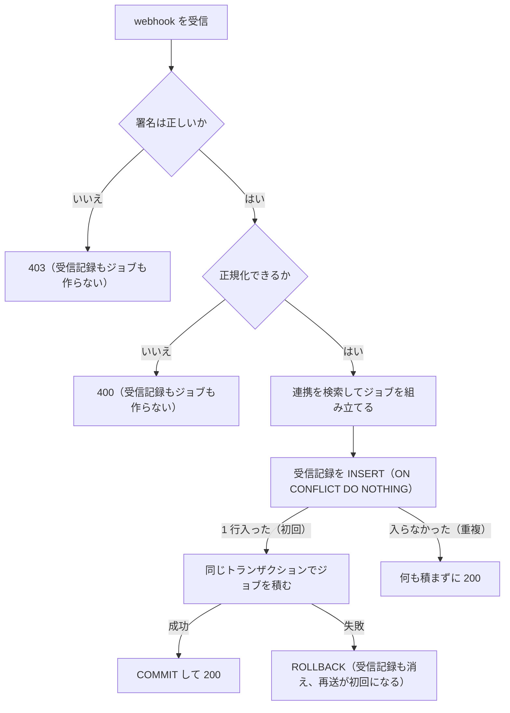

## 概要

[Git ホスティング連携](/features/tasks/github-tasks)のうち、ホストの Webhook を受けてタスク側の処理へ渡す部分を書く。受信エンドポイントで署名検証と正規化を行い、受信記録とジョブ投入を 1 トランザクションで確定し、ジョブが PR・コミット・ブランチのリンクとマージ時の自動完了を処理する。実装済みのホストは GitHub である。列の定義と判断の理由は親ページの[データ](/features/tasks/github-tasks#データ)と[決定の記録](/features/tasks/github-tasks#決定の記録)の節に書く。

## 振る舞い

### 受信エンドポイントと正規化

ホストごとに受信エンドポイントを分け、署名検証とペイロード変換だけをそこで行う。変換後は共通の正規化イベントとして、ジョブ（`job::github_webhook`）へ積む。タスク側の処理（`service::forge`）はホストを知らない。

| ホスト | エンドポイント | 署名検証 | 備考 |
|---|---|---|---|
| GitHub | `POST /v1/github/webhook` | `X-Hub-Signature-256` HMAC | `X-GitHub-Event` が `push` / `pull_request` / `create` / `delete` なら正規化する。`issues` はペイロードのままジョブへ積み、ジョブがタスクへ反映する |

正規化イベント（`service::forge::events`）は次の 4 種類である。

| イベント | 持つもの |
|---|---|
| `Push` | `repo: ForgeRepo` / `ref_name` / `forced` / `before: Option<String>` / `after` / `commits_truncated` / `commits: Vec<ForgeCommit>` |
| `PullRequest` | `repo: ForgeRepo` / `action: PrAction` / `number` / `title` / `body` / `author_handle` / `state` / `merged_at` / `head_sha` / `head_branch` / `html_url` / `updated_at`。`action` は `Opened` / `Edited` / `Synchronize` / `Closed { merged }` / `Reopened` |
| `BranchCreated` | `repo: ForgeRepo` / `branch` / `html_url` |
| `BranchDeleted` | `repo: ForgeRepo` / `branch` |

- `ForgeRepo` は[リポジトリの識別](/features/tasks/github-tasks#リポジトリの識別)の 4 列である。GitHub の `host_url` は `https://github.com` 固定である
- ホスト固有の語彙（GitHub の `installation`、GitLab の `object_kind` / `iid`、Forgejo の `X-Forgejo-Event`）は受信エンドポイントの外へ出さない
- タグの `create` / `delete` は正規化しないので、ペイロードのままジョブに積まれ、受信のログだけを残す
- 処理しない action（`labeled` 等）も受信時に正規化せず、ジョブを積んで受信のログだけを残す
- `PullRequest` のイベントはホスト側の更新時刻 `updated_at` を必ず持つ。受信エンドポイントがペイロードから取り出して詰める。GitHub は `pull_request.updated_at` である
- GitHub の `issues` イベントは[GitHub App 基盤](/features/tasks/github-app)のとおりで、正規化の対象外である

### 切り詰められた push

ホストは push の `commits` に上限を設ける。GitHub は [2048 件](https://docs.github.com/en/webhooks/webhook-events-and-payloads#push)で、載るのは古い側で新しい側が欠ける。ペイロードに総件数を示すフィールドは無いので、受信エンドポイントは「上限ちょうどで届いたか」を `commits_truncated` に落とし、範囲として `before`（push 前の ref の先頭。ブランチを作った push では `None`）と `after`（push 後の ref の先頭）を持たせる。

ワーカーは `commits_truncated` のとき `service::github::commits` で差分を取り直す。

- 既存ブランチへの push は `GET /repos/{owner}/{repo}/compare/{before}...{after}` を引く
- ブランチを作った push は比較の起点が無いので、`after` から履歴を辿る
- 取り直しは 1 ジョブにつき 1 ページ（100 件）で、続きがあれば次のページを持つジョブを積む
- 取り直せなければジョブを成功させず再試行する。配信 ID は受信時点で記録済みで、成功にすると欠けたコミットは二度と処理されない
- 続きの投入は `backfill:{配信 ID}:{連携 ID}:{プロジェクト ID}:{after}:{ページ}` を鍵として受信記録（`forge_webhook_deliveries`）へ入れ、取れたときだけ行う。鍵の INSERT とジョブ投入は受信時と同じく 1 トランザクションで確定する

### 登録

GitHub は登録が要らない。App の webhook は App 側の設定 1 つで、インストール先リポジトリのイベントは自動で届く。必要な権限と購読イベントは [GitHub App 基盤](/features/tasks/github-app)の GitHub App の権限に書く。権限を増やした後は、既存インストールのオーナーが承認するまで新しいイベントは届かない。

### 冪等性

ホストは障害時に同一イベントを複数回送信することがある。配信固有 ID（GitHub は `X-GitHub-Delivery`）で二重処理を防ぐ。受信記録は Postgres に置き、ジョブ投入と同じトランザクションで確定する。受信記録を作るのは署名検証を通った後である。

受信エンドポイントは、署名検証、ペイロードの正規化、対象の連携の検索の順に進み、最後に受信記録とジョブを 1 トランザクションで確定する。

- 正規化できないペイロードは 400 を返すので受信記録は残らない
- 該当する連携が無いときも受信記録だけは作り、ジョブは積まない
- ペイロードに installation が無いときと配信 ID が無いときは受信記録を作らない
- 配信 ID が無いときは再送を見分けられないので、ジョブをそのまま積む

apalis のキューは同じ Postgres（`apalis.jobs`）なので、受信記録とジョブ投入を 1 つのトランザクションに入れられる。ジョブ投入後の失敗はキュー側の再試行に任せる。

実体（`forge_pull_requests` / `forge_commits`）とリンク表の INSERT は常に UPSERT で行い、再送でも行が増えない。アクティビティ行は「そのタスクにとって初めてのリンク」のときだけ積み、判定は `task_activities.dedupe_key` の UNIQUE で行う（[アクティビティ](/features/tasks/github-tasks#アクティビティ)の小節）。

`Closed { merged: true }` 時のタスク遷移は、タスクが既に done 系ステータス（`is_done_state = true`）の場合はスキップして二重遷移を防ぐ。

### イベントごとの処理

正規化後のイベントの処理は次のとおりである。

| イベント | 処理内容 |
|---|---|
| `Push` | 切り詰められていれば欠けたコミットを取り直したうえで、`commits[]` ごとにメッセージをパースし、リンク先があれば `forge_commits` を UPSERT してリンクとアクティビティを作る。リンク先が 1 件も無いコミットは積まない。`forced` でも新 SHA を積むだけである |
| `PullRequest / Opened` | [PR イベント共通の前処理](#pr-イベント共通の前処理)と[コミット集合の同期](#pr-のコミット集合の同期) |
| `PullRequest / Edited` | [PR イベント共通の前処理](#pr-イベント共通の前処理) |
| `PullRequest / Synchronize` | [PR イベント共通の前処理](#pr-イベント共通の前処理)と[コミット集合の同期](#pr-のコミット集合の同期) |
| `PullRequest / Closed { merged: true }` | [PR イベント共通の前処理](#pr-イベント共通の前処理)と[マージ時副作用](#マージ時副作用)。古いイベントでも副作用が未処理なら一度だけ実行する |
| `PullRequest / Closed { merged: false }` | [PR イベント共通の前処理](#pr-イベント共通の前処理)。`state → closed` を action から別途実行しない |
| `PullRequest / Reopened` | [PR イベント共通の前処理](#pr-イベント共通の前処理)。`state → open` を action から別途実行しない |
| `BranchCreated` | ブランチ名をパースし `forge_branch_links` を UPSERT する。行はリンク先タスクのプロジェクトに置く（`forge_commits` と同じ規則）。アクティビティは積まない |
| `BranchDeleted` | 該当の `forge_branch_links` を削除する。webhook を受けた連携のテナント内の行に限る |

### PR イベント共通の前処理

`PullRequest` のすべての action は、次の比較で適用対象のスナップショットを決め、`forge_pull_requests` の更新とリンク集合の再構築を共通処理として行う。PR 行がまだ無ければここで作成するので、`Opened` を受信していない既存 PR でも最初の `Synchronize` / `Edited` / `Closed` / `Reopened` だけで実体とリンクが揃う。

何を適用するかは、イベントの `updated_at` と既存行の `host_updated_at` の比較で決める。

| 比較 | 適用するもの |
|---|---|
| `>` | イベントのペイロード |
| `<` | PR スナップショットを適用しない。UPSERT・現在リンクの再構築・状態遷移は行わない。元の action に応じたコミット集合の同期とマージ時副作用は、それぞれの規則で処理する |
| `=` | ペイロードではなく、ホストの PR 取得 API（GitHub は `GET /repos/{owner}/{repo}/pulls/{number}`、`service::github::client::fetch_pull_request`）で取り直した現在のスナップショット |

- 既存行に `host_updated_at` が無い（`NULL`）ときは `>` として扱う。レビューラウンドの起票や、ホストから取得できなかった手動リンクだけで作られた行である
- `=` で取得に失敗したら（レート制限・5xx・ネットワーク断）部分的に適用せずジョブを失敗させ、キューの再試行に任せる

この比較から UPSERT、`title` / `body` / `branch` の現在リンク再構築、トランザクションの COMMIT までを、同じ transaction-level advisory lock の中で行う。

- 鍵は PR の自然キー（`project_id` + `host` + `host_url` + `repo_owner` + `repo_name` + `number`）を連結した文字列の `hashtext` である（`pg_advisory_xact_lock(hashtext(...))`）
- トランザクションを開始してこのロックを取得してから `host_updated_at` を読み、`=` のときのホスト API 取得もロック保持中に行う
- 行がまだ無い場合も `pull_request_id` ではなくこの自然キーのロックを先に取る
- ロック解放は COMMIT / ROLLBACK に任せ、`<` の判定を含む比較と書き込みを同じトランザクションで再確認する

適用対象が決まったら、元の action を状態遷移の根拠にしない。

- スナップショットの `merged_at` があれば実効状態を `merged`、無ければスナップショットの `state`（`open` / `closed`）とする
- 少なくとも `title` / `author_handle` / `state` / `head_sha` / `html_url` / `merged_at` / `host_updated_at` を UPSERT する
- マージは取り消せないので、既存行が `merged` なら取得・ペイロードのスナップショットが `open` / `closed` でも戻さない
- ここで確定する実効状態は現在表示用であり、マージ時のタスク完了の処理済み判定には使わない
- PR 行が初めて `merged` になった処理では、同じトランザクションで `pr_merged` 通知を出す（[通知・ウォッチャー](/features/tasks/notifications)）

適用対象になったすべての PR action で、そのスナップショットのタイトル・本文・head ブランチから `title` / `body` / `branch` のリンクを再構築する。

- 元の action が `Synchronize` / `Reopened` / `Closed { merged: false }` でも例外にしない
- 再構築は追加だけでなく削除も含む。対象の `source` について、スナップショットから導いたリンクの集合と一致させる。現在の行のうち集合に無いものを削除し、足りないものを INSERT する。同一トランザクション内で行う
- `manual` のリンクは残す
- この集合は現在表示用であり、マージ時の完了対象は[マージ時副作用](#マージ時副作用)で決める
- マージイベントが現在状態にも適用される場合は、この再構築でマージ時点の表示へ揃う。後着した古いマージイベントは現在表示用リンクを再構築しない

共通処理は `service::forge::pull_requests::apply_pull_request` である。

### マージ時副作用

`Closed { merged: true }` だけが、タスク完了の根拠になる。現在状態の同期とは独立に、イベントの `updated_at` が `host_updated_at` より古い場合もこの処理を行う。マージ後の `Edited` / `Synchronize` や、PR 取得 API の現在スナップショットで `merged_at` を観測しただけでは行わない。

元の `Closed { merged: true }` ペイロードのタイトル・本文・head ブランチを解析し、そのイベント固有のマージ時点集合をメモリ上で作る。現在表示用の `forge_pull_request_links` はこの集合へ戻さない。自動完了の候補は、次の行を `task_id` ごとにまとめて `bool_or(closes)` が true になる未完了タスクである。

- マージ時点集合の `title` / `body` / `branch` 由来の参照
- `created_at <= merged_at` で、処理時点にも残っている `manual` 行

マージ後に追加された手動リンクは過去のマージの完了対象にしない。マージ前に作られていても処理前に利用者が削除した手動リンクは、明示的なリンク解除を尊重して対象にしない。

PR 行をロックし、`merge_effects_processed_at IS NULL` の場合だけ、上記タスクの完了と `merge_effects_processed_at` の設定を同一 DB トランザクションで行う。同じ PR の再試行・重複配送・並行 `Closed` でも副作用は一度だけになる。処理に失敗した場合はすべてロールバックし、列を NULL のままにして再試行する。

`Closed { merged: true }` を一度も受信できず、別 action の現在スナップショットだけで初めて `merged` を観測した場合、PR の表示状態は `merged` に更新するが、副作用は推測せず `merge_effects_processed_at = NULL` のまま保持する。後から `Closed` が届けば、そのイベントが古くても処理を行う。現在リンクされているタスクを一括で自動完了する回収処理は設けない。

実装は `service::forge::merge_effects::apply_merge_effects` で、共通処理の COMMIT の後に別トランザクションで呼ぶ。

- 完了先はタスクのプロジェクトの `is_default_done` のステータス、無ければ `is_done_state` の先頭である
- 完了系ステータスが 1 つも無いプロジェクトのタスクは完了させずログに残す
- 遷移したタスクには `forge_pull_request_merged` と `status_changed` を積む。どちらも `user_id` は NULL である
- 通常のステータス変更と同じく `status_changed` の通知を出す
- 必須カスタムフィールドの検査は GitHub Issue の同期と同じく行わない
- GitHub Issue から取り込んだタスク（`github_issue_links` がある）は、通常のタスク更新と同じく完了と同じトランザクションで書き戻しのフラグ（`pending_push`）を立て、ジョブがコミット後に書き戻しを積む。積めなくてもフラグが残るので書き戻しのスイープが拾う

`Closed` が届く見込みが無い PR は、利用者が手で対応を終えた時点で[確認済みにする操作](/features/tasks/github-tasks#マージ時副作用の確認済み操作)（`POST .../merge-effects/acknowledge`）から `merge_effects_processed_at` を設定できる。以後この PR の副作用は NULL 判定で実行されないので、後から `Closed` が届いてもタスクを二重に完了させない。

### PR のコミット集合の同期

`Opened` と `Synchronize` の両方で、`updated_at` の比較結果にかかわらず PR のコミット一覧 API（GitHub は `GET /repos/{owner}/{repo}/pulls/{number}/commits`）を引き、その PR に属する `forge_pull_request_commits` を一覧と一致させる。同値の場合だけ呼ぶ PR 取得 API（`GET /pulls/{number}`）とは別の取得である。

同じ PR の同期は、最初の API リクエストから DB 反映の COMMIT まで直列化する。

- ワーカー全体の並列度には依存しない
- トランザクション開始後に、Postgres の `pull_request_id` 由来の `pg_advisory_xact_lock` を API の 1 ページ目を取得する前に取り、手順 1〜4 と `commits_complete` の更新を確定してから解放する
- 別プロセスのワーカーにも同じ PR 識別キーが効き、COMMIT / ROLLBACK で自動解放される
- 先行ジョブの取得中に force-push と後続イベントが起きても、後続ジョブは先行ジョブの反映完了後に API を取得する。最終的には後続ジョブが取得した現在一覧へ収束する

取得は全ページを読み切る。ホストの既定ページサイズに任せず（GitHub は既定 30 件・最大 100 件）、`per_page` を最大にして次が無くなるまで読む。GitHub の終端の判定は、返った件数が `per_page` 未満になったときである（Issue の取り込み `service::github::issues` と同じ判定）。

全ページを読めたら `forge_pull_requests.commits_complete = true`、途中のページで失敗した・ホストの上限に当たったら `false` にする。手順は次のとおりである。

1. 一覧の各コミットで `forge_commits` を UPSERT する。`Push` と同じ正規化である。`Push` webhook を受けていないコミット（連携前の push、PR 作成だけで push が続かない場合）はここで実体ができる
2. メッセージをパースして `forge_commit_links` を UPSERT し、アクティビティは新規行のときだけ積む（`Push` と同じ）
3. `forge_pull_request_commits` を UPSERT する
4. 読み切れたときだけ、その `pull_request_id` の行のうち一覧に無いものを削除する

削除の規則は次のとおりである。

- `forge_commits` 本体・`forge_commit_links`・アクティビティは削除しない。消すのは中間表の行だけである
- 削除はその `pull_request_id` に限る。同じコミットが別の PR にも属している場合、他の PR の行は残る
- 読み切れなかったときは手順 1〜3 の UPSERT だけ行う

実装は `service::forge::pull_request_commits::sync_pull_request_commits`（GitHub の取得は `service::github::commits::fetch_pull_request_commits_page`）である。

- 途中のページで失敗したときは、読めた分の UPSERT と `commits_complete = false` を確定させてからジョブを失敗させ、再試行に回す
- 手順 3 の中間表は PR 行と同じプロジェクト（webhook を受けた連携）の `forge_commits` 行に結ぶ
- 手順 1〜2 のタスクへのリンクはリンク先タスクのプロジェクトの行に置くので、リンク先が別プロジェクトにあるコミットは実体が 2 行になる

GitHub の「PR のコミット一覧」は 250 件が上限で、それを超える PR ではこの API から集合を確定できない。ページングを読み切っても 250 件で頭打ちになるので、`commits_complete = false` のままにして削除を行わず、[リポジトリセクション](/features/tasks/github-tasks#リポジトリセクション)に「コミット一覧は一部のみ」と出す。

条件はホストごとの件数ではなく「全ページを読み切れたときだけ削除する」という形で持つ。ホスト固有の上限（GitHub の 250 件）はホストごとの取得処理（`service::github::commits`）が `host_limit_reached` として返し、タスク側の処理はそのフラグだけを見る。

### コミットの取り込みの範囲

コミットの取り込み経路は 2 つで、webhook の `Push` と、`Opened` / `Synchronize` を契機に引く PR のコミット一覧である。後者は `Push` を受けていないコミットの実体・タスクリンク・アクティビティも作る。どちらも「webhook を受けた PR / push」の範囲に限り、連携開始時にリポジトリ全体を遡る処理は無い。`POST /github/import` は Issue 専用である。

## 未実装と既知の制限

受信エンドポイントと登録で GitLab / Forgejo が未実装である。足すときの設計は次のとおりである。

| ホスト | エンドポイント | 署名検証 | 備考 | 登録 | 配信 ID |
|---|---|---|---|---|---|
| GitLab | `POST /v1/gitlab/webhook` | `X-Gitlab-Token` の定数比較 | `object_kind` で分岐 | 連携フローで `POST /projects/:id/hooks`（push / merge_requests。tag は不要）を登録し、`secret_token` を保存する。解除で `DELETE` | `X-Gitlab-Event-UUID` |
| Forgejo | `POST /v1/forgejo/webhook` | `X-Forgejo-Signature` HMAC | ペイロードは GitHub にほぼ互換 | 連携フローで `POST /repos/{owner}/{repo}/hooks`（push / pull_request / create / delete）を登録する。解除で `DELETE` | `X-Forgejo-Delivery` |

- 登録が要るホストでは、連携表に hook の id と secret（暗号化）を持つ設計である。`forge_integrations` を作るときに入れる列で、現状の表には無い
- `updated_at` は Forgejo なら `pull_request.updated_at`、GitLab なら `object_attributes.updated_at` から取り出す。取り出せないホストを足すときは、そのホストの適用規則を先に決める必要がある
- 古い受信記録の掃除が無い。設計では掃除ジョブで 30 日分だけ残す。ホストの再送は長くても数時間で終わり、UNIQUE を保つのに必要なのは再送が届きうる期間だけである。`created_at` のインデックスは用意してあるが、今は行を消す処理が無い
- ホストの上限を超える PR のコミット集合を確定できない。確定させる必要が出たら、上限のない `GET /repos/{owner}/{repo}/commits?sha={head_sha}` 側で base との差分を組む方針である
- 連携開始時の過去分の取り込みが無い。必要になったら「open な PR と既定ブランチの直近 N コミット」を取り込む拡張を足す方針である
- Automation の投入が無い。Automation は[自動化](/features/tasks/automation)のとおり存在せず、トリガー `pull_request_merged`（旧名 `github_pr_merged` も別名として受ける）の永続ジョブは、実装するときにマージ時副作用のトランザクションで積む設計である

次の受け入れ条件はテストが無い。

- 受信記録: ジョブ投入が失敗した配信は受信記録も残らず、同じ `delivery_id` の再送が初回として処理される。`host_url` だけが違う同じ `delivery_id` は別の配信として扱う
- PR イベントのスナップショット並行実行: ワーカー並列度を 2 以上にし、同じ自然キーで行が無い状態から 2 ジョブを開始する。先行ジョブをスナップショット取得後に停止し、後続ジョブを開始して旧世代の取得・逆順 COMMIT を狙う停止点を入れても、自然キー由来の transaction-level advisory lock が比較から UPSERT・3 source のリンク再構築・COMMIT までを直列化し、後続ジョブは比較前にロック取得を待って世代を再読する。古い PR 状態やリンクへ巻き戻さず、同じ PR の初回作成でも行は 1 件だけになる。別 PR のジョブは並行して進められる
- 同じ秒の状態遷移: 同一 `updated_at` の `Closed { merged: false }` と `Reopened` を両方の配送順で処理し、いずれも最終的な `state` とリンク集合が PR 取得 API の現在のスナップショットと一致する。後着した元 action の状態遷移を重ねて実行しない。取得結果が `merged` でも `Closed { merged: true }` を受信していなければ、表示状態だけを `merged` にして `merge_effects_processed_at` は NULL のまま、タスク完了は行わない
- コミット集合の同期の並行実行: ワーカー並列度を 2 以上にし、同じ PR のジョブ A が force-push 前の一覧取得を開始したところで停止させ、force-push 後のジョブ B も開始する。B は A が反映を COMMIT するまでコミット API を呼ばず、ロック取得後に新しい一覧を取得・反映する。最終集合は force-push 後の一覧になり、別 PR の同期は同時に進められる

次の受け入れ条件は、テストファイルへ移した部分を除いた次のサブ条件のテストが無い。

- アクティビティの冪等: 同じ PR ↔ タスクを指す 2 つのイベントを同時に処理しても 1 行
- `Closed { merged: true }`: head ブランチ・タイトル由来の `Closes`、処理前に消えた `manual` 行
- マージ副作用の冪等性: 2 ジョブ並行、並行時に列が一度だけ設定されること、遷移の失敗でのロールバックと再試行
- `Closed { merged: true }` の初回観測: `Closes KEY-N` のタスクの完了、最新の `title` / `author` / `head_sha` / `html_url`、本文と head ブランチ由来のリンク
- PR イベントの共通スナップショット: 最初のイベントが `Reopened` のケース、本文と head ブランチの `KEY-N`、`branch` source のリンク
- 配送順の逆転: `Closed` の後に古い `Opened` / `Synchronize` が届くケース、`head_sha` が巻き戻らないこと、古い `Opened` でのコミット一覧 API
- マージ後編集の先着: この順序で副作用と列の設定が一度だけであること
- 同じ秒のイベント: `Closed`、`Synchronize`、`Edited` の逆順、5xx のときリンクが変わらないこと
- `Closed` のリンクと副作用: 本文の参照が消えたまま `Edited` を受け取れず `Closed` が届くシナリオ、再構築で `manual` が消えないこと、処理時点に残る行の絞り込み
- 複数参照元: 本文だけ `Closes` 付きでマージ時点には本文から消えていれば自動完了しないシナリオ
- コミット集合の同期: `=` のときのコミット一覧 API、同じ秒の古いイベントの後着、`Opened` の `<` / `=`
