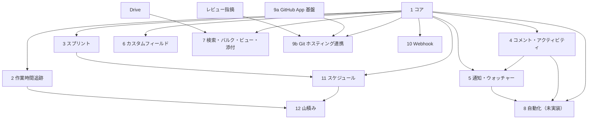

タスク機能の仕様は機能グループごとのページに分かれている。このページは、各機能の実装状況と共通の決まりをまとめる。

## 機能一覧

「API」はバックエンドの REST API とジョブ、「画面」は `apps/frontend` の Web 画面を指す。「依存」の番号は `#` の列の番号である。

| # | 機能グループ | 内容 | 仕様 | 依存 | API | 画面 |
|---|---|---|---|---|---|---|
| 1 | コア | CRUD・ステータス・担当者・ラベル・マイルストーン・依存関係 | [tasks/core](/features/tasks/core) | なし | 実装済み | 一覧・詳細・設定は実装済み。カンバンとマイルストーン管理は未実装 |
| 2 | 作業時間追跡 | タイマー・手動ログ | [tasks/time-tracking](/features/tasks/time-tracking) | 1 | 実装済み | 未実装（実績は山積みの計算にだけ使う） |
| 3 | スプリント | イテレーション・バーンダウン | [tasks/sprints](/features/tasks/sprints) | 1 | 実装済み | 専用画面は未実装（カレンダーに帯だけ出す） |
| 4 | コメント・アクティビティ | スレッド・変更履歴・@メンション | [tasks/collaboration](/features/tasks/collaboration) | 1 | 実装済み | 実装済み |
| 5 | 通知・ウォッチャー | in-app・メール・購読 | [tasks/notifications](/features/tasks/notifications) | 1, 4 | 実装済み | 未実装 |
| 6 | カスタムフィールド | プロジェクト固有属性 | [tasks/custom-fields](/features/tasks/custom-fields) | 1 | 実装済み | 定義の管理だけ実装済み。タスクごとの値の入力は未実装 |
| 7 | 検索・バルク・ビュー・添付 | 全文検索・一括更新・保存フィルター・Drive 連携 | [tasks/extensions](/features/tasks/extensions) | 1, Drive | 実装済み | 検索・類似タスク・添付は実装済み。一括操作と保存済みビューは未実装 |
| 8 | 自動化 | トリガーとアクションのエンジン | [tasks/automation](/features/tasks/automation) | 1, 4, 5 | 未実装 | 未実装 |
| 9a | GitHub App 基盤 | インストール・認証情報管理・Webhook 受信インフラ | [tasks/github-app](/features/tasks/github-app) | なし | 実装済み | 実装済み |
| 9b | Git ホスティングとタスクの連携 | PR・コミット・ブランチのリンク、マージ時の自動完了、コミットのアクティビティ表示。ホスト中立モデル | [tasks/github-tasks](/features/tasks/github-tasks) | 1, 9a, レビュー指摘 | 実装済み | 実装済み |
| 10 | Webhook | 外部向けイベント送信。レビューイベント・Discord 形式を含む | [tasks/webhooks](/features/tasks/webhooks) | 1 | 実装済み | 実装済み |
| 11 | スケジュール | 期間に重なるタスク・スプリント・マイルストーンの一括取得 | [tasks/schedule](/features/tasks/schedule) | 1, 3 | 実装済み | 実装済み |
| 12 | 山積み・手動の山崩し | メンバー・日ごとの残工数の棒、開始予定日のドラッグ | [tasks/workload](/features/tasks/workload) | 1, 2, 11 | 実装済み | 実装済み |

## 依存関係図

矢印は「元の機能が先に要る」ことを表す。コアにはほぼすべての機能が依存する。自動化は未実装で、Git ホスティング連携のマージ時の自動完了は自動化エンジンを使わず独立に動く。

## 実装状況の読み方

仕様は「現在どう動くか」を書く。まだコードが無いものは、各ページの「未実装と既知の制限」の節に書く。API の機械可読な定義元は `apps/frontend/openapi.json` で、API を変えたら `pnpm openapi` で再生成する。

## 共通仕様

### スコープ

個人アクセストークンのスコープは `entity::scopes::Scope` に定義している。タスク機能で使うのは次の値である。

| スコープ | 主な用途 |
|---|---|
| `read:task` / `write:task` | タスク・ステータス・ラベル・コメント・作業時間・ウォッチャー・カスタムフィールド・保存済みビュー・添付・通知（タスク系） |
| `read:milestone` / `write:milestone` | マイルストーン |
| `read:sprint` / `write:sprint` | スプリント。完了とタスクの割り当ては `write:sprint` と `write:task` の両方が要る |
| `read:review` / `write:review` | レビュー指摘・通知（レビュー系） |
| `read:project` / `write:project` | プロジェクト本体。外部向け Webhook の管理は `write:project` で行う |
| `read:tenant` / `write:tenant`・`read:drive` / `write:drive` | テナントと Drive |
| `api` / `read_api` | `api` はすべての `read:*` / `write:*` を、`read_api` はすべての `read:*` を満たす |

### URL 規則

- プロジェクトスコープのリソースは `/v1/tenants/{tenant_id}/projects/{project_id}/...` である
- テナント横断のリソースは `/v1/tenants/{tenant_id}/...` である。例は `/schedule`、`/users/me/tasks`
- 利用者スコープのリソースは `/v1/users/me/...` である
- システムエンドポイント（GitHub Webhook 受信など）は `/v1/...` である

### 優先順位 enum

DB には snake_case で保存し、API の JSON には enum 名（PascalCase）で出し入れする。例外は `GET /tasks` の `priority` クエリで、こちらは DB 値（`high` など）を受け取る。アクティビティの `payload` も DB 値である。

| DB 値 | JSON の値 | 画面の表示 | 色 |
|---|---|---|---|
| `critical_fire` | `CriticalFire` | 緊急 | `#dc2626` |
| `critical` | `Critical` | 重大 | `#ef4444` |
| `high` | `High` | 高 | `#f97316` |
| `medium` | `Medium` | 中 | `#eab308` |
| `low` | `Low` | 低 | `#6b7280` |
| `trivial` | `Trivial` | 些細 | `#9ca3af` |

### タスク連番 ID

プロジェクト内で `ENG-1`, `ENG-2`, ... の連番を振る。`ENG` はプロジェクトキーである。`project_task_counters` の行を `SELECT ... FOR UPDATE` でロックして採番するので、同時に作成しても番号は重複しない。`GET /tasks/{id}` など `{id}` を取る API は UUID と `KEY-N` のどちらでも受け付ける。GitHub の `#N`（Issue 番号）と区別するためにこの形式を採用している。
