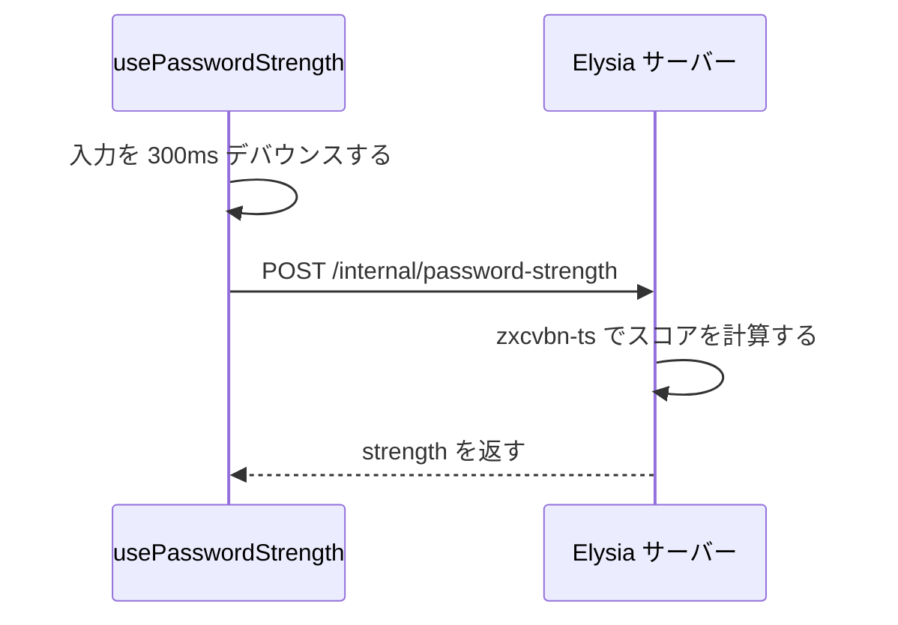

サインアップとサインインのフォームの仕様を示す。パスワードの表示切り替え、強度メーター、検証エラーの表示条件を含む。パスワードリセットの流れは[パスワードリセットと変更](/dev/features/auth/password-reset)に書く。

## コンポーネント構成

パスは `apps/frontend/` からの相対パスである。

| ファイル | 役割 |
|---|---|
| `src/components/auth/SignUpForm.vue` | 新規登録フォーム |
| `src/components/auth/SignInForm.vue` | サインインフォーム |
| `src/components/auth/OAuthButtons.vue` | OAuth ログインのボタン。両フォームが使う |
| `src/components/auth/EmailNotVerified.vue` | メール未確認の案内。登録の完了後と、未確認でのサインイン時に出す |
| `src/components/auth/PasswordStrengthBar.vue` | パスワード強度バー |
| `src/components/HydrationSafeForm.vue` | ハイドレーションが済むまで送信を止めるフォーム |
| `src/composables/usePasswordStrength.ts` | 強度判定のコンポーザブル（API クライアント） |
| `src/composables/__tests__/usePasswordStrength.test.ts` | 強度判定のユニットテスト |
| `src/components/auth/__tests__/SignInForm.test.ts`、`SignUpForm.test.ts` | フォームのユニットテスト |
| `server/elysia.ts` | SSR サーバー（`POST /internal/password-strength` を含む） |

強度バーと `usePasswordStrength` は、リセット後の再設定（`PasswordResetCompleteForm.vue`）と設定画面のパスワード変更（`settings/PasswordMethodRow.vue`）でも使う。

## パスワード表示トグル

パスワード入力は `@koyori-app/ui-vue` の `PasswordInput` を使い、表示と非表示の切り替えはこの部品が持つ。`PasswordInput` は `onFocus` / `onBlur` を受けず、ルート要素が `span` である。そのためフォームはルート要素の捕捉フェーズ（`@focus.capture` / `@blur.capture`）でフォーカスの変化を受け取り、`SignUpForm` はこれで `passwordFocused` を管理する。

## パスワード強度判定

スコアの計算は Elysia の SSR サーバーで行い、クライアントは API から結果だけを受け取る。

Vite の開発プロキシと Elysia の API プロキシが中継するのは `/api` だけなので、`/internal/` はどちらにも重ならない。開発環境と本番環境のどちらでも、`elysia.ts` がこのパスを直接処理する。

### エンドポイント

`POST /internal/password-strength` の形は次のとおりである。

- リクエストは `{ password: string }` である。256 文字までで、超えるとスキーマ違反で弾く
- レスポンスは `{ strength: '' | 'low' | 'medium' | 'high' }` である

パスワードは記録せず、認証も求めない。サインイン前のフォームから呼ぶためである。

### スコアの対応

| zxcvbn score | strength |
|---|---|
| 0–1 | `low` |
| 2–3 | `medium` |
| 4 | `high` |
| 空文字 | `''` |

### 辞書

`ZxcvbnFactory` の `dictionary` に `commonPackage.dictionary` と `jaPackage.dictionary` を渡し、`graphs` に `commonPackage.adjacencyGraphs` を渡す。日本語パッケージの辞書は一般語、姓名、Wikipedia 由来の語を含む。日本語のローマ字パスワード（`sakura`、`hanako` など）を低く評価するためである。

### 古いレスポンスの破棄

高速に入力すると古いレスポンスが後から届き、新しい結果を上書きすることがある。`usePasswordStrength` はこれを連番 `seq` で防ぐ。

- fetch の前に `seq` を増やし、その値を `id` として持つ
- 空文字にリセットしたときも `seq` を増やし、進行中のリクエストを無効にする
- 受信時に `response.ok` が偽か `id !== seq` なら結果を捨てる

通信や JSON の解析に失敗したときは、直前の強度の表示を保つ。

## SignUpForm の表示

TanStack Form と ArkType を使う。

| フィールド | 検証ルール | タイミング |
|---|---|---|
| username | 3 文字以上 | onBlur と送信時 |
| email | email 形式 | onBlur と送信時 |
| password | 8 文字以上 | onBlur と送信時 |

バックエンドの `RegisterRequest` も同じ条件（ユーザー名 3 文字以上、email 形式、パスワード 8 文字以上）で検証する。送信ボタンは `canSubmit` が偽の間、送信中、ハイドレーション前は押せない。

### ユーザー名の説明とエラー

`Field` に説明文「3文字以上で設定してください。」を常に渡し、検証エラーは `isTouched` のときだけ渡す。

### パスワードの説明、エラー、強度バー

`Field` に説明文「8文字以上で設定してください。」を常に渡す。エラーと強度バーの条件は次のとおりである。

| 表示 | 条件 |
|---|---|
| 検証エラー | エラーがあり、`isTouched` であり、「入力済みかつフォーカス中」ではないとき |
| `PasswordStrengthBar` | 1 文字以上で、フォーカス中またはエラーなしのとき |

入力を続けている間はエラーを出さず、強度を返す。入力中の利用者には、未確定の値へのエラーより強度の情報を優先するためである。

### PasswordStrengthBar

- 3 セグメントのカラーバー（赤、黄、緑）である
- `v-if="strength"` なので、空文字のときは何も描画しない
- ラベルは「弱い」「普通」「強い」である
- `role="meter"` と `aria-valuenow`、`aria-valuemin`（1）、`aria-valuemax`（3）、`aria-label` で強度を支援技術へ伝える

### 登録後の表示

登録 API が成功すると、フォームの代わりに `EmailNotVerified` を出す。失敗したときは「登録に失敗しました。時間をおいて再度お試しください。」を出し、原因を区別しない。

バックエンドは既存のメールアドレスにも同じ 201 を返し（メールアドレスの列挙対策）、そのアドレスには「登録済み」の通知メールを送る。したがってフォームが重複を知ることは無い。

## SignInForm の表示

| フィールド | 検証ルール | タイミング | エラーを出す条件 |
|---|---|---|---|
| email | email 形式 | onChange と送信時 | onBlur 後、または送信を試みた後 |
| password | 8 文字以上 | onBlur と送信時 | エラーがあるとき |

email の表示は `isBlurred` で抑えるので、入力途中にはエラーが出ない。

`canSubmitWhenInvalid: true` により、送信ボタンは送信中とハイドレーション前だけ押せない。送信時に全フィールドを検証し直すので、古いエラーもここで消える。

サインインの結果による動作は次のとおりである。

| 結果 | 動作 |
|---|---|
| 成功 | Desktop の承認画面または招待の承諾画面から来たならそこへ、それ以外は `/` へ移動する |
| 403 かつ `message` が `email-not-verified` | `EmailNotVerified` を出す。403 は CSRF 拒否や凍結でも返るので、本文で判定する |
| その他のエラー | 「メールアドレスまたはパスワードが正しくありません。」を出す |
| `requires_2fa` を含む応答 | [未実装と既知の制限](#未実装と既知の制限)の節を参照する |

パスワード変更で全セッションが失効した場合、設定画面が同じタブに残した通知（`PASSWORD_CHANGED_NOTICE`）を読み、サインインのやり直しが必要な理由を表示する。

## 未実装と既知の制限

Web の 2 段階認証は未実装である。バックエンドは 2FA の対象者に `requires_2fa` / `requires_2fa_setup` を返す（[2 段階認証](/dev/features/auth/2fa)）。`SignInForm` はこの応答を受けるとログアウトし、「二要素認証は現在サポートされていません。」を表示する。したがって 2FA の対象者は、Web のパスワードサインインを完了できない。

## 決定の記録

| 日付 | 決定 | 理由 |
|---|---|---|
| 2026-06-15 | zxcvbn-ts をクライアントバンドルに載せず、サーバーで計算する | パッケージが辞書を含めて数 MB ある |
| 2026-11-04 | サインインの email を onChange で検証する | onBlur だと入力を直しても次にフォーカスを外すまでエラーが残る。表示の抑制に `isTouched` は使えない。change でも真になるためである（日付は不明） |
| 2026-11-04 | サインインの送信ボタンを `canSubmit` で塞がない | 塞ぐと、onBlur 由来のエラーが残った状態で Enter を押しても 1 回目の送信が無反応になり、理由も画面に出ない（日付は不明） |
