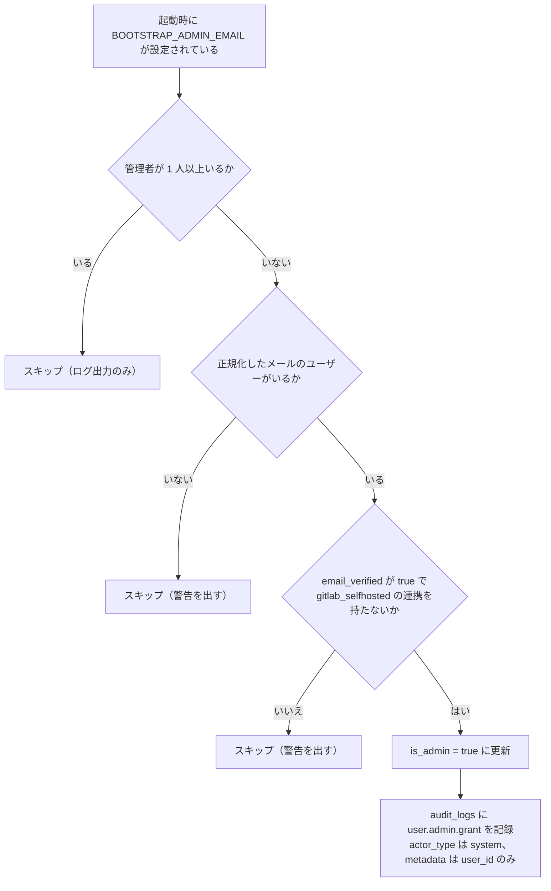

> ステータス: **バックエンド実装済み。管理画面は未実装（§9）。一般ユーザー操作の監査は `user.profile.update` を除き未実装（§6.1）** / 作成日: 2026-05-27
> **依存: なし（`users` + `tenants` テーブルのみ使用）**

---

## 1. 概要

本機能は 2 つからなる。

1. **サービス管理者フラグ** — `users.is_admin` による、テナントを横断した全権管理者の識別
2. **監査ログ** — 管理者操作を `audit_logs` テーブルに記録し、管理者が検索・閲覧できる

管理者（`is_admin = true`）が実行できる操作:

| カテゴリ | 操作 |
|---------|------|
| **閲覧** | 全テナントの一覧と詳細、テナント配下のプロジェクト一覧、プロジェクト配下のタスク一覧（読み取り専用） |
| **ユーザー管理** | ユーザーの作成・停止・停止解除・強制削除、管理者フラグの付与・剥奪 |
| **ユーザー管理** | パスワードリセットメールの送信（送信先メール指定可） |
| **ユーザー管理** | パスキー削除・2FA リセット・OAuth 連携解除 |
| **テナント管理** | テナント強制削除 |
| **システム** | システム設定変更 |
| **監査** | 監査ログ閲覧・検索 |
| **運用** | ジョブ管理画面（apalis board）の閲覧 |

> **閲覧は読み取り専用**: 管理者 API でテナント・プロジェクト・タスクの内容を編集することはできない。

ジョブ管理画面を管理者に限るのは、ジョブのペイロードにメール認証トークンやメールアドレスが含まれるためである。
公開 API と同じリスナーに載せるので、ミドルウェア（`require_admin_session`）で管理者のセッションに限定している。

---

## 2. データモデル

### 2.1 `users` テーブルのカラム

```rust
// entity/src/_generated/users.rs（管理者機能に関わるもの）
pub is_admin: bool,
pub is_suspended: bool,
pub sessions_revoked_at: Option<DateTimeWithTimeZone>,
```

1 ユーザーにつき `is_admin` フラグ 1 本のみ。ロール階層は設けない（管理者か否かの 2 値）。

---

### 2.2 `audit_logs` テーブル

```rust
pub struct Model {
    pub id: Uuid,
    pub actor_id: Option<Uuid>,      // NULL = システム自動実行
    pub actor_type: String,          // "user" | "system"
    pub action: String,              // ドット記法（例: "user.admin.grant"）
    pub resource_type: String,       // "user" | "tenant" | "system"
    pub resource_id: String,         // 対象リソースの ID（UUID 文字列など）
    pub tenant_id: Option<Uuid>,     // テナントスコープ操作のみ設定
    pub metadata: Option<Json>,      // before/after など
    pub ip_address: Option<String>,  // X-Forwarded-For の先頭、無ければ X-Real-IP
    pub user_agent: Option<String>,
    pub created_at: DateTimeWithTimeZone,
}
```

| カラム | 型 | 制約 | 説明 |
|--------|-----|------|------|
| `id` | UUID | PK | |
| `actor_id` | UUID | NULLABLE, FK→users SET NULL | 操作者ユーザー。NULL = システム |
| `actor_type` | VARCHAR | NOT NULL | `user` / `system` |
| `action` | VARCHAR | NOT NULL | ドット記法アクション名（§6.1） |
| `resource_type` | VARCHAR | NOT NULL | 対象リソース種別 |
| `resource_id` | VARCHAR | NOT NULL | 対象リソース ID |
| `tenant_id` | UUID | NULLABLE, FK→tenants SET NULL | テナントスコープ操作のみ |
| `metadata` | JSONB | NULLABLE | 変更前後・補足情報など |
| `ip_address` | VARCHAR(45) | NULLABLE | |
| `user_agent` | VARCHAR | NULLABLE | |
| `created_at` | TIMESTAMPTZ | NOT NULL DEFAULT now() | |

> **監査ログは追記専用（append-only）**: 更新・削除する API は無い。DB では `app_role` というロールが存在する環境に限り `UPDATE` / `DELETE` を剥奪する（§3）。保持期間によるアーカイブ・物理削除は未実装で、行は残り続ける。

---

### 2.3 `system_settings` テーブル

サーバー全体の設定を 1 行だけ持つテーブルである（`singleton` が主キーで、CHECK により `true` だけを許す）。

| カラム | 型 | 既定値 | 説明 |
|--------|-----|-------|------|
| `user_registration_enabled` | BOOLEAN | `true` | 新規登録を受け付けるか。パスワード登録と OAuth の新規作成が参照する |
| `drive_default_quota_mb` | BIGINT | `10240` | §7.4 の注記を参照 |
| `drive_system_max_quota_mb` | BIGINT | `102400` | §7.4 の注記を参照 |

---

## 3. マイグレーション

3 つのテーブルの定義は初期スキーマ（`m20260520000000_initial_schema`）にまとまっている。監査ログのインデックスと権限は次のとおりである。

```sql
CREATE INDEX idx_audit_logs_actor_id ON audit_logs(actor_id);
CREATE INDEX idx_audit_logs_action ON audit_logs(action);
CREATE INDEX idx_audit_logs_resource ON audit_logs(resource_type, resource_id);
CREATE INDEX idx_audit_logs_tenant_id ON audit_logs(tenant_id);
CREATE INDEX idx_audit_logs_created_at ON audit_logs(created_at DESC);

-- app_role は外部プロビジョニング前提で、存在しない環境もある。存在するときだけ剥奪する
DO $$ BEGIN
  IF EXISTS (SELECT 1 FROM pg_roles WHERE rolname = 'app_role') THEN
    REVOKE UPDATE, DELETE ON audit_logs FROM app_role;
  END IF;
END $$;
```

---

## 4. 初期管理者のブートストラップ

アプリ起動時に `BOOTSTRAP_ADMIN_EMAIL` 環境変数が設定されている場合、管理者が 1 人もいなければ該当ユーザーの `is_admin` を `true` に設定する。



> **昇格の条件**: email が確認済み（`email_verified = true`）で、その確認の出所が確かな利用者だけを昇格する。確かな出所は、password の登録の確認メール・GitHub・gitlab.com・Google・運用者が設定した OIDC。`gitlab_selfhosted` の連携を持つ利用者は、確認の印を運用者の外の instance から受け取ったことがありうるため昇格しない。初期管理者は password で登録して確認メールを通すか、上の provider でログインしてから起動する。

> **安全ガード**: 管理者が既に存在する場合はブートストラップを実行しない。これにより、運用中に環境変数が誤設定されても意図しない権限付与が発生しない。初期構築後は `BOOTSTRAP_ADMIN_EMAIL` を環境変数から削除することを推奨する。

---

## 5. AdminUser エクストラクタ

```rust
/// is_admin = true のユーザー専用エクストラクタ。セッション認証のみ受理（PAT・Device Token は不可）。
pub struct AdminUser {
    pub user_id: Uuid,
}

impl FromRequestParts<AppState> for AdminUser {
    type Rejection = AuthError;

    async fn from_request_parts(parts: &mut Parts, state: &AppState) -> Result<Self, Self::Rejection> {
        // 無効なトークンは AuthUser が 401 を返し、有効なものは認証方式の不一致として 403 にする
        // （Desktop は Device Token への 401 を失効とみなしてログアウトするため）
        if bearer_token_from_parts(parts).is_some() {
            AuthUser::from_request_parts(parts, state).await?;
            return Err(AuthError::Forbidden);
        }
        let session = session_from_parts(parts, state).await?;
        if session_is_half_authed(&session) {
            return Err(AuthError::Forbidden);
        }
        let user = user_from_session(&session, state).await?;
        if user.is_suspended {
            return Err(AuthError::Suspended);
        }
        if !user.is_admin {
            return Err(AuthError::Forbidden);
        }
        Ok(AdminUser { user_id: user.id })
    }
}
```

管理者専用エンドポイントはすべて `AdminUser` エクストラクタを使用する。非管理者、有効な Bearer トークン、2FA を終えていないセッションは `403 Forbidden` になる。

停止中のユーザーは、`AuthUser` などの認証エクストラクタ全般で `403`（`account-suspended`）になる。

---

## 6. 監査ログ記録対象

### 6.1 アクション一覧

#### 記録しているアクション

管理者の操作と、本人によるプロフィール更新を記録する。

| アクション | resource_type | トリガー |
|-----------|--------------|---------|
| `user.admin.grant` | `user` | 管理者フラグ付与（ブートストラップを含む） |
| `user.admin.revoke` | `user` | 管理者フラグ剥奪 |
| `user.create` | `user` | 管理者によるユーザー作成 |
| `user.suspend` | `user` | ユーザー停止 |
| `user.unsuspend` | `user` | ユーザー停止解除 |
| `user.delete` | `user` | ユーザー強制削除（管理者のみ） |
| `user.password_reset` | `user` | パスワードリセットメール送信（管理者操作） |
| `user.2fa.reset` | `user` | 2FA 強制リセット（管理者操作） |
| `user.passkey.delete` | `user` | パスキー強制削除（管理者操作） |
| `user.oauth.disconnect` | `user` | OAuth 連携強制解除（管理者操作） |
| `tenant.delete` | `tenant` | テナント強制削除（管理者のみ） |
| `system.settings.update` | `system` | システム設定変更 |
| `user.profile.update` | `user` | 本人によるユーザー名・アバターの更新 |

#### 未実装のアクション

一般ユーザーの重要操作への拡大は未実装である。次のアクションは記録していない。

| アクション | resource_type | 対応機能 |
|-----------|--------------|---------|
| `auth.login.success` / `auth.login.failure` | `user` | 認証基盤 |
| `auth.2fa.enable` / `auth.2fa.disable` | `user` | 2FA |
| `auth.passkey.add` / `auth.passkey.remove` | `user` | パスキー |
| `auth.oauth.connect` / `auth.oauth.disconnect` | `user` | OAuth |
| `auth.pat.create` / `auth.pat.delete` | `user` | PAT |
| `tenant.owner.transfer` | `tenant` | テナント管理 |
| `project.member.add` / `project.member.remove` / `project.member.role.change` | `project` | プロジェクト管理 |
| `project.delete` | `project` | プロジェクト管理 |
| `github.integration.connect` / `github.integration.disconnect` | `project` | GitHub 連携 |

### 6.2 `metadata` フィールドの構造

```json
// user.admin.grant / user.admin.revoke / user.suspend / user.unsuspend
{ "before": false, "after": true }

// user.admin.grant（ブートストラップ。actor_type は system）
{ "user_id": "uuid" }

// user.create
{ "email": "alice@example.com", "is_admin": false }

// user.delete
{ "email": "alice@example.com" }

// user.password_reset
{ "reset_email": "support-relay@example.com" }

// user.passkey.delete
{ "passkey_id": "uuid" }

// user.oauth.disconnect
{ "provider": "github" }

// tenant.delete
{ "tenant_name": "Example Corp" }

// system.settings.update
{
  "changed_fields": ["user_registration_enabled"],
  "before": { "user_registration_enabled": true, "drive_default_quota_mb": 10240, "drive_system_max_quota_mb": 102400 },
  "after": { "user_registration_enabled": false, "drive_default_quota_mb": 10240, "drive_system_max_quota_mb": 102400 }
}

// user.profile.update
{ "changed_fields": ["username"], "username": { "before": "alice", "after": "alice2" } }
```

`user.2fa.reset` の `metadata` は NULL である。

### 6.3 記録タイミング

操作が**成功した後**に INSERT する。失敗した操作（バリデーションエラー等）は記録しない。

管理者操作では対象の更新と監査ログの INSERT は別のトランザクションなので、INSERT に失敗すると、操作は成立したまま応答が `500` になる。`user.profile.update` と `tenant.delete` だけは対象の更新・削除と同じトランザクションで記録する（`tenant.delete` は削除より前に INSERT する）。

---

## 7. API

### 7.1 管理者専用 API（ユーザー管理）

すべて `AdminUser` エクストラクタを使用。セッション認証必須（PAT 不可）。

| メソッド | パス | 説明 |
|---------|------|------|
| `GET` | `/v1/admin/users` | 全ユーザー一覧 |
| `POST` | `/v1/admin/users` | ユーザー作成 |
| `PATCH` | `/v1/admin/users/{id}` | `is_admin` / `is_suspended` 変更 |
| `DELETE` | `/v1/admin/users/{id}` | ユーザー強制削除 |
| `POST` | `/v1/admin/users/{id}/password-reset` | パスワードリセットメール送信 |
| `POST` | `/v1/admin/users/{id}/reset-2fa` | 2FA 強制リセット |
| `DELETE` | `/v1/admin/users/{id}/passkeys/{passkey_id}` | パスキー強制削除 |
| `DELETE` | `/v1/admin/users/{id}/oauth/{provider}` | OAuth 連携強制解除 |

**ユーザー作成**:

`username`（3 文字以上）、`email`、`password`（8 文字以上）と、任意の `is_admin` / `email_verified` を受け取る。重複は `409 Conflict`。

**管理者フラグと停止**:

- 自分自身の `is_admin = false` は `403`
- 最後の管理者の降格・停止・削除は `403`（§8）
- 停止すると対象の全セッションを無効化し、PAT を失効させる。停止解除で失効した PAT は戻らない

**ユーザー強制削除**:

`users` の行は消さず、墓標として残す。

- メールとユーザー名を `deleted+{id}@invalid.local` / `deleted-{id}` に置き換え、パスワードを消し、`is_suspended = true`・`is_admin = false`・`email_verified = false` にする
- 作成したタスクをソフト削除し、担当者の割り当てとテナント所属を消す
- PAT を失効させ、セッションを無効化し、2FA・パスキー・OAuth 連携を消し、アバターの実体を消す
- `project_members` の行は消さない。消すと、その人しか指定されていなかったプロジェクトがメンバー 0 件になり、テナント全体に開放されてしまうためである

自分自身の削除は `403`。

**パスワードリセットメール送信**:

`POST /v1/admin/users/{id}/password-reset` リクエスト:

```json
{
  "send_to": "support-relay@example.com"
}
```

- `send_to` は省略可（値は `null` か省略。本文の JSON 自体は必要）。省略時はユーザーの登録メールアドレスに送信する
- 指定した場合はその宛先に送信する（ユーザーがメールアドレスを削除・変更してしまった場合の救済用）
- 生成されたリセットトークンは [パスワードリセット仕様書](/features/auth-password-reset) と同じ TTL（30 分）で有効
- 送信先ごとのレート制限に当たると `409 Conflict`
- トークンは応答に含めない。応答は `{ "message": "..." }` だけである
- 監査ログに `user.password_reset` + `metadata.reset_email` を記録する

**2FA 強制リセット**:

`POST /v1/admin/users/{id}/reset-2fa`:

- `totp_credentials` レコードを削除し `users.totp_enabled = false` に設定
- リカバリーコードも全削除
- 対象ユーザーの全セッションを無効化（PAT は失効させない）
- 監査ログに `user.2fa.reset` を記録する

### 7.2 管理者専用 API（テナント・閲覧）

| メソッド | パス | 説明 |
|---------|------|------|
| `GET` | `/v1/admin/tenants` | 全テナント一覧（名前順） |
| `GET` | `/v1/admin/tenants/{id}` | テナント詳細 |
| `DELETE` | `/v1/admin/tenants/{id}` | テナント強制削除 |
| `GET` | `/v1/admin/tenants/{id}/projects` | テナント配下プロジェクト一覧（読み取り専用） |
| `GET` | `/v1/admin/tenants/{id}/projects/{pid}/tasks` | プロジェクト配下タスク一覧（読み取り専用。`id` / `project_id` / `title` のみ、削除済みを除く） |

テナント強制削除は行を消して外部キーの CASCADE に任せる。Drive のストレージ実体は消さない（[Drive](/features/drive) §12）。

テナント削除の監査ログ（`tenant.delete`）は、削除と同じトランザクションで削除より前に INSERT する。`audit_logs.tenant_id` の外部キー（`ON DELETE SET NULL`）により、削除の確定後はこのログの `tenant_id` が NULL になる。消したテナントは `resource_id` と `metadata`（`tenant_id` / `tenant_display_id` / `tenant_name`）で追える。

### 7.3 監査ログ閲覧 API

```text
GET /v1/admin/audit-logs
```

クエリパラメータ:

| パラメータ | 型 | 説明 |
|-----------|-----|------|
| `action` | string | アクション名でフィルタ（前方一致、例: `user.admin`） |
| `resource_type` | string | リソース種別フィルタ |
| `resource_id` | string | リソース ID フィルタ |
| `actor_id` | UUID | 操作者フィルタ |
| `tenant_id` | UUID | テナントフィルタ |
| `from` | RFC 3339 | 期間開始（含む）。形式が違えば `400` |
| `to` | RFC 3339 | 期間終了（含む）。形式が違えば `400` |
| `limit` | int | デフォルト 50。`1..=200` に補正する |
| `cursor` | string | ページネーションカーソル（`created_at` + `id` 複合。不正なら `400`） |

並びは `created_at` の降順、同時刻は `id` の降順。

レスポンス:

```json
{
  "logs": [
    {
      "id": "uuid",
      "actor_id": "uuid",
      "actor_type": "user",
      "action": "user.admin.grant",
      "resource_type": "user",
      "resource_id": "uuid",
      "tenant_id": null,
      "metadata": { "before": false, "after": true },
      "ip_address": "203.0.113.1",
      "user_agent": "Mozilla/5.0",
      "created_at": "2026-05-27T10:00:00Z"
    }
  ],
  "next_cursor": "base64urlcursor"
}
```

`next_cursor` は続きがあるときだけ返す。

### 7.4 システム設定 API

| メソッド | パス | 説明 |
|---------|------|------|
| `GET` | `/v1/admin/system/settings` | システム設定取得 |
| `PATCH` | `/v1/admin/system/settings` | システム設定変更（省略した項目は変えない） |

設定項目:

```json
{
  "user_registration_enabled": true,
  "drive_default_quota_mb": 10240,
  "drive_system_max_quota_mb": 102400
}
```

負の値と、`drive_system_max_quota_mb > 0` のときにそれを超える `drive_default_quota_mb` は `400`。値が変わらなければ監査ログを記録しない。

> **クォータ値は反映されない**: `user_registration_enabled` は登録処理が参照するが、`drive_default_quota_mb` / `drive_system_max_quota_mb` は保存されるだけである。Drive の有効クォータは環境変数 `DRIVE_DEFAULT_QUOTA_MB` / `DRIVE_SYSTEM_MAX_QUOTA_MB` だけで決まる（[Drive](/features/drive) §12）。

---

## 8. セキュリティ

| 脅威 | 対策 |
|------|------|
| 管理者権限の横取り | `is_admin` 変更は `AdminUser` エクストラクタ経由のみ。一般ユーザー API では変更不可 |
| 管理者ゼロ状態 | 自己 `is_admin=false` 操作と、最後の管理者の降格・停止・削除を `403` で拒否 |
| 監査ログ改ざん | 更新・削除の API を持たない。`app_role` が存在する環境では DB ロールでも `UPDATE` / `DELETE` を剥奪する |
| ブートストラップの悪用 | `BOOTSTRAP_ADMIN_EMAIL` は起動時のみ参照し、管理者がいれば実行しない。本番では環境変数削除を推奨 |
| PAT による管理者操作 | `AdminUser` エクストラクタはセッション認証のみ受理。有効な PAT・Device Token は `403` |
| パスワードリセット悪用 | リセットメール送信を監査ログに記録。トークンは応答に含めず、管理者がパスワードを知ることはできない |
| ジョブペイロードの漏洩 | ジョブ管理画面を管理者セッションに限定する（§1） |

---

## 9. フロントエンド（未実装）

管理画面は未実装である。`/admin` 配下のページも、管理者用のコンポーネントも無い。フロントエンドにあるのは、`GET /v1/auth/me` の応答に含まれる `is_admin` の型だけである。URL は [`docs/frontend/url-spec.md`](/frontend/url-spec) に予定として載っている。

以下は導入時の設計である。

### 設計原則: 管理者 UI の完全分離

管理者の権限で通常のテナント・プロジェクト・タスク画面を見ても、**一般ユーザーと同じ表示**にする。管理者専用の操作・データは `/admin` 配下のページからのみアクセスできるようにする。

- 通常画面に管理者バッジや追加操作ボタンは表示しない
- ナビゲーションバーに「管理者」リンクを 1 つ追加するのみ（`is_admin` のときのみ表示）
- テナント・プロジェクト・タスクの管理者用閲覧は `/admin` 配下の専用ルートで行う

### 管理者ダッシュボード

```text
/admin
```

上部にユーザー数・テナント数・停止中の件数を並べ、その下に各管理画面への入口を置く。


### ユーザー管理画面

```text
/admin/users
```

名前・メール・状態・操作の列を持つ一覧と、ユーザー作成のボタンを置く。


一覧の「詳細」から開くドロワーには、状態と、そのユーザーへの操作をまとめる。


### 監査ログ画面

```text
/admin/audit-logs
```

日時・操作者・アクション・対象の列を持つ一覧と、アクション・期間の絞り込みと検索を置く。


### ルートガード

`/admin/**` 配下のページは、未ログインと `is_admin = false` の利用者を通さない。`is_admin` は `GET /v1/auth/me` の応答から得る。画面側のガードは表示の制御であり、権限の判定は API の `AdminUser` が行う。
