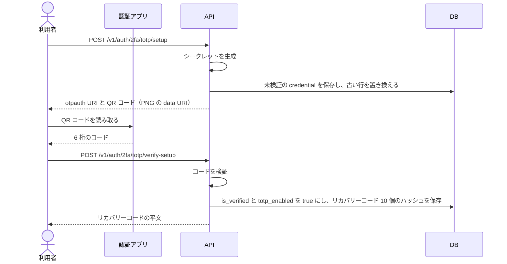
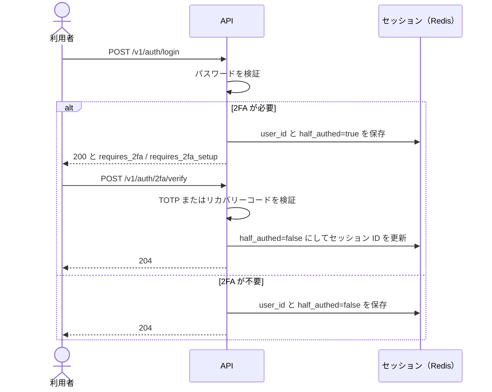
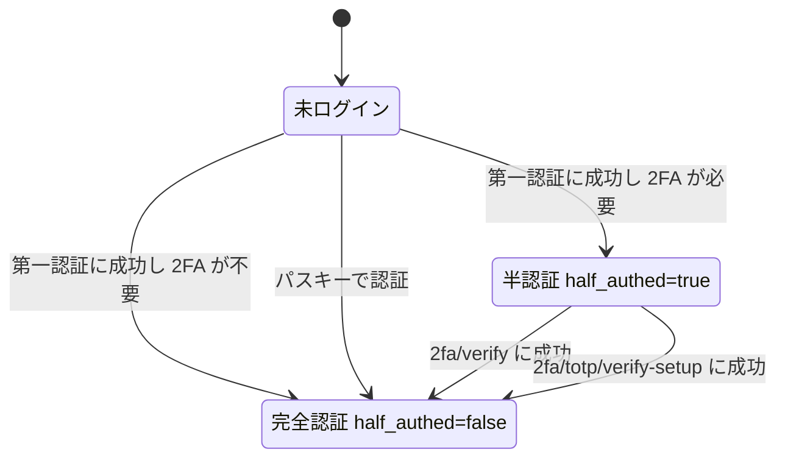
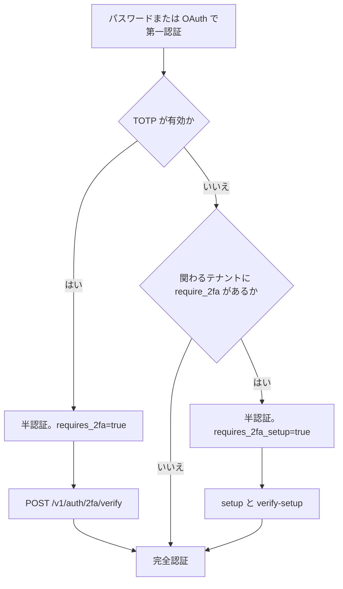

> 実装状況: バックエンドの API とテナント強制は実装済みである。ログイン後の TOTP 入力とセットアップの画面（`/auth/2fa`）も実装済みで、管理の画面は未実装である。詳細は §12 に書く。

---

## 1. 概要

2 段階認証は、メール/パスワードまたは OAuth のログイン（第一認証）の後に TOTP（Time-based One-Time Password）を要求する仕組みである。実装には [`totp-rs`](https://github.com/constantoine/totp-rs) を使う。

パスキーログインには TOTP を要求しない。パスキーは利用者の検証（生体または端末の PIN）を必須にして認証するので、それ自体を多要素認証として扱う（[パスキー仕様書](/features/auth-passkeys)）。

テナントオーナーはテナント全体に 2FA を強制できる。強制されたテナントでは、2FA を満たさない利用者のリソースへのアクセスを `403` で拒否する。強制前から持っているセッション・PAT・Device Token も同じである（§9）。

---

## 2. データモデル

### 2.1 `totp_credentials`

| カラム | 型 | 制約 | 説明 |
|--------|-----|------|------|
| `user_id` | UUID | PK, FK→users CASCADE | 1 ユーザー 1 シークレット |
| `secret_enc` | TEXT | NOT NULL | AES-256-GCM で暗号化した TOTP シークレット（Base32）。形式は `base64(nonce 12 バイト + 暗号文)` |
| `is_verified` | BOOLEAN | NOT NULL DEFAULT false | 初回コード入力で `true` になるまで有効扱いしない |
| `created_at` | TIMESTAMPTZ | NOT NULL DEFAULT now() | |

暗号鍵は環境変数 `TOTP_ENCRYPTION_KEY` で、UTF-8 で正確に 32 バイトでなければ起動できない。OAuth トークンの暗号鍵（HKDF で導出する）とは別の鍵である。

### 2.2 `recovery_codes`

| カラム | 型 | 制約 | 説明 |
|--------|-----|------|------|
| `id` | UUID | PK | |
| `user_id` | UUID | NOT NULL, FK→users CASCADE | |
| `code_hash` | VARCHAR | NOT NULL | 正規化したコードの HMAC-SHA256（鍵は `RECOVERY_CODE_SECRET`）を base64url にした値 |
| `used_at` | TIMESTAMPTZ | NULLABLE | NULL = 未使用 |
| `created_at` | TIMESTAMPTZ | NOT NULL DEFAULT now() | |

### 2.3 `users` の列

`users.totp_enabled`（BOOLEAN NOT NULL DEFAULT false）を持つ。`totp_enabled = true` かつ `totp_credentials.is_verified = true` のときに TOTP が有効である。無効化すると `totp_enabled` を `false` に戻し、`totp_credentials` と `recovery_codes` の行を消す。

### 2.4 `tenants` の列（強制ポリシー）

`tenants.require_2fa`（BOOLEAN NOT NULL DEFAULT false）を持つ。

---

## 3. マイグレーション

これらの列と表は初期スキーマ（`m20260520000000_initial_schema`）に含まれる。

```sql
-- users.totp_enabled / tenants.require_2fa は CREATE TABLE の中で定義する

CREATE TABLE totp_credentials (
    user_id     UUID PRIMARY KEY REFERENCES users(id) ON DELETE CASCADE,
    secret_enc  TEXT NOT NULL,
    is_verified BOOLEAN NOT NULL DEFAULT false,
    created_at  TIMESTAMPTZ NOT NULL DEFAULT now()
);

CREATE TABLE recovery_codes (
    id         UUID PRIMARY KEY,
    user_id    UUID NOT NULL REFERENCES users(id) ON DELETE CASCADE,
    code_hash  VARCHAR NOT NULL,
    used_at    TIMESTAMPTZ,
    created_at TIMESTAMPTZ NOT NULL DEFAULT now()
);

CREATE INDEX idx_recovery_codes_user ON recovery_codes(user_id);
```

---

## 4. TOTP セットアップフロー

セットアップは 2 段階で進む。`setup` がシークレットを未検証のまま保存し、利用者が認証アプリに登録したあと、`verify-setup` が初回のコードを確かめて有効にする。どちらもセッション専用（Bearer は `403`）で、半認証のセッションでも呼べる。テナントの強制で半認証になった利用者が、ここで設定を済ませられるようにするためである。



- TOTP が有効な利用者が呼ぶと `409`（`2fa-already-enabled`）を返す
- `setup` を呼ばずに `verify-setup` を呼ぶと `400`（`2fa-not-enabled`）を返す
- `verify-setup` が成功すると、セッションの `half_authed` を `false` にしてセッション ID を更新する
- `otpauth` URI の issuer は環境変数 `TOTP_ISSUER`（既定は `TaskApp`）である

`POST /v1/auth/2fa/totp/setup` のレスポンス:

```json
{
  "otpauth_uri": "otpauth://totp/TaskApp:user%40example.com?secret=BASE32SECRET&issuer=TaskApp",
  "qr_code_png": "data:image/png;base64,..."
}
```

`POST /v1/auth/2fa/totp/verify-setup` のリクエストとレスポンス:

```json
{ "code": "123456" }
```

```json
{
  "recovery_codes": ["XXXX-XXXX-XXXX", "YYYY-YYYY-YYYY", "..."]
}
```

リカバリーコードの平文を返すのは、このレスポンスと再生成（§7）のレスポンスだけである。

---

## 5. ログイン時の 2FA フロー（半セッション）

第一認証に成功したとき、`service::login_session::establish_login_session` がセッションを確立する。パスワードと OAuth コールバックの両方がこの関数を呼ぶので、2FA の要否の判定は経路によって変わらない。

2FA が必要なら、セッションを半認証（`half_authed: true`）にする。半認証のセッションでは TOTP の入力と設定に関わる API しか通らず、通常の API は `403` になる。



`POST /v1/auth/login` の `200` のレスポンスは次の形で、2 つの値は別々の条件を表す。`requires_2fa` は TOTP が有効であること、`requires_2fa_setup` は TOTP が未設定で、関わるテナントのいずれかが 2FA を強制していること（§9）を表す。

```json
{ "requires_2fa": true, "requires_2fa_setup": false }
```

OAuth コールバックは JSON を返さず、半認証なら `/auth/2fa?redirect_after=...` へリダイレクトする（[フォローアップ](/features/auth-2fa-oauth-followup)）。

セッションの状態遷移は次のとおりである。パスキーログインは半認証を経ない。



### エクストラクタの責務

半認証の扱いは、次のエクストラクタ（`handler::extractors`）で分けている。

| エクストラクタ | 受理する認証 | `half_authed` の扱い | 用途 |
|--------------|------------|-------------------|------|
| `AuthUser` | セッション / PAT / Device Token | セッションで `true` なら `403` | 通常の保護済み API |
| `OptionalAuthUser` | `AuthUser` と同じ | `true` のセッションは未認証として扱う | コンテンツ配信・OAuth 開始 |
| `HalfAuthedUser` | セッションのみ | `true` を必須とする（`false` と Bearer は `403`） | `POST /v1/auth/2fa/verify` |
| `LoggedInUser` | セッションのみ | 問わない | `setup` / `verify-setup` |
| `CurrentUser` | セッションのみ | `true` なら `403` | アカウント API |
| `AdminUser` | セッションのみ | `true` なら `403` | `/v1/admin/**` |

PAT と Device Token はセッションを持たないので、`half_authed` の確認の対象にならない。

`POST /v1/auth/logout` は `AuthUser` を使うので、半認証のセッションでは `403` になる。

---

## 6. TOTP 検証仕様

| 項目 | 値 |
|------|----|
| アルゴリズム | HMAC-SHA1（RFC 6238 標準） |
| 桁数 | 6 桁 |
| ステップ | 30 秒 |
| 許容スキュー | ±1 ステップ（±30 秒） |
| ブルートフォース対策 | 利用者ごとに最初の試行から 15 分のあいだ 5 回まで（§11） |

試行の回数は Redis のカウンターで数える。コードを検証する前に Lua スクリプトで試行を予約するので、同時リクエストでも 6 回目以降は検証まで進まず `429` になる。5 回目の失敗も `429` を返す。検証に成功するとカウンターを消す。TOTP の検証を伴う `verify-setup`・`verify`・無効化・再生成は、同じカウンターを共有する。

---

## 7. リカバリーコード

- 生成数: 10 個
- 形式: `XXXX-XXXX-XXXX`（大文字英数字 12 文字、ハイフン区切り）。文字は `I`・`O`・`0`・`1` を除く 32 種
- 保存: HMAC-SHA256 のハッシュのみを DB に保存し、平文は保存しない
- 比較: 入力から英数字以外を取り除いて大文字にしてからハッシュし、未使用の行と比べる
- 使用: 1 回使用したら `used_at` を設定する。更新の条件に `used_at IS NULL` を含めるので、同じコードの同時使用は 1 回だけ成功する
- 再生成: `POST /v1/auth/2fa/recovery-codes/regenerate`。古いコードをすべて消し、新しいコードを 10 個返す。要求するのは TOTP のコード（`{ "code": "123456" }`）で、リカバリーコードでは再生成できない

`POST /v1/auth/2fa/verify` のリクエストには、TOTP かリカバリーコードのどちらかを指定する。両方を指定するとリカバリーコードを検証し、どちらも無ければ `401`（`invalid-2fa-code`）を返す。

```json
{ "code": "123456" }
```

```json
{ "recovery_code": "XXXX-XXXX-XXXX" }
```

---

## 8. 2FA 無効化

```http
DELETE /v1/auth/2fa/totp
Content-Type: application/json

{ "code": "123456" }
```

本文には §7 と同じく TOTP かリカバリーコードを指定する。セッション専用（Bearer は `403`）で、次の順に処理して `204` を返す。

1. TOTP が有効でなければ `400`（`2fa-not-enabled`）を返す
2. `require_2fa` のテナントに関わる利用者なら `403`（`forbidden`）を返す。試行の回数を消費する前に拒否する
3. コードを検証する
4. 同じトランザクションで `users.totp_enabled = false` にし、`totp_credentials` と `recovery_codes` の行を消す

サービス管理者は `POST /v1/admin/users/{id}/reset-2fa` で同じ行を消せる。こちらは対象者のセッションも失効させる（[サービス管理者仕様書](/features/admin) §7.1）。

---

## 9. テナント強制ポリシー

テナントオーナーが次の API で `require_2fa` を切り替える。セッション専用で、レスポンスは更新後のテナントである。

```http
POST /v1/tenants/{tenant_id}/require-2fa
Content-Type: application/json

{ "enabled": true }
```

強制されたテナントに関わる利用者が TOTP 未設定のままパスワードか OAuth でログインすると、セッションは半認証になる。TOTP を設定するか（`verify-setup`）、パスキーでログインするまで、半認証は解けない。



2FA を満たすのは、TOTP が有効（`users.totp_enabled` かつ `totp_credentials.is_verified`）か、パスキーを 1 件以上登録している利用者である。ログイン時の判定と所属判定で基準が違う点に注意が要る。ログイン時の半認証の判定は TOTP だけを見るので、パスキー登録済みでもパスワードでログインすると半認証になる。所属判定は登録済みのパスキーも満たす扱いにする（パスキー自体が MFA であるため）。

### リクエストごとの判定

2FA を満たさない利用者は、そのテナントのリソースへのアクセスを `403`（`2fa-setup-required`）で拒否される。強制前から持っている本認証セッション・PAT・Device Token も同じで、ログイン時だけでなくテナントの所属判定（`has_tenant_access`）がリクエストごとに確かめる。判定は所属が決まった後に行うので、無関係な利用者にテナントの強制設定は漏れない。

所属判定を通らない経路にも、同じ判定を個別に置いている。

- オーナー専用の API（テナント更新・削除、Drive クォータ、GitHub 連携など）は、2FA を満たさないオーナーを `403`（`2fa-setup-required`）で拒否する
- ファイル本文の配信（`GET /v1/drive/files/{id}/content`）も同じ判定を通す。ただし共有トークン（`?token=`）での配信は利用者を問わないので対象外である
- 通知の一覧（`/v1/users/me/notifications` の一覧・未読数・既読化）は `403` にせず、強制下のテナントの通知を視界から外す

2FA の設定 API（`/v1/auth/2fa/...`）と `/v1/auth/me` は所属判定を通らないので、未設定の利用者も使える。

### 強制の有効化と無効化

有効化（`enabled: true`）は、操作する本人が 2FA を満たすときだけ受け付ける。満たさなければ `403`（`2fa-setup-required`）を返し、`require_2fa` は変えない。有効にした途端に本人もテナントの API から締め出されるためである。

無効化（`enabled: false`）は、オーナー専用の API の中で唯一 2FA の判定を省く。2FA の無いオーナーが強制下に残った場合の救済経路として、常に受け付ける。

### 客分の扱い

project にだけ参加しテナントに参加しない客分（project-only guest）も、関わるテナントの `require_2fa` の対象である。ここから漏れると、除名後に残る `project_members` の行で project へ入れる利用者が 2FA 無しで読み書きできてしまう。

---

## 10. API

| メソッド | パス | 認証 | 説明 |
|---------|------|------|------|
| `POST` | `/v1/auth/2fa/totp/setup` | セッション（半認証も可） | TOTP シークレット生成・QR 返却 |
| `POST` | `/v1/auth/2fa/totp/verify-setup` | セッション（半認証も可） | 初回コード検証→有効化 |
| `POST` | `/v1/auth/2fa/verify` | 半認証セッション | ログイン後の TOTP / リカバリーコード検証 |
| `DELETE` | `/v1/auth/2fa/totp` | セッション | 2FA 無効化（コード要求） |
| `POST` | `/v1/auth/2fa/recovery-codes/regenerate` | セッション | リカバリーコード再生成（TOTP コード要求） |
| `POST` | `/v1/tenants/{tenant_id}/require-2fa` | テナントオーナーのセッション | テナント 2FA 強制ポリシー変更 |

---

## 11. セキュリティ

| 脅威 | 対策 |
|------|------|
| ブルートフォース | Redis の `2fa_attempts:{user_id}` で数える。検証前に予約し、最初の試行から 15 分のあいだに 6 回目以降は検証せず `429` を返す。成功で消す |
| リカバリーコード漏洩 | HMAC-SHA256 ハッシュのみ保存。平文は生成時のレスポンスでのみ返す |
| TOTP シークレット漏洩 | AES-256-GCM で暗号化して保存。`otpauth` URI を返すのは `setup` のレスポンスだけである |
| 半セッションの悪用 | `AuthUser` と `CurrentUser` と `AdminUser` が `half_authed: true` のセッションを `403` で拒否する（§5） |
| タイミング攻撃 | リカバリーコードのハッシュの比較に `subtle` の定数時間比較を使う |

---

## 12. フロントエンド

ログイン後の入力とセットアップは `/auth/2fa`（`components/auth/TwoFactor.vue`）で行う。パスワードログインが `requires_2fa` / `requires_2fa_setup` を返したときと、OAuth コールバックのリダイレクト先がこの画面である。半認証のセッションでも開けるよう、認証ガードの対象から外している。

| 画面 | 内容 |
|---|---|
| 入力 | TOTP のコードか、リカバリーコードのどちらでも `POST /v1/auth/2fa/verify` を実行できる |
| セットアップ | `setup` の QR コードと手入力用のシークレットを出し、初回コードを `verify-setup` で確かめる。続けてリカバリーコードを一度だけ表示し、保存の確認（チェックボックス）を経てから先へ進む。コードは画面の中にしか持たないので、開き直しても再掲しない |
| 管理（未実装） | `/settings/security` での再生成と無効化。この画面は今、パスワードと OAuth 連携と端末だけを扱う（[アカウント設定](/features/account-settings) §7） |
| テナントの強制（未実装） | `require_2fa` を切り替える設定項目 |

- 画面の判別: `/v1/auth/me` が `200` なら 2FA は済んでいるので戻り先へ進み、`401` なら期限切れとして再サインインを案内する。`403`（半認証）なら `setup` を呼び、`409`（`2fa-already-enabled`）なら入力、`200` ならセットアップの画面にする。OAuth から直接来るとログインの応答が無いので、この判別を使う
- 成功後は `/v1/auth/me` を取り直し、`redirect_after` へ進む。`redirect_after` は `/` 始まりの相対パスだけを受け付け、`//` や `\` 始まり、外部 URL、`/auth/2fa` 自身は `/` にする
- 半認証のセッションで通常の画面を開くと `/v1/auth/me` が `403` になり、認証ガードは `/signin` ではなく `/auth/2fa` へ進める
- ロックアウト（`429`）は案内を出して送信を止める。期限切れ（`invalid-2fa-code` 以外の `401`）は再サインインを案内する
- キャンセルはサインイン画面へ戻すだけである。`POST /v1/auth/logout` は半認証のセッションを `403` で拒む（§5）ので、サーバー側のセッションは残り、次のサインインで置き換わる

---

## 13. 未決事項

いずれも未実装で、対応するかどうかも決まっていない。

| 項目 | 内容 |
|------|------|
| SMS OTP | セキュリティが TOTP より低く、SIM スワップ攻撃のリスクがある |
| メール OTP | パスワードリセットフローに組み込むかどうか |
| テナント強制の猶予期間 | 今は有効化の直後から `403` になる。有効化から何日以内に設定しなければアクセス不可にするか（例: 7 日間の猶予） |
