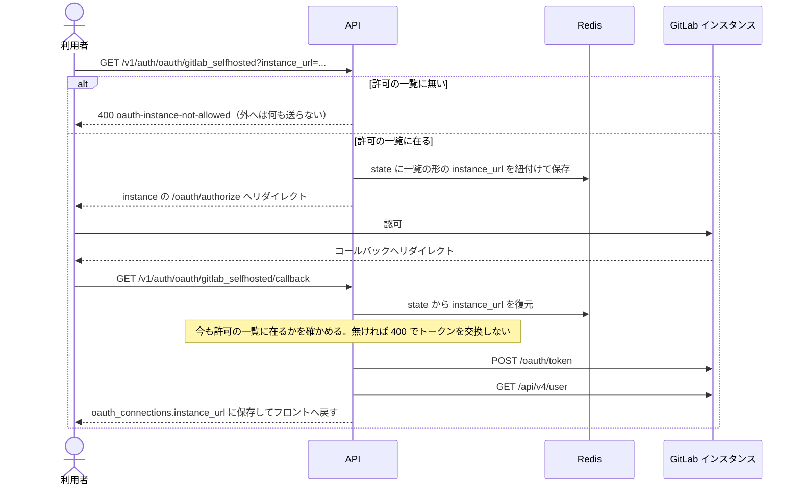
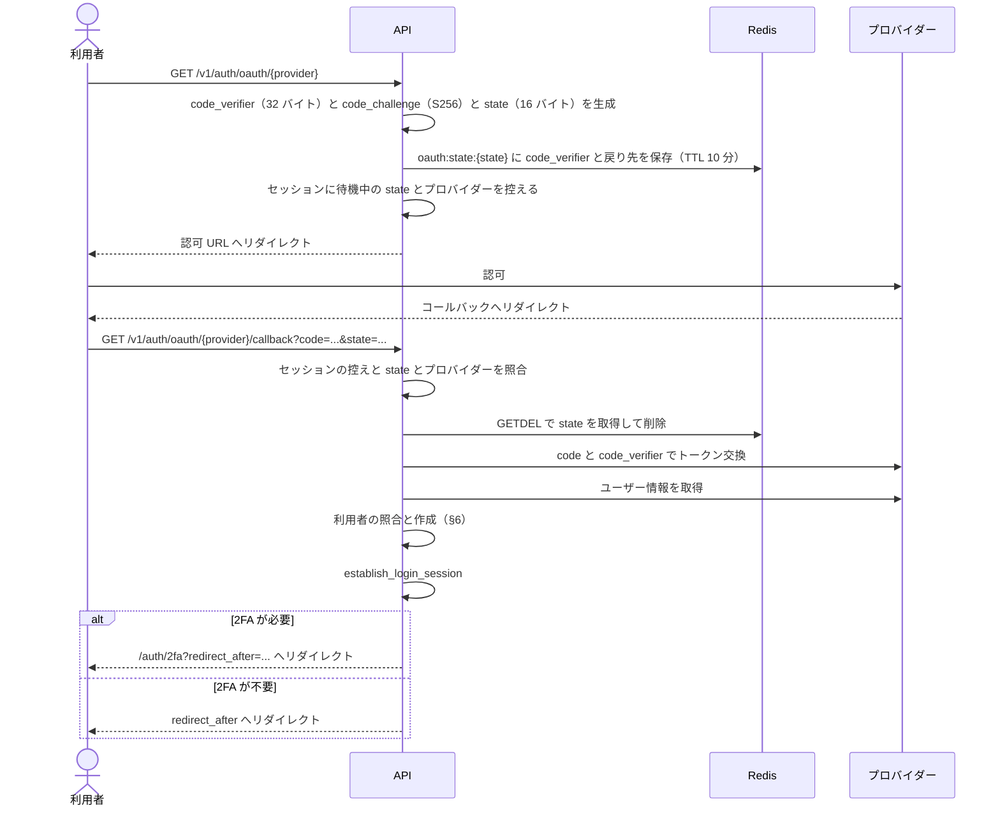
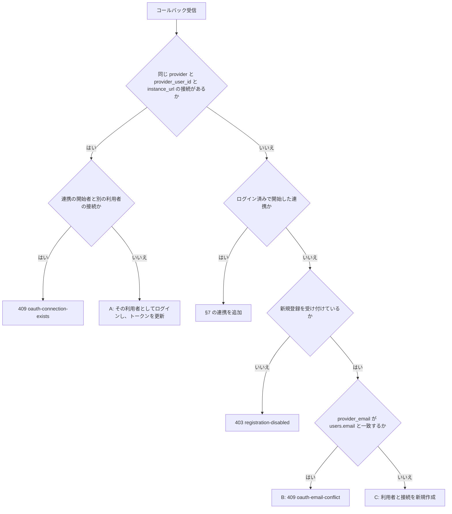

## 1. 概要

メール + パスワード認証（Argon2id）に加えて、GitHub・GitLab・Google・汎用 OIDC でのログインと新規登録ができる。PKCE や state、トークン暗号化といったプロトコル層は外部クレート `auth-core` に置き、プロバイダーの解決と利用者の照合はこのリポジトリの `service::oauth` と `handler::handlers::oauth` が担う。

設計方針:

- Authorization Code + PKCE のみを使う（Implicit Flow は使わない）
- OAuth ユーザーのセッション管理は既存の Redis セッションと共通である
- メール/パスワードユーザーは後から OAuth を連携できる（逆も可）
- パスワードなしの OAuth 専用ユーザーも許容する

---

## 2. データモデル変更

### 2.1 `users` テーブル変更

OAuth ユーザーはパスワードを持たないので、`users.password_hash` は NULL を許容する。パスワードが NULL のユーザーへのパスワード認証は `401 invalid-credentials` を返す。

### 2.2 `oauth_connections`（新規）

| カラム | 型 | 制約 | 説明 |
|--------|-----|------|------|
| `id` | UUID | PK | |
| `user_id` | UUID | NOT NULL, FK→users CASCADE | |
| `provider` | VARCHAR | NOT NULL | `github` / `gitlab` / `gitlab_selfhosted` / `google` / `oidc:{issuer}` / `github_app`（PR 承認用の連携。§4） |
| `provider_user_id` | VARCHAR | NOT NULL | プロバイダー側の不変ユーザー ID |
| `provider_email` | VARCHAR | NULLABLE | プロバイダーが返したメール（参照用。主キーとして使わない） |
| `instance_url` | VARCHAR | NULLABLE | GitLab self-hosted のインスタンス URL（例: `https://gitlab.example.com`）。クラウド版は NULL |
| `access_token_enc` | TEXT | NULLABLE | AES-256-GCM 暗号化 |
| `refresh_token_enc` | TEXT | NULLABLE | AES-256-GCM 暗号化 |
| `token_expires_at` | TIMESTAMPTZ | NULLABLE | |
| `created_at` | TIMESTAMPTZ | NOT NULL DEFAULT now() | |
| `updated_at` | TIMESTAMPTZ | NOT NULL DEFAULT now() | |
| `provider_login` | VARCHAR | NULLABLE | プロバイダー上のログイン名（小文字）。下記 |
| — | — | UNIQUE NULLS NOT DISTINCT (provider, provider_user_id, instance_url) | self-hosted の複数インスタンスに対応する。NULL どうしも重複として扱うので、クラウド版も一意になる |

`provider_login` はログイン・連携のたびに `ProviderUserInfo.username` を小文字にして控え直す。ログイン名は改名できるので本人の識別には `provider_user_id` を使い、こちらはコミット作者を Task ユーザーに解決する用途（[Git ホスティング↔タスク連携](/features/tasks/github-tasks) §2「アクティビティ」）と、レビュー画面の「自分が作成した PR」の判定（[レビュー指摘](/features/review-findings) §8）に使う。

列を足す前からある接続は空のまま残るので、連携一覧（`GET /v1/auth/oauth/connections`）を開いたときに保存済みのアクセストークンでプロバイダーに問い合わせて補完する。期限切れ・失効・復号できないトークンでは補完できず、空のまま返す（一覧そのものは止めない）。問い合わせは接続ごとに 3 秒で打ち切り、接続どうしは並行に待つ。汎用 OIDC の接続は slug から実装を解決できないので補完の対象外である。

改名で同じ名前が別の人に移ることがあるので、控えるときに同じ `provider` / `instance_url` で同じ名前を持つ別の接続からは外す。一意性はこの付け替えと、照合側の「ちょうど 1 件のときだけ採る」で保ち、UNIQUE 制約は張らない。SeaORM の entity は 1 列に `unique_key` を 1 つしか持てず、`provider` は上の複合 UNIQUE に入っているので表せない。表せない UNIQUE 制約は起動時の schema sync が黙って DROP する。ログインし直さない人の改名は追えない。

---

## 3. マイグレーション

`users.password_hash` の NULL 許容と `oauth_connections` は初期スキーマ（`m20260520000000_initial_schema`）に含まれ、`provider_login` は `m20260911010000_oauth_provider_login` が足す。

```sql
CREATE TABLE oauth_connections (
    id                UUID PRIMARY KEY,
    user_id           UUID NOT NULL REFERENCES users(id) ON DELETE CASCADE,
    provider          VARCHAR NOT NULL,
    provider_user_id  VARCHAR NOT NULL,
    provider_email    VARCHAR,
    instance_url      VARCHAR,
    access_token_enc  TEXT,
    refresh_token_enc TEXT,
    token_expires_at  TIMESTAMPTZ,
    created_at        TIMESTAMPTZ NOT NULL DEFAULT now(),
    updated_at        TIMESTAMPTZ NOT NULL DEFAULT now(),
    UNIQUE NULLS NOT DISTINCT (provider, provider_user_id, instance_url)
);

CREATE INDEX idx_oauth_connections_user ON oauth_connections(user_id);

ALTER TABLE oauth_connections ADD COLUMN provider_login VARCHAR;
```

---

## 4. 対応プロバイダー

| プロバイダー | `provider` 値 | 開始用 slug | 方式 | スコープなど |
|------------|--------------|-------------|------|------|
| GitHub | `github` | `github` | OAuth 2.0 | GitHub Apps とは別。`read:user` / `user:email` |
| GitLab.com | `gitlab` | `gitlab` | OAuth 2.0 | `read_user` |
| GitLab self-hosted | `gitlab_selfhosted` | `gitlab_selfhosted` | OAuth 2.0 | `read_user`。利用者がインスタンス URL を入力する（§4a） |
| Google | `google` | `google` | OIDC | `openid email profile` |
| 汎用 OIDC | `oidc:{issuer}` | `oidc` | OIDC Discovery | `openid email profile`。Okta・Entra ID・Keycloak などを想定する |
| GitHub（PR 承認用） | `github_app` | `github_app` | GitHub App のユーザー認可 | サインインには使わない連携専用（下記） |

`github_app` は、レビューが完了した PR をレビュワー本人の名義で Approve するための連携である（[レビュー指摘管理](/features/review-findings) §7）。

- ログイン中の利用者にだけ結べる。開始・コールバックとも `link_user_id` が無ければ拒み、これで利用者を作ったりログインしたりはしない。`list_providers` は `sign_in: false` で返し、サインイン画面（`OAuthButtons.vue`）には出さない
- 資格情報は App 連携と同じ `GITHUB_APP_CLIENT_ID` / `GITHUB_APP_CLIENT_SECRET`。`OAUTH_ENCRYPTION_KEY` が無ければ有効にしない（ここで鍵を必須にすると、ログイン用 OAuth を使っていない環境が起動しなくなる）
- トークンの権限は「App の権限 ∩ 本人の権限」で、scope は無い。`/user` だけを読む（`/user/emails` は App の Email addresses 権限が要るので読まない）
- トークンは既定で 8 時間で切れる。使う側（要約ジョブ）が期限の近いトークンをリフレッシュトークンで更新し、回転した新しいトークンを保存し直す（`service::oauth::github_app`）
- ログイン手段には数えない（連携解除のガード。§7）。連携一覧（`/oauth/connections`）も連携ごとに `sign_in: false` を返し、設定画面はこれで数える（プロバイダー一覧の `sign_in` で引くと、GitHub App の設定を外した後に残った連携をログイン手段に数えてしまう）

プロバイダー設定は環境変数で管理する（テナント単位の設定は未実装。§11）。汎用 OIDC は 1 つの issuer だけを設定できる。

```env
OAUTH_GITHUB_CLIENT_ID=...
OAUTH_GITHUB_CLIENT_SECRET=...
OAUTH_GITLAB_CLIENT_ID=...
OAUTH_GITLAB_CLIENT_SECRET=...
OAUTH_GITLAB_SELFHOSTED_INSTANCE_URLS=https://gitlab.example.com,https://gitlab.example.org
OAUTH_GITLAB_SELFHOSTED_CLIENT_ID=...
OAUTH_GITLAB_SELFHOSTED_CLIENT_SECRET=...
# instance ごとの client（任意。鍵は一覧と同じ URL）
OAUTH_GITLAB_SELFHOSTED_INSTANCE_CREDENTIALS={"https://gitlab.example.org":{"client_id":"...","client_secret":"..."}}
OAUTH_GOOGLE_CLIENT_ID=...
OAUTH_GOOGLE_CLIENT_SECRET=...
OAUTH_OIDC_ISSUER_URL=https://accounts.example.com
OAUTH_OIDC_CLIENT_ID=...
OAUTH_OIDC_CLIENT_SECRET=...
# ログイン用プロバイダーを 1 つでも有効にするなら必須（32 文字以上）
OAUTH_ENCRYPTION_KEY=...
# redirect_after の省略時の戻り先（既定は /dashboard）
OAUTH_DEFAULT_REDIRECT_PATH=/dashboard
```

### §4a. GitLab self-hosted フロー

self-hosted は GitLab.com と違い、OAuth エンドポイントがインスタンスごとに異なる。

**受け付ける instance は運用者が決める。** `OAUTH_GITLAB_SELFHOSTED_INSTANCE_URLS`（カンマ区切り）に並べた instance だけを受け、空・未設定なら `gitlab_selfhosted` は無効になる（プロバイダー一覧にも出ない）。一覧と利用者が渡す `instance_url` は、比べる前に同じ形へ揃える（scheme と host を小文字に、既定の port と末尾の `/` を落とす。資格情報・query・fragment を含む URL は受けない）。

許可の一覧に入っていても、`auth-core` の URL 検証（SSRF 対策）を通らない instance は使えない。プライベート IP・リンクローカルへ解決される host を拒み、http は localhost にだけ許す。

client の資格情報は既定で `OAUTH_GITLAB_SELFHOSTED_CLIENT_ID` / `_SECRET` を一覧の全ての instance に使い、`OAUTH_GITLAB_SELFHOSTED_INSTANCE_CREDENTIALS`（JSON）で instance ごとに上書きできる。資格情報の無い instance や、一覧に無い instance の資格情報は設定の誤りとして起動を止める。



同一ユーザーが複数の self-hosted インスタンスを接続できる。接続は `(provider, provider_user_id, instance_url)` で識別する。

**OAuth アプリの事前登録**: self-hosted の利用には、対象インスタンスに管理者がシステムの OAuth アプリ（Client ID / Secret）を登録しておく必要がある。`callback URL` は `{APP_BASE_URL}/v1/auth/oauth/gitlab_selfhosted/callback` に統一する。

---

### §4b. 本番（Dokploy）の設定

`list_providers` は `is_provider_configured` で client id と secret が**両方**入っているプロバイダーだけ返し、`OAuthButtons.vue` はサインインに使えるプロバイダーが 1 件以上あるときだけ描画する。つまり未設定だとボタンも「または」の区切り線も出ない（エラーにはならない）。

**Dokploy の Environment に入れただけではコンテナへ渡らない。** compose の `backend.environment` に列挙したキーしかコンテナへ渡らないので、`docker-compose.prod.yml` 側にも書く。

**Redirect URI には `/api` を含める。**

```text
{APP_ORIGIN}/api/v1/auth/oauth/{provider}/callback
```

`github_app` を使うなら、GitHub App の設定の Callback URL に `{APP_ORIGIN}/api/v1/auth/oauth/github_app/callback` を足す（App の Callback URL は複数登録できる。インストール時のユーザー認可の URL は残したまま）。

backend は frontend の SSR サーバ（`/api/*` を転送し、`redirect: 'manual'` でバックエンドのリダイレクトをそのまま返す）越しにしか公開されていない。プロバイダーへ渡す `redirect_uri` は `APP_BASE_URL` から組むので、compose は `APP_BASE_URL` に `${APP_ORIGIN}/api` を渡す。ここを `${APP_ORIGIN}` にすると、認可画面から `/v1/auth/...` へ戻されて frontend のルーティングに落ち、コールバックが届かない。

コールバック後にユーザーを戻す先は別で、`EMAIL_VERIFICATION_APP_URL`（= `APP_ORIGIN`）から組む（`build_frontend_redirect`）。`/api` は付かない。

`OAUTH_ENCRYPTION_KEY` は 32 文字以上である。実際の鍵は `auth_core::crypto` の HKDF が導出するので、文字列であればよい（`openssl rand -base64 48`）。**一度決めたら変えない。** 変えると保存済みのトークンが復号できず、連携済みのユーザーは OAuth をやり直すことになる。

設定できているかは discovery を呼ぶと確かめられる。

```bash
curl -s https://<domain>/api/v1/auth/oauth/providers
# {"providers":[]} なら backend に渡っていない
```

## 5. OAuth フロー（Authorization Code + PKCE）



`redirect_after` は `/` で始まる相対パスのみ許可する（`//`・`:`・`\`・`@`・`..` を拒否し、開始の時点で `400` を返す）。組み立て時はフロント基底 URL と `url::Url::join` で同一 origin を検証する。省略時の戻り先は `OAUTH_DEFAULT_REDIRECT_PATH`（既定は `/dashboard`）である。

プロバイダーが `error` を返した場合は詳細をログに残し、フロントへ `oauth_error=authorization_failed` のみ付与して `error_redirect_after`（省略時は `redirect_after`）へリダイレクトする。これ以外のコールバックの失敗（§6.1 の `409` など）はリダイレクトせず、JSON のエラーをそのまま返す。`oauth_error` を付けるのはプロバイダーのエラーのときだけである。

---

## 6. ユーザー照合ロジック

コールバックは、プロバイダーから受け取った `provider_user_id` と `provider_email` で次の順に判定する。



新規登録の設定は `system_settings.user_registration_enabled` である。止めても、ケース A の既存の利用者のログインと、ログイン済みの利用者への連携は通る。設定の確認はメールの照合より先に行うので、止めている間はケース B の条件でも `403` になる。

ケース A は接続があれば成立し、利用者の `email_verified` を確かめない。凍結中の利用者は照合の後で `403 account-suspended` になる。

### 6.1 メール競合（ケース B）

既存の利用者と同じメールアドレスで、ログインせずに OAuth ログインを試みると `409 oauth-email-conflict` を返す。プロバイダーが返すメールアドレスは不変ではないので、なりすまし防止のため自動マージはしない。

ログイン済みで開始した場合はメールを照合せず、セッションの利用者に接続を追加する（§7）。

画面の案内は未実装である（§11）。`409` はコールバックの JSON のまま返るので、今はサインイン画面に戻らない。

### 6.2 新規ユーザー作成（ケース C）

| 項目 | 値 |
|---|---|
| `username` | プロバイダーのログイン名から英数字と `_`・`-` だけを残して先頭 50 文字にする。空なら `oauth_user`。同名がいれば `{name}_2`, `{name}_3` … とし、100 まで試して空かなければ失敗する |
| `email` | 正規化した `provider_email`。プロバイダーが返さなければ `{user_id}@oauth.local` |
| `email_verified` | 下記 |
| `password_hash` | NULL |
| `bio` | 空文字 |
| `avatar_url` | プロバイダーが返した値 |

`email_verified` は、プロバイダー自身が確かめた印を採る。

| プロバイダー | 印 |
|---|---|
| GitHub | `/user/emails` の `verified`。verified のメールだけを候補にし、`primary` を優先する |
| gitlab.com | `/api/v4/user` の `confirmed_at` |
| Google・汎用 OIDC | userinfo の `email_verified`（汎用 OIDC は運用者が設定した issuer の値） |
| `gitlab_selfhosted` | 印を採らず `false` で作る |

印が無いときは `false` で作り、メールアドレスがあれば password の登録と同じ確認メールを送る。確認メールのリンクを開けば `email_verified` が `true` になる。送信のキュー投入に失敗しても利用者の作成は止めない（再送 API で送り直せる）。

---

## 7. アカウント連携・解除

### 連携（ログイン済みユーザーが追加 OAuth を接続する）

1. ログイン済みで `GET /v1/auth/oauth/{provider}` をリクエストする。開始者の `link_user_id` を state に保存する
2. コールバックは、セッションの利用者が `link_user_id` と同じかを確かめる。違えば `400 invalid-oauth-state` を返す
3. 現在のセッションユーザーに `oauth_connections` の行を追加する

重複の扱いは次のとおりである。

| 状況 | 結果 |
|---|---|
| そのプロバイダーのアカウントが別の利用者に接続済み | `409 oauth-connection-exists` |
| 同じ利用者が同じプロバイダー・インスタンスに別のアカウントで接続済み | `409 oauth-connection-exists` |
| 同じ利用者が同じアカウントを接続し直す | エラーにせず、トークンを更新する |

連携のコールバックもログインと同じ `establish_login_session` を通る。セッション ID が更新され、TOTP が有効な利用者は半認証になって `/auth/2fa` へリダイレクトされる。

### 解除

```http
DELETE /v1/auth/oauth/connections/{provider}
```

`{provider}` には開始用 slug か DB の `provider` の値を指定する。`gitlab_selfhosted` はクエリの `instance_url` が必須で、無ければ `400` を返す。接続が無ければ `404 oauth-connection-not-found` を返す。

**ガード**: 最後の認証手段は解除できない。ログイン用の連携が 1 件以下で、パスワードが無く、パスキーも無いときの解除を `403 oauth-last-auth-method` で拒む。判定は利用者の行をロックしたトランザクションの中で行う。

`github_app` の連携は件数に数えない（サインインに使えないので、それだけ残るとログインできない）。`github_app` 自体の解除はこのガードにかけない（解除してもログイン手段は減らない）。

---

## 8. API

| メソッド | パス | 認証 | 説明 |
|---------|------|------|------|
| `GET` | `/v1/auth/oauth/providers` | 不要 | 有効なプロバイダー一覧 |
| `GET` | `/v1/auth/oauth/{provider}` | 不要（`github_app` は要ログイン） | 認可 URL へリダイレクト |
| `GET` | `/v1/auth/oauth/{provider}/callback` | 不要 | コールバック処理（公開エンドポイント） |
| `GET` | `/v1/auth/oauth/connections` | セッション | 連携済みプロバイダー一覧 |
| `DELETE` | `/v1/auth/oauth/connections/{provider}` | セッション | 連携解除 |
| `POST` | `/v1/auth/password` | セッション | OAuth ユーザーがパスワードを新規設定 |

`GET /v1/auth/oauth/providers` のレスポンス:

```json
{
  "providers": [
    {
      "provider": "oidc",
      "connection_provider": "oidc:https://accounts.example.com",
      "requires_instance_url": false,
      "sign_in": true
    }
  ]
}
```

`GET /v1/auth/oauth/connections` のレスポンス（`provider_email`・`instance_url`・`provider_login` は値があるときだけ含める）:

```json
{
  "connections": [
    {
      "provider": "github",
      "provider_email": "user@example.com",
      "provider_login": "octocat",
      "connected_at": "2026-05-27T10:00:00+00:00",
      "sign_in": true
    }
  ]
}
```

`POST /v1/auth/password`（OAuth ユーザーのパスワード初回設定。8 文字以上。成功は `204`）:

```json
{ "password": "new-password-min-8" }
```

既にパスワードが設定されている場合は `409 password-already-set` を返す。変更は `/v1/auth/password/change` を使う（[パスワードリセット仕様書](/features/auth-password-reset) §4）。

---

## 9. セキュリティ

| 脅威 | 対策 |
|------|------|
| CSRF | `state` を Redis で管理し（TTL 10 分、`GETDEL` で使い捨て）、開始したセッションの控えとも照合する |
| Code Injection | PKCE（`code_challenge_method=S256`）。`code_verifier` は Redis にのみ保存する |
| Token 漏洩 | `access_token` / `refresh_token` は AES-256-GCM で暗号化して保存する（鍵は `OAUTH_ENCRYPTION_KEY` から HKDF で導出）。API レスポンスでは返さない |
| メール偽装 | プロバイダーのメール一致でも自動マージしない。セッションなしのときは `409` |
| オープンリダイレクト | `redirect_after` を相対パスに限り、組み立て時に同一 origin を確かめる（§5） |
| SSRF | self-hosted は運用者の許可の一覧に限り、URL 検証も通す（§4a）。汎用 OIDC の issuer も同じ URL 検証を通す |
| provider_user_id の衝突 | 接続は `provider` を含む複合 UNIQUE で識別するので、プロバイダーをまたいで ID が同じでも別の接続になる |
| 最後の認証手段削除 | 解除前にパスワード・ログイン用の連携の件数・パスキーの件数を確かめる（§7） |

---

## 10. フロントエンド

### ログイン画面

サインイン画面はメールアドレスとパスワードの欄の下に、区切り線「または」と OAuth のボタンを並べる（`OAuthButtons`）。ボタンの文言は「{プロバイダー名} で続ける」で、self-hosted にはインスタンス URL の入力欄が付く。プロバイダーのエラーで戻ると（`?oauth_error=`）、「外部プロバイダーでの認証に失敗しました。もう一度お試しください。」を表示する。

### アカウント設定「認証方法」

連携の一覧・追加・解除は、パスワードと同じ「サインインできる方法」として `/settings/security` にまとめた。どちらも「最低 1 つは残す」という同じ制約を共有するため、別々の画面にしていない。画面の仕様は [アカウント設定](/features/account-settings) §7 を正とする。

連携の追加は既存の開始 URL（`GET /v1/auth/oauth/{provider}`）をそのまま使い、`redirect_after` にこの画面を指定して戻す。ログイン済みで開始した場合の連携追加は §7 の経路である。

### コンポーネント

| コンポーネント | ファイル |
|--------------|---------|
| `OAuthButtons` | `components/auth/OAuthButtons.vue` |
| `AuthMethodsSection` | `components/settings/AuthMethodsSection.vue` |
| `PasswordMethodRow` | `components/settings/PasswordMethodRow.vue` |
| プロバイダー表示名・開始 URL | `lib/oauth-providers.ts`（サインイン画面と共通） |

---

## 11. 未決事項

いずれも未実装である。

| 項目 | 内容 |
|------|------|
| テナント単位 OIDC | 企業向けに Okta 等を「テナント独自の IdP」として設定できるようにするか（SaaS 標準機能） |
| アカウント統合 UI | メール競合時に「ログインして連携」へ誘導する画面。今は `409` の JSON がそのまま表示される |
