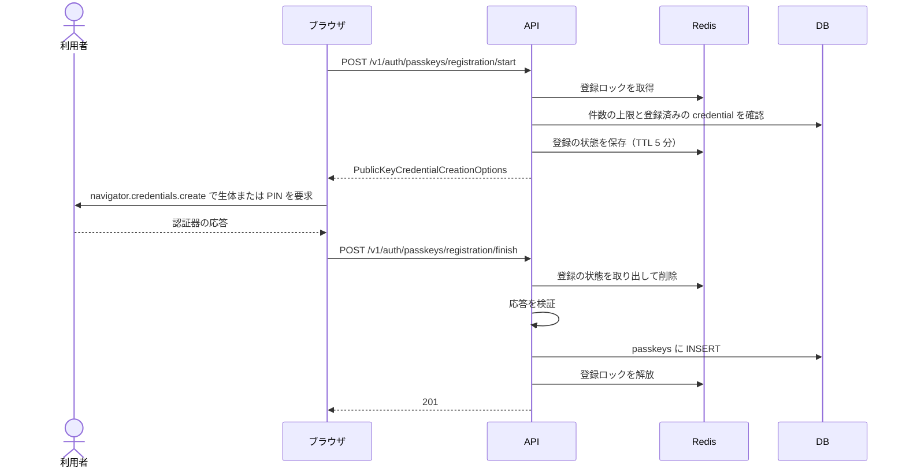
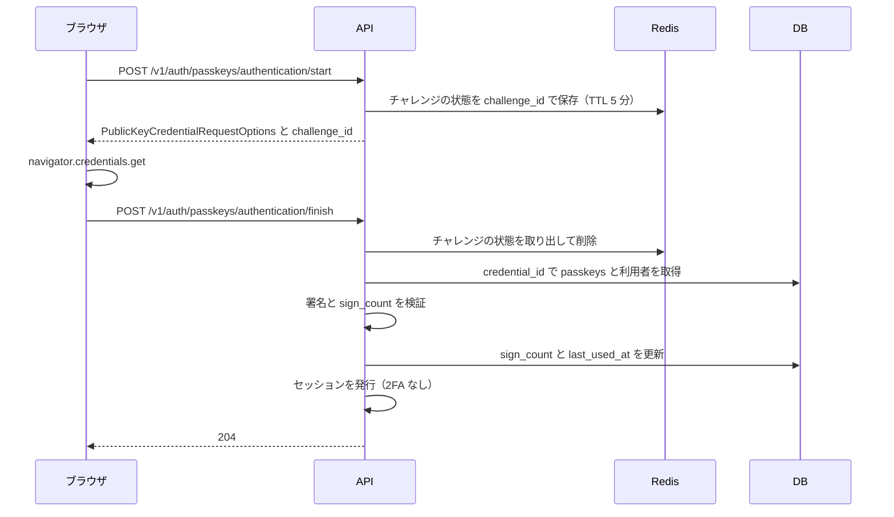

> 実装状況: バックエンドの API は実装済みである。登録・ログイン・管理の画面は未実装で、詳細は §8 に書く。

---

## 1. 概要

WebAuthn（FIDO2）を使い、Touch ID・Face ID・セキュリティキーなどをパスキーとして登録・使用できる。実装には [`webauthn-rs`](https://github.com/kanidm/webauthn-rs) を使う。

パスキーは利用者の検証（生体または端末の PIN）を必須にして認証するので、「所持（デバイス）+ 生体または PIN」の多要素認証として扱う。

- パスキーログインは 2FA（TOTP）を免除する（[2FA 仕様書](/features/auth-2fa)）
- パスワードなしの完全ログインとして機能する
- 既存のメール/パスワードや OAuth に追加で登録でき、代替の認証手段になる

---

## 2. データモデル

### `passkeys`

| カラム | 型 | 制約 | 説明 |
|--------|-----|------|------|
| `id` | UUID | PK | |
| `user_id` | UUID | NOT NULL, FK→users CASCADE | |
| `credential_id` | BYTEA | NOT NULL, UNIQUE | WebAuthn が生成する認証器固有 ID |
| `public_key` | BYTEA | NOT NULL | `webauthn-rs` の `Passkey` を JSON にしたもの（公開鍵を含む） |
| `aaguid` | BYTEA | NULLABLE | 認証器モデル識別子（16 バイト）。取得できない場合とゼロの場合は NULL |
| `sign_count` | BIGINT | NOT NULL DEFAULT 0 | 署名カウンター（0 = カウンター非対応の認証器） |
| `name` | VARCHAR(255) | NOT NULL | ユーザーが付けた名前 |
| `last_used_at` | TIMESTAMPTZ | NULLABLE | |
| `created_at` | TIMESTAMPTZ | NOT NULL DEFAULT now() | |

1 ユーザーが複数のデバイスにパスキーを登録できる（上限 20 個）。上限は登録の開始時に確かめ、完了時にも利用者の行をロックして確かめ直す。

---

## 3. マイグレーション

`passkeys` は初期スキーマ（`m20260520000000_initial_schema`）に含まれる。

```sql
CREATE TABLE passkeys (
    id            UUID PRIMARY KEY,
    user_id       UUID NOT NULL REFERENCES users(id) ON DELETE CASCADE,
    credential_id BYTEA NOT NULL UNIQUE,
    public_key    BYTEA NOT NULL,
    aaguid        BYTEA,
    sign_count    BIGINT NOT NULL DEFAULT 0,
    name          VARCHAR(255) NOT NULL,
    last_used_at  TIMESTAMPTZ,
    created_at    TIMESTAMPTZ NOT NULL DEFAULT now()
);

CREATE INDEX idx_passkeys_user ON passkeys(user_id);
```

---

## 4. 登録フロー（Registration Ceremony）

登録はログイン済みの利用者が既存のアカウントにパスキーを足す操作で、メールアドレスが確認済みでなければ `403` になる。同じ利用者の登録は Redis のロックで 1 つに限り、進行中に開始すると `409`（`passkey-registration-in-progress`）を返す。ロックとチャレンジの状態の TTL はどちらも 5 分である。



`start` のレスポンスは `webauthn-rs` の `CreationChallengeResponse` をそのまま JSON にしたもので、`publicKey` の下に `challenge`・`rp`・`user`・`pubKeyCredParams` などが入る。`excludeCredentials` に登録済みの credential を渡すので、同じ認証器を二重に登録しにくい。

`POST /v1/auth/passkeys/registration/finish` のリクエスト（`name` は 1〜255 文字）:

```json
{
  "name": "MacBook Touch ID",
  "credential": { "...PublicKeyCredential JSON..." }
}
```

上限を超えると `409`（`passkey-limit-exceeded`）、ロックや状態が無いと `400` を返す。検証に失敗すると `400`（`webauthn-error`）を返してロックを解放する。

---

## 5. 認証フロー（Authentication Ceremony）

セッションなしでパスキーだけでログインできる。`start` が発行した `challenge_id` を `finish` に渡して、Redis のチャレンジの状態と対応づける。



`start` のリクエストの `email` は省略できる。

```json
{ "email": "user@example.com" }
```

`start` のレスポンスは `webauthn-rs` の `RequestChallengeResponse` の JSON に `challenge_id` を足したものである。

```json
{
  "publicKey": {
    "challenge": "base64url-encoded-challenge",
    "rpId": "app.example.com",
    "allowCredentials": [{ "type": "public-key", "id": "base64url-credential-id" }],
    "userVerification": "required"
  },
  "challenge_id": "uuid"
}
```

`finish` のリクエストは `{ "challenge_id": "uuid", "credential": { ... } }` である。結果は次のとおりである。

| 状況 | 結果 |
|---|---|
| 成功 | `204`。セッションを発行する |
| `challenge_id` の状態が無い | `400` |
| credential が未登録、利用者のメールが未確認、カウンターの逆行 | `401`（`invalid-credentials`） |
| カウンターが非ゼロからゼロに戻った | `401`（`possible-credential-clone`） |
| 凍結済みの利用者 | `403`（`account-suspended`） |
| 署名の検証に失敗 | `400`（`webauthn-error`） |

### Conditional UI（パスワード欄のオートフィル）

`email` を省略すると、discoverable credential 用のチャレンジを返す。`allowCredentials` は空で、`mediation: "conditional"` が付く。フロントエンドはこの指定で `credentials.get()` を呼び、ブラウザがパスワードオートフィルの UI にパスキーを表示する。

`email` を指定しても、利用者が存在しない・未確認・パスキー未登録なら同じ discoverable のチャレンジに切り替える。パスキーがある場合だけ `allowCredentials` に credential を列挙する。

---

## 6. API

| メソッド | パス | 認証 | 説明 |
|---------|------|------|------|
| `POST` | `/v1/auth/passkeys/registration/start` | セッション必須 | 登録チャレンジ発行 |
| `POST` | `/v1/auth/passkeys/registration/finish` | セッション必須 | 登録完了・DB 保存（`201`） |
| `POST` | `/v1/auth/passkeys/authentication/start` | 不要 | 認証チャレンジ発行 |
| `POST` | `/v1/auth/passkeys/authentication/finish` | 不要 | 認証検証・セッション発行（`204`） |
| `GET` | `/v1/auth/passkeys` | セッション必須 | 登録済みパスキー一覧 |
| `PATCH` | `/v1/auth/passkeys/{id}` | セッション必須 | 名前変更（`204`） |
| `DELETE` | `/v1/auth/passkeys/{id}` | セッション必須 | 削除（最後の手段ガード付き。`204`） |

セッション必須の API は `CurrentUser` を使うので、有効な Bearer は `403`、半認証のセッションも `403` になる。他人のパスキーの ID を指定すると `404`（`passkey-not-found`）を返す。サービス管理者は `DELETE /v1/admin/users/{id}/passkeys/{passkey_id}` で強制削除できる（[サービス管理者仕様書](/features/admin) §7.1）。

`GET /v1/auth/passkeys` のレスポンス（`last_used_at` は未使用なら含まない）:

```json
{
  "passkeys": [
    {
      "id": "uuid",
      "name": "MacBook Touch ID",
      "last_used_at": "2026-05-27T10:00:00+00:00",
      "created_at": "2026-05-01T09:00:00+00:00"
    }
  ]
}
```

---

## 7. セキュリティ

| 項目 | 仕様 |
|------|------|
| RP ID | 環境変数 `WEBAUTHN_RP_ID`。省略時は origin のホスト名 |
| origin 検証 | `EMAIL_VERIFICATION_APP_URL` の scheme・host・port を origin とし、`webauthn-rs` が検証する。サブドメインを許す設定はしていない |
| userVerification | `required`（生体認証またはデバイス PIN を必須） |
| residentKey | `webauthn-rs` の `start_passkey_registration` の既定で `discouraged`。discoverable な credential を作るかは認証器による |
| sign_count | 応答のカウンターが 0 より大きければ、DB の値より大きいことを必須とする。カウンターが 0 の場合、DB の値も 0 なら「非対応の認証器」として許容し、DB の値が 0 より大きければクローンの疑いとして拒否する |
| challenge TTL | Redis で 5 分。`GETDEL` で取り出すので使い捨てである |
| 最後の手段削除 | パスキーが 1 件で、`password_hash IS NULL` で、ログイン用の `oauth_connections` が 0 件なら `403`（`last-auth-method`）。`github_app` の連携はログインに使えないので数えない |
| メール未確認 | 未確認の利用者は登録できず（`403`）、認証も通らない（`401`） |

---

## 8. フロントエンド

パスキーの画面は未実装である。

| 未実装の画面 | 内容 |
|---|---|
| ログイン画面 | パスキーでのログインボタンと、Conditional UI での候補の表示 |
| セキュリティ設定画面 | `/settings/security` でのパスキーの一覧・追加・名前変更・削除 |

フロントエンドが今パスキーの API を使うのは 1 か所だけである。`/settings/security` の `AuthMethodsSection.vue` が `GET /v1/auth/passkeys` を呼び、最後の認証方法の注意書きを出すために件数を数える（[アカウント設定](/features/account-settings) §7）。
