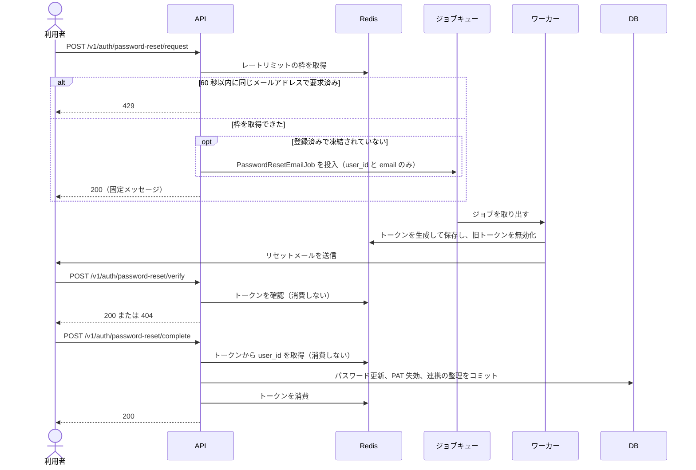
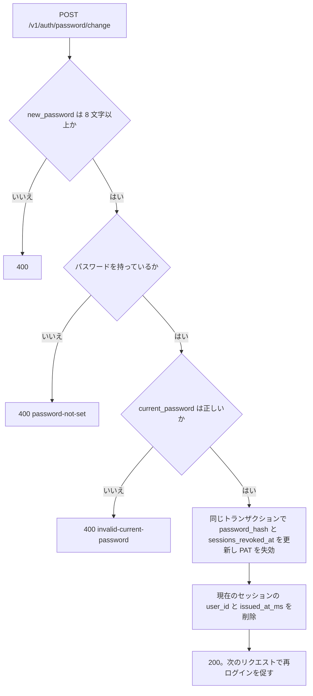

## 1. 概要

パスワードを変える経路は 2 つある。

| フロー | 対象 | 認証 |
|--------|------|------|
| **パスワードリセット** | パスワードを忘れたユーザー | 不要（公開エンドポイント） |
| **パスワード変更** | ログイン中のユーザー | セッション必須 |

どちらも完了後に、対象ユーザーの既存のセッションと Device Token を無効化し、PAT を失効させる。TOTP の設定は変えないので、2FA が有効な利用者は新しいパスワードでログインしても 2FA を求められる。

管理者が特定ユーザー宛にリセットメールを送る操作は [サービス管理者仕様書](/features/admin) §7.1 で定義する。本仕様のトークン生成と保存を共有する。

---

## 2. データモデル

トークンのために DB の表は持たない。トークンは Redis のみに保持する（メール認証と同じ方針）。

### 2.1 Redis キー設計

```text
pw_reset:t:{token}   → user_id（文字列）  TTL: TOKEN_TTL_SECS
pw_reset:u:{user_id} → token（文字列）    TTL: TOKEN_TTL_SECS
pw_reset:rl:{email}  → "1"（存在するだけで意味あり）  TTL: RATE_LIMIT_SECS
```

- `t:` / `u:` ペアはメール認証（`email_verify:`）と同じ双方向マッピング構造である
- 同一ユーザーへの二重発行時は Lua スクリプトで旧トークンを原子的に無効化する
- `rl:` キーで送信レートをメールアドレス単位に制限する
- `rl:` キーに使うメールアドレスは正規化する（小文字変換 + 前後空白トリム）

### 2.2 セッション無効化のための `users` の列

`users.sessions_revoked_at`（TIMESTAMPTZ、NULL 許容）を持つ（初期スキーマに含まれる）。パスワードリセット・変更の完了時に現在時刻を設定する。

ログインは発行時刻をセッションの `issued_at_ms` にミリ秒精度で保存する。エクストラクタはこれを `sessions_revoked_at` と比べ、セッションが古ければ `401` を返す。ミリ秒で比べるのは、失効の直後に発行したセッションまで落とさないためである。Device Token は発行時刻（`created_at`）が `sessions_revoked_at` 以前なら `401` になる。

---

## 3. パスワードリセットフロー

リセットは「メールの要求」「トークンの確認」「新パスワードの設定」の 3 段階で進む。



`request` は、未登録・凍結中のメールアドレスにも同じ `200` を返す（メール存在の有無を漏らさない）。キュー投入の失敗も外部には `200` のままにする。レートリミットの判定は利用者の検索より先に行うので、`429` の有無も登録の有無に左右されない。トークンはワーカー内で生成するので、Apalis の payload に秘密値は載らない。

`complete` は、`validator` で `new_password` を検証してから（8 文字以上）トークンを確認する。トークンが無効・期限切れなら `400` を返す。

トークンの消費を DB のコミットの後に行うのは、DB の更新に失敗したときにトークンだけ失効して再試行できなくなるのを避けるためである。この順序の帰結として、同じトークンの同時リクエストは両方ともコミットまで進みうる。その場合、後の消費は `400` を返すが、パスワードの更新は取り消されない。

`complete` の同じトランザクションで `users.password_hash` と `sessions_revoked_at` を更新し、該当ユーザーの `personal_tokens` を `revoked = true` にする。パスワードの無い OAuth 専用ユーザーも、この経路でパスワードを設定できる。

リセットのメールを受けた者を、この利用者の持ち主とみなす。次の OAuth の連携は同じトランザクションで外す（外した連携は、ログインした後に結び直せる）。

- `email_verified = false` の利用者の連携は全て（確かめていない email で結ばれた連携）
- `email_verified = true` の利用者でも、許可の一覧（`OAUTH_GITLAB_SELFHOSTED_INSTANCE_URLS`）に無い instance の `gitlab_selfhosted` の連携

---

## 4. パスワード変更フロー（ログイン中）

`POST /v1/auth/password/change` は、現在のパスワードを確かめて新しいパスワードに置き換える。セッション専用で、有効な PAT・Device Token は `403` になる。



他のセッションは `sessions_revoked_at` で次のリクエストのときに無効になる。

OAuth のみで登録したユーザー（`password_hash IS NULL`）はこのエンドポイントを使えない。パスワードを新規に設定するには `POST /v1/auth/password`（[OAuth 仕様書](/features/auth-oauth) §8）かパスワードリセットを使う。

---

## 5. Redis トークン管理

メール認証と同じ Lua スクリプトの構造で、実装は `service::password_reset` にある。

```rust
/// トークン有効期限（秒）。30 分。
pub const TOKEN_TTL_SECS: u64 = 30 * 60;
/// リセットメール送信のレートリミット（秒）。
pub const RATE_LIMIT_SECS: u64 = 60;

/// トークンを Redis に原子的に保存する（旧トークンは失効する）。
pub async fn store_token(redis: &RedisConnection, user_id: Uuid, token: &str) -> Result<(), anyhow::Error>;

/// 消費せずに、トークンに紐づく user_id を返す。無効・期限切れは None。
pub async fn lookup_token_user_id(redis: &RedisConnection, token: &str) -> Result<Option<Uuid>, anyhow::Error>;

/// Lua スクリプトでトークンを消費し user_id を返す。無効・期限切れは None。
pub async fn consume_token(redis: &RedisConnection, token: &str) -> Result<Option<Uuid>, anyhow::Error>;

/// レートリミット枠を取得する（SET NX）。Ok(false) は 429 相当。
pub async fn try_acquire_rate_limit(redis: &RedisConnection, email: &str) -> Result<bool, anyhow::Error>;
```

---

## 6. API

| メソッド | パス | 認証 | 説明 |
|---------|------|------|------|
| `POST` | `/v1/auth/password-reset/request` | 不要 | リセットメール送信 |
| `POST` | `/v1/auth/password-reset/verify` | 不要 | トークン有効確認（token は JSON ボディ） |
| `POST` | `/v1/auth/password-reset/complete` | 不要 | 新パスワード設定 |
| `POST` | `/v1/auth/password/change` | セッション必須 | ログイン中の変更 |

**リセットリクエスト**:

```http
POST /v1/auth/password-reset/request

{ "email": "user@example.com" }
```

レスポンス（メールが存在するかどうかに関わらず同一。枠が取れなければ `429`）:

```http
200 OK

{ "message": "入力されたメールアドレスにリセットリンクを送信しました（登録済みの場合）" }
```

**トークン確認**:

```http
POST /v1/auth/password-reset/verify

{ "token": "URL-safe-base64-token" }
```

```text
200 OK  — 有効
404     — 無効・期限切れ（password-reset-token-not-found）
```

**新パスワード設定**:

```http
POST /v1/auth/password-reset/complete

{
  "token": "URL-safe-base64-token",
  "new_password": "newpassword123"
}
```

```http
200 OK

{ "message": "パスワードをリセットしました。再度ログインしてください。" }
```

トークンが無効・期限切れなら `400`（`invalid-password-reset-token`）を返す。

**ログイン中のパスワード変更**:

```http
POST /v1/auth/password/change

{
  "current_password": "oldpassword",
  "new_password": "newpassword123"
}
```

```http
200 OK

{ "message": "パスワードを変更しました。再度ログインしてください。" }
```

---

## 7. リセットメール

メール認証の `VerificationEmailJob` と同じ Apalis のジョブキューの構造で、`PasswordResetEmailJob` を実装している（キュー名は `password_reset_email`、最大 8 回再試行）。

メール本文のテキスト部分は次のとおりで、同じリンクを持つ HTML 部分も送る。リンクの基底は `EMAIL_VERIFICATION_APP_URL` である。

```text
件名: パスワードリセットのご案内

以下のリンクをクリックしてパスワードをリセットしてください。
このリンクは 30 分間有効です。

https://app.example.com/auth/reset-password?token={token}

このメールに心当たりのない場合は無視してください。
```

リンク先のフロントエンドは URL の `?token=` を読み取り、`POST /v1/auth/password-reset/verify` に `{"token":"..."}` を送ってトークンを確認する。有効なら新パスワードの入力フォームを表示する。

---

## 8. セキュリティ

| 脅威 | 対策 |
|------|------|
| メールアドレス列挙 | リクエスト結果は登録の有無によらず同一レスポンス（200）。キュー障害時も 200 |
| Apalis board 漏洩 | パスワードリセットキューは board API に登録しない（verification のみ） |
| トークン総当たり | 32 バイト = 256 ビットの乱数を使うので、総当たりは現実的でない |
| トークン再利用 | 完了時に消費して削除する。TTL 30 分で自動失効する。ただし同時リクエストの排他はしない（§3） |
| 旧セッションの悪用 | `sessions_revoked_at` で完了前のセッションと Device Token を無効化し、PAT を失効させる |
| 出所の確かでない OAuth の連携 | 完了時に、未確認の email の利用者の連携と、許可の一覧に無い instance の連携を外す |
| メール爆撃 | `pw_reset:rl:{email}` で 60 秒に 1 回に制限 |
| OAuth ユーザーへの誤ったパスワード変更 | `password_hash IS NULL` の場合 change エンドポイントは `400` |
| トークンのログ・キュー漏洩 | リセットトークンは Redis のみ。Apalis payload・構造化ログ・HTTP ログのクエリに載せない（運用: [password-reset-flow.md](https://github.com/koyori-app/task/blob/main/apps/backend/docs/password-reset-flow.md)） |

### 8.1 観測性（構造化ログ）

成功時のみ `tracing` の `event` フィールドで記録する（値は `user_id` のみ）:

- `auth.password_reset.email_queued`
- `auth.password_reset.email_sent`
- `auth.password_reset.completed`
- `auth.password_change.completed`

enqueue 失敗は `warn!(user_id, error)` で記録する。外部 HTTP 応答は列挙防止のため 200 のままである。OAuth の連携を外したときは、外した件数を `info` のログに残す。

---

## 9. フロントエンド

### ログイン画面

サインイン画面に「パスワードをお忘れですか？」のリンクがあり、`/auth/reset-password` へ移動する。

### パスワードリセットページ

`/auth/reset-password` の 1 ページが、クエリの `token` の有無で 2 つのフォームを出し分ける。

| URL | 表示 |
|---|---|
| `/auth/reset-password` | メールアドレスの入力（`PasswordResetRequestForm`） |
| `/auth/reset-password?token=...` | トークンの確認の後、新パスワードの入力（`PasswordResetCompleteForm`） |

### セキュリティ設定画面（パスワード変更）

パスワードの変更は `/settings/security` の「パスワード」の行で行う。現在のパスワード・新しいパスワード・確認を入力する。規則は [アカウント設定](/features/account-settings) §7 を正とする。

| コンポーネント | ファイル |
|--------------|---------|
| `PasswordReset` | `components/auth/PasswordReset.vue`（ページは `pages/auth/reset-password/+Page.vue`） |
| `PasswordResetRequestForm` | `components/auth/PasswordResetRequestForm.vue` |
| `PasswordResetCompleteForm` | `components/auth/PasswordResetCompleteForm.vue` |
| `PasswordMethodRow` | `components/settings/PasswordMethodRow.vue` |
