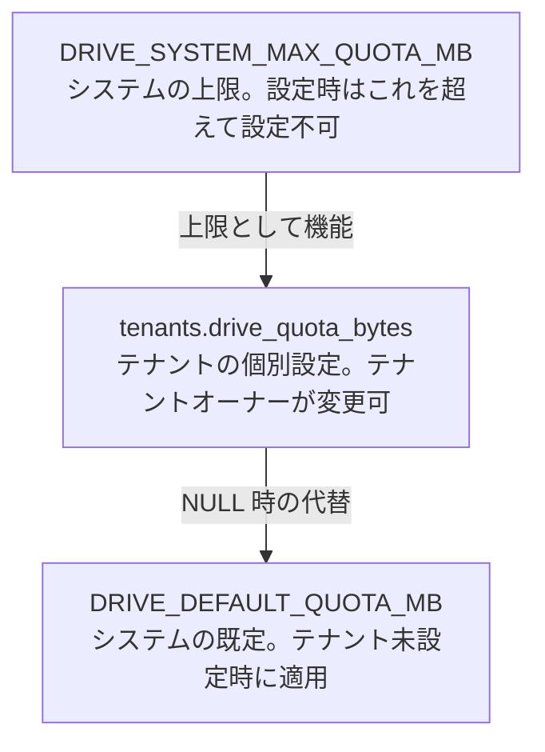

## 概要

テナントが Drive に置ける容量を、システムの上限・テナントの個別設定・システムの既定の 3 層で決める機能である。テナントオーナーは API で個別の容量を変更できる。環境変数の一覧は [Drive の設定](/features/drive#設定)に書き、判断の理由は [Drive の決定の記録](/features/drive#決定の記録)に集める。

## 振る舞い

### 3 つの層

有効クォータは、テナントの個別設定（無ければシステムの既定）にシステムの上限を掛けて決まる。システムの上限とシステムの既定は環境変数だけで決まる。



| 層 | 設定元 | 変更者 | 説明 |
|---|---|---|---|
| システムの上限 | `DRIVE_SYSTEM_MAX_QUOTA_MB` | サーバー管理者（環境変数） | テナントが設定できる上限。`0` は上限なし |
| テナントの個別設定 | `tenants.drive_quota_bytes` | テナントオーナー（API） | テナント固有の有効クォータ。`NULL` は既定を適用する |
| システムの既定 | `DRIVE_DEFAULT_QUOTA_MB` | サーバー管理者（環境変数） | テナントの個別設定が無いときの値。`0` は無制限 |

### 有効クォータの決定

希望値は `tenants.drive_quota_bytes` で、`NULL` なら `DRIVE_DEFAULT_QUOTA_MB` である。希望値の `0` は無制限の指定である。システムの上限は `0` でなければ常に最後に適用する。

| 希望値 | システムの上限 | 有効クォータ |
|---|---|---|
| あり | あり | 2 つのうち小さいほう |
| 無制限 | あり | システムの上限 |
| あり | なし | 希望値 |
| 無制限 | なし | 無制限 |

### 設定の検証

テナントオーナーが設定するときの検証は次のとおりである。

- `DRIVE_SYSTEM_MAX_QUOTA_MB > 0` の場合、`quota_bytes` がそれを超えると `400 Bad Request` を返す
- 負の `quota_bytes` は `400 Bad Request` を返す
- `0` は無制限の指定だが、システムの上限があれば適用される
- `DRIVE_SYSTEM_MAX_QUOTA_MB = 0` の場合、非負の値を上限なく設定できる
- `null` を渡すとシステムの既定に戻す

### 使用量と超過の判定

使用量はアップロード時に `drive_files` の `size` をテナントごとに合計して算出する。キャッシュせず、常に正確な値である。

- アップロードの開始前に、既存の使用量が上限に達していないかを確認する
- 保存後、DB の登録前にテナントの行をロックし、実測のサイズで「現在の使用量 + 新しいファイルのサイズ ≤ 有効クォータ」を再検証する
- 超過時は保存済みのオブジェクトの削除を試み、`413 Content Too Large` を返す
- 有効クォータが無制限の場合は容量の検証を飛ばす

### システムの上限の引き下げ

`DRIVE_SYSTEM_MAX_QUOTA_MB` を引き下げても、既存のテナントの `drive_quota_bytes` 自体は変更しない。起動時に個別設定の値がシステムの上限を超えるテナントを抽出し、`tenant_id`・`quota_bytes`・`system_max_bytes` とともに次の警告を出力する。

```text
WARN tenant drive quota exceeds system_max — update tenant quota or raise DRIVE_SYSTEM_MAX_QUOTA_MB
```

実行時の有効クォータにはシステムの上限が常に適用される。使用量が上限以上なら新規のアップロードを拒否し、本文の更新は差し替え後の合計が上限を超える場合に `413 Content Too Large` を返す。本文を縮めても合計が上限を超えたままなら拒否する。

## データ

| 列 | 型 | 制約 | 説明 |
|---|---|---|---|
| `tenants.drive_quota_bytes` | BIGINT | NULL 可 | テナントのドライブの最大容量（バイト）。`NULL` はシステムの既定を適用する |

列の定義は [m20260520000000_initial_schema.rs](https://github.com/koyori-app/task/blob/main/apps/backend/migration/src/m20260520000000_initial_schema.rs) にある。

## API

| メソッド | パス | 説明 |
|---|---|---|
| GET | `/v1/tenants/{tenant_id}/drive/usage` | 使用量とクォータを取得する |
| PATCH | `/v1/tenants/{tenant_id}/drive/quota` | クォータを設定する。本文は `{ "quota_bytes": 10737418240 }` の形 |

`GET .../drive/usage` の応答の項目は次のとおりである。

| 項目 | 内容 |
|---|---|
| `used_bytes` | 現在の使用量（バイト） |
| `quota_bytes` | 有効なクォータ（バイト）。無制限の場合は `null` |
| `system_max_bytes` | システムの上限（バイト）。上限なしの場合は `null`。テナントオーナーが設定 UI の上限として使う |
| `unlimited` | 有効クォータが無制限の場合 `true` |

## 認可

| 操作 | 誰が | スコープ |
|---|---|---|
| 使用量の取得 | テナントに入れる利用者 | `read:drive` |
| クォータの設定 | テナントオーナー（既存の `ensure_tenant_owner`） | `write:tenant` |

## 未実装と既知の制限

- 管理者のシステム設定の `system_settings.drive_default_quota_mb` / `drive_system_max_quota_mb` は `/v1/admin/system/settings` で変更できるが、有効クォータの計算（`DriveConfig`）は環境変数だけを読むので反映されない（[サービス管理者の API](/features/admin#api)）
- 超過テナントの一覧を管理者が確かめるエンドポイントと UI が無く、確認手段は起動時の警告だけである
- クォータの画面が無い
