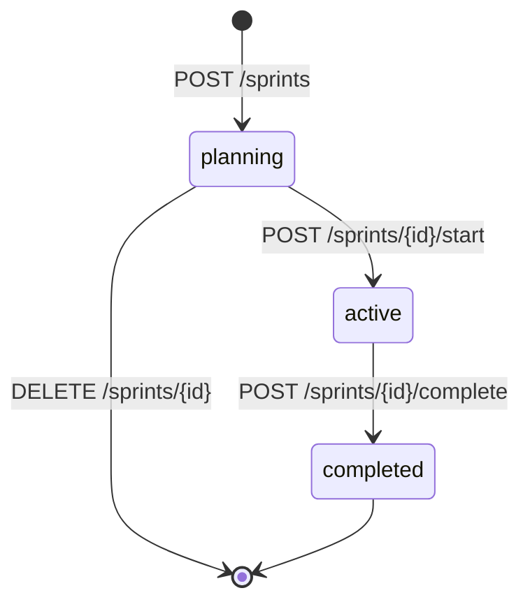

> ステータス: **API と CLI は実装済み。専用画面は未実装**（§5）
> **依存: [コア](/features/tasks/core)**

---

## 1. 概要

スプリントは 2 週間程度の時間軸で区切った作業サイクルで、プロジェクトごとに持つ。マイルストーンが「リリース単位」なら、スプリントは「作業サイクル単位」である。詳細 API はバーンダウンのデータを一緒に返す。

---

## 2. データモデル

### 2.1 `sprints`

```rust
pub struct Model {
    pub id: Uuid,
    pub project_id: Uuid,
    pub name: String,
    pub goal: Option<String>,
    pub start_date: NaiveDate,
    pub end_date: NaiveDate,
    pub status: SprintStatus,   // planning | active | completed
    pub created_by: Uuid,
    pub created_at: DateTimeUtc,
    pub updated_at: DateTimeUtc,
}
```

| カラム | 型 | 制約 | 説明 |
|--------|-----|------|------|
| `id` | UUID | PK | |
| `project_id` | UUID | NOT NULL, FK→projects CASCADE | |
| `name` | VARCHAR(255) | NOT NULL | 例: "Sprint 3", "2026-W23" |
| `goal` | TEXT | NULLABLE | スプリントゴール |
| `start_date` | DATE | NOT NULL | |
| `end_date` | DATE | NOT NULL | |
| `status` | VARCHAR | NOT NULL DEFAULT 'planning' | `planning` / `active` / `completed` |
| `created_by` | UUID | NOT NULL, FK→users | |
| `created_at` | TIMESTAMPTZ | NOT NULL DEFAULT now() | |
| `updated_at` | TIMESTAMPTZ | NOT NULL DEFAULT now() | |
| — | — | CHECK(start_date <= end_date) | |

`status='active'` のスプリントはプロジェクト内で同時に **1 つのみ**である。開始 API は既存のアクティブスプリントを見て 409 を返し、同時に開始された場合は部分 UNIQUE インデックスの違反を 409 に変える。

状態は次の順に一方向に進む。更新と削除ができるのは `planning` の間だけで、他の状態では 409 になる。



タスクとの紐付けは `tasks.sprint_id` カラムで行う。完了済みのスプリントへは割り当てられない（409。一括更新の例外は[タスク拡張 §2](/features/tasks/extensions)）。

---

## 3. マイグレーション

```sql
CREATE TABLE sprints (
    id UUID PRIMARY KEY,
    project_id UUID NOT NULL REFERENCES projects(id) ON DELETE CASCADE,
    name VARCHAR(255) NOT NULL,
    goal TEXT,
    start_date DATE NOT NULL,
    end_date DATE NOT NULL,
    status VARCHAR NOT NULL DEFAULT 'planning',
    created_by UUID NOT NULL REFERENCES users(id),
    created_at TIMESTAMPTZ NOT NULL DEFAULT now(),
    updated_at TIMESTAMPTZ NOT NULL DEFAULT now(),
    CHECK (start_date <= end_date),
    CONSTRAINT sprints_status_check CHECK (status IN ('planning', 'active', 'completed'))
);

CREATE INDEX idx_sprints_project ON sprints(project_id);
CREATE UNIQUE INDEX idx_sprints_active_per_project ON sprints(project_id) WHERE status = 'active';

-- tasks テーブルの sprint_id（コアの tasks 定義に含まれる）
-- sprint_id UUID REFERENCES sprints(id) ON DELETE SET NULL
CREATE INDEX idx_tasks_sprint ON tasks(sprint_id) WHERE sprint_id IS NOT NULL;
```

---

## 4. API

URL 基底パスは `/v1/tenants/{tenant_id}/projects/{project_id}` である。スコープは読み取りが `read:sprint`、書き込みが `write:sprint` で、完了とタスクの割り当てには `write:task` も要る。

| メソッド | パス | 説明 |
|---------|------|------|
| `GET` | `/sprints` | 一覧（`?status=` でフィルター可。不明な値は 400） |
| `POST` | `/sprints` | 作成（`planning` 状態で作成） |
| `GET` | `/sprints/{id}` | 取得（バーンダウンデータ含む） |
| `PUT` | `/sprints/{id}` | 更新（`planning` 状態のみ。`clear_goal` でゴールを消す） |
| `DELETE` | `/sprints/{id}` | 削除（`planning` 状態のみ） |
| `POST` | `/sprints/{id}/start` | 開始（`planning` → `active`） |
| `POST` | `/sprints/{id}/complete` | 完了（`active` → `completed`） |
| `POST` | `/sprints/{id}/tasks` | タスクを割り当て `{ "task_ids": ["uuid"] }`。割り当て後のタスクを返す |

CLI は `task sprints list` / `show` / `start` / `complete` / `burndown` を持つ。

### POST `/sprints`

```json
{
  "name": "Sprint 3",
  "goal": "認証機能の完成",
  "start_date": "2026-06-01",
  "end_date": "2026-06-14"
}
```

### POST `/sprints/{id}/complete`

未完了タスクをどこへ移動するかを指定する。

```json
{
  "move_incomplete_to_sprint_id": "uuid",
  "move_incomplete_to_backlog": false
}
```

どちらも指定しない場合と `move_incomplete_to_backlog` が `true` の場合は、タスクの `sprint_id` を NULL にして Backlog 扱いにする。両方を指定すると 400、移動先が自分自身か完了済みのスプリントでも 400 になる。

### GET `/sprints/{id}` レスポンス（バーンダウン含む）

`task_counts.in_progress` は完了ステータスでないタスクの数である（`In Progress` という名前のステータスだけを数えるわけではない）。

```json
{
  "id": "uuid",
  "project_id": "uuid",
  "name": "Sprint 3",
  "goal": "認証機能の完成",
  "start_date": "2026-06-01",
  "end_date": "2026-06-14",
  "status": "active",
  "created_by": "uuid",
  "created_at": "…",
  "updated_at": "…",
  "task_counts": { "total": 20, "done": 5, "in_progress": 15 },
  "burndown": [
    { "date": "2026-06-01", "ideal_remaining": 20, "actual_remaining": 20 },
    { "date": "2026-06-02", "ideal_remaining": 18, "actual_remaining": 17 },
    { "date": "2026-06-03", "ideal_remaining": 17, "actual_remaining": 19 }
  ]
}
```

バーンダウンの各ポイントはスプリントの開始日から、終了日と今日の早い方までの日ごとに作る。未来の日は含まない。日付の区切りはすべて UTC である。

- `ideal_remaining`: 開始日までに作られていたタスク数を 0 まで線形に減らした値（四捨五入）。期間が 1 日のときは 0
- `actual_remaining`: その日までに作られたタスクのうち、その日の終わりに未完了だったものの数。いま完了ステータスにあるタスクは、`completed_at` がその日より後なら未完了として数える

`tasks.sprint_id` の変更履歴は持たないので、過去の日の数も、いまスプリントに入っているタスクから計算する。

---

## 5. フロントエンド（未実装）

スプリントの専用画面（一覧・作成・開始と完了の操作・バーンダウンチャート）はまだ無い。画面に出るのは、カレンダーの最上段のスプリントの帯だけである（[スケジュール §5](/features/tasks/schedule)）。

バーンダウンチャートの案では、横軸を日付、縦軸を残タスク数として `ideal_remaining` と `actual_remaining` の 2 本の線を引き、actual が ideal より上（遅延）か下（前倒し）かを色で分ける。計算に使う値は上の API が返す。


