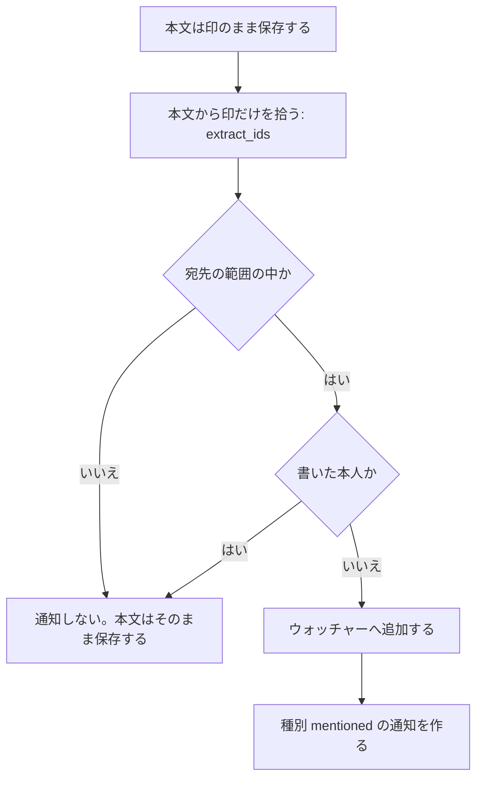

> ステータス: **実装済み（API・画面）**
> **依存: [コア](/features/tasks/core)**

---

## 1. データモデル

### 1.1 `task_comments`

```rust
pub struct Model {
    pub id: Uuid,
    pub task_id: Uuid,
    pub user_id: Uuid,
    pub body: String,                     // 本文。メンションは `<@利用者ID>` の印（§3）
    pub parent_comment_id: Option<Uuid>,  // スレッド返信（1 段のみ）
    pub created_at: DateTimeUtc,
    pub updated_at: DateTimeUtc,
    pub deleted_at: Option<DateTimeUtc>,  // ソフトデリート
}
```

| カラム | 型 | 制約 |
|--------|-----|------|
| `id` | UUID | PK |
| `task_id` | UUID | NOT NULL, FK→tasks CASCADE |
| `user_id` | UUID | NOT NULL, FK→users CASCADE |
| `body` | TEXT | NOT NULL |
| `parent_comment_id` | UUID | NULLABLE, FK→task_comments SET NULL |
| `created_at` | TIMESTAMPTZ | NOT NULL DEFAULT now() |
| `updated_at` | TIMESTAMPTZ | NOT NULL DEFAULT now() |
| `deleted_at` | TIMESTAMPTZ | NULLABLE |

### 1.2 `task_activities`

タスクへの変更を記録する履歴で、アプリ層から明示的に書き込む。データベースのトリガーは使っていない。

| カラム | 型 | 制約 | 説明 |
|--------|-----|------|------|
| `id` | UUID | PK | |
| `task_id` | UUID | NOT NULL, FK→tasks CASCADE | |
| `user_id` | UUID | NULLABLE, FK→users SET NULL | NULL = システム操作 |
| `event_type` | VARCHAR | NOT NULL | 下表参照 |
| `payload` | JSONB | NOT NULL | 変更前後の値 |
| `created_at` | TIMESTAMPTZ | NOT NULL DEFAULT now() | |
| `dedupe_key` | VARCHAR | NULLABLE, UNIQUE | 連携由来の出来事を 1 回だけ積むための鍵（[Git ホスティング連携 §2](/features/tasks/github-tasks)） |

`event_type` 一覧:

| 値 | ペイロード例 |
|----|------------|
| `task_created` | `{}` |
| `github_issue_imported` | `{ "repo_owner": "acme", "repo_name": "backend", "issue_number": 42 }` |
| `github_issue_synced` | `{ "repo_owner": "acme", "repo_name": "backend", "issue_number": 42 }` |
| `status_changed` | `{ "from": "Backlog", "to": "In Progress" }` |
| `priority_changed` | `{ "from": "medium", "to": "high" }` |
| `assignee_added` | `{ "user_id": "uuid", "role": "primary" }`（一括更新では `role` が付かない） |
| `assignee_removed` | `{ "user_id": "uuid" }` |
| `deadline_changed` | `{ "field": "hard_deadline", "from": "...", "to": "..." }` |
| `planned_start_changed` | `{ "from": "2026-10-01", "to": "2026-10-05" }`（解除は `to: null`） |
| `comment_added` | `{ "comment_id": "uuid" }` |
| `comment_edited` | `{ "comment_id": "uuid" }` |
| `comment_deleted` | `{ "comment_id": "uuid" }` |
| `relation_added` | `{ "type": "blocks", "target_seq_id": 55 }` |
| `relation_removed` | `{ "type": "blocks", "target_seq_id": 55 }` |
| `label_added` | `{ "label_id": "uuid", "name": "bug" }` |
| `label_removed` | `{ "label_id": "uuid", "name": "bug" }` |
| `archived` / `unarchived` | `{}` |
| `forge_commit_linked` | `{ "host": "github", "sha": "a3f92c1…", "message": "fix: … TASK-42", "author_handle": "yupix", "author_name": "Yupix", "html_url": "https://github.com/…/commit/a3f92c1…" }` |
| `forge_pull_request_linked` | `{ "host": "github", "number": 87, "title": "feat: … TASK-42", "author_handle": "yupix", "html_url": "https://github.com/…/pull/87", "state": "open", "source": "manual" }`（`source` は初回のリンクの参照元。`manual` なら主語は操作者） |
| `forge_pull_request_unlinked` | `{ "host": "github", "number": 87, "html_url": "https://github.com/…/pull/87", "pull_request_id": "uuid" }` |
| `forge_pull_request_merged` | `forge_pull_request_linked` と同じ形（`state` は `"merged"`）。`Closes` 付きの PR のマージでタスクを完了したときに積む（`user_id` は NULL） |
| `forge_merge_effects_acknowledged` | `{ "host": "github", "pull_request_id": "uuid", "number": 87, "html_url": "https://github.com/…/pull/87" }`（`user_id` は確認済みにした操作者） |

**未実装**: `sprint_changed`（スプリント割り当ての履歴）。スプリントを変えても履歴は積まない。タスクの削除も履歴を積まない。

GitHub Issue の一括取り込みと webhook による新規作成は `github_issue_imported`、リンク済みタスクへの変更反映は `github_issue_synced` を記録する。どちらも `user_id = NULL`（システム操作）で、タスク・同期リンクと同じトランザクションで保存する。再取り込み・同じ内容の通知・古い通知・書き戻しの跳ね返りでは履歴を増やさない。画面には同期元のリポジトリ名と Issue 番号を表示する。導入前の履歴は遡って作成しない。

---

## 2. マイグレーション

```sql
CREATE TABLE task_comments (
    id UUID PRIMARY KEY,
    task_id UUID NOT NULL REFERENCES tasks(id) ON DELETE CASCADE,
    user_id UUID NOT NULL REFERENCES users(id) ON DELETE CASCADE,
    body TEXT NOT NULL,
    parent_comment_id UUID REFERENCES task_comments(id) ON DELETE SET NULL,
    created_at TIMESTAMPTZ NOT NULL DEFAULT now(),
    updated_at TIMESTAMPTZ NOT NULL DEFAULT now(),
    deleted_at TIMESTAMPTZ
);

CREATE TABLE task_activities (
    id UUID PRIMARY KEY,
    task_id UUID NOT NULL REFERENCES tasks(id) ON DELETE CASCADE,
    user_id UUID REFERENCES users(id) ON DELETE SET NULL,
    event_type VARCHAR NOT NULL,
    payload JSONB NOT NULL,
    created_at TIMESTAMPTZ NOT NULL DEFAULT now()
);

-- m20260911000000_forge_commit_links（増分）
ALTER TABLE task_activities ADD COLUMN dedupe_key VARCHAR UNIQUE;

CREATE INDEX idx_comments_task ON task_comments(task_id, created_at)
    WHERE deleted_at IS NULL;
CREATE INDEX idx_activities_task ON task_activities(task_id, created_at DESC);
```

---

## 3. @メンション処理

コメント本文と**タスクの説明文**のメンションは、利用者の **ID を印 `<@利用者ID>`**（`<@` + ハイフン付き UUID + `>`）で本文に埋めて持つ。この節では、この印を「印」、画面で `@今の名` と描く部品を「札」と呼ぶ。名前を本文に持たないので、改名してもメンションは切れない。印の形・拾い方・宛先の範囲・名前の解決は、コメントと説明文で**同じ関数**を通る（`payload::mentions`・`service::mentions`）。

本文を受け取ってから通知するまでの流れは次のとおりである。



- **保存**: 例 `<@11111111-1111-4111-8111-111111111111> 確認お願いします`
- **拾う**: 本文の `@username` の文字は拾わない。文字を拾うと、同名の利用者や `bob@example.com` の `example` を宛先にしてしまう
- **宛先の範囲**: そのプロジェクトに入れる者（`project_accessible_user_ids`）とテナント owner だけである。範囲外の id・存在しない id は通知しない。外れた者・退会した者には、名前を表示に出しても通知しない
- **編集**: 編集前に無く、新しく増えた印の者だけに通知する（`comment_added` は送らない）

範囲外や存在しない id を**拒否しない**のは、メンションされた者が後からプロジェクトを外れても、その本文を編集できるようにするためである。描画側で灰色の札にする。

### 3.1 通知の種別と文言（コメント／説明文）

どちらも種別は `mentioned`（通知の設定・メールの有無も共通）で、`payload` と文言で分かれる。

| 出所 | トリガー | `payload` | メールの文言 | 遷移先 |
|------|---------|-----------|-------------|--------|
| コメント | 投稿・編集（編集では増えた分だけ） | `{ comment_id, author }` | `{author} が {タスク} のコメントであなたにメンションしました。` | タスクの頁 |
| 説明文 | タスクの作成・説明文の編集（編集では増えた分だけ） | `{ source: "task_description", author }` | `{author} が {タスク} の説明文であなたにメンションしました。` | タスクの頁 |

説明文を書く経路は、Web・CLI・API のすべてが `POST /tasks`・`PUT /tasks/{id}` の同じハンドラを通るので、どこから書いても同じように拾う。GitHub の Issue 本文の取り込み（`github/sync.rs`）は説明文を書くが、GitHub 側の本文には印が無いので拾わず、通知もしない（§3 の末尾の残件）。説明文を空にする更新では通知しない。

### 3.2 名前の解決（`mentions`）

API は本文を印のまま返し、並べて **`mentions`（id → 表示情報）** を返す。対象はコメントの作成・編集・一覧と、タスクの詳細（`GET`/`POST`/`PUT /tasks/{id}` の説明文）である。`mentions` は画面が描くときに API を呼び直さないための対応表で、`status` は次のいずれかになる。

| `status` | 意味 | `name` | `avatar_url` | 札の描き方 |
|----------|------|--------|-------------|-----------|
| `member` | いまそのプロジェクトに入れる者 | 返す | 返す | アバター＋`@今の名`（自分宛ては強調） |
| `outside` | 利用者は存在するが、そのプロジェクトに入れない者（外れた者・テナントを抜けた者を含む） | そのテナントに属している・**属していた**者だけ返す | 名前と同じ範囲で返す | 灰色の札に灰色のアバター＋`@今の名`。名前が引けない者はアバター無しの `@（このプロジェクトの外の利用者）` |
| `gone` | 利用者の行が無い（削除、存在しない id） | 返さない | 返さない（返す行が無い） | 灰色のアバター無しの `@（退会した利用者）` |

表に無い id を画面が描くときは `@（不明な利用者）` にする。

**名前を返す範囲**は `service::mentions::tenant_footprint_ids` の 1 か所に置く。後から外れた者・テナントを抜けた者の名前が消えると文脈が読めなくなる一方、印の id を知っただけで**別のテナントの利用者の名前**を引かれるわけにはいかない。`users` の行は除名後も残るが、テナントの所属の履歴は残らない（`tenant_members` は除名で行ごと消える）ので、属していた証拠をそのテナントのプロジェクトの中にある記録で判定する。記録とは、現在の所属・テナント owner・プロジェクトの明示のメンバー（除名後も残る）・タスクの作成者・コメントの書き手・担当者・アクティビティの主である。どれにも当たらない者（別のテナントの利用者、所属して何も残さず外れた者）は名前が引けず、定型の句になる。

**本文が利用者の画面の外へ出るところでは、印を `@今の名` に戻す。** 戻す関数は `payload::mentions::to_plain` の 1 つで、外れた者・退会した者も、名前が引ければ名前で出す（引けない者は定型の句。id は決して出さない）。

| 出力先 | コメント | 説明文 |
|----|---------|--------|
| webhook | `comment.created` の `comment.body` を戻す | 載せていない（`task.created` は説明文を持たない） |
| CLI | `tasks comment` の出力を戻す | `tasks create/show/update/complete` の出力を戻す（`tasks show --raw` は印のまま出す）。`tasks list` は対応表を持たないので定型の句にする |
| タスク検索の抜粋（`/tasks/search`） | — | 戻してから抜粋にする |
| GitHub への書き戻し（`push_task`） | 書き出す経路が無い | 戻してから Issue 本文に書く（`github/sync.rs`） |
| メール・通知 `payload` | 本文を載せない | 本文を載せない |

CLI の出力は人が読む形なので、`tasks show` の出力をそのまま `tasks update --description` に戻すと印が名前の素の文字になる。書き換えて戻すなら `tasks show --raw` で印のまま取る（`--json` と併せても同じで、`mentions` の表はどちらでも載る）。GitHub へ書き戻した本文は GitHub 側で `@今の名` の素の文字になり、GitHub 側の編集で説明文が置き換わると印は失われる。

**検索**（`/tasks/search`。web の検索欄・CLI の `tasks search` も同じ API）は、検索語の中の `@名` の語（`@` の後に空白までの一続きの文字）を、その名の者を印でメンションした説明文にも当てる。

- 名は検索のときに利用者へ引く（`service::mentions::resolve_names`）。そのため改名の後は今の名で当たり、前の名では当たらない。索引の列も移し替えも持たない
- 名を引く範囲は、上の「名前を返す範囲」と同じである。範囲外の者は同名でも当てない
- 名は大小を問わず完全に一致する者だけを引く。名の一部（`@ali`）や `@` だけの語は印に当てず、文字として当てる（文字の当て方は本文の生の文字に及ぶので、`@` だけの語は、印の `<@` を含む説明文にも当たる）
- 同名の者が範囲の中に 2 人いれば、どちらの印にも当てる（画面ではどちらも同じ `@名` と出る）
- 「検索語の文字に当てる」も残す（OR）。文字の当て方は検索全体と同じ（tsvector・部分一致・表記ゆれ。[タスク拡張 §1](/features/tasks/extensions)）。印より前の素の `@username` の本文も文字で当たる
- 他の語と並べたとき（`@名 仕様`）は、`@名` の語ごとの当て方と残りの語の当て方をすべて満たすものが当たる
- 抜粋は `to_plain` で印を `@今の名` に戻してから切り、`@名` の語を強調する
- コメントは検索しない

**既存の本文**（`@username` の文字で書かれたコメント・説明文）は移し替えない。素の文字のまま描き、編集してもその中の `@username` は名前で解決されず、通知も送らない（補完で選び直せば印になる）。

### 3.3 入力欄と表示

- 入力欄: コメント（`CommentEditor`）も説明文（`MarkdownEditor`）も、同じ CodeMirror の拡張（`lib/comment-mention-extensions.ts`）を使う。`@` を打つと候補（`assignable-users`。通知の範囲と同じ集合）を出し、選ぶと `@検索語` を印に替える。入力欄の中でも印は見せず、札として一塊に扱う。補完で選ばなかった手打ちの `@name` は素の文字のままで、メンションにならない。説明文の入力欄ではコード（コードブロック・インラインコード）の中の印は札にしない。候補に出すのは今入れる者だけである（外れた者・退会した者は候補に出さない）
- 表示（コメント）: `CommentBody` だけが本文を描画する。説明文と同じ KFM renderer と sanitizer を `profile: 'comment'`（github profile ＋ 単独の改行を `<br>` にする）で使う。`v-html` に渡すのは sanitize 済みの HTML だけで、独自の消毒の設定や経路は無い。markdown の中の生の HTML（`<b>`・`<script>`・`<!-- -->`、`Vec<String>` の `<String>` など）は、要素にせず**文字として**（escape して書いたとおりに）出す。説明文も同じである。描画器は初めて要るときに動的 import し、描画中・失敗・上限超（65,536 文字。タスク説明文の SSR の上限 100,000 文字より小さい）は id を出さない素の文字（`@今の名`）にする
  - 札: 説明文と同じ `remark-kfm-mention` で描く。ログイン中の利用者への札には `kfm-mention-self`（強調）が付き、プロジェクトの外の者・退会した者は灰色の札で、名前が引ける者は名前を出す。描画のキャッシュキーに `currentUserId` を含め、閲覧者ごとの強調が混ざらないようにする。いま入れる者の札はプロフィールへのリンクになる（説明文の札と同じ。下の「札のリンク」）
  - 保存済みのコメントは移し替えず、DB の本文のまま描く。素の文字として書かれた本文は、markdown の記法に当たる並びだけ見た目が変わる。単独の改行は `<br>` で改行のままである。見た目が変わる並び（行頭の `# `・`- `・`* `・`1. `・`> `、`_`・`*`・`~` の囲み、`---` の直前の行、自動 link）と、生の HTML として読まれる並び（`Vec<String>` の `<String>` など、英数字を山括弧で囲んだ文字・HTML の行で始まる段落・HTML のコメント。画面には文字のまま出る）の一覧は `comment-legacy-text.test.ts` が固定する（本文は無傷）
  - 見出しは、コメントの枠（14px）の中だけ大きさを詰める（h1 1.25em・h2 1.15em・h3 1.05em）。説明文の見た目は変えない
- 表示（説明文）: 説明文も同じ KFM renderer で HTML にして `v-html` へ出す。両方とも印は remark プラグイン `remark-kfm-mention` が `span.kfm-mention.kfm-mention-{status}` の札にする。札の文字・状態・アバターはレンダラへ渡す `mentions` の表から引き、表（名前とアバターの URL を含む）はキャッシュキーにも載る。コードブロックとインラインコードの中・リンクの内側の印は札にせず、`mentions` を渡さない描画（他の消費側）は何も変えない。ID は HTML に出さない
- **札の形**（コメントと説明文の KFM の描画・入力欄の 2 つが、同じ 1 枚の CSS `lib/remark-kfm-mention/style.css` と、同じ判定 `mentionChip`（`lib/comment-mention.ts`）を使う）: 丸い地の札に、先頭のアバター（`UserAvatar` の xs と同じ 1rem の丸）と `@名` を並べる。札の高さは文字の 1.25 倍で、行の中ほどに置き、札で行が広がらない
  - アバターは札が名前で出るときだけ置く。画像があれば ``、無ければ頭文字の丸である（頭文字は `data-initials` を CSS で描くので、札の文字・コピー・読み上げに混ざらない）。アバターは丸ごと `aria-hidden` にする（名前は隣の文字で読み上げる）
  - 画像の URL は `safeAvatarUrl` を通るものだけ使う。`http(s):` の絶対 URL・同じ origin の `/` から始まるパス・raster（png・jpeg・gif・webp）の base64 の data URI である。説明文の札はさらに DOMPurify を通る
  - いま入れる者: 強調色（`--primary`）の文字に、強調色を 12% 敷いた地
  - 自分宛て（ログイン中の本人。`member` のときだけ）: 強調色の地に反転の文字（`--primary-foreground`）。コメントの札は `currentUserId` を渡して適用する。説明文はサーバーで描くが、サーバーの描画に閲覧者を渡していないので強調しない
  - 外れた者・退会した者・名前が引けない者: 地の色（`--background`）の上に灰色の文字（`--muted-foreground`。対比 4.73:1）と、同じ色の破線の縁。色の薄さだけで状態を分けない。外れた者のアバターも灰色にして薄くする（`UserAvatar` の inactive と同じ `grayscale` と 0.6 の不透明度）
  - 名前が引けない者（定型の句）の札にはアバターを出さない
  - **札のリンク**: いま入れる者（`member`）で名前が引ける札は、プロフィールのページ（`/{テナントの表示用 id}/users/{利用者 ID}`。`userProfileHref` と同じパス）への `<a>` にする
    - パスは表にある利用者の id とテナントだけで組み、本文の文字は入れない。テナントは描画の引数 `mentionTenant`（説明文は SSR の `+data.ts`、コメントは `TaskComments` から `TaskCommentItem` を経て `CommentBody` へ）で渡し、`remark-kfm-task-ref` と同じ文字種（`[a-z0-9][a-z0-9-]{0,62}`）のときだけリンクにする。キャッシュキーにも含める
    - 外れた者はリンクにしない。プロフィールの API はテナントの owner・メンバー・プロジェクトの明示のメンバーしか返さず、記録だけの者は 404 になるためである。名前が引けない者・退会した者もリンクにしない
    - 消毒の許可は足していない（`a` と `href` は DOMPurify の既定で通り、class は札の既存の語だけ）
    - 指したときは下線、キーボードの focus には `--primary` の輪（2px）を出す
    - 入力欄の札はリンクにしない（編集の邪魔になる）
  - 入力欄の札（CodeMirror の widget）も同じ形である。一塊の扱い・caret・クリップボードの形式は共通で、札の要素は本文の印から作り、画面の DOM からは作らない
- **コピー・貼り付け**: 札を含む文をコピー・切り取りすると、`text/plain` には `@今の名`、`text/html` には札の要素を載せ、task の入力欄へ貼ると札のまま戻る。形式の決まりは [コメントのメンションのクリップボード形式](/features/tasks/collaboration-clipboard) に書く

### 未実装の残件

- desktop・iOS・Android の app でのクリップボードの読み書き（[形式](/features/tasks/collaboration-clipboard)の実装。web だけ実装済み）
- 外部 Issue（GitHub）の本文の `@user` を `@user@github.com` の形で描き、タスクの利用者と紛れさせないこと（GitHub の Issue 本文を取り込んだ説明文は、印を持たないのでメンションの通知も札も出ない）
- 所属して何も記録を残さず外れた者の名前（所属の履歴を持たないため引けない。履歴を残すなら `tenant_members` の除名を記録する表が要る）

---

## 4. API

スコープは読み取りが `read:task`、書き込みが `write:task` である。

### コメント

| メソッド | パス | 説明 |
|---------|------|------|
| `GET` | `/tasks/{id}/comments` | コメント一覧（スレッド構造。親は新着順、返信は古い順） |
| `POST` | `/tasks/{id}/comments` | 投稿 |
| `PUT` | `/tasks/{id}/comments/{cid}` | 編集（投稿者本人のみ） |
| `DELETE` | `/tasks/{id}/comments/{cid}` | ソフトデリート（投稿者 or テナントオーナー） |

`POST` リクエスト:

```json
{
  "body": "この件は <@11111111-1111-4111-8111-111111111111> さんに確認してください。",
  "parent_comment_id": null
}
```

返信は 1 段までで、返信への返信と削除済みコメントへの返信は 400 になる。

`GET` レスポンス（スレッド構造）:

```json
{
  "comments": [
    {
      "id": "uuid",
      "user": { "id": "uuid", "name": "tanaka", "avatar_url": null },
      "body": "設計は完了しました。",
      "replies": [
        {
          "id": "uuid",
          "user": { "id": "uuid", "name": "suzuki", "avatar_url": null },
          "body": "レビュー依頼します。",
          "created_at": "2026-05-27T12:00:00Z",
          "updated_at": "2026-05-27T12:00:00Z",
          "is_deleted": false
        }
      ],
      "created_at": "2026-05-27T11:00:00Z",
      "updated_at": "2026-05-27T11:00:00Z",
      "is_deleted": false
    }
  ],
  "mentions": {}
}
```

削除済みコメントは返信の有無にかかわらず、`"body": null, "is_deleted": true` で一覧に残る。`mentions` は削除済みコメントの本文にある印を含まない。

### アクティビティ

| メソッド | パス | 説明 |
|---------|------|------|
| `GET` | `/tasks/{id}/activities` | 変更履歴一覧（新着順。`limit` 既定 20・上限 100、`cursor`） |

履歴は操作のたびに増えるので全件は返さない。長く使われたタスクほど DB・応答・描画のコストが上限なく伸びるためである。続きは `offset` ではなくカーソルで取る。履歴は新しい側に積まれるので、`offset` だとページの間に 1 件積まれただけで境界の行が二重に出る。

レスポンス:

```json
{
  "activities": [
    {
      "id": "uuid",
      "event_type": "status_changed",
      "user": { "id": "uuid", "name": "tanaka" },
      "payload": { "from": "Backlog", "to": "In Progress" },
      "created_at": "2026-05-27T11:00:00Z"
    }
  ],
  "total": 12,
  "next_cursor": null
}
```

`user` はシステム操作なら `null` である。

---

## 5. フロントエンド

### タスク詳細のアクティビティ欄（実装済み）

タスク詳細の右の欄に、操作履歴とコメントを古い順の 1 本にまとめて並べる。新しい物が下端の入力欄の隣に来る。日付で区切り、時刻は `14:02` の形で出す。見出しの絞り込みで「すべて / コメント / 履歴」を切り替える。

**合流の規則**（`lib/activity-timeline.ts` の `buildTimeline`）:

- コメント本体と重なるので、`comment_added` の履歴は並べない。編集と削除の履歴は残す
- 同じ人の操作は、束の先頭から 5 分以内なら 1 件に束ねる。間にコメントが入るか、日付が変わると束ねない
- 履歴はカーソルで 20 件ずつ、コメントは全件取る。未取得の履歴より古いコメントは前後関係が決まらないので、続きの履歴があるあいだは出さない。上端の「以前のアクティビティを見る」で続きを取る。コメントの絞り込みでは全件を出す

**コメント:**

- 一覧はクライアント取得（vue-query）で取る。取得失敗は欄の中だけで扱い、再試行の導線を出す。入力欄は取得失敗時も残す（GET と POST は独立）
- 操作は投稿・返信（1 段スレッド）・編集・削除である。返信は一覧に展開せず、件数を押すと列ごとスレッドへ切り替える。削除済みコメントは「削除されたコメント」と表示し、編集・削除・返信の導線を出さない（既にある返信を開く導線は残す）
- 編集と削除はホバーで出るメニューに集める。ホバーできない端末では常に出す。編集は投稿者本人のコメントにだけ出す（backend は本人以外を 403 にする）。削除は全コメントに出し、可否は backend の判定に任せる（テナントオーナーにも許可されており、frontend からは判定できないため）
- 削除済みでないコメントのうち `updated_at != created_at` のものに「(編集済み)」を表示する（backend は作成時に両カラムへ同一時刻を入れる）
- 本文は §3.3 のとおり Markdown として描画する
- 入力欄はふだん 1 行で、フォーカスするか下書きがあるときに広げる

**操作履歴:**

- コメント（14px）より小さい 12px で「項目と値」の行にする。変更前後の値を出し、`from` のない履歴は変更後だけを出す
- 優先度は `PRIORITY_CONFIG` の語に直す。担当者の名前はメンバー一覧、ステータスとラベルの色はプロジェクトの定義から引く。引けない色は省き、引けない担当者は文で出す
- 利用者が選ぶ色と優先度の色は点とアイコンにだけ載せる
- 取得失敗はコメントと独立に扱う。`event_type` が未知なら「操作しました」と出す

### コンポーネント

| コンポーネント | ファイル |
|--------------|---------|
| `TaskComments`（タイムライン＋入力欄＋スレッド） | `components/tasks/TaskComments.vue` |
| `TaskActivityEntry`（履歴 1 件） | `components/tasks/TaskActivityEntry.vue` |
| `TaskActivityFilter`（見出しの絞り込み） | `components/tasks/TaskActivityFilter.vue` |
| `TaskCommentItem`（1 コメントの表示・編集・削除） | `components/tasks/TaskCommentItem.vue` |
| `CommentBody`（本文の描画） | `components/tasks/CommentBody.vue` |
| `CommentEditor`（入力欄） | `components/tasks/CommentEditor.vue` |
