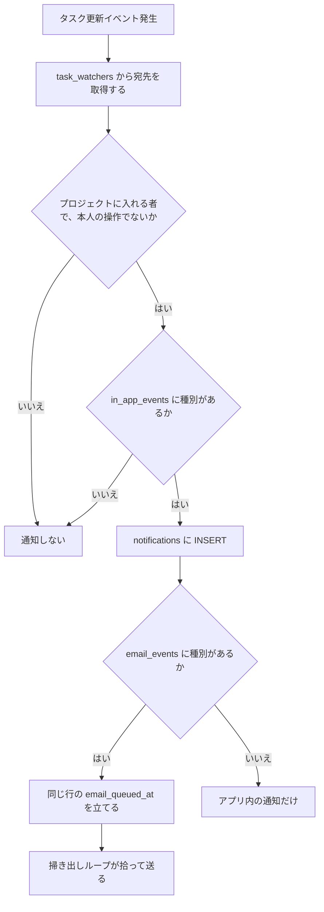

> ステータス: **API・ジョブ・CLI は実装済み。画面は未実装**（§5）
> **依存: [コア](/features/tasks/core), [コメント・アクティビティ](/features/tasks/collaboration)**

---

## 1. データモデル

### 1.1 `task_watchers`

タスクの変更を購読する利用者の一覧である。自分で登録できるほか、担当者に追加されたときとメンションされたときに自動で登録される。担当者を外しても、ウォッチャーの行は残る。

| カラム | 型 | 制約 |
|--------|-----|------|
| `task_id` | UUID | NOT NULL, FK→tasks CASCADE |
| `user_id` | UUID | NOT NULL, FK→users CASCADE |
| `created_at` | TIMESTAMPTZ | NOT NULL DEFAULT now() |
| — | — | PRIMARY KEY(task_id, user_id) |

### 1.2 `notifications`

| カラム | 型 | 制約 | 説明 |
|--------|-----|------|------|
| `id` | UUID | PK | |
| `user_id` | UUID | NOT NULL, FK→users CASCADE | 受信者 |
| `task_id` | UUID | NULLABLE, FK→tasks CASCADE | |
| `project_id` | UUID | NULLABLE, FK→projects CASCADE | 可視性の判定に使う。レビュー通知のようにタスクへ紐づかない通知も、プロジェクト単位で絞れる |
| `notification_type` | VARCHAR | NOT NULL | 下表参照 |
| `payload` | JSONB | NOT NULL | 表示に必要なデータ |
| `read_at` | TIMESTAMPTZ | NULLABLE | NULL = 未読 |
| `created_at` | TIMESTAMPTZ | NOT NULL DEFAULT now() | |
| `email_queued_at` | TIMESTAMPTZ | NULLABLE | 次にメール送信できる時刻。初回は通知作成時刻、失敗時は再試行時刻。NULL = 送らない |
| `emailed_at` | TIMESTAMPTZ | NULLABLE | 送信済み時刻。NULL = 未送信 |
| `email_attempts` | SMALLINT | NOT NULL DEFAULT 0 | 送信の試行回数。5 回で打ち止め |

通知の行そのものがメールの送信待ち行列（outbox）になっている。通知を作るのは `service::notifications::create_notification` の 1 箇所で、そこからジョブは積めない（依存の向きが service → job）ため、行に印を立てて掃き出しループが拾う。

保持期間は `NOTIFICATION_RETENTION_DAYS`（既定 90 日）である。掃除ループ（`job::notification_retention`。§3.2 のメール掃き出しと同じ tokio のループで、起動直後と以後 1 日 1 回）がそれより古い通知を消す。**メール送信待ちの行（`email_queued_at` あり・`emailed_at` なし・試行 5 回未満。§3.2 の掃き出しが拾う条件と同じ）は古くても残す**（送る前に消さない）。送信を諦めた行（5 回に達した行）は待ちではないので消す。通知の削除は監査ログ・遷移履歴に影響しない。

`notification_type` と通知対象:

| type | 通知対象 | トリガー |
|------|---------|--------|
| `assigned` | アサインされたユーザー（自分で自分を担当にした場合は通知しない。ウォッチャー登録だけ行う） | 担当者追加 |
| `mentioned` | 本文の `<@利用者ID>` の印で指されたユーザー（プロジェクトに入れる者とテナント owner のみ。コメントとタスクの説明文で共通） | コメント投稿・編集、タスクの作成・説明文の編集（編集では増えた分だけ）。説明文の通知は `payload.source = "task_description"` で分かれる |
| `deadline_soon` | 担当者 + ウォッチャー（プロジェクトに入れる者のみ） | 期限（仮締め・Deadline それぞれ）の 24 時間以内に入ったとき。15 分ごとのバッチ（`job::deadline_soon`。起動直後にも走る。複数インスタンスでは Redis のロック `deadline_soon:sweep_lock`（TTL 10 分）を取れた 1 つだけが走る）。完了・アーカイブ・削除済みのタスクは除く。同じ期限に 1 回、期限を変えたら再送。payload は `{ task_id, seq_key, title, kind: "soft" \| "hard", deadline }` |
| `status_changed` | ウォッチャー全員（変更した本人を除く） | ステータス変更（PR のマージによる自動完了を含む）。一括更新では送らない |
| `comment_added` | ウォッチャー全員（投稿者と、同じコメントでメンション通知が届いた人を除く） | コメント投稿 |
| `pr_merged` | リンク先タスクの担当者 + ウォッチャー、その PR のレビューラウンドの作成者 | PR 行の `state` が初めて `merged` になったとき（webhook の共通処理） |
| `review_round_created` | レビューの関係者 + `review_round_any` の購読者 | レビューラウンドの起票 |
| `review_finding_changed` | レビューの関係者 | 指摘の状態遷移 |

`status_changed`・`comment_added` の宛先は、そのプロジェクトに入れる者とテナント owner に絞る（`notifiable_user_ids`）。

**未実装**: `task_blocked`（ブロッキング関係が追加されたときに担当者へ知らせる種別）。関係を追加しても通知は作らず、種別の定数も無い。

`review_round_any` は**通知種別ではなく購読の印**である。`in_app_events` に入れた利用者を `review_round_created` の受信者に加えるだけで、この種別の通知行は作られない。既定は OFF である（既定に入れるとプロジェクト全員が全 PR のラウンドを受け取る）。

### 1.3 `notification_settings`

| カラム | 型 | 制約 |
|--------|-----|------|
| `user_id` | UUID | NOT NULL, FK→users CASCADE |
| `project_id` | UUID | NOT NULL, FK→projects CASCADE |
| `email_events` | VARCHAR[] | NOT NULL DEFAULT '{}' |
| `in_app_events` | VARCHAR[] | NOT NULL DEFAULT '{assigned,mentioned,status_changed,deadline_soon,comment_added,pr_merged}' |
| — | — | PRIMARY KEY(user_id, project_id) |

行が無い利用者には、コードの既定（`common::notifications::DEFAULT_IN_APP_EVENTS`）を使う。`assigned`・`mentioned`・`status_changed`・`deadline_soon`・`comment_added`・`pr_merged`・`review_round_created`・`review_finding_changed` がアプリ内で有効で、メールは無効である。列の DEFAULT はコードの既定より狭いが、行は `PUT` で両方の列を指定して作るので適用されない。

---

## 2. マイグレーション

```sql
CREATE TABLE task_watchers (
    task_id UUID NOT NULL REFERENCES tasks(id) ON DELETE CASCADE,
    user_id UUID NOT NULL REFERENCES users(id) ON DELETE CASCADE,
    created_at TIMESTAMPTZ NOT NULL DEFAULT now(),
    PRIMARY KEY (task_id, user_id)
);

CREATE TABLE notifications (
    id UUID PRIMARY KEY,
    user_id UUID NOT NULL REFERENCES users(id) ON DELETE CASCADE,
    task_id UUID REFERENCES tasks(id) ON DELETE CASCADE,
    project_id UUID REFERENCES projects(id) ON DELETE CASCADE,
    notification_type VARCHAR NOT NULL,
    payload JSONB NOT NULL,
    read_at TIMESTAMPTZ,
    created_at TIMESTAMPTZ NOT NULL DEFAULT now(),
    email_queued_at TIMESTAMPTZ,
    emailed_at TIMESTAMPTZ,
    email_attempts SMALLINT NOT NULL DEFAULT 0
);

CREATE TABLE notification_settings (
    user_id UUID NOT NULL REFERENCES users(id) ON DELETE CASCADE,
    project_id UUID NOT NULL REFERENCES projects(id) ON DELETE CASCADE,
    email_events VARCHAR[] NOT NULL DEFAULT '{}',
    in_app_events VARCHAR[] NOT NULL DEFAULT
        '{assigned,mentioned,status_changed,deadline_soon,comment_added,pr_merged}',
    PRIMARY KEY (user_id, project_id)
);

CREATE INDEX idx_notifications_user_unread
    ON notifications(user_id, created_at DESC) WHERE read_at IS NULL;

CREATE INDEX idx_notifications_project ON notifications(project_id);

CREATE INDEX idx_notifications_email_pending ON notifications(created_at)
    WHERE email_queued_at IS NOT NULL AND emailed_at IS NULL;

-- 一覧のカーソル（created_at DESC, id DESC）の並び順
CREATE INDEX idx_notifications_user_created_id
    ON notifications (user_id, created_at DESC, id DESC);
```

---

## 3. 通知生成フロー

タスクの更新を受けたハンドラが、同じトランザクションの中で通知の行を作る。アプリ内が無効の種別は行を作らないので、メールも送らない。メールが有効なら行に送信待ちの印を立てるだけで、送るのは掃き出しループである。



読み取り（`GET /v1/users/me/notifications`）は `project_id` で見える範囲を絞る。入れないプロジェクトの通知は一覧にも未読数にも出ない（`project_id IS NULL` の通知はセッションからは常に見える）。

### 3.1 レビュー通知の受信者

レビューは PR 単位で起きるのでウォッチャーが使えない。宛先は次の 2 つの和から、**操作した本人**と**そのプロジェクトに入れない利用者**を除いたものである。

1. **関係者**: 同じ PR の全ラウンドから集める。ラウンドの作成者、指摘を修正したと宣言した人（`fixed_by`）、解決できた PR の作者である。各人の `in_app_events` を見る
2. **購読者**（`review_round_created` のみ）: そのプロジェクトの `in_app_events` に `review_round_any` を入れている利用者である。設定で明示的に ON にしているので、重ねて `in_app_events` は見ない

1 と 2 の両方に当たる利用者でも通知は 1 件。

`review_finding_changed` の payload は `project_id` / `review_id` / `finding_id` / `pr_number` / `round` / `from` / `to` ほかである。`to = deferred` のときは繰り延べ先タスクの `deferred_task_id`（起票・再オープン直後の値）も入れる。クライアントはこれらの ID で遷移先を組み立てる。

PR の作者はラウンドの起票時点では分からない（要約ジョブが GitHub から取って `reviews.pr_author` に控える）。そのため作者への「ラウンドが起票された」通知は要約ジョブが補う。宛先は `pr_author` が NULL だったラウンドだけで、この列が NULL から埋まるのはラウンドごとに 1 回きりなので、ジョブを何度走らせても重複しない。過去ラウンドから作者が判明している場合や購読者の場合は、起票時に作った同じラウンド・宛先の通知を確認し、要約ジョブから二重に通知しない。

### 3.2 メール送信

`email_events` の `review_round_any` は `review_round_created` の通知もメール対象にする。全ラウンドを受け取るには `in_app_events` にも `review_round_any` を設定する。メールは作成済みの in-app 通知から送るため、メール設定だけでは宛先は増えない。

`job::notification_email` の掃き出しループが **30 秒間隔** で、`email_queued_at` が現在時刻以下で `emailed_at` が NULL の行を **最大 50 件** 拾って送る（`FOR UPDATE SKIP LOCKED` なので複数インスタンスでも二重送信しない）。

- 1 通ごとに確定する（行ごとの短いトランザクションで `FOR UPDATE SKIP LOCKED` を取り、送信とその行の更新を commit する）。後の行の失敗で送信済みの印が消えて再送されることはない
- 成功 → `emailed_at` を立てる。1 通の失敗で他の行は止めない
- 失敗 → `email_attempts` を 1 進め、`email_queued_at` を **30 秒 / 5 分 / 30 分 / 2 時間後**へ進める。**5 回**で打ち止めにする（`email_queued_at` を NULL に戻し、以後は拾わない）。再試行時刻を待つ間も送信待ちであり、保持期間による削除対象にしない
- メール未認証（`users.email_verified = false`）の宛先 / プロジェクトを引けない通知 / 送信時点でそのプロジェクトに入れない宛先（通知作成後にテナントやプロジェクトから外れた。判定は作成時と同じ `notifiable_user_ids`）→ 送らずに `email_queued_at` を NULL に戻して打ち切る

件名・本文は `service::notification_email::render` が種別ごとに日本語で組み立てる。導線の URL は `email_verification_app_url` を基点に、タスク系は `/{tenant}/projects/{KEY}/tasks/{KEY}-{seq_id}`、レビュー系は `/{tenant}/projects/{KEY}/reviews?pr={N}` を出す。

---

### 3.3 `pr_merged` の受信者

PR イベントの共通処理（[Git ホスティング↔タスク連携](/features/tasks/github-tasks) §5）が、PR 行の `state` を `merged` 以外から `merged` へ変えたトランザクションの中でだけ送る。`merged` は戻らず、遷移は自然キーのロック下で判定するので、再送・再試行・マージ後の後続イベントでは送り直さない。

宛先は次の和から、**そのプロジェクトに入れない利用者**を除いたものである。各人の `in_app_events` / `email_events` を見る。

1. PR にリンクされたタスク（削除済みを除く）の担当者とウォッチャー。通知はそのタスクに結ぶ
2. その PR のレビューラウンドの作成者（`reviewer_id`）。PR 行のプロジェクトで判定し、タスクには結ばない

1 人 1 通にまとめる（先に当たった 1 のタスクに結ぶ）。payload は `{ number, title, html_url, repo_owner, repo_name }` である。メールのリンクはタスクに結ばれていればタスク詳細、そうでなければレビュー画面のその PR である。

## 4. API

### ウォッチャー

| メソッド | パス | 説明 |
|---------|------|------|
| `GET` | `/tasks/{id}/watchers` | 購読者一覧 `{ "watchers": [{ "id", "name", "created_at" }] }` |
| `POST` | `/tasks/{id}/watch` | 自分を追加（リクエストボディ不要。既に購読中でも 201） |
| `DELETE` | `/tasks/{id}/watch` | 自分を解除 |

パスは `/v1/tenants/{tenant_id}/projects/{project_id}` の配下である。解除できるのは自分の分だけで、テナントオーナーが他人を外す API は無い。

### 通知（ユーザースコープ）

| メソッド | パス | 必要スコープ | 説明 |
|---------|------|-------------|------|
| `GET` | `/v1/users/me/notifications` | 種別に応じて `read:task` / `read:review` | 一覧（新着順・カーソル） |
| `PATCH` | `/v1/users/me/notifications/read-all` | 種別に応じて `write:task` / `write:review` | 権限のある通知を全件既読 |
| `PATCH` | `/v1/users/me/notifications/{id}/read` | 種別に応じて `write:task` / `write:review` | 1 件既読 |

`GET /v1/users/me/notifications` のクエリ:

| クエリ | 意味 |
|---|---|
| `unread` | `true` で未読のみ |
| `kind` | `task` / `review`。既知のレビュー通知種別に含まれるかで分ける。それ以外の値は 400 |
| `limit` | 既定 50、上限 100（超える指定は 100 に切る） |
| `cursor` | このカーソルより**古い**行（ページ送り） |
| `after` | このカーソルより**新しい**行（catch-up）。`cursor` と同時指定は 400 |

- 並びは `created_at DESC, id DESC` のみである。未読優先はしない（既読化で順位が変わるとカーソルが成り立たない）。未読を上に出したい画面は `unread=true` で別に引く。`offset` は持たない
- **`after` 指定時だけは古い順（`created_at ASC, id ASC`）**で返す。新しい側から `limit` 件を切ると、`after` との間の行を引く手段が無くなるためである
- `next_cursor` は続きがあるときだけ返る（`null` なら取り切っている）
  - `cursor` 指定時・無指定時: ページ内の最も古い行。次の `cursor` に渡す
  - `after` 指定時: ページ内の最も新しい行。次の `after` に渡す
- 各行の `cursor` はその行自身を指すカーソルである。catch-up では受け取った最新行の `cursor` を控えて次回 `after` に渡す（`next_cursor` は取り切ると `null` になるので控えには使えない）
- カーソルは `common::cursor`（`(created_at, id)` を base64 で畳んだもの）。壊れた値は 400
- `unread_count` はクエリに関係なく、見える通知全体の未読数
- catch-up は `unread=true` ではなく `after` を使う（既読だが未受信の行を落とさない）。`created_at` はトランザクション内の時刻なので、長いトランザクションの通知が後から commit されると控えたカーソルより古い位置に現れ、`after` では拾えない。現状の生成経路は短いトランザクションなので許容する

`GET /v1/users/me/notifications` レスポンス:

```json
{
  "unread_count": 3,
  "next_cursor": "eyJjcmVhdGVkX2F0Ijoi…",
  "notifications": [
    {
      "id": "uuid",
      "notification_type": "assigned",
      "project_id": "uuid",
      "project": { "tenant_id": "uuid", "id": "uuid", "key": "TASK" },
      "task": { "id": "uuid", "seq_id": 42, "title": "OAuth 対応" },
      "payload": { "assigned_by": "tanaka", "role": "primary" },
      "cursor": "eyJjcmVhdGVkX2F0Ijoi…",
      "read_at": null,
      "created_at": "2026-05-27T10:00:00Z"
    }
  ]
}
```

`project` は `project_id` から引いた要約（API パスと画面 URL の組み立てに使う）。引けなければ `null`。

### 通知設定（プロジェクトスコープ）

| メソッド | パス | 必要スコープ | 説明 |
|---------|------|-------------|------|
| `GET` | `/v1/users/me/notification-settings/{project_id}` | `read:task` | 現在の設定取得 |
| `PUT` | `/v1/users/me/notification-settings/{project_id}` | `write:task` | 設定更新 |

`PUT` リクエスト:

```json
{
  "email_events": ["assigned", "deadline_soon"],
  "in_app_events": ["assigned", "mentioned", "deadline_soon", "comment_added", "pr_merged"]
}
```

### PAT からの読み書き

CLI（`task notifications list` / `read` / `read-all` / `settings`）は PAT で呼ぶので、これらの 5 つのエンドポイントはセッション専用にしない。タスク通知には `read:task` / `write:task`、レビュー通知（`review_round_created` / `review_finding_changed`）には `read:review` / `write:review` が必要である。一覧・未読数は読み取り権限のある種別だけを含み、個別・一括既読は書き込み権限のある種別だけを対象にする。各操作でどちらのスコープもなければ 403、個別既読で対象の種別に書き込み権限がなければ 404 である。既存の上位スコープの包含関係も適用する。未知の通知種別は PAT に公開しない。通知設定には `read:task` / `write:task` を使う。CLI の `task notifications settings --project` にキーを渡すと UUID の解決にプロジェクト API を呼ぶため `read:project` も要る。UUID を渡せば設定 API だけを呼ぶ。

PAT から見える範囲は「PAT のテナントのプロジェクト ∩ `allowed_project_ids`（指定があれば）」を、セッションと同じ所属判定（入れるプロジェクト）と重ねた集合まで絞る。一覧・未読数・全件既読の対象・1 件既読の 404 判定は、このプロジェクト範囲と種別ごとの権限を重ねて決める。

`project_id` を持たない通知（この列を足す前に作られた行）は、どのプロジェクトのものか判別できないため **セッションにだけ** 見せる。PAT からは一覧にも未読数にも出ず、全件既読の対象にもならない。

---

## 5. フロントエンド（未実装）

通知を見る画面・ウォッチャーの操作・通知設定の画面はまだ無い。ヘッダーのユーザーメニューに `Notifications` の項目はあるが、選んでも何も起きない。通知は API と CLI からだけ読める。

計画している画面は次のとおりである。

- ヘッダーの通知ベルに未読数のバッジを出す
- ベルをクリックすると通知のドロップダウンを開き、未読の印・タスク（`KEY-N` とタイトル）・内容・操作者・相対時刻を並べ、「全て既読」の操作を置く
- タスク詳細にウォッチャーの一覧と購読の切り替えを置く
- 設定画面でプロジェクトごとの通知設定を編集する
