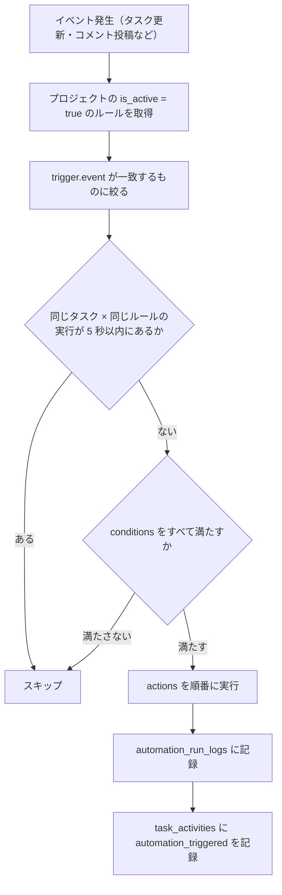

> **このページの機能はすべて未実装である。** `automations` / `automation_run_logs` のテーブル、API、ジョブ、画面のいずれもコードに無い。
> 以下は実装するときの設計案で、現在の動作を説明するものではない。
> 依存する機能は[コア](/features/tasks/core)、[コメント・アクティビティ](/features/tasks/collaboration)、[通知・ウォッチャー](/features/tasks/notifications)である。

---

## 1. 概要

「X が起きたとき、（条件を満たせば）Y をする」をノーコードで設定できるルールエンジンである。

現在、利用者が設定できる自動処理は無い。これに近い動作としては、`Closes KEY-N` を含む PR のマージでタスクを完了にする処理があるが、これは自動化エンジンを通らない固定の処理である（[Git ホスティング↔タスク連携](/features/tasks/github-tasks) §5）。

---

## 2. データモデル（案）

### `automations`

```rust
pub struct Model {
    pub id: Uuid,
    pub project_id: Uuid,
    pub name: String,
    pub trigger: Value,     // トリガー定義 JSONB
    pub conditions: Value,  // 追加条件 JSONB（AND 結合）
    pub actions: Value,     // アクション定義 JSONB（順番に実行）
    pub is_active: bool,
    pub created_by: Uuid,
    pub created_at: DateTimeUtc,
}
```

| カラム | 型 | 制約 |
|--------|-----|------|
| `id` | UUID | PK |
| `project_id` | UUID | NOT NULL, FK→projects CASCADE |
| `name` | VARCHAR(255) | NOT NULL |
| `trigger` | JSONB | NOT NULL |
| `conditions` | JSONB | NOT NULL DEFAULT '[]' |
| `actions` | JSONB | NOT NULL |
| `is_active` | BOOLEAN | NOT NULL DEFAULT true |
| `created_by` | UUID | NOT NULL, FK→users |
| `created_at` | TIMESTAMPTZ | NOT NULL DEFAULT now() |

### `automation_run_logs`（無限ループ防止用）

| カラム | 型 | 制約 | 説明 |
|--------|-----|------|------|
| `task_id` | UUID | NOT NULL, FK→tasks CASCADE | |
| `automation_id` | UUID | NOT NULL, FK→automations CASCADE | |
| `ran_at` | TIMESTAMPTZ | NOT NULL DEFAULT now() | |
| — | — | INDEX(task_id, automation_id, ran_at DESC) | 5 秒以内の再発火チェックに使用 |

---

## 3. JSONB スキーマ（案）

### トリガー（`trigger`）

```jsonc
// ステータスが特定の値に変わったとき
{ "event": "status_changed", "to_status_id": "uuid" }

// 担当者が追加されたとき
{ "event": "assignee_added" }

// 締切の N 日前（バッチジョブが毎日評価）
{ "event": "deadline_approaching", "days_before": 1 }

// 全サブタスクが完了したとき
{ "event": "subtask_all_done" }

// PR がマージされたとき（旧名の github_pr_merged も別名として受ける）
{ "event": "pull_request_merged" }

// コメントが投稿されたとき
{ "event": "comment_added" }
```

トリガー名をホスト中立の `pull_request_merged` にするのは、PR の連携が GitLab / Forgejo を見据えた作りだからである。投入元は [Git ホスティング↔タスク連携](/features/tasks/github-tasks) §5 のマージ時副作用で、自動完了と同じトランザクションでジョブを積む想定である。

### 条件（`conditions`）

```jsonc
// 優先度が high 以上
{ "field": "priority", "op": "in", "value": ["high", "critical", "critical_fire"] }

// 担当者が特定ユーザー
{ "field": "assignee_ids", "op": "contains", "value": "uuid" }

// ラベルが付いている
{ "field": "label_ids", "op": "contains", "value": "uuid" }
```

### アクション（`actions`）— 配列、順番に実行

```jsonc
[
  // ステータスを変更
  { "type": "set_status", "status_id": "uuid" },

  // ラベルを追加 / 削除
  { "type": "add_label", "label_id": "uuid" },
  { "type": "remove_label", "label_id": "uuid" },

  // 担当者を追加
  { "type": "assign_user", "user_id": "uuid", "role": "secondary" },

  // 進捗率を設定
  { "type": "set_progress", "value": 100 },

  // 担当者全員に通知
  { "type": "notify_assignees" },

  // コメントを自動投稿
  { "type": "post_comment", "body": "全サブタスクが完了しました。自動クローズします。" }
]
```

---

## 4. 実行フロー（案）

イベントが起きると、そのプロジェクトの有効なルールのうちトリガーが一致するものを順に評価する。同じタスクで同じルールが 5 秒以内に動いていればスキップする。アクションがさらにイベントを起こしても、ルールが互いを発火し続けないようにするためである。条件をすべて満たしたルールだけがアクションを順番に実行し、`automation_run_logs` と `task_activities`（`automation_triggered`）に記録する。



---

## 5. マイグレーション（案）

```sql
CREATE TABLE automations (
    id UUID PRIMARY KEY,
    project_id UUID NOT NULL REFERENCES projects(id) ON DELETE CASCADE,
    name VARCHAR(255) NOT NULL,
    trigger JSONB NOT NULL,
    conditions JSONB NOT NULL DEFAULT '[]',
    actions JSONB NOT NULL,
    is_active BOOLEAN NOT NULL DEFAULT true,
    created_by UUID NOT NULL REFERENCES users(id),
    created_at TIMESTAMPTZ NOT NULL DEFAULT now()
);

CREATE TABLE automation_run_logs (
    task_id UUID NOT NULL REFERENCES tasks(id) ON DELETE CASCADE,
    automation_id UUID NOT NULL REFERENCES automations(id) ON DELETE CASCADE,
    ran_at TIMESTAMPTZ NOT NULL DEFAULT now()
);
CREATE INDEX idx_automation_run_logs
    ON automation_run_logs(task_id, automation_id, ran_at DESC);
```

---

## 6. API（案）

| メソッド | パス | 説明 |
|---------|------|------|
| `GET` | `/automations` | 一覧 |
| `POST` | `/automations` | 作成（テナントオーナーのみ） |
| `PUT` | `/automations/{id}` | 更新 |
| `DELETE` | `/automations/{id}` | 削除 |
| `POST` | `/automations/{id}/toggle` | 有効 / 無効切替 |

`POST /automations` リクエスト例（全サブタスク完了で親タスクを Done にする）:

```json
{
  "name": "全サブタスク完了 → 親を Done に",
  "trigger": { "event": "subtask_all_done" },
  "conditions": [],
  "actions": [
    { "type": "set_status", "status_id": "uuid-of-done" },
    { "type": "set_progress", "value": 100 }
  ]
}
```

---

## 7. フロントエンド（案）

### ページ

```text
/tenants/{tid}/projects/{pid}/automations
```

### Automation エディタ UI

エディタは 1 つのルールを上から順に、トリガー、任意の条件、順番に実行するアクションの 3 段で編集する。右上で有効 / 無効を切り替える。


### コンポーネント

| コンポーネント | ファイル |
|--------------|---------|
| `AutomationPage` | `pages/automations/+Page.vue` |
| `AutomationEditor` | `components/automations/AutomationEditor.vue` |
| `TriggerSelector` | `components/automations/TriggerSelector.vue` |
| `ConditionEditor` | `components/automations/ConditionEditor.vue` |
| `ActionEditor` | `components/automations/ActionEditor.vue` |
