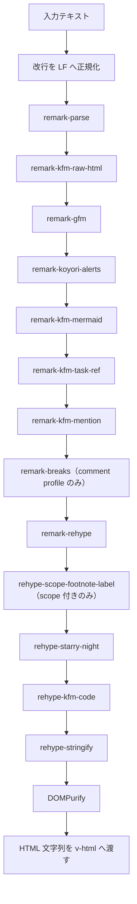

KFM (Koyori Flavored Markdown) は、task の本文を描画するレンダラである。
Phase 1 の実体は GFM、GitHub alerts、コードブロック着色（starry-night）、安全 core から成る複製レンダラ（github profile）で、これに task 固有の拡張としてタスク参照とメンションの札、Mermaid の図、コードブロックの枠を加えている。
本書は現在の実装を説明する。設計判断の根拠は設計書（別管理）を正とする。

## 消費側

本文を描画する箇所は次の五つである。

| 消費側 | 描画する場所 | profile | scope | KEY-N のリンク | メンションの札 | 本文の上限（文字数） |
|---|---|---|---|---|---|---|
| タスク詳細（`tasks/@taskId/+data.ts` → `TaskDetailHub`） | サーバ | github | `task-<uuid>` | あり | あり | 100,000 |
| 分割ビューとオーバーレイ（`TaskDetailPane`） | サーバ（内部エンドポイント） | github | `task-<uuid>` | あり | あり | 65,536 |
| ドキュメント詳細（`docs/@fileId/+data.ts`、編集プレビューは内部エンドポイント） | サーバ | github | `doc-<file_id>` | あり | なし | 65,536 |
| コメント（`CommentBody`。[コメント・アクティビティ](/features/tasks/collaboration)） | ブラウザ | comment | `comment-<id>` | なし | あり | 65,536 |
| レビュー指摘（`ReviewFindingBody`） | ブラウザ | comment | `finding-<id>` | あり | なし | なし |

`comment` profile は github profile に `remark-breaks` を足したもので、空行を挟まない単一の改行を `<br>` として出す（GitHub のコメント欄の流儀）。

タスク詳細は描画済み HTML と描画元テキスト（stale 照合キー `descriptionSource`）を `+Page.vue` 経由で `TaskDetailHub.vue` へ渡し、最新の `task.description` と厳密に一致するときだけ `v-html` する。一致しないときはプレーンテキストで表示する。

## 構成

```
apps/frontend/src/lib/
  remark-gfm/                  GFM 層の薄いラッパと GFM 由来 class の sanitize スキーマ
    index.ts
    content-class.ts           器クラス kfm-content の単一ソース（GFM CSS の scope）
    style.css                  サイドカー CSS（リスト/blockquote/リンク。preflight 対策。
                               全ルール .kfm-content 子孫限定）
  remark-koyori-alerts/        GitHub alerts (> [!NOTE] 等) → callout
    index.ts                   自前 transformer（GitHub alerts の境界規則）
    style.css                  サイドカー CSS（アイコンは名前空間クラス。inline style 不使用）
  rehype-starry-night/         コードブロック着色 (rehype-starry-night の薄いラッパ)
    index.ts                   createRehypeStarryNight（starry-night 実体の共有と失敗回収）
    schema.ts                  pl-* class の sanitize スキーマ
    style.css                  サイドカー CSS（light シート固定と .dark ブリッジ）
  rehype-kfm-code/             コードブロックの枠（帯・行番号・コピーボタン）
    index.ts                   <kfm-code> で包み、data-lang / data-title と行分割を焼く
    element.ts                 コピーボタンを足す custom element
    schema.ts                  kfm-code と pl-line の sanitize スキーマ
    _tag.ts                    タグ名
    style.css                  サイドカー CSS
  remark-kfm-mermaid/          mermaid フェンス → client 描画 custom element
    index.ts                   remark 変換と sanitize スキーマ
    element.ts                 遅延ロード・SVG 描画・再接続処理
    _tag.ts                    タグ名
    style.css                  JS 無効/描画失敗時のソース表示フォールバック
  remark-kfm-raw-html/         生の HTML を字として出す（html ノード → text ノード）
  remark-kfm-task-ref/         タスク参照 KEY-N → タスク詳細へのリンク
    index.ts                   remark 変換と sanitize スキーマ
  remark-kfm-mention/          メンションの印 <@利用者ID> → 札
    index.ts                   remark 変換と sanitize スキーマ
    style.css                  サイドカー CSS
  markup-renderer/             KFM コア
    index.ts                   composition root（renderDescription singleton・公開 API）
    _renderer.ts               createRenderer（controlled pipeline・profile memoize）
    _sanitize.ts               DOMPurify 設定（構造専任・registry 方式）
    _schemas.ts                本番と story probe が共用する sanitize スキーマ一覧
    _cache.ts                  L1 キャッシュ（full-text キー）
    _config.ts                 多層 config 解決（Phase 1 はコード既定と system 層）
    _client-registry.ts        カスタム要素の client 登録（kfm-code / kfm-mermaid）
apps/frontend/src/pages/
  +client.ts                   client 専用 entry（カスタム要素登録の呼び出し元）
apps/frontend/server/middlewares/
  render-description.ts        POST /internal/render-description
```

`index.ts` だけが外部 API で、`_*.ts` は内部である（スキーマだけが要る story は `_schemas.ts` を直接使う）。コアはプラグインを import せず、composition root が remark 層、rehype 層、sanitize スキーマを注入する。

client registry は例外で、composition root から再エクスポートしない。
`+client.ts` は `_client-registry.ts` を直接 import し、サーバ用レンダラ一式が client bundle へ混入するのを防ぐ。この非再エクスポート規約は bundle 境界であり、公開 API の整理ではない。

同じ bundle 境界として、composition root は starry-night を `import()` で遅延ロードする。
静的な import や re-export に戻すと common 文法一式を含む約 417.5 KB raw が root の静的グラフへ加わるので、`kfm-cache.test.ts` が副作用 import を含む静的参照の不在と実行時 import を固定している。

## パイプライン



入力は remark 層（markdown の構文木）、rehype 層（HTML の構文木）、DOMPurify の順に処理される。全 profile で共通であり、違いは `remark-breaks` の有無だけである。

- `allowDangerousHtml` は使わない。生の HTML を HTML として通す経路は無く、通してよい生の tag の一覧（allowlist）も無い（DOMPurify の許可は、プラグインが出力する要素と class だけである）。プラグインは `data.hName` / `hProperties` の型付きの出力だけを行う。
- **生の HTML は字として出す**（`remark-kfm-raw-html`）。markdown の構文として読まれた生の HTML（行中の tag、HTML の行で始まる段落、HTML のコメント）は mdast の `html` ノードになり、remark-rehype の既定ではそのまま捨てられて画面から消える（`Vec<String>` の `<String>`、`<b>太字</b>`、`<!-- 注 -->`）。そこで全 profile の先頭の remark 層が `html` ノードを同じ値の `text` ノードへ替え、出力で escape して**書いたとおりの字で見せる**。行中は `text` に繋ぎ、行の HTML は `text` を一つ持つ段落にする。コードスパンとコードブロックの中は元から字なので変わらない。要素、属性、scheme が増える経路は無い（字は `&lt;` に escape され、DOMPurify の入力にも tag として現れない）。説明文、コメント、レビュー指摘の本文は同じレンダラを使うので、振る舞いも同じである。テストは `kfm-raw-html.test.ts` にある。
- processor は profile ごとに 1 回だけ build して memoize する。ただし memoize されるのは scope なし（既定 `clobberPrefix`）の経路だけで、scope 付き描画は毎回 build する。scope の値（comment id など）には上限が無く、singleton に溜めるとメモリが漏れるためである（`_renderer.ts` の `getProcessor` の分岐）。build のたびに高い初期化が走るわけではない。starry-night の WASM 読み込みと文法登録はプラグイン factory の closure で共有しており、構築回数に比例しない。
- 描画の既定 profile は composition root が `CreateRendererOptions.defaultProfile` へ `contentConfig.defaultProfile` を渡して決める。未指定時の fallback は `github` である。

## GitHub alerts（remark-koyori-alerts）

GitHub 互換の境界仕様をテストで固定している。

- 5 種のみ（NOTE / TIP / IMPORTANT / WARNING / CAUTION）で、type は大文字小文字を区別しない
- マーカーは blockquote の先頭行に単独で置く。同じ行に後続テキストがあれば通常の blockquote になる（行末スペース 2 つの hard break は単独として扱う）
- ネストは不可である。alert 内の alert と、通常の blockquote 内の alert のどちらも、内側は通常の blockquote のままにする。不正な type も通常の blockquote になる
- エスケープした `\[!NOTE]` はマーカーではない（原文のマーカー行と照合する）
- 出力は `div.kfm-alert.kfm-alert--{type}` と `p.kfm-alert__title` で、inline style は出さない
- アイコンと配色は `style.css` の名前空間クラスで当てる（消費側で明示的に import するサイドカー方式）

## タスク参照の自動リンク（remark-kfm-task-ref）

- マッチは `([A-Z][A-Z0-9]{1,9})-(\d+)` である。前が英数字、`_`、`/`、`-`、後が英数字、`_`、`-` なら一致しない（`foo/TASK-58`、`TASK-58-foo` は対象外）。全角括弧と句読点は隣にあってよい
- `text` ノードだけを分割する。`code` / `inlineCode` / `link` / `linkReference` / `definition` / `html` の内側は走査しない。autolink 済みの `link` を触らないよう GFM の後ろに置き、alerts の原文照合（先頭 text の position）を壊さないよう alerts の後ろに置く
- 出力は `<a class="kfm-task-ref" href="/{tenant}/projects/{KEY}/tasks/{KEY-N}">` である。存在は確認しない（描画時に API を呼ばない）
- テナントは `renderDescription(text, { taskRef: { tenant } })` で渡し、コアが vfile の `data.kfm.taskRef` へ載せる。プラグインの options にしないのは、processor が profile ごとに memoize されており、テナントごとに作るとメモリが漏れるためである。tenant が無いか、`^[a-z0-9][a-z0-9-]{0,62}$`（大文字小文字を区別しない）に合わなければ何もしない
- 同じ本文でもテナントで href が変わるので、テナントはキャッシュキーに含まれる
- 分割ビューとオーバーレイ（`TaskDetailPane`）の中では、修飾キーなしの左クリックを横取りし、ページ遷移せず同じ器の中で開く（`open-task-ref`）。オーバーレイは子タスクと同じく戻り先を積む。タスク一覧は 1 プロジェクト分なので、別プロジェクトの KEY-N は詳細ページへ移動する（カレンダーはテナント横断なのでオーバーレイで開く）。Cmd / Ctrl / Shift / 中クリックはブラウザの既定のままである。vike は document の click でリンクを横取りし `defaultPrevented` を見ないので、伝播も止める

## メンションの札（remark-kfm-mention）

本文中の印 `<@利用者ID>`（ハイフン付き UUID）を札 `@今の名` にする。形式は入力欄と backend の `payload::mentions` と同じで、壊れた印は素のテキストのまま残す。

- 表（id → 状態、名前、アバター）は `renderDescription` の `mentions` で渡し、vfile の `data.kfm.mentions` から読む。`mentions` を渡さない描画では何もせず、印は素の文字のまま残る。空の表を渡すと、印は「不明な利用者」の札になる
- text ノードは札へ分割する。code、inlineCode、link、linkReference の内側では札にせず `@今の名` の字へ戻す。画像の alt、リンクと画像と定義の title、code の meta も同じである。URL と生の HTML は意味を変えない
- 状態は class（`kfm-mention-member` / `-outside` / `-gone` / `-unknown`）で表す。`currentUserId` と同じ member には `kfm-mention-self` も付ける
- `mentionTenant` を渡すと、今も参加しており名前の引ける札を `/{tenant}/users/{利用者ID}` への link にする。`taskRef` とは別の引数なのは、コメントでは KEY-N をリンクにせず札だけを link にするためである。`kfm-mention-tenant-routes.test.ts` が、表を渡す描画は必ずテナントも渡すことを固定している
- 表の内容で出力が変わるので、表、`currentUserId`、`mentionTenant` はキャッシュキーに含まれる

## コードブロックの枠（rehype-kfm-code）

着色済みのコードブロックを `<kfm-code>` で包み、帯（言語名とファイル名）の `data-lang` / `data-title` と行番号用の行分割（`pl-line`）を SSR の HTML へ焼く。

- 行分割は着色済みの span を行ごとに切る処理なので、rehype 層の starry-night の後ろに置く。mermaid フェンスは remark 層が `pre > code` を出さないので、このプラグインの対象にならない
- ファイル名は ` ```ts title="src/foo.ts" ` と ` ```ts:src/foo.ts ` のどちらでも書け、両方あれば `title="…"` を採る。`:` 形式は sanitize の `language-*` の字種に合わず、着色もされない
- コピーボタンは client の custom element（`element.ts`）が足し、SSR の HTML には入れない。sanitize の許可を `button` へ広げないためである。JS が無効ならボタンだけが無い
- コピーは code の `textContent` を書き込む。行番号は CSS の `::before` で描くのでコピーに混ざらない。VRT と E2E は `data-kfm-code-copy`（`copied` / `failed`）を待つ

## mermaid 図（remark-kfm-mermaid）

設計上の決定は次のとおりである。変更するときは理由ごと書き換える。

- **client 専用描画**: SSR は不活性な `<kfm-mermaid>` とエスケープ済みのソーステキストだけを出す。mermaid はレイアウト計測に DOM を要するブラウザ描画であり、SVG をサーバで焼く方式は採らない。mermaid 本体（重量）は custom element の connectedCallback 内の dynamic import だけが参照し、図のあるページでだけ読み込まれる。
- **securityLevel は strict に固定する**（緩める変更はしない）。`suppressErrorRendering` で構文エラー時のエラー図の DOM 注入も止め、失敗は状態値で表す。なお strict でも `click A "https://…"` の URL リンクは `<a>` として出力される（strict が止めるのは callback の実行で、リンクではない）。
- **shadow DOM は成功時にだけ張る**: 失敗時に張ると light DOM のソーステキスト（JS 無効時と失敗時のフォールバック表示）まで隠れるためである。描画に成功した SVG は shadow に入れ、ページ側の CSS から隔離する。
- **完了シグナルは `data-kfm-mermaid` の二値**（`rendered` / `error`。属性なしは未処理）である。VRT と E2E はこの属性の出現を待つ（時間待ちはしない）。状態を増やすときは、待つ側（story play、VRT）を全部洗い出してから変更する。
- **挿入前の最終防御は sink と同じ HTML パース**（`element.ts` の `parseSafeSvg`）である。XML パーサでの検査は、mermaid の正常出力（click 付き flowchart の `<a xlink:href>` は `xmlns:xlink` 宣言なし）を偽陽性で落とし、逆に HTML 再パースで構造が変わる mXSS を素通しする。検査を通った同一ノードをそのまま挿入する。
- **href のスキーム拒否は要素種別で分ける**: `<a>`（遷移の sink）と画像以外の href は実行可能スキーム（`javascript:` / `vbscript:` / `data:` 全体）を拒否する。`<image>` / `` は画像として解釈される sink なので `data:image/` だけを許す。`data:` を一律に拒否できないのは、C4 図が Person アイコンを `<image xlink:href="data:image/png;base64,…">` で埋める（mermaid@11.16.1 で実測）ので、C4 図全体が error になるためである。
- **一時描画コンテナは自要素内の不可視ノード**である。render の第三引数を省くと mermaid が一時ノードを document.body の末尾へ置き、図が一瞬見えるので、接続中の自要素内へ置いて成否にかかわらず撤去する。この方式の副作用を二つ手当てしている。描画ソースは textContent でなく直下の text node だけから組む（描画中の再接続でコンテナの中身がソースへ混入しない）。テキスト計測は祖先の CSS を継承するので、非 rendered 状態専用のサイドカー CSS の `white-space: pre` だけはコンテナ側で打ち消す。
- **テーマは描画時のスナップショット**である。`.dark` の祖先を描画時に一度だけ見て、描画後のテーマ切り替えには追従しない。

## サニタイズ（_sanitize.ts）

DOMPurify は HTML 構造の allowlist に専念する。

- `USE_PROFILES: { html: true }` で SVG と MathML を落とす
- `FORBID_ATTR: ['style']` で inline style を経路を問わず落とす
- class は既知のトークンとの**完全一致**で許可する（`afterSanitizeAttributes` フック）。許可集合は、各プラグインが export する `SanitizeSchema` を `createRenderer({ sanitizeSchemas })` で合成した registry が単一ソースである
- 動的な class は `SanitizeSchema.classPatterns` で明示した固定形だけを許可する。現在はコードフェンスの `language-*` と starry-night の `pl-*` に限り、任意のアプリの class を通す汎用パターンにはしない
- `CUSTOM_ELEMENT_HANDLING` は registry への登録制である。現在は `kfm-code`（属性は `data-lang` と `data-title`）と `kfm-mermaid`（属性なし）を許可する。`allowCustomizedBuiltInElements: false` で `is=""` の経路を塞ぐ
- `classPatterns` の正規表現に `g` / `y` フラグは使えない。`lastIndex` の状態で `.test()` の判定が呼び出し履歴により反転するので、registry の組み立て時に throw する

URI とリンク属性の契約は、DOMPurify の既定に依拠する部分も含めて次のとおりである。

- **`data:` URI は画像系タグ（`img` など）の `src` に限り通る**（DOMPurify の既定）。`a href` の `data:` は通らない。GitHub と同様に埋め込み画像の表示を許容する。サイズ上限などの資源制約は KFM 層では課さない。
- **ユーザーリンクの rel の硬化（`rel="nofollow noopener noreferrer"` など）は行っていない。** `target="_blank"` を出力しないので reverse tabnabbing の経路が無く、同じタブの遷移では `noopener` は不要である。`target` を導入するときは rel の硬化と同時に行う（リンクが `target` / `rel` を持たない現状はテストで固定している）。`nofollow` は SEO の方針の問題であり、必要になった時点で rehype 層として追加する。

DOMPurify を最終段に置くのは、remark プラグインの出力を含む最終 HTML 文字列を、`v-html` へ渡す直前の一か所で検査するためである。class allowlist のフックは DOMPurify のモジュール singleton を汚さないよう sanitize の呼び出し中だけ登録し、`finally` で撤去する。

## キャッシュ（_cache.ts）

- `renderDescription` はモジュール singleton であり、サーバでは全リクエストと全 tenant で共有される。この前提で **L1 のキーは入力本文そのもの（full-text）** とし、ハッシュ化しない。32-bit ハッシュは誕生日境界の約 77,000 件で衝突し、別 tenant の本文の HTML を返す漏えいになるためである。
- キーの前置部は pipeline fingerprint、profile、scope、taskRef のテナント、解決済みの content-scope config、メンションの表である。scope をキーに含めるのは安全条件の一部で、落とすと `clobberPrefix` の違う HTML を取り違え、別の断片の脚注 id が付いた HTML を返す。テナントも同様で、落とすと別テナントの href が付いた HTML を返す。fingerprint は plugin 列と sanitize スキーマから導出するので、構成を変えると古い HTML は自動で失効する。
- fingerprint から見える非配列の plugin の情報は `plugin.name` だけで、closure に閉じた設定値は見えない。factory に options を追加するときは、設定の直列化とキャッシュキーの分離を同じ変更で実装する。
- `lru-cache` は `max`（500 件）、`maxSize`（4 MiB）、`sizeCalculation`（キーと値の UTF-8 バイト長の合計）で上限を持つ。
- L2（ブラウザ永続）は採用していない。必要性を計測してから設計する。

## SSR / Hydration 契約

- `+data.ts` を持つ消費側（タスク詳細、ドキュメント詳細）は、サーバ生成の HTML だけを受ける。`descriptionHtml: await renderDescription(text)` を実行し、描画元テキスト `descriptionSource`（renderDescription へ渡した入力そのもの）と**対で** `pageContext.data` に載せる。消費側は descriptionSource がクライアントの持つ最新の生テキストと厳密に一致するときだけ descriptionHtml を `v-html` へ流し、一致しないとき（保存直後、reload の失敗、他者の更新で HTML が古いとき）はプレーンテキストで表示する。descriptionHtml を単独で受けて無条件に `v-html` する消費側は作らない。
- タスクの編集を保存した後に KFM 表示へ戻すには、同じ URL へ `navigate(href, { keepScrollPosition: true, overwriteLastHistoryEntry: true })` して `+data.ts` を再実行する。`reload()` はスクロール位置を保てないので使わない。`overwriteLastHistoryEntry: true` で履歴エントリを置き換えるので、保存のたびにブラウザの戻るが 1 段増えることは無い（`keepScrollPosition` だけでは履歴が積み上がる）。実装の単一ソースは `task-description-navigation.ts` の `TASK_DESCRIPTION_REFRESH_NAVIGATE_OPTIONS` である。失敗すると descriptionSource の照合が一致せず、プレーンテキストのまま残る。
- **入力長の上限**は、消費側が `renderDescription` を呼ぶ**前**に敷く。renderDescription の CPU も L1 キャッシュのメモリも本文長に比例するので、サーバに上限の無い入力を入れない。超過すると `descriptionHtml: null` などでプレーンテキスト表示になり、エラーは出さない。値は「消費側」の表のとおりである。タスク詳細は backend の保存上限 `payload::tasks::MAX_DESCRIPTION_LEN`（100,000）に手で合わせており、backend は code point、フロントエンドは UTF-16 単位で数える。内部エンドポイント、ドキュメント詳細、コメントは 65,536（GitHub issue 本文の上限と同値）のままである。コメントの長さは backend が制限しないので、上限を超えるコメントも保存はでき、表示だけがプレーンになる。
- サーバの消費側で KFM 描画の前に backend からの取得が要るなら、直列のリクエストごとの timeout ではなく、取得全体で共有する予算を設ける（現在は 3 秒の単一の `AbortSignal`）。超過時は `descriptionHtml: null` としてプレーンテキスト表示にし、ページ本体の表示と編集を巻き添えにしない。これは backend の取得待ちだけの上限であり、SSR 全体の完了時間を保証するものではない。
- 同じページに複数の KFM 断片を並べるときは、断片ごとに**決定的な scope** を渡す（`renderDescription(text, { scope: 'comment-42' })`）。ランダムにしないのは、同じ入力から同じ HTML を得る性質（L1 キャッシュ、SSR と CSR の一致）を保つためである。
- scope は `[A-Za-z0-9_-]+` だけを許可し、それ以外は throw する。加えて、`-` 区切りのセグメントとして `fn` / `fnref` を含む scope（`fn-1`、`a-fn-b` など）も throw する。脚注 id は `user-content-<scope>-fn-<label>` で label は利用者の入力なので、細工した label と別の scope の id が一致し得るためである。scope の側からセグメントを禁止すれば衝突しない。
- scope 付き描画では脚注 id（`fn-*` / `fnref-*`）に加え、`footnote-label` とそれを指す `aria-describedby` にも scope が付く。scope なしの既定の描画は GitHub 互換の固定の `footnote-label` を保つ。
- 入口で `\r\n` と単独の `\r` を `\n` へ正規化する（キーの構築より前）。正規化しないと alert のマーカー照合が CRLF の本文で成立せず、LF 版と CRLF 版が別の HTML、別のキャッシュエントリになる。
- サーバで描画した HTML を、クライアントが再パースや再サニタイズすることは無い（DOMPurify はサーバで一度だけ走る）。
- コメントとレビュー指摘は取得がクライアント操作で `+data.ts` が使えないので、ブラウザで `import('@/lib/markup-renderer')` して描画する。描画中と失敗時はプレーンテキストを表示する。この経路ではパイプライン一式がブラウザで動き、starry-night はブラウザ向けの実装（`https://esm.sh/vscode-oniguruma@2/release/onig.wasm` を取得する）を読み込む。
- カスタム要素の登録は `src/pages/+client.ts`（client 専用の entry）から行い、関数側にも `customElements` 不在のガードを持たせる。main.ts は存在せず、`+onCreateApp.ts` は SSR でも走るので使わない。

## クライアントからの描画（`POST /internal/render-description`）

選択がクライアント操作の画面（タスク一覧の分割ビュー）や入力中のプレビュー（ドキュメントの編集）は、`+data.ts` が追従できない。これらは Elysia の内部エンドポイント（`apps/frontend/server/middlewares/render-description.ts`）へ本文を送り、HTML だけを受け取る。KFM 一式を client bundle へ載せない（+417.5 KB）ためのエンドポイントである。

入口では描画の前に二つを確認する。CPU を使う処理を誰でも実行できる状態にしないためである。

- `content-length` が無ければ `411`、上限（本文上限の 8 倍）を超えれば本文を読まず `413` を返す
- backend の `/v1/auth/me` でセッションを確かめ（10 秒キャッシュ）、ログインしていなければ `401` を返す。未ログインの訪問者にも `session` Cookie が発行されるので、Cookie の有無では判定しない

本文の扱いは次のとおりである。

- 受け取るのは `{ description, scope, tenant?, mentions? }` である。`scope` は断片ごとの決定的な識別子で、`+data.ts` と同じ組み立てにする（タスク説明は `task-<uuid>`、ドキュメントは `doc-<file_id>`）。`[A-Za-z0-9_-]{1,64}` に合わなければ `400` を返す（スキーマ違反の `422` とは分ける）。`fn` / `fnref` セグメントを含む scope は renderDescription が throw するので、`html: null` を返す
- `tenant` は任意で、`renderDescription` の `taskRef` と `mentionTenant` に渡す。字種は `^[A-Za-z0-9][A-Za-z0-9-]{0,62}$` で検査し、外れれば `422` を返す
- `mentions` は任意で、札を描くための表である（200 件まで）
- 旧形式の `{ description, taskId }`（`scope = task-<taskId>`）も受ける
- 呼び出し側（`composables/useRenderedDescription.ts` の `renderOnServer`）は `400` / `411` / `413` / `422` を「その入力では通らない」として `html: null` で記憶し、`401` と `5xx` は再試行する

## 利用方法

```ts
// +data.ts（サーバ側）: 実体は tasks/@taskId/+data.ts。scope はタスク UUID で決定的にする。
// taskRef と mentionTenant は URL の tenant、mentions は API の応答の表である。
// HTML は描画元テキストと必ず対で返す（消費側の stale 照合キー）
import { renderDescription } from '@/lib/markup-renderer';
const descriptionHtml = await renderDescription(task.description, {
  scope: `task-${task.id}`,
  taskRef: { tenant: tenantDisplayId },
  mentions: task.mentions ?? {},
  mentionTenant: tenantDisplayId,
});
return { descriptionHtml, descriptionSource: task.description };

// 消費側のコンポーネントで CSS を明示的に import する
import '@/lib/remark-gfm/style.css';
import '@/lib/remark-koyori-alerts/style.css';
import '@/lib/rehype-starry-night/style.css';
import '@/lib/rehype-kfm-code/style.css';
import '@/lib/remark-kfm-mermaid/style.css';
import '@/lib/remark-kfm-mention/style.css'; // 札を描く消費側のみ
```

```html
<!-- 消費側コンポーネント: 描画元が最新の生テキストと厳密に一致するときだけ v-html する。
     器に kfm-content を付ける（GFM CSS の scope） -->
<div
  v-if="descriptionHtml && descriptionSource === task.description"
  class="kfm-content"
  v-html="descriptionHtml"
/>
<!-- 不一致と HTML なしはプレーンテキストで表示する -->
<p v-else>{{ task.description }}</p>
```

サイドカー CSS は消費側の契約が二種類に分かれる。GFM CSS だけが器クラスを要し、他は import だけで当たる。

- **GFM CSS は import と器クラスの二点が要る。** GFM の出力は素の ul/ol/blockquote/a/del で掴む class が無く、bare 要素へ当てるとアプリ全体へ漏れるので、全ルールが `.kfm-content` の子孫に限定されている。器クラスを付け忘れると一行も当たらない。
- **alerts CSS と mention CSS** はレンダラ自身が出力する名前空間クラス（`.kfm-alert`、`.kfm-mention` など）を直接指す。
- **着色 CSS** は starry-night が出力する `pl-*` の名前空間クラスを直接指す。実体は upstream の light シート固定と `.dark` ブリッジで、アプリの class 戦略のダークに追従する。OS 設定に連動する both.css を使わないのは、発火条件を `.dark` の一系統にまとめ、OS がダークでアプリがライトのときにコードだけ暗転する状態を防ぐためである。
- **kfm-code CSS** は `kfm-code` 要素と `.pl-line` を直接指し、着色 CSS と同じ場所で import する。
- **mermaid CSS** は JS 無効時または描画失敗時の light DOM のソースを、`white-space: pre` と横スクロールで読める状態に保つ。

着色の transformer の初期化や変換が reject すると、`renderDescription` も reject する。未着色コードへの部分的なフォールバックはしない。ただし `+data.ts` と内部エンドポイントはこれを捕まえて null を返すので、プレーンテキスト表示になる。呼び出し側が独自に処理するときも、失敗を握り潰さない。

器クラスの単一ソースは `remark-gfm/content-class.ts`（`KFM_CONTENT_CLASS`）である。CSS との scope の一致は `kfm-gfm-css-contract.test.ts` が強制し、story の器も同じ定数を使う（VRT baseline の器は本番の器と同じになる）。

## 拡張の方法

新しいフレーバーの追加は次の 3 点に閉じる。コア、sanitize、cache、SSR 契約は共有のままである。

1. `_renderer.ts` の `KfmProfile` union にプロファイル名を足す
2. composition root（`index.ts`）の `profiles` にそのプロファイルの remark 層と rehype 層を注入する
3. 追加プラグインの `SanitizeSchema`（class、タグ、属性）を `_schemas.ts` の一覧に合流させる

`defaultProfile` に選べる値は `_config.ts` の `KNOWN_PROFILES`（現在は `github` のみ）に限られる。`comment` は呼び出し側が `profile` で明示して使う。

カスタム要素は `_client-registry.ts` の定義配列に追加し、対応するプラグインの出力、`SanitizeSchema.tags` / `attrs`、登録の三点を揃える。多層 config（`_config.ts`）は解決層を重ねる形で拡張する。
追加プラグインは生の HTML や inline style を出さず、`data.hName` / `hProperties` の型付きの出力と対応する `SanitizeSchema` を同じ変更で提供する。新しい class は完全一致のトークンを原則とし、動的な値が必要な場合だけ、許容する字種を狭く固定した `classPatterns` と陽性、陰性のテストを加える。

## 未実装

- `kfm` profile（MFM や Koyori 拡張を含む）と `gitlab` profile。`KfmProfile` は `github` と `comment` だけである
- config の tenant / project / user 層と lock。`resolveContentConfig` はコード既定と system 層だけを解決する
- L2 キャッシュ（ブラウザ永続）
- mermaid の図の、描画後のテーマ切り替えへの追従
- ユーザーリンクの rel の硬化と `target` の出力

## テスト

`src/lib/__tests__/kfm-*.test.ts` にある（ファイル数とテスト数は増え続けるので書かない。現在値は `pnpm test:unit` の出力を正とする）。

- `kfm-renderer.test.ts`: GFM の基本、alerts の境界、安全 core、決定性、profile の fail-closed
- `kfm-sanitize.test.ts`: FORBID style、class の完全一致、XSS の基本、カスタム要素の registry
- `kfm-cache.test.ts`: djb2 の衝突ペアの実衝突を示す full-text キーの検証、fingerprint の分離
- `kfm-config.test.ts`: config の層のキー単位の上書き
- `kfm-client-registry.test.ts`: SSR ガード（customElements 不在で no-op）、二重 define の安全性
- `kfm-gfm-css-contract.test.ts`: KFM のサイドカー CSS（remark-* / rehype-*）を scope の方式で全件分類し、器クラスまたは各プラグインの出力の名前空間から逸脱しないことを固定
- `kfm-code-highlight.test.ts`: 着色の境界仕様（言語別の pl-*、style 属性の禁止、未知言語のフォールバック、注入ペイロードの封じ込め、sanitize との整合）
- `kfm-code.test.ts`: コードブロックの枠（情報文字列の解釈、行分割、sanitize の許可、コピーボタン）
- `kfm-raw-html.test.ts`: 生の HTML を字で出すこと（入力ごとの出力、tag と属性が増えないこと）
- `kfm-starry-night-init-count.test.ts`: 文法初期化の回数の機械的な計数（N scope の描画で初期化 1 回。旧配線の factory 直挿しが N 回になる陽性対照つき）
- `kfm-starry-night-upstream-contract.test.ts`: upstream 実体（theme.js の classes の値域、light/both/dark の CSS）と sanitize の許可、サイドカー style.css の契約の固定
- `kfm-processor-memoize.test.ts`: processor の構築回数の機械的な計数（既定 prefix は memoize、scope 付きは都度構築だが初期化回数とは独立）
- `kfm-starry-night-init-failure.test.ts`: 初期化の失敗（poisoned promise）を捨てて次の描画で作り直す回収経路
- `kfm-story-fixtures.test.ts`: story fixture の drift 検査、孤立した rendered/*.html の検出
- `kfm-mermaid.test.ts`: mermaid フェンスの変換（remark 層）と custom element（client 層、mermaid の mock）の契約の固定（strict 固定、.dark のテーマ切り替え、SVG 挿入前の検査、error のフォールバック）
- `kfm-mermaid-fixtures.test.ts`: mermaid の story fixture（rendered/mermaid-*.html）の drift 検査
- `kfm-task-ref.test.ts`: タスク参照の自動リンク（マッチの境界、除外ノード、tenant の検証、テナント別のキャッシュ分離）
- `kfm-mention.test.ts`: メンションの札（印の形、除外ノード、状態、link、アバター）
- `kfm-mention-tenant-routes.test.ts`: 表を渡す描画が必ずテナントも渡すことをソースから確認

セキュリティ上の要点（inline style の禁止、full-text キー、client ガード）は、いずれも「その規約を破る変更を入れるとテストが落ちる」形で書かれている。

## story fixture

KFM の Storybook story (`stories/kfm/*`) は、本番と同じ「サーバ生成 HTML を v-html するだけ」の同期描画で VRT baseline を決定的にする。器も本番と同じ `.kfm-content`（`remark-gfm/content-class.ts` の定数を import）で、GFM のサイドカー CSS が本番と同じ条件で当たる。fixture の運用は次の四点である。

- 入力の単一ソースは `src/lib/kfm-story-fixtures/inputs.ts` と `inputs-mermaid.ts` である（キー 1 つが fixture 1 枚、story 1 つに対応するのが基本。mermaid 分は `mermaid-` 接頭辞の別ファイルで、drift 検査は `kfm-mermaid-fixtures.test.ts`）
- `rendered/*.html` は `renderDescription` の事前生成物で、手で書き換えない
- 再生成は `pnpm test:unit --update` で行う（`kfm-story-fixtures.test.ts` の `toMatchFileSnapshot` が drift を CI で検出する）
- `vite.config.ts` の `fmt.ignorePatterns` から `rendered/**` を外さない。formatter が生成 HTML を整形すると、drift 検査が偽陽性で落ちる
